## 4.1 资料下载

Arduino 教程资料包含本套课程的完整示例代码与所需库文件。请先下载，后续各课都会用到。

资料包：[Arduino 资料](./Arduino_Resource.7z)

下载后解压，可以看到两个文件夹：

- `arduino_code/`：20 课的示例程序，按课号命名，如 `01_LED_Dot_Matrix`、`02_Motor_Driving`。
- `arduino_libraries/`：课程依赖的第三方库，见 4.4 节Arduino如何添加库文件。


## 4.2 安装 Arduino IDE

### 4.2.1 下载

Arduino IDE 把写代码、编译、下载、串口监视放在一个窗口里，是本套课程用的开发环境。官网：<https://www.arduino.cc/en/software/>。

页面按系统分成三栏，选自己电脑对应的那一栏：

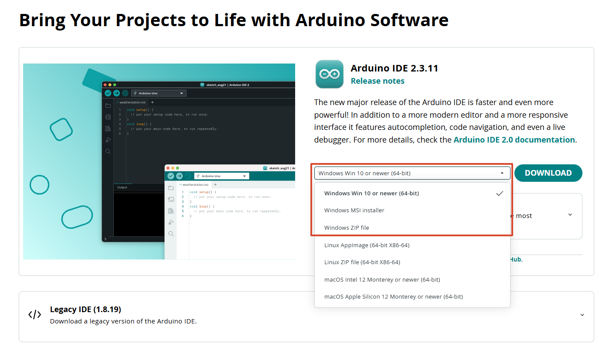

Windows 有两种包，学课用安装版最省事：

- `Windows Win 10 and newer, 64 bits`：安装版，双击一路装下去
- `Windows ZIP file`：免安装版，解压后直接运行，换电脑带着方便


点击**立即下载**即可下载软件。

macOS 的下载方式一样，Intel 芯片选 `macOS Intel`，M 系列芯片选 `macOS Apple Silicon`：

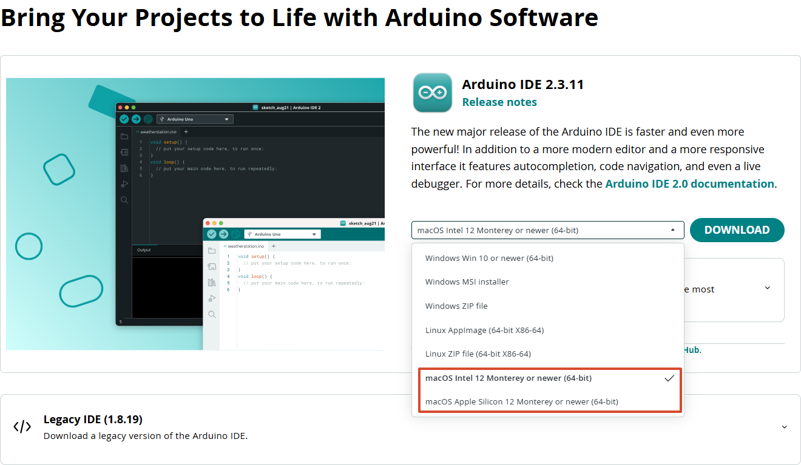

### 4.2.2 安装

Windows 下双击下载好的 exe。文件名里的版本号会更新，认准 `Windows_64bit` 就行：


1. 许可协议页点**I Agree**。
   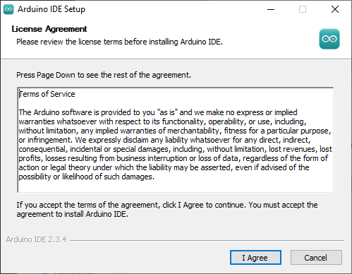
2. 选**Only for me**或**Anyone who uses this computer**，点**Next**。
   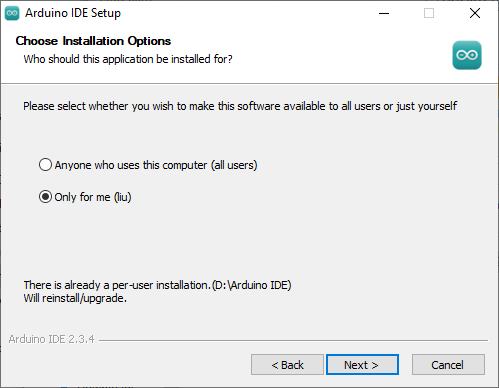
3. 选安装路径。默认在 C 盘，空间紧张就点**Browse...**换到别的盘，点**Install**。
   
4. 装完点**Finish**，IDE 会自己打开。
   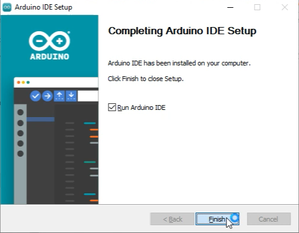

macOS 把 dmg 里的 Arduino IDE 拖进**应用程序**就装好了。

### 4.2.3 认识界面

打开后先认一遍窗口。2.x 的布局是固定的：上面一排菜单和按钮、左边一竖排图标、中间写代码、下面看输出。


| 编号 | 名称 | 干什么用 |
| :---: | --- | --- |
| 1 | File 文件 | 新建、打开、打开最近用过的程序，示例代码也在这里 |
| 2 | Edit 编辑 | 复制粘贴、自动格式化、字号、注释与取消注释 |
| 3 | Sketch 项目 | 验证、上传、加载库、添加文件 |
| 4 | Tools 工具 | 用得最多的是**开发板**和**端口**两项 |
| 5 | Help 帮助 | 查 IDE 版本和官方参考文档 |
| 6 | 串口绘图器 | 把串口数据画成曲线，看变化趋势比盯数字直观 |
| 7 | 串口监视器 | 打印串口输出，调试主要靠它 |
| 8 | 验证 | 只编译不下载，先查语法错 |
| 9 | 上传 | 编译并下载到板子 |
| 10 | 草图本 | 本机保存的程序列表 |
| 11 | 开发板管理器 | 装或卸开发板支持包，4.3.2 用的就是它 |
| 12 | 库管理器 | 搜库、装库 |
| 13 | 调试器 | 单步调试，本套课程用不到 |
| 14 | 搜索 | 在当前程序里找关键词 |
| 15 | 代码编辑区 | 写代码的地方，出错的行号前会标红叉 |
| 16 | 输出区 | 编译、上传的提示都在这里；串口监视器也开在这块 |


## 4.3 开发板配置

### 4.3.1 安装 CH340 驱动

主控板用板载 CH340 芯片做 USB 转串口，第一次上机前先装好驱动，Windows 和 macOS 的步骤见第 3 章**驱动安装**。

### 4.3.2 安装 ESP32 开发板支持包

Arduino IDE 刚装好只有 AVR 的板子，点**工具 → 开发板**找不到 ESP32，要手动加。

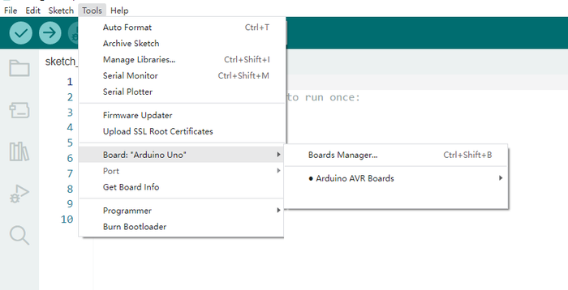

1. 打开**文件 → 首选项**，在**附加开发板管理器网址**里填下面二选其一，一个用不了就还另一个，点**确定**：

   `https://espressif.github.io/arduino-esp32/package_esp32_index.json`
   `https://raw.githubusercontent.com/espressif/arduino-esp32/gh-pages/package_esp32_index.json`

   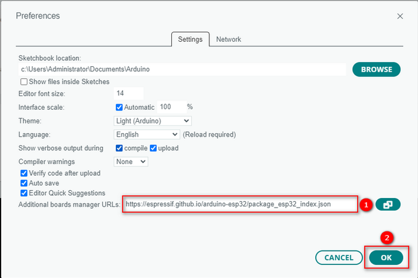

2. 点左侧栏的开发板管理器图标，也可以走**工具 → 开发板 → 开发板管理器**。

   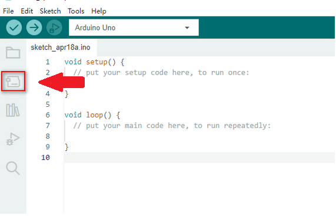

3. 搜索框输入 `esp32`，找到 `esp32 by Espressif Systems`，版本选 **3.2.0**，点**INSTALL**。下载进度在输出区能看到，中途断了就重新点一次。

   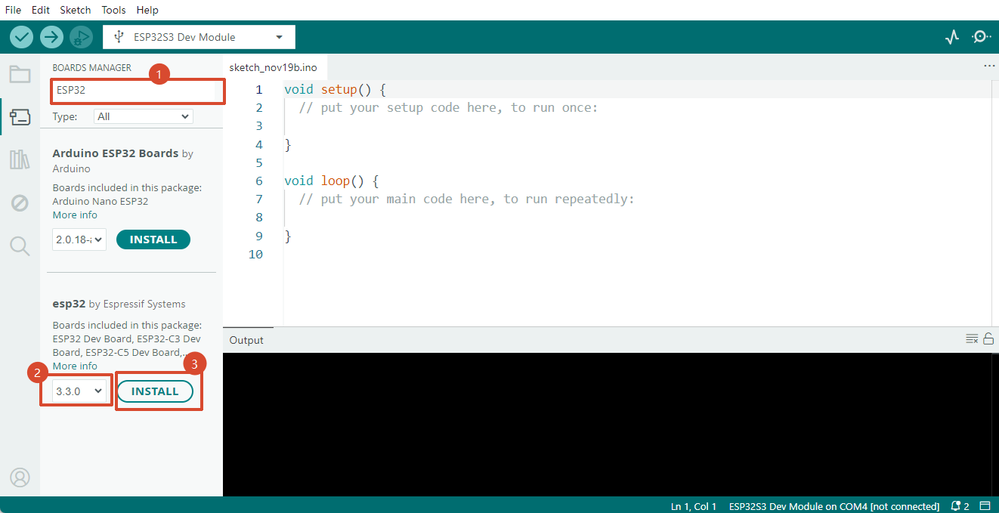


4. 装好之后按钮变成**REMOVE**，版本号显示 3.2.0 就对了。

   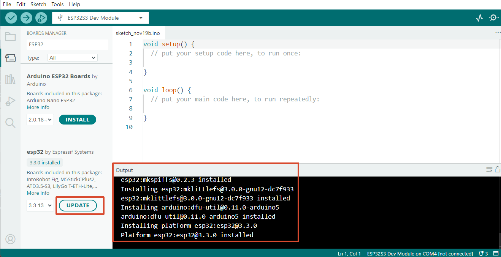

### 4.3.3 选择开发板与端口

1. 用 USB 线把主控板接到电脑。

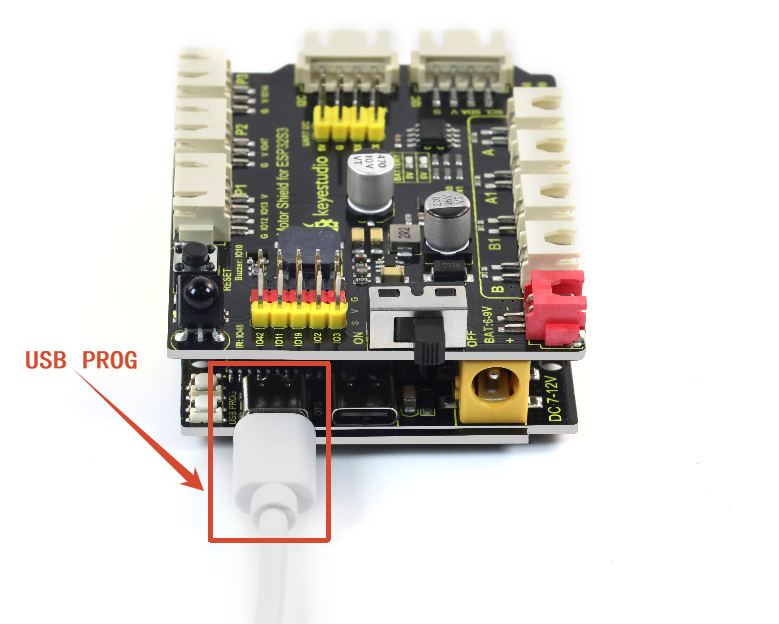

2. **工具 → 开发板 → esp32 → ESP32S3 Dev Module**。

   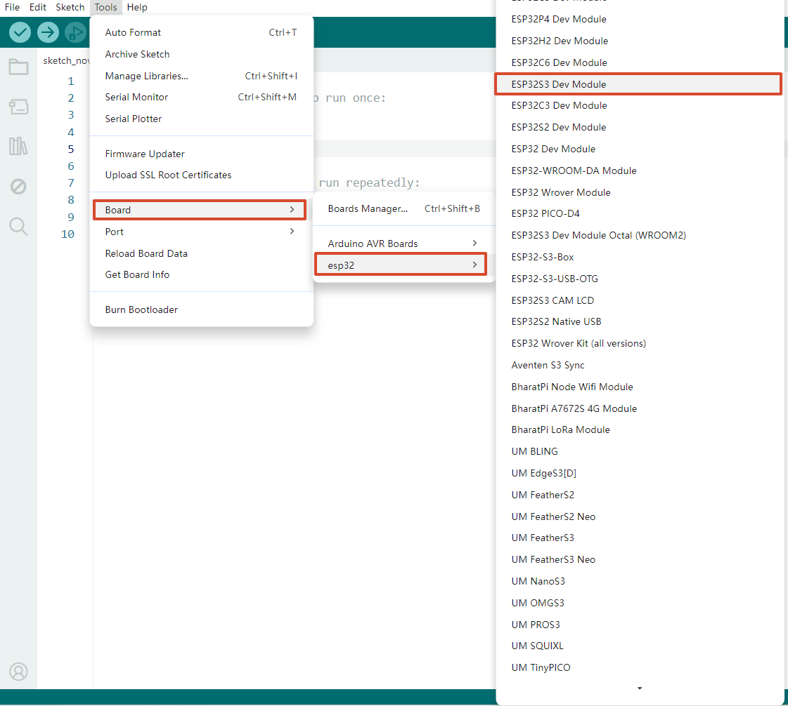

3. **工具 → 端口**里选 CH340 对应的 COM 口。不确定哪个是板子，看设备管理器里**端口 (COM 和 LPT)**下的 `USB-SERIAL CH340 (COMx)`；或者拔掉板子再插上，端口列表里消失又出现的那个就是。

   

   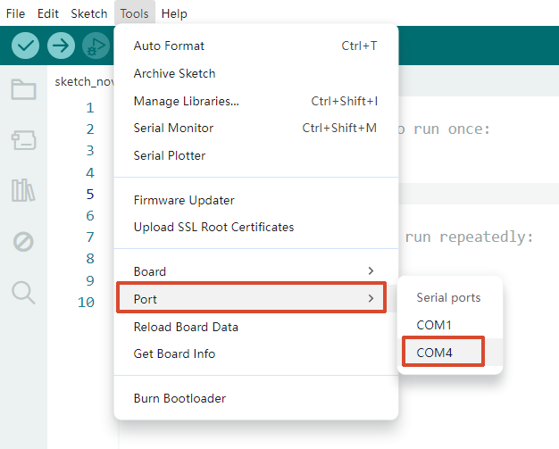

板子和端口都选好之后，工具栏的板卡栏会显示 `ESP32S3 Dev Module`，窗口右下角显示板型和 COM 口，两边对得上就说明配置生效了。

### 4.3.4 上传第一个程序

先跑一段最小的程序，把**编译 → 下载 → 串口输出**这条链路走通。

**文件 → 新建**，把下面这段代码整个粘进去。它每秒钟往串口打一行字：

```cpp
/*
  keyestudio 
  Print “Hello Keyestudio!”
  http://www.keyestudio.com
*/
void setup() {  
    // put your setup code here, to run once:
    Serial.begin(9600);  //Set the serial port baud rate to 9600
}

void loop() {  
    // put your main code here, to run repeatedly:
    Serial.println("Hello Keyestudio!");  //Serial port printing
 	delay(1000);  //Delay of 1 second
}
```

点工具栏的上传按钮，编译和下载都在这一步完成：编译进度在输出区滚动，最后弹出 `Done uploading.` 就是下载成功：

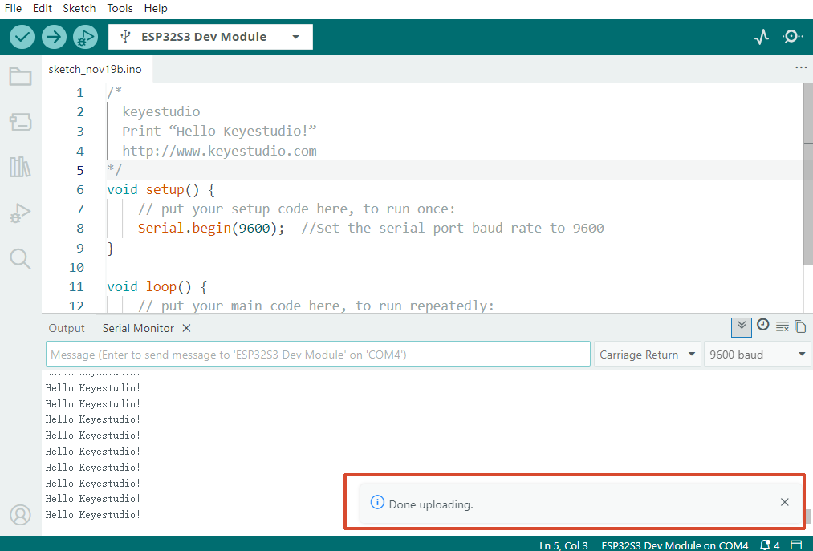

点右上角的串口监视器：波特率选 **9600**，窗口里每秒出现一行 `Hello Keyestudio!`：


| 编号 | 名称 | 干什么用 |
| :---: | --- | --- |
| 1 | 切换自动滚动 | 新内容进来时是否自动滚到底 |
| 2 | 切换时间戳 | 每行前面是否显示打印时间 |
| 3 | 清除输出 | 清空已经打印的内容 |
| 4 | 串行输入 | 往板子发消息，在这里输入 |
| 5 | 串行输出格式 | 结尾符，默认 `New Line`（回车换行） |
| 6 | 波特率 | 要和代码里 `Serial.begin()` 的数一致 |
| 7 | 打印窗口 | 板子打回来的内容显示在这里 |

两边的波特率对不上，窗口里全是乱码，这是新手最常踩的一脚。

上传、开串口这两步后面每一课都要走一遍，只是换代码。

## 4.4 库文件安装

上传的流程熟了，接下来把库导入 IDE。不装库，打开带库的示例代码会直接编译报错。

### 4.4.1 什么是库

库（Library）是别人写好、打包起来的代码。比如点阵屏的时序、舵机的 PWM，库里都替我们处理了，程序里直接调函数就行，不用自己从头写通信细节。

### 4.4.2 本课程需要的库

本套课程用到以下第三方库，均已放在资料包的 `arduino_libraries/` 文件夹中（以 `.zip` 形式提供）：

| 库文件 | 用途 | 涉及课程 |
| --- | --- | --- |
| `ESP32Servo.zip` | 驱动舵机（云台、夹爪） | 4.5.4、4.5.8、4.5.9 等 |
| `IRremote.zip` | 红外接收解码 | 4.5.10、4.5.11 |
| `PCF8574_library-master.zip` | I/O 扩展，用于循迹等 | 4.5.6、4.5.7 |

### 4.4.3 安装方法

用 IDE 的**加载 .ZIP 库**装，zip 不用解压：

1. 打开**项目 → 加载库 → 添加 .ZIP 库…**。

   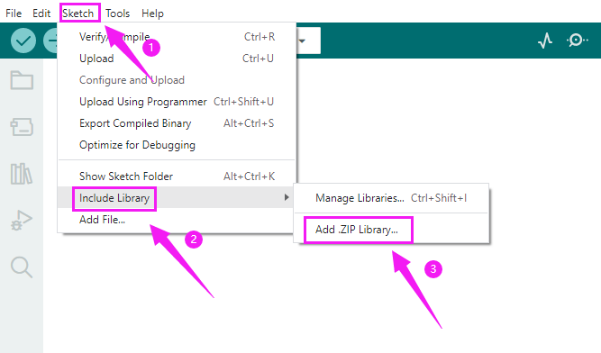

2. 定位到资料包位置 `arduino_libraries/` 文件夹，选中要装的库（如 `ESP32Servo.zip`），点**打开**。图中是操作添加库的方法。

   

3. 装成功后，IDE 底部会提示 `Library installed`。三个库按同样方法装完。

   

下面是完整的操作演示：


> MAC 和 WINDOWS 安装库的方法相同。
