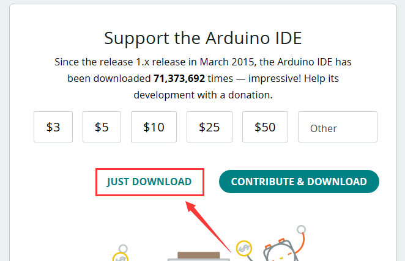
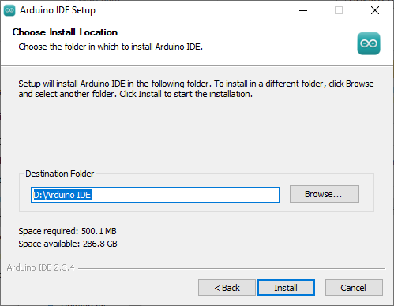
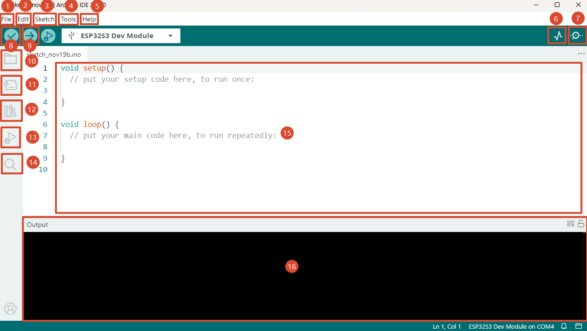
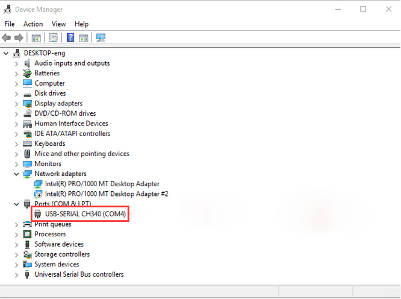
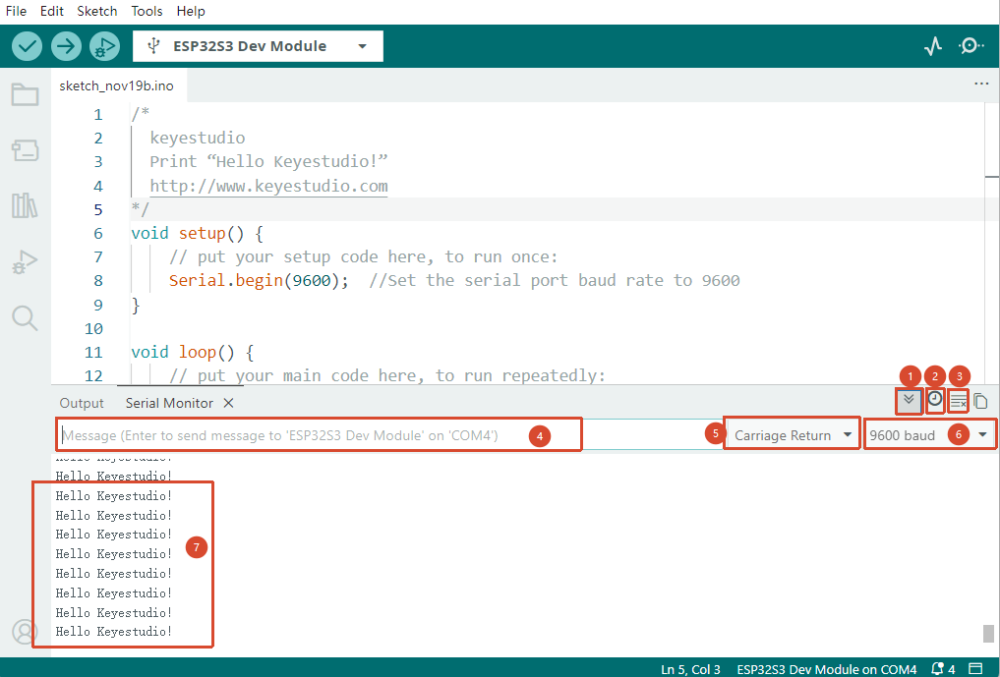
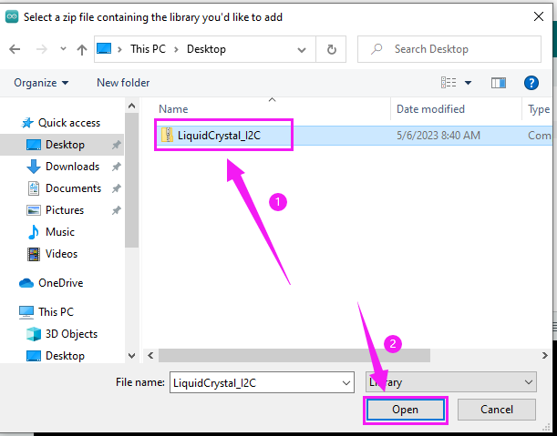
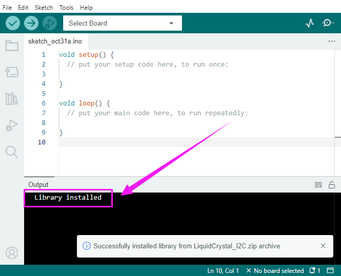
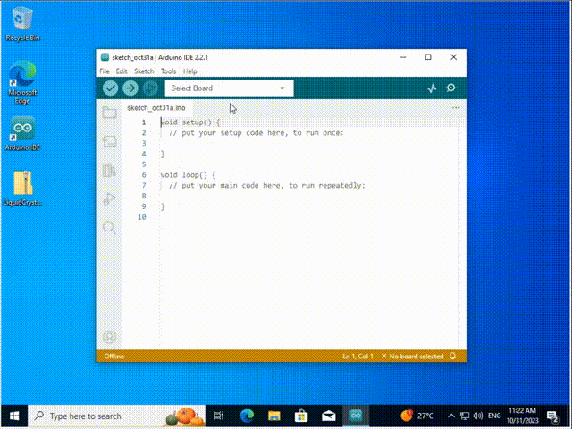

## 4.1 Downloading the resources

The Arduino tutorial package contains all the example code and libraries you will need for this course. Download it first — every lesson ahead depends on it.

Resource pack: [Arduino Resources](./Arduino_Resource.7z)

Unzip the download and you will find two folders:

- `arduino_code/`: sample programs for all 20 lessons, named by lesson number, such as `01_LED_Dot_Matrix` and `02_Motor_Driving`.
- `arduino_libraries/`: the third-party libraries the course depends on; see Section 4.4, Installing libraries.


## 4.2 Installing Arduino IDE

### 4.2.1 Download

Arduino IDE brings code editing, compiling, uploading, and serial monitoring together in a single window. It is the development environment used throughout this course. Official site: <https://www.arduino.cc/en/software/>.

The page is split into three columns by operating system — pick the one that matches your computer:


Windows has two packages; for this course the installer is the easiest route:

- `Windows Win 10 and newer, 64 bits`: the installer — double-click and follow the prompts.
- `Windows ZIP file`: the portable build — unzip and run it directly, convenient if you switch computers.



Click **Download Now** to get the software.

macOS works the same way: choose `macOS Intel` for Intel chips, or `macOS Apple Silicon` for M-series chips:


### 4.2.2 Installation

On Windows, double-click the downloaded exe. The version number in the filename changes over time — just look for `Windows_64bit`:


1. On the license agreement page, click **I Agree**.
   
2. Choose **Only for me** or **Anyone who uses this computer**, then click **Next**.
   
3. Pick an install path. It defaults to the C drive; if space is tight, click **Browse...** to choose another drive, then click **Install**.
   
4. When installation finishes, click **Finish** and the IDE opens by itself.
   

On macOS, drag Arduino IDE out of the dmg into **Applications** and it is installed.

### 4.2.3 Getting to know the interface

Open the IDE and take a tour of the window first. The 2.x layout is fixed: a row of menus and buttons across the top, a vertical strip of icons on the left, the code editor in the middle, and the output panel at the bottom.



| No. | Name | What it does |
| :---: | --- | --- |
| 1 | File | New, Open, Open Recent — the example sketches are here too |
| 2 | Edit | Copy and paste, auto-format, font size, comment and uncomment |
| 3 | Sketch | Verify, Upload, Include Library, Add File |
| 4 | Tools | The two you will use most are **Board** and **Port** |
| 5 | Help | Check the IDE version and the official reference documentation |
| 6 | Serial Plotter | Draws serial data as curves — easier to see trends than staring at numbers |
| 7 | Serial Monitor | Prints serial output; debugging depends on it |
| 8 | Verify | Compiles without uploading, so you can catch syntax errors first |
| 9 | Upload | Compiles and downloads to the board |
| 10 | Sketchbook | The list of programs saved on this computer |
| 11 | Boards Manager | Install or remove board support packages; this is what Section 4.3.2 uses |
| 12 | Library Manager | Search for and install libraries |
| 13 | Debugger | Step-by-step debugging; not used in this course |
| 14 | Search | Find keywords in the current program |
| 15 | Code editor | Where you write code; an error puts a red cross in front of the line number |
| 16 | Output panel | Compilation and upload messages appear here; the Serial Monitor opens here too |


## 4.3 Board configuration

### 4.3.1 Installing the CH340 driver

The controller board uses an on-board CH340 chip for USB-to-serial conversion. Install the driver before your first session; the Windows and macOS steps are in **Driver Installation** in Chapter 3.

### 4.3.2 Installing the ESP32 board support package

A freshly installed Arduino IDE only knows AVR boards, and **Tools → Board** won't show ESP32. You have to add it manually.


1. Open **File → Preferences**, paste one of the two URLs below into **Additional boards manager URLs** (if one doesn't work, use the other), and click **OK**:

   `https://espressif.github.io/arduino-esp32/package_esp32_index.json`
   `https://raw.githubusercontent.com/espressif/arduino-esp32/gh-pages/package_esp32_index.json`

   

2. Click the Boards Manager icon in the left toolbar, or go through **Tools → Board → Boards Manager**.

   

3. Type `esp32` in the search box, find `esp32 by Espressif Systems`, select version **3.2.0**, and click **INSTALL**. The download progress shows in the output panel; if it breaks off, just click again.

   


4. Once installed the button turns to **REMOVE** and the version reads 3.2.0 — that means it worked.

   

### 4.3.3 Selecting the board and port

1. Connect the controller board to the computer with a USB cable.


2. **Tools → Board → esp32 → ESP32S3 Dev Module**.

   

3. In **Tools → Port**, select the COM port that belongs to the CH340. If you are not sure which one it is, look under **Ports (COM & LPT)** in Device Manager for `USB-SERIAL CH340 (COMx)`; or unplug the board and plug it back in — the port that disappears and reappears is the right one.

   

   

With the board and port both selected, the toolbar's board field shows `ESP32S3 Dev Module` and the bottom-right corner shows the board type and COM port. When the two agree, the configuration has taken effect.

### 4.3.4 Uploading your first program

Start with the smallest possible program and get the whole **compile → upload → serial output** chain working.

Go to **File → New** and paste the following sketch in its entirety. It prints one line to the serial port every second:

```cpp
/*
  keyestudio 
  Print “Hello Keyestudio!”
  http://www.keyestudio.com
*/
void setup() {  
    // put your setup code here, to run once:
    Serial.begin(9600);  //Set the serial port baud rate to 9600
}

void loop() {  
    // put your main code here, to run repeatedly:
    Serial.println("Hello Keyestudio!");  //Serial port printing
 	delay(1000);  //Delay of 1 second
}
```

Click the Upload button on the toolbar; compiling and uploading both happen at this step:  Compilation progress scrolls in the output panel, and `Done uploading.` popping up at the end means the upload succeeded:


Click the Serial Monitor at the top right:  set the baud rate to **9600**, and a line reading `Hello Keyestudio!` appears in the window every second:



| No. | Name | What it does |
| :---: | --- | --- |
| 1 | Auto-scroll | Whether to scroll to the bottom as new content arrives |
| 2 | Show timestamp | Whether to prefix each line with its print time |
| 3 | Clear output | Wipe everything already printed |
| 4 | Serial input | Type here to send messages to the board |
| 5 | Serial output format | The line ending; `New Line` (carriage return + newline) by default |
| 6 | Baud rate | Must match the number in `Serial.begin()` in the code |
| 7 | Print window | Everything the board sends back is displayed here |

If the two baud rates don't match, the window fills with garbage characters — the most common beginner trap.

Uploading and opening the serial port are two steps you will repeat in every lesson ahead; only the code changes.

## 4.4 Installing libraries

Once the upload flow is familiar, the next step is to import libraries into the IDE. Without them, an example that uses a library will fail to compile straight away.

### 4.4.1 What is a library

A library is code someone else has written and packaged. The timing for a dot matrix display or the PWM for a servo, for example, is handled inside the library — your program just calls the functions instead of writing the communication details from scratch.

### 4.4.2 Libraries used in this course

The course uses the following third-party libraries, all provided in the resource pack's `arduino_libraries/` folder (as `.zip` files):

| Library file | Purpose | Lessons |
| --- | --- | --- |
| `ESP32Servo.zip` | Driving servos (pan-tilt, gripper) | 4.5.4, 4.5.8, 4.5.9, etc. |
| `IRremote.zip` | Infrared (IR) receive and decode | 4.5.10, 4.5.11 |
| `PCF8574_library-master.zip` | I/O expansion, used for line tracking, etc. | 4.5.6, 4.5.7 |

### 4.4.3 How to install

Install them with the IDE's **Add .ZIP Library** command — there is no need to unzip the file first:

1. Open **Sketch → Include Library → Add .ZIP Library...**.

   

2. Navigate to the `arduino_libraries/` folder of the resource pack, select the library you want to install (for example `ESP32Servo.zip`), and click **Open**. The figure shows how to add a library.

   

3. On success, `Library installed` appears at the bottom of the IDE. Install all three libraries the same way.

   

Here is a complete walkthrough of the process:



> Adding libraries works the same way on macOS and Windows.
