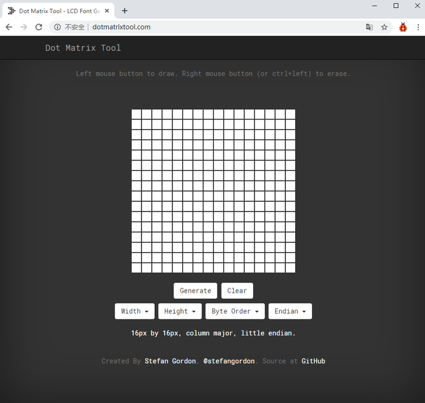

### Project 1: 8×16 Dot Matrix Expression Display

#### **1. Introduction:**


From a distance it is a picture; up close, nothing but dots. The 8×16 panel on the front of the car is how it talks to you — a heart when it sets off, an exclamation mark when something gets in its way, a smiley when it scores. Lesson 1 leaves the motors and sensors alone and simply brings that face to life.

Here is the puzzle: the panel has 128 LEDs in total, far more than the controller has spare pins. The trick is a driver chip hidden behind the panel that looks after the lights for you. The controller sends out just two lines, one clock and one data, feeding the picture in bit by bit; the panel scans itself column by column at high speed, and your eye fuses it into a steady image.

What you actually send is only 16 bytes, called the **font bitmap**: one byte per column, and the 8 bits inside a byte cover the 8 rows of that column, with the top row mapping to the lowest bit. A frame adds up to 18 bytes and 144 clock bits, and pushing the whole thing through takes about 1.3 ms — far shorter than the 40 ms the human eye can resolve, so the screen appears to light up "all at once". This lesson provides two bitmaps, a heart and a smiley, and finally sets the smiley scrolling sideways.

#### **2. Parts List:**
The parts used in this lesson:

| 8×16 LED dot matrix display ×1 | 8×16 bent acrylic mounting plate for the dot matrix ×1 |
| :---: | :---: |
|  |  |
| ESP32-S3 development board ×1 | DRV8835 motor expansion board ×1 |
|  |  |
> ⚠️ **The dot matrix was already installed in Chapter 2. This table is for reference only — nothing needs to be removed; the wiring notes below merely show how the connections are made, again for reference, so no assembly or disassembly is required. For the complete parts list, see the kit list in Section 1.4.**
#### **3. Parameters:**
| Item | Parameter |
| --- | --- |
| Display spec | 8×16 LED dot matrix (8 rows × 16 columns) |
| Signal pins | CLK = IO9, DIN = IO8 |
| Font bitmap format | 16 bytes, one byte for the 8 rows of one column, bit0 at the top row |
| Brightness control | Command 0x8A, brightness 8/16 |
| Display sequence | Heart 3 s → smiley 2 s → scrolling smiley (150 ms per frame) |

#### **4. Wiring:**

The dot matrix only needs two signal lines plus power:

| Dot matrix pin | Controller GPIO |
| --- | :---: |
| CLK | IO9 |
| DIN | IO8 |


#### **5. Flowchart:**

Sending one frame takes four steps: first tell the chip **to write data**, then set the starting point at column 0, then send the 16 bytes in a row, and finally turn the display on.


#### **6. Test Code:**
```cpp
// Dot matrix display signal lines (see wiring table)
#define CLK_Pin 9   // Clock, connect to module CLK
#define DIN_Pin 8   // Data, connect to module DIN

// Smile font bitmap: 16 bytes for 16 columns, 8 bits per byte for 8 rows per column
unsigned char smile[] = {
  0x00, 0x00, 0x1C, 0x02, 0x02, 0x02, 0x5C, 0x40, 
  0x40, 0x5C, 0x02, 0x02, 0x02, 0x1C, 0x00, 0x00
};

// Heart font bitmap, same format as smile
unsigned char heart[] = {
    0x00, 0x00, 0x00, 0x00, 0x08, 0x1c, 0x3e, 0x7c,
    0x7c, 0x3e, 0x1c, 0x08, 0x00, 0x00, 0x00, 0x00
};

void setup() {
  pinMode(CLK_Pin, OUTPUT);
  pinMode(DIN_Pin, OUTPUT);
  
  // Pull both lines high to leave the bus idle
  digitalWrite(CLK_Pin, HIGH);
  digitalWrite(DIN_Pin, HIGH);
  
  // Clear display on power on to avoid residue
  unsigned char clear_data[16] = {0};
  matrix_display(clear_data);
}

void loop() {
  // Show heart for 3 s
  matrix_display(heart);
  delay(3000);
  
  // Show smile for 2 s
  matrix_display(smile);
  delay(2000);
  
  // Scroll: shift the font bitmap left by 1 column
  for (int shift = 0; shift < 16; shift++) {
    unsigned char scroll_data[16];
    for (int i = 0; i < 16; i++) {
      // Wrap around the bitmap; after 16 columns it returns to the original
      scroll_data[i] = smile[(i + shift) % 16]; 
    }
    matrix_display(scroll_data);
    delay(150); // Scroll interval, smaller is faster
  }
}

// Write the 16-byte font bitmap to the dot matrix display buffer
void matrix_display(unsigned char matrix_value[]) {
  // 0x40: write data mode, auto-increment address
  IIC_start();
  IIC_send(0x40);
  IIC_end();
  
  // 0xC0: display buffer start address 0
  IIC_start();
  IIC_send(0xC0);
  
  // Write 16 columns consecutively
  for (int i = 0; i < 16; i++) {
    IIC_send(matrix_value[i]);
  }
  IIC_end();
  
  // 0x8A: turn on display, brightness 8/16
  IIC_start();
  IIC_send(0x8A);
  IIC_end();
}

// Start condition: DIN falling edge while CLK is HIGH
void IIC_start() {
  digitalWrite(CLK_Pin, HIGH);
  delayMicroseconds(3);
  digitalWrite(DIN_Pin, HIGH);
  delayMicroseconds(3);
  digitalWrite(DIN_Pin, LOW);
  delayMicroseconds(3);
}

// Send 1 byte, LSB first: set data when CLK is LOW, sample on rising edge
void IIC_send(unsigned char send_data) {
  for (int i = 0; i < 8; i++) {
    digitalWrite(CLK_Pin, LOW);  // Pull clock low, prepare data
    delayMicroseconds(3);
    
    // Send bit by bit starting from bit0
    if (send_data & 0x01) {
      digitalWrite(DIN_Pin, HIGH);
    } else {
      digitalWrite(DIN_Pin, LOW);
    }
    delayMicroseconds(3);
    
    digitalWrite(CLK_Pin, HIGH); // Pull clock high, module samples
    delayMicroseconds(3);
    
    send_data = send_data >> 1;  // Shift right to get the next bit
  }
}

// Stop condition: DIN rising edge while CLK is HIGH
void IIC_end() {
  digitalWrite(CLK_Pin, LOW);
  delayMicroseconds(3);
  digitalWrite(DIN_Pin, LOW);
  delayMicroseconds(3);
  digitalWrite(CLK_Pin, HIGH);
  delayMicroseconds(3);
  digitalWrite(DIN_Pin, HIGH);
  delayMicroseconds(3);
}
```

#### **7. Code Explanation:**
**(1) Two signal lines**

```cpp
#define CLK_Pin 9   // Clock, connect to module CLK
#define DIN_Pin 8   // Data, connect to module DIN
```

The dot matrix does not use hardware I2C — just two ordinary IO pins: CLK is the clock and DIN is the data. The three functions below flip these two lines manually with `digitalWrite` to produce the timing the panel recognizes, an approach known as software-simulated I2C.

**(2) Two font bitmaps, 16 bytes each**

```cpp
unsigned char smile[] = {
  0x00, 0x00, 0x1C, 0x02, 0x02, 0x02, 0x5C, 0x40, 
  0x40, 0x5C, 0x02, 0x02, 0x02, 0x1C, 0x00, 0x00
};
```

16 columns × 8 rows = 128 LEDs, so the font bitmap has to be 16 bytes: one byte controls one column, the 8 bits in that byte control the 8 rows of the column, and bit0 is at the very top.

`0x00` means the whole column is off; `0x1C` is `0001 1100`, lighting rows 3, 4 and 5. Both pictures are drawn bit by bit like this, not calculated.

**(3) setup: pull both lines high, then clear the screen**

```cpp
void setup() {
  pinMode(CLK_Pin, OUTPUT);
  pinMode(DIN_Pin, OUTPUT);
  
  // Pull both lines high to leave the bus idle
  digitalWrite(CLK_Pin, HIGH);
  digitalWrite(DIN_Pin, HIGH);
  
  // Clear display on power on to avoid residue
  unsigned char clear_data[16] = {0};
  matrix_display(clear_data);
}
```

Right after `pinMode`, pull both lines high. That combination is the bus idle state — CLK high, DIN high — so the start condition that follows has a clear contrast to work with. On power on the display buffer holds random values, so send 16 zeroes first to clear it and avoid a flash of garbage before the first frame.

**(4) The first two phases of loop: heart for 3 s, smiley for 2 s**

```cpp
void loop() {
  // Show heart for 3 s
  matrix_display(heart);
  delay(3000);
  
  // Show smile for 2 s
  matrix_display(smile);
  delay(2000);
```

`matrix_display()` takes only about 1 ms to send a whole picture; what really decides how long it stays is the `delay()` that follows. During these two phases the controller can do nothing but wait — Lesson 15 will rewrite this using `millis()` timing.

With the first two phases plus the scrolling, one round of `loop()` takes about 3 + 2 + 2.4 ≈ 7.4 seconds.

**(5) Scrolling: wrap-around with the modulo operator**

```cpp
  for (int shift = 0; shift < 16; shift++) {
    unsigned char scroll_data[16];
    for (int i = 0; i < 16; i++) {
      // Wrap around the bitmap; after 16 columns it returns to the original
      scroll_data[i] = smile[(i + shift) % 16]; 
    }
    matrix_display(scroll_data);
    delay(150); // Scroll interval, smaller is faster
  }
```

Putting column `i + shift` of `smile` into column `i` shifts the whole picture left by `shift` columns; `% 16` wraps the index back to 0 once it passes 15, so the picture scrolls end to end without leaving a black gap. `shift` counts from 0 to 15, and after moving 16 columns the picture is back where it started.

16 scroll steps × `delay(150)` = 2.4 seconds for one full cycle. Changing 150 to 80 nearly doubles the speed while the picture stays clear — the safest tweak you can make. Changing `% 16` to `% 17` goes out of bounds: `smile[]` holds only 16 elements, so you read memory outside the array and the picture turns to garbage.

**(6) `IIC_start()` / `IIC_end()`: a pair of start and stop markers**

```cpp
void IIC_start() {
  digitalWrite(CLK_Pin, HIGH);
  delayMicroseconds(3);
  digitalWrite(DIN_Pin, HIGH);
  delayMicroseconds(3);
  digitalWrite(DIN_Pin, LOW);
  delayMicroseconds(3);
}
```

The start condition is "DIN goes from HIGH to LOW while CLK stays HIGH"; the stop condition is the reverse, "DIN goes from LOW to HIGH while CLK is HIGH". Seeing these two transitions, the chip knows where a command begins and where it ends.

The `delayMicroseconds(3)` calls in between give the chip its setup and hold time. Leave them out and short wires may still work, but as the wires get longer bytes start going missing and the screen shows garbage.

**(7) `IIC_send()`: least significant bit first**

```cpp
void IIC_send(unsigned char send_data) {
  for (int i = 0; i < 8; i++) {
    digitalWrite(CLK_Pin, LOW);  // Pull clock low, prepare data
    delayMicroseconds(3);
    
    // Send bit by bit starting from bit0
    if (send_data & 0x01) {
      digitalWrite(DIN_Pin, HIGH);
    } else {
      digitalWrite(DIN_Pin, LOW);
    }
    delayMicroseconds(3);
    
    digitalWrite(CLK_Pin, HIGH); // Pull clock high, module samples
    delayMicroseconds(3);
    
    send_data = send_data >> 1;  // Shift right to get the next bit
  }
}
```

The loop runs eight times. Each round pulls CLK low, sets the current bit on DIN, then pulls CLK high — the chip samples on the rising edge.

`send_data & 0x01` picks out the lowest bit and `send_data >> 1` then shifts right, so bits are sent **least significant first**. This order cannot be swapped: sending the most significant bit first inverts every bit of the received byte and leaves garbage on the screen.

**(8) `matrix_display()`: four commands write one frame**

```cpp
void matrix_display(unsigned char matrix_value[]) {
  // 0x40: write data mode, auto-increment address
  IIC_start();
  IIC_send(0x40);
  IIC_end();
  
  // 0xC0: display buffer start address 0
  IIC_start();
  IIC_send(0xC0);
  
  // Write 16 columns consecutively
  for (int i = 0; i < 16; i++) {
    IIC_send(matrix_value[i]);
  }
  IIC_end();
  
  // 0x8A: turn on display, brightness 8/16
  IIC_start();
  IIC_send(0x8A);
  IIC_end();
}
```

Three start-send-stop sequences correspond to three commands: `0x40` switches to write-data mode with auto-increment address, `0xC0` positions the write pointer at column 0 of the display buffer, and `0x8A` turns the display on and sets the brightness (`0x88` is dimmest, `0x8F` brightest).

The 16 bytes in the middle are **sent as part of the same transfer as `0xC0`, with no new transmission in between** — the auto-increment address set by `0x40` drops them into the 16 columns. This is the easiest place to go wrong: call `IIC_start()` before every byte and only the first column will light up.

One frame is 18 bytes in all (1 + 1 + 16), or 18 × 8 = 144 clock ticks. Each bit takes three steps in `IIC_send()`, 3 µs per step, so one bit is about 9 µs and one frame about 1.3 ms — much shorter than the 40 ms the human eye can resolve, which is why the whole panel appears to light up at once.

Change `0x8A` to `0x8F` and the panel gets noticeably brighter, though the current draw rises as well; `0x88` is the dimmest setting, comfortable to look at at night.

#### 8.Drawing your own pattern: an online font bitmap tool

The 16 bytes in `heart[]` and `smile[]` were not calculated — they were clicked together in an online tool at [dotmatrixtool.com](http://dotmatrixtool.com/).

When you open it, the middle is a 16×16 grid. Under the grid are the `Generate` and `Clear` buttons, and beneath them a row of four drop-down boxes: `Width`, `Height`, `Byte Order` and `Endian`.



**Step 1: change the grid to 8 rows by 16 columns.** Set `Width` to 16 and `Height` to 8; the grid turns from a square into a wide strip and the status line below changes to `16px by 8px, column major, little endian.`.

This default **column-major + little-endian** layout is exactly the format the code wants: the 16 bytes correspond in order to the 16 columns, and bit0 of each byte is the top row. So the `Byte Order` and `Endian` boxes can be left untouched.


**Step 2: left-click to light a cell, right-click to erase it.** Each left-click lights one cell; if you click the wrong one, right-click (or Ctrl + left-click) to erase it. Try copying the 16 bytes of `smile[]` from the code first and see whether the smiley reappears — once you have done that, the format of **one byte per column with bit0 at the top** needs no memorizing.

**Step 3: click Generate to get the data.** Once your drawing is ready, click `Generate` and a block of `const uint8_t data[] = {...}` appears at the bottom of the page; inside the brackets are the 16 hexadecimal bytes.


Copy those 16 bytes into `smile[]` in the code, compile and upload again, and the dot matrix will show your drawing.

Two spots that commonly trip people up:

- The tool provides the type `const uint8_t` while this lesson's code uses `unsigned char`. On the ESP32 the two are equivalent, so **change only the contents of the array** — the type and the array name need no change.
- Don't drop the semicolon at the end of the array; without it the compile fails immediately.

> The output generated in the third figure is exactly where `smile[]` in the code came from — use it to check your answer.

#### **9. Expected Behavior:**

After power-on the panel clears first, then loops through the following rhythm:

1. The heart is displayed for 3 seconds;
2. The smiley is displayed for 2 seconds;
3. The smiley scrolls to the left as a whole, one column every 150 ms; after 16 columns it returns to the original picture and the sequence restarts from step 1.

If the heart and smiley light up clearly and the scrolling is continuous with no missing columns, the wiring and the font bitmaps are both correct.

> [Image to be added] Photos of the running display: one of the heart, one of the smiley and one of the scrolling effect, with the lit dots clearly visible.

#### **10. Troubleshooting:**

(1) The whole panel stays dark: first check whether CLK and DIN are reversed. In the code `CLK_Pin` is IO9 and `DIN_Pin` is IO8; swap the two and the panel will not light up.

(2) A scrambled pattern, missing columns, or a left-right mirror image: the byte order of the font bitmap is almost certainly wrong. The 16 bytes correspond in order to the 16 columns and bit0 of each byte is the top row; when generating with the online tool, set Width to 16 and Height to 8 and keep **column-major + little-endian**.

(3) Only the first column lights and all the rest are dark: the 16 bytes in `matrix_display()` must be sent in a single transfer (after `0xC0` and before `IIC_end()`). Insert an `IIC_start()` in the middle and the chip rewrites from column 0 every time, leaving only one column on screen.

(4) The scrolling runs backwards or looks jerky: the shift formula is `smile[(i + shift) % 16]`; change `+` to `-` to scroll the other way. Lower `delay(150)` for faster scrolling, but below 80 the picture starts to blur.
