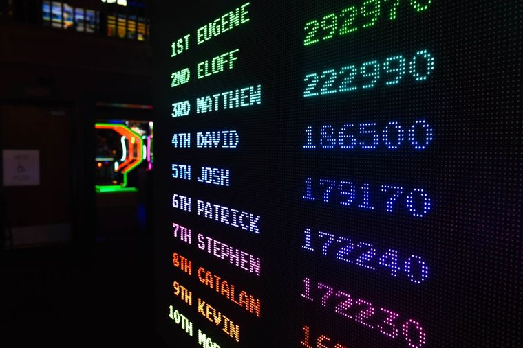
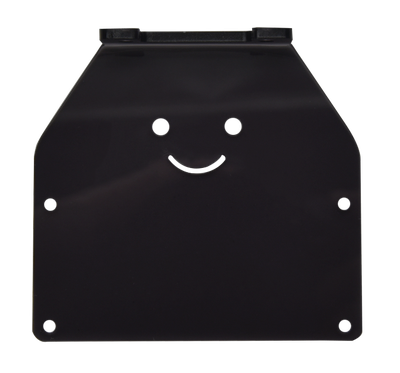
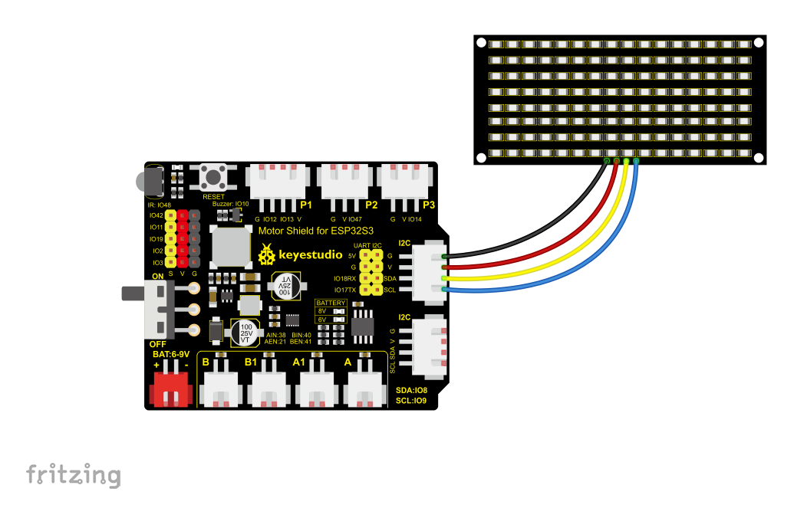
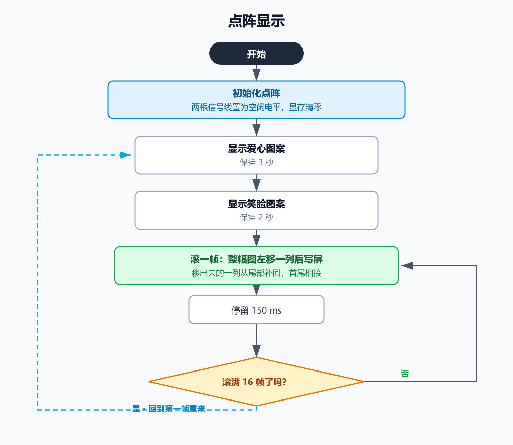
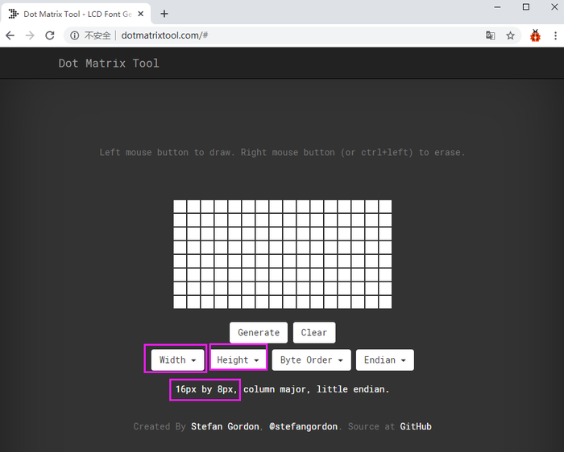
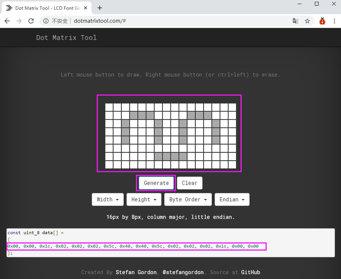

### 项目 1：8×16 点阵表情展示

#### **1. 简介：**

{width=520px}

远看是一幅图，近看全是点。车头这块 8×16 的屏，就是车用来说话的地方：走起来是爱心，发现障碍是感叹号，进球是笑脸。第一课不接电机、不碰传感器，先把这张脸点亮。

屏上一共 128 颗 LED。一颗一根引脚的话，主控早就没脚可用了，所以屏背后藏了一颗驱动芯片替主控管灯。主控只出两根线，一根时钟、一根数据，把要显示的内容一位一位送进去；屏幕自己以很高的频率一列一列扫描，人眼看到的便是一幅稳定的画面。

要送的其实只有 16 个字节，叫**字模**：一个字节管一列，字节里的 8 位管这一列的 8 行，最上面一行对应最低位。一帧加起来 18 个字节、144 个时钟位，全部送完约 1.3 毫秒——比人眼能分辨的 40 毫秒短得多，所以整屏是"一下子"亮起来的。本课给出爱心和笑脸两张字模，最后让笑脸横向滚起来。


#### **2. 所需清单：**

本课用到的器件：

|     |     |
| :---: | :---: |
| {width=200px}<br><span style="font-size:0.85em">8×16 LED 点阵屏 ×1</span> | {width=200px}<br><span style="font-size:0.85em">8×16 点阵固定折弯亚克力板 ×1</span> |
| {width=200px}<br><span style="font-size:0.85em">ESP32-S3 开发板 ×1</span> | {width=200px}<br><span style="font-size:0.85em">DRV8835 电机扩展板 ×1</span> |
> ⚠️ **点阵在第 2 章就装好了，本表只作对照，不用拆下来；下面的接线说明只标清接线方式，供对照，不必拆装。完整物料见 1.4 套件清单。**
#### **3. 参数：**

| 项目 | 参数 |
| --- | --- |
| 显示规格 | 8×16 LED 点阵（8 行 × 16 列） |
| 信号引脚 | CLK = IO9，DIN = IO8 |
| 字模格式 | 16 字节，每字节对应 1 列的 8 行，bit0 在顶行 |
| 亮度控制 | 命令 0x8A，亮度 8/16 |
| 显示内容 | 爱心 3 s → 笑脸 2 s → 笑脸滚动（每帧 150 ms） |

#### **4. 接线说明：**

点阵只需两根信号线加电源：

| 点阵引脚 | 主控 GPIO |
| --- | :---: |
| CLK | IO9 |
| DIN | IO8 |



#### **5. 流程图：**

送一帧画面分四步：先告诉芯片**要写数据**，再指定从第 0 列开始，然后连发 16 个字节，最后开显示。



#### **6. 测试代码：**

```cpp
// 点阵屏信号线（对应接线表）
#define CLK_Pin 9   // 时钟，接模块 CLK
#define DIN_Pin 8   // 数据，接模块 DIN

// 笑脸字模：16 字节对应 16 列，每字节 8 位对应一列 8 行
unsigned char smile[] = {
  0x00, 0x00, 0x1C, 0x02, 0x02, 0x02, 0x5C, 0x40, 
  0x40, 0x5C, 0x02, 0x02, 0x02, 0x1C, 0x00, 0x00
};

// 爱心字模，格式同笑脸
unsigned char heart[] = {
    0x00, 0x00, 0x00, 0x00, 0x08, 0x1c, 0x3e, 0x7c,
    0x7c, 0x3e, 0x1c, 0x08, 0x00, 0x00, 0x00, 0x00
};

void setup() {
  pinMode(CLK_Pin, OUTPUT);
  pinMode(DIN_Pin, OUTPUT);
  
  // 两线拉高，总线置空闲
  digitalWrite(CLK_Pin, HIGH);
  digitalWrite(DIN_Pin, HIGH);
  
  // 上电清屏，避免残留
  unsigned char clear_data[16] = {0};
  matrix_display(clear_data);
}

void loop() {
  // 显示爱心 3 s
  matrix_display(heart);
  delay(3000);
  
  // 显示笑脸 2 s
  matrix_display(smile);
  delay(2000);
  
  // 滚动：字模整体左移 1 列
  for (int shift = 0; shift < 16; shift++) {
    unsigned char scroll_data[16];
    for (int i = 0; i < 16; i++) {
      // 取模回绕，移满 16 列回到原图
      scroll_data[i] = smile[(i + shift) % 16]; 
    }
    matrix_display(scroll_data);
    delay(150); // 滚动间隔，越小越快
  }
}

// 将 16 字节字模写入点阵屏显存
void matrix_display(unsigned char matrix_value[]) {
  // 0x40：写数据模式，地址自增
  IIC_start();
  IIC_send(0x40);
  IIC_end();
  
  // 0xC0：显存起始地址 0
  IIC_start();
  IIC_send(0xC0);
  
  // 连写 16 列
  for (int i = 0; i < 16; i++) {
    IIC_send(matrix_value[i]);
  }
  IIC_end();
  
  // 0x8A：开显示，亮度 8/16
  IIC_start();
  IIC_send(0x8A);
  IIC_end();
}

// 起始条件：CLK 高电平期间 DIN 下降沿
void IIC_start() {
  digitalWrite(CLK_Pin, HIGH);
  delayMicroseconds(3);
  digitalWrite(DIN_Pin, HIGH);
  delayMicroseconds(3);
  digitalWrite(DIN_Pin, LOW);
  delayMicroseconds(3);
}

// 发送 1 字节，低位在前：CLK 低时置数据，上升沿采样
void IIC_send(unsigned char send_data) {
  for (int i = 0; i < 8; i++) {
    digitalWrite(CLK_Pin, LOW);  // 拉低时钟，准备数据
    delayMicroseconds(3);
    
    // 从 bit0 起逐位发送
    if (send_data & 0x01) {
      digitalWrite(DIN_Pin, HIGH);
    } else {
      digitalWrite(DIN_Pin, LOW);
    }
    delayMicroseconds(3);
    
    digitalWrite(CLK_Pin, HIGH); // 拉高时钟，模块采样
    delayMicroseconds(3);
    
    send_data = send_data >> 1;  // 右移，取出下一位
  }
}

// 停止条件：CLK 高电平期间 DIN 上升沿
void IIC_end() {
  digitalWrite(CLK_Pin, LOW);
  delayMicroseconds(3);
  digitalWrite(DIN_Pin, LOW);
  delayMicroseconds(3);
  digitalWrite(CLK_Pin, HIGH);
  delayMicroseconds(3);
  digitalWrite(DIN_Pin, HIGH);
  delayMicroseconds(3);
}
```

#### **7. 代码解释：**

**(1) 两根信号线**

```cpp
#define CLK_Pin 9   // 时钟，接模块 CLK
#define DIN_Pin 8   // 数据，接模块 DIN
```

点阵没有用硬件 I2C，只有两根普通 IO：CLK 是时钟，DIN 是数据。后面三个函数靠 `digitalWrite` 手动翻转这两根线，凑出点阵屏认的时序——这种做法叫软件模拟 I2C。

**(2) 两张字模，每张 16 个字节**

```cpp
unsigned char smile[] = {
  0x00, 0x00, 0x1C, 0x02, 0x02, 0x02, 0x5C, 0x40, 
  0x40, 0x5C, 0x02, 0x02, 0x02, 0x1C, 0x00, 0x00
};
```

16 列 × 8 行 = 128 颗灯，所以字模必须是 16 个字节：一个字节管一列，字节里的 8 位管这一列的 8 行，bit0 在最上面。

`0x00` 表示这一列全灭，`0x1C` 是 `0001 1100`，点亮第 3、4、5 行。两张图都是这样一位一位点出来的，不是算出来的。

**(3) setup：两线拉高，再清屏**

```cpp
void setup() {
  pinMode(CLK_Pin, OUTPUT);
  pinMode(DIN_Pin, OUTPUT);
  
  // 两线拉高，总线置空闲
  digitalWrite(CLK_Pin, HIGH);
  digitalWrite(DIN_Pin, HIGH);
  
  // 上电清屏，避免残留
  unsigned char clear_data[16] = {0};
  matrix_display(clear_data);
}
```

`pinMode` 之后先把两根线都拉高。这个组合是总线的空闲状态——CLK 高、DIN 高，后面的"起始条件"才有明确的反差可用。上电时点阵显存里是随机值，先送 16 个 0 清一遍，避免第一帧之前闪一下花屏。

**(4) loop 前两段：爱心 3 秒、笑脸 2 秒**

```cpp
void loop() {
  // 显示爱心 3 s
  matrix_display(heart);
  delay(3000);
  
  // 显示笑脸 2 s
  matrix_display(smile);
  delay(2000);
```

`matrix_display()` 把整幅图送完只要 1 ms 左右，真正决定"停多久"的是后面的 `delay()`。这两段里主控什么都做不了，只是等着——第 15 课会把它改成用 `millis()` 计时。

前两段加滚动，一轮 `loop()` 约 3 + 2 + 2.4 ≈ 7.4 秒。

**(5) 滚动：取模回绕**

```cpp
  for (int shift = 0; shift < 16; shift++) {
    unsigned char scroll_data[16];
    for (int i = 0; i < 16; i++) {
      // 取模回绕，移满 16 列回到原图
      scroll_data[i] = smile[(i + shift) % 16]; 
    }
    matrix_display(scroll_data);
    delay(150); // 滚动间隔，越小越快
  }
```

把 `smile` 的第 `i + shift` 列填到第 `i` 列，等于整幅图往左挪了 `shift` 列；`% 16` 让下标越过 15 之后绕回 0，所以首尾相接循环滚，不会滚出一段黑边。`shift` 从 0 数到 15，移满 16 列正好回到原图。

滚动 16 次 × `delay(150)` = 2.4 秒走完一圈。把 150 改成 80，滚动快近一倍，仍看得清，是最安全的调参；把 `% 16` 改成 `% 17` 就会越界——`smile[]` 只有 16 个元素，读到的是数组外面的内存，画面变乱码。

**(6) `IIC_start()` / `IIC_end()`：一对起止标记**

```cpp
void IIC_start() {
  digitalWrite(CLK_Pin, HIGH);
  delayMicroseconds(3);
  digitalWrite(DIN_Pin, HIGH);
  delayMicroseconds(3);
  digitalWrite(DIN_Pin, LOW);
  delayMicroseconds(3);
}
```

起始条件是"CLK 保持高电平期间，DIN 从高变低"；停止条件反过来，"CLK 高电平期间 DIN 从低变高"。芯片看到这两个跳变，就知道一条命令从哪开始、到哪结束。

中间的 `delayMicroseconds(3)` 是给芯片留的建立/保持时间。去掉在短线上也能跑，线一长就开始丢字节、花屏。

**(7) `IIC_send()`：低位先发**

```cpp
void IIC_send(unsigned char send_data) {
  for (int i = 0; i < 8; i++) {
    digitalWrite(CLK_Pin, LOW);  // 拉低时钟，准备数据
    delayMicroseconds(3);
    
    // 从 bit0 起逐位发送
    if (send_data & 0x01) {
      digitalWrite(DIN_Pin, HIGH);
    } else {
      digitalWrite(DIN_Pin, LOW);
    }
    delayMicroseconds(3);
    
    digitalWrite(CLK_Pin, HIGH); // 拉高时钟，模块采样
    delayMicroseconds(3);
    
    send_data = send_data >> 1;  // 右移，取出下一位
  }
}
```

循环 8 次，每次先把 CLK 拉低、把当前位摆到 DIN，再把 CLK 拉高——芯片在上升沿采样。

`send_data & 0x01` 取的是最低位，随后 `send_data >> 1` 右移，所以是**低位先发**。这个顺序不能改：改成高位先发，收到的字节每一位都是反的，屏幕上就是一副乱码。

**(8) `matrix_display()`：四条命令写一帧**

```cpp
void matrix_display(unsigned char matrix_value[]) {
  // 0x40：写数据模式，地址自增
  IIC_start();
  IIC_send(0x40);
  IIC_end();
  
  // 0xC0：显存起始地址 0
  IIC_start();
  IIC_send(0xC0);
  
  // 连写 16 列
  for (int i = 0; i < 16; i++) {
    IIC_send(matrix_value[i]);
  }
  IIC_end();
  
  // 0x8A：开显示，亮度 8/16
  IIC_start();
  IIC_send(0x8A);
  IIC_end();
}
```

三次"起始 + 发送 + 停止"，对应三条命令：`0x40` 切到写数据模式并让地址自增，`0xC0` 把写指针定位到显存第 0 列，`0x8A` 开显示并给亮度（`0x88` 最暗、`0x8F` 最亮）。

中间那 16 个字节是**跟着 `0xC0` 一起发完的，中间没有另起一次传输**——它们靠 `0x40` 设的"地址自增"落到 16 个列上。这是最容易写错的地方：每发一个字节就 `IIC_start()` 一次，屏幕只会亮第一列。

一帧一共 18 个字节（1 + 1 + 16），18 × 8 = 144 个时钟；每个位在 `IIC_send()` 里分三段，每段 3 µs，一个位约 9 µs，一帧约 1.3 ms——比人眼能分辨的 40 ms 短得多，所以整屏是"一下子"亮起来的。

把 `0x8A` 改成 `0x8F`，亮度明显提高，同时整屏电流也上升；改成 `0x88` 最暗，夜里看不刺眼。

##### 想画自己的图案：在线字模生成工具

代码里 `heart[]` 和 `smile[]` 那 16 个字节不是算出来的，是在线工具点出来的。地址：[dotmatrixtool.com](http://dotmatrixtool.com/)。

打开后中间是一块 16×16 的格子。格子下方是 `Generate`、`Clear` 两个按钮，再下面一排四个下拉框：`Width`、`Height`、`Byte Order`、`Endian`。


**一、把格子改成 8 行 16 列。** `Width` 选 16、`Height` 选 8，格子会从方块变成扁长条，下方那行状态文字跟着变成 `16px by 8px, column major, little endian.`。

这个默认的**列优先 + 小端**正好就是代码要的格式：16 个字节依次对应 16 列，每个字节的 bit0 是顶行。所以 `Byte Order` 和 `Endian` 两个框不用动。



**二、左键点亮，右键擦掉。** 左键点一格亮一格，点错了按右键（或 Ctrl + 左键）擦掉。可以先照着代码里 `smile[]` 的那 16 个字节点一遍，看是不是还原出那个笑脸——这一遍点完，**每字节一列、bit0 在顶行**这个格式就不用背了。

**三、点 Generate 取数据。** 画好之后点 `Generate`，页面底部会冒出一段 `const uint8_t data[] = {...}`，方括号里就是 16 个十六进制字节。



把这 16 个字节抄进代码的 `smile[]`，重新编译上传，点阵显示的就是你画的图。

两处容易卡住的地方：

- 工具给的类型是 `const uint8_t`，本课代码写的是 `unsigned char`。在 ESP32 上两者等价，**只换数组里的内容**，类型和数组名都不用改。
- 数组末尾那个分号别跟着丢，少了它编译直接报错。

> 第三张图里生成的输出，就是代码里 `smile[]` 的来历，可以拿来对答案。

#### **8. 运行现象：**

上电后点阵先清屏，随后按以下节奏循环：

1. 显示爱心图案 3 秒；
2. 显示笑脸图案 2 秒；
3. 笑脸图案整体向左滚动，每 150 ms 移动一列，移满 16 列回到原图，然后回到第 1 步重新开始。

能看到爱心、笑脸清晰点亮、滚动连续不缺列，就说明接线和字模都对。

> 【图片待补】运行现象实拍：爱心、笑脸、滚动各拍一张，能看清点阵点亮效果。

#### **9. 常见问题解决：**

(1) 整屏不亮：先查 CLK、DIN 有没有接反。代码里 `CLK_Pin` 是 IO9、`DIN_Pin` 是 IO8，两根对调屏就不亮。

(2) 图案错乱、缺列或者左右颠倒：多半是字模的字节顺序不对。16 个字节依次对应 16 列、每字节 bit0 是顶行；用在线工具生成时 Width 选 16、Height 选 8，保持**列优先 + 小端**。

(3) 只有第一列亮、其余全灭：`matrix_display()` 里那 16 个字节必须连在一次传输里发完（`0xC0` 之后、`IIC_end()` 之前）。中间插了 `IIC_start()`，芯片每次都从第一列重写，屏上就只有一列。

(4) 滚动方向反了、或者看着一顿一顿：移位公式是 `smile[(i + shift) % 16]`，把 `+` 改 `-` 就往反方向走；`delay(150)` 调小滚得更快，小于 80 开始糊。
