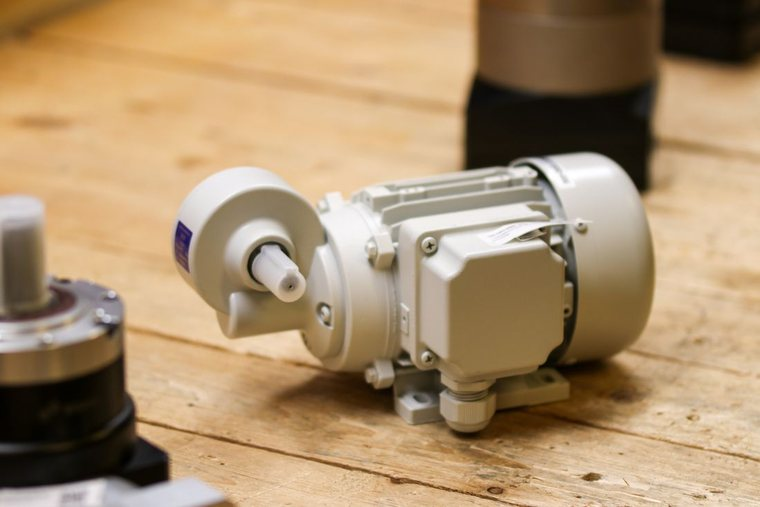
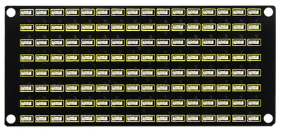
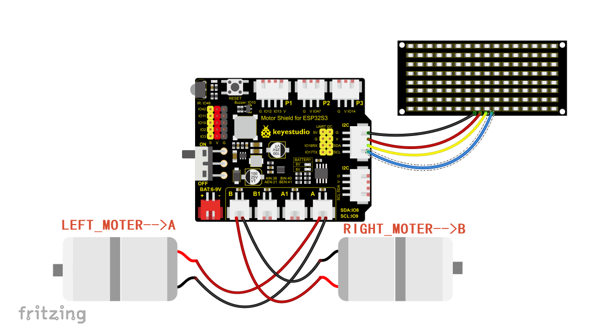
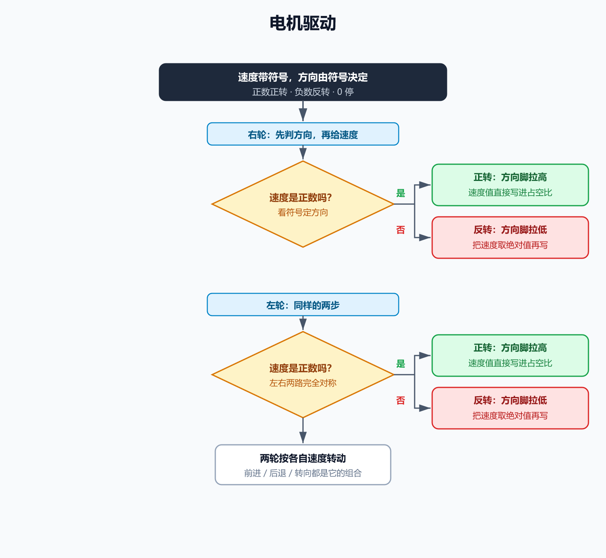

### Project 2: Motor Driving and Speed Control

#### **1. Introduction:**

{width=520px}

Last lesson the car was still just a light-up ornament; this lesson it moves on its own for the first time.

Start with a contradiction you cannot go around: a DC motor has only two wires — connect a battery and it spins, swap them and it spins backwards. But this course wants more than just spinning and spinning backwards; it wants spinning slowly. A controller pin can only output HIGH or LOW, with no setting in between, so where does a thirty-percent speed come from?

The trick is to replace "power on all the time" with "on, off, on, off, repeated rapidly". Inside the DRV8835 on the expansion board are two pairs of H-bridge switches that swap the motor's two wires between forward, reverse and disconnected. How fast the motor runs depends on what fraction of each cycle is powered — that fraction is the duty cycle. At thirty percent, the motor gets thirty percent of the average voltage. The switching runs at 1 kHz, a sound too high for human ears to hear, and the motor has no time to stop between pulses, so it feels only one smooth average force.

Speed can therefore be written as a signed number: positive goes forward, negative goes backward, and zero stops — a convention every later lesson reuses. On power-on the car first stands still with a smiley on the dot matrix, then goes forward for two seconds, backward for two seconds, and turns right and left in place for one and a half seconds each, with a half-second stop between segments. In the last segment the duty cycle is ramped up from 0 and back down to 0, so the car speeds up from slow to fast and then slows to a stop, with the heart on the dot matrix scrolling along in sync.

#### **2. Parts list:**

The parts used in this lesson:

|     |     |
| :---: | :---: |
| {width=200px}<br><span style="font-size:0.85em">DRV8835 motor expansion board ×1</span> | {width=200px}<br><span style="font-size:0.85em">Mini tracked tank robot bottom assembly ×1</span> |
| {width=200px}<br><span style="font-size:0.85em">8×16 LED dot matrix display ×1</span> | {width=200px}<br><span style="font-size:0.85em">ESP32-S3 development board ×1</span> |
> ⚠️ **The motors come fitted on the chassis at the factory; in Chapter 2 you only stack the expansion board onto the controller. This table is for reference only — nothing needs to be removed; the wiring notes below merely show how the connections are made, again for reference, so no assembly or disassembly is required. For the complete parts list, see the kit list in Section 1.4.**
#### **3. Parameters:**

| Item | Value |
| --- | --- |
| Channel A (silkscreen AIN/AEN, physical left wheel) | Direction pin IO38, speed pin IO21 |
| Channel B (silkscreen BIN/BEN, physical right wheel) | Direction pin IO40, speed pin IO41 |
| Speed range | −255 to +255 (negative reverses, 0 stops) |
| Forward speed | SPEED_RUN = 150 |
| Turning speed | SPEED_TURN = 150 |
| PWM frequency / resolution | 1 kHz, 8-bit (ledcAttach) |
| Speed-sweep demo | Duty cycle 0 → 255 → 0, step 5, 20 ms per step |
| Debug serial | 115200 |

> Note: a speed of 150 has been tested to clear the startup dead zone while keeping drag on both wheels low. Fine-tune it for your own floor surface.

#### **4. Wiring:**

| Motor | Channel (silkscreen) | Direction pin | Speed pin (PWM) |
| --- | :---: | :---: | :---: |
| Left motor (physical left wheel) | Channel A (AIN/AEN) | IO38 | IO21 |
| Right motor (physical right wheel) | Channel B (BIN/BEN) | IO40 | IO41 |

The dot matrix signal lines are the same as in Lesson 1: CLK = IO9, DIN = IO8.



#### **5. Flowchart:**

Speed is signed, so a single branch settles the direction pin and the duty cycle together:



#### **6. Test code:**

```cpp
// ===== Pins =====
// Dot matrix display
#define CLK_Pin 9   // Clock
#define DIN_Pin 8   // Data

// Motor driver
#define MOTOR_AIN 38  // Left motor direction
#define MOTOR_AEN 21  // Left motor speed control
#define MOTOR_BIN 40  // Right motor direction
#define MOTOR_BEN 41  // Right motor speed control

// ===== Speed parameters =====
#define SPEED_RUN  150  // Forward speed, 0~255
#define SPEED_TURN 150  // Spot-turn speed, 0~255

// ===== Dot matrix font bitmaps (16 columns x 8 rows) =====
// Heart: forward
unsigned char heart[] = {
  0x00, 0x00, 0x00, 0x00, 0x08, 0x1c, 0x3e, 0x7c,
  0x7c, 0x3e, 0x1c, 0x08, 0x00, 0x00, 0x00, 0x00
};

// Down arrow: backward
unsigned char arrow_down[] = {
  0x00, 0x00, 0x00, 0x00, 0x10, 0x30, 0x7e, 0xfe,
  0xfe, 0x7e, 0x30, 0x10, 0x00, 0x00, 0x00, 0x00
};

// Left arrow: turn left
unsigned char arrow_left[] = {
  0x00, 0x00, 0x00, 0x18, 0x3c, 0x7e, 0xff, 0x18,
  0x18, 0x18, 0x18, 0x18, 0x18, 0x00, 0x00, 0x00
};

// Right arrow: turn right
unsigned char arrow_right[] = {
  0x00, 0x00, 0x00, 0x18, 0x18, 0x18, 0x18, 0x18,
  0x18, 0xff, 0x7e, 0x3c, 0x18, 0x00, 0x00, 0x00
};

// Smile: stopped/idle, scrolling during speed change
unsigned char smile[] = {
  0x00, 0x00, 0x1C, 0x02, 0x02, 0x02, 0x5C, 0x40, 
  0x40, 0x5C, 0x02, 0x02, 0x02, 0x1C, 0x00, 0x00
};

// ===== Dot matrix driver =====
void IIC_start() {
  digitalWrite(CLK_Pin, HIGH);
  delayMicroseconds(3);
  digitalWrite(DIN_Pin, HIGH);
  delayMicroseconds(3);
  digitalWrite(DIN_Pin, LOW);
  delayMicroseconds(3);
}

void IIC_send(unsigned char send_data) {
  for (int i = 0; i < 8; i++) {
    digitalWrite(CLK_Pin, LOW);
    delayMicroseconds(3);
    digitalWrite(DIN_Pin, (send_data & 0x01) ? HIGH : LOW);
    delayMicroseconds(3);
    digitalWrite(CLK_Pin, HIGH);
    delayMicroseconds(3);
    send_data >>= 1;
  }
}

void IIC_end() {
  digitalWrite(CLK_Pin, LOW);
  delayMicroseconds(3);
  digitalWrite(DIN_Pin, LOW);
  delayMicroseconds(3);
  digitalWrite(CLK_Pin, HIGH);
  delayMicroseconds(3);
  digitalWrite(DIN_Pin, HIGH);
  delayMicroseconds(3);
}

void matrix_display(unsigned char matrix_value[]) {
  IIC_start();
  IIC_send(0x40); // Write data mode, auto-increment address
  IIC_end();
  
  IIC_start();
  IIC_send(0xC0); // Start writing at address 0
  for (int i = 0; i < 16; i++) {
    IIC_send(matrix_value[i]);
  }
  IIC_end();
  
  IIC_start();
  IIC_send(0x8A); // Turn on display, maximum brightness
  IIC_end();
}

// Display the font bitmap shifted left by shift columns
void matrix_display_scroll(unsigned char base_pattern[], int shift) {
  unsigned char scroll_data[16];
  for (int i = 0; i < 16; i++) {
    scroll_data[i] = base_pattern[(i + shift) % 16];
  }
  matrix_display(scroll_data);
}

// ===== Motor driver =====
// Signed speed: forward / reverse / 0 stop
void driveMotors(int rightSpeed, int leftSpeed) {
  rightSpeed  = constrain(rightSpeed,  -255, 255);
  leftSpeed = constrain(leftSpeed, -255, 255);

  if (rightSpeed >= 0) {
    digitalWrite(MOTOR_BIN, HIGH);
    ledcWrite(MOTOR_BEN, rightSpeed);
  } else {
    digitalWrite(MOTOR_BIN, LOW);
    ledcWrite(MOTOR_BEN, -rightSpeed);
  }

  if (leftSpeed >= 0) {
    digitalWrite(MOTOR_AIN, HIGH);
    ledcWrite(MOTOR_AEN, leftSpeed);
  } else {
    digitalWrite(MOTOR_AIN, LOW);
    ledcWrite(MOTOR_AEN, -leftSpeed);
  }
}

// Each action also refreshes the dot matrix pattern
void goForward(int speed) {
  matrix_display(heart);        // Forward: heart
  driveMotors(speed, speed);
}

void goBackward(int speed) {
  matrix_display(arrow_down);   // Backward: down arrow
  driveMotors(-speed, -speed);
}

void spinRight(int speed) {
  matrix_display(arrow_left);   // Spot turn right, dot matrix shows left arrow
  driveMotors(-speed, speed);
}

void spinLeft(int speed) {
  matrix_display(arrow_right);  // Spot turn left, dot matrix shows right arrow
  driveMotors(speed, -speed);
}

void stopCar() {
  matrix_display(smile);        // Stop: smile
  driveMotors(0, 0);
}

// ===== Initialization =====
void setup() {
  Serial.begin(115200);

  // Clear dot matrix display on power on
  pinMode(CLK_Pin, OUTPUT);
  pinMode(DIN_Pin, OUTPUT);
  digitalWrite(CLK_Pin, HIGH);
  digitalWrite(DIN_Pin, HIGH);
  unsigned char clear_data[16] = {0};
  matrix_display(clear_data);

  // Direction pins as output, speed pins use PWM
  pinMode(MOTOR_BIN, OUTPUT);
  pinMode(MOTOR_AIN, OUTPUT);
  pinMode(MOTOR_BEN, OUTPUT);
  pinMode(MOTOR_AEN, OUTPUT);
  ledcAttach(MOTOR_BEN, 1000, 8);  // 1 kHz, 8-bit
  ledcAttach(MOTOR_AEN, 1000, 8);

  // Stop and show smile on power on
  stopCar();
  Serial.println("Motor driving experiment starts, action in 1 second");
  delay(1000);
}

// ===== Main loop =====
void loop() {
  // Forward for 2 s
  Serial.println("Forward (show heart)");
  goForward(SPEED_RUN);
  delay(2000);

  stopCar();
  delay(500);

  // Backward for 2 s
  Serial.println("Backward (show down arrow)");
  goBackward(SPEED_RUN);
  delay(2000);

  stopCar();
  delay(500);

  // Spot turn right for 1.5 s
  Serial.println("Spot turn right");
  spinRight(SPEED_TURN);
  delay(1500);

  stopCar();
  delay(500);

  // Spot turn left for 1.5 s
  Serial.println("Spot turn left");
  spinLeft(SPEED_TURN);
  delay(1500);

  stopCar();
  delay(1000);

  // Speed control: duty cycle 0→255→0, dot matrix scrolls along
  int scroll_step = 0;

  Serial.println("Accelerate: duty cycle 0 -> 255");
  for (int duty = 0; duty <= 255; duty += 5) {
    driveMotors(duty, duty);
    if (duty % 20 == 0) {
      matrix_display_scroll(heart, scroll_step++);
    }
    delay(20);
  }

  Serial.println("Decelerate: duty cycle 255 -> 0");
  for (int duty = 255; duty >= 0; duty -= 5) {
    driveMotors(duty, duty);
    if (duty % 20 == 0) {
      matrix_display_scroll(heart, scroll_step++);
    }
    delay(20);
  }

  stopCar();
  Serial.println("Stop, next round in 2 seconds");
  delay(2000);
}
```

#### **7. Code walkthrough:**

**(1) Six pins, two kinds of job**

```cpp
#define CLK_Pin 9   // Clock
#define DIN_Pin 8   // Data

#define MOTOR_AIN 38  // Left motor direction
#define MOTOR_AEN 21  // Left motor speed control
#define MOTOR_BIN 40  // Right motor direction
#define MOTOR_BEN 41  // Right motor speed control
```

Two pins go to the dot matrix, four to the motors. Each motor channel uses two pins: `IN` is the H-bridge direction input, deciding forward or reverse, and `EN` is the enable input, deciding how fast. Channel A drives the left wheel and channel B the right wheel — a mapping that stays fixed throughout this course.

**(2) Two speed parameters**

```cpp
#define SPEED_RUN  150  // Forward speed, 0~255
#define SPEED_TURN 150  // Spot-turn speed, 0~255
```

150 is roughly a 59% duty cycle. It is a compromise: any lower and the tracks may not move the car on tile; any higher and it visibly lurches on starting and stopping. The real threshold depends on battery level and floor material, so try again when you change venues.

**(3) `driveMotors()` is the only place that touches the pins**

```cpp
void driveMotors(int rightSpeed, int leftSpeed) {
  rightSpeed  = constrain(rightSpeed,  -255, 255);
  leftSpeed = constrain(leftSpeed, -255, 255);
```

The signature is `driveMotors(int rightSpeed, int leftSpeed)`, with the **right wheel first** — the opposite of the usual left-then-right reading order — and all four action functions below pass their arguments in this order. `constrain()` clamps both values to ±255, clipping anything beyond so it cannot overflow when written to the PWM.

**(4) The sign sets direction, the absolute value sets PWM**

```cpp
  if (rightSpeed >= 0) {
    digitalWrite(MOTOR_BIN, HIGH);
    ledcWrite(MOTOR_BEN, rightSpeed);
  } else {
    digitalWrite(MOTOR_BIN, LOW);
    ledcWrite(MOTOR_BEN, -rightSpeed);
  }
```

The H-bridge needs two things: the direction pin `BIN` decides which way current flows and the speed pin `BEN` decides how fast. `ledcWrite()` accepts only 0–255; give it a negative number and it becomes a huge unsigned value, sending the motor into a wild spin. So first test the sign and write the direction pin, then write the absolute value into the PWM — that is what the minus sign in `-rightSpeed` is for.

The left-wheel section (`AIN`/`AEN`) mirrors this exactly, with only the two pins changed.

**(5) All four actions are wrappers around `driveMotors()`**

```cpp
void goForward(int speed) {
  matrix_display(heart);        // Forward: heart
  driveMotors(speed, speed);
}

void goBackward(int speed) {
  matrix_display(arrow_down);   // Backward: down arrow
  driveMotors(-speed, -speed);
}

void spinRight(int speed) {
  matrix_display(arrow_left);   // Spot turn right, dot matrix shows left arrow
  driveMotors(-speed, speed);
}

void spinLeft(int speed) {
  matrix_display(arrow_right);  // Spot turn left, dot matrix shows right arrow
  driveMotors(speed, -speed);
}

void stopCar() {
  matrix_display(smile);        // Stop: smile
  driveMotors(0, 0);
}
```

Each function does two things: change the dot matrix pattern, then assign speeds to the two wheels. `spinRight` passes (−speed, +speed) — the right wheel reverses and the left goes forward, turning the car right on the spot; yet it displays a left arrow, because when the body turns right the direction looks left from the car's point of view. The four actions differ only in signs; learn these four lines and the later obstacle-avoidance and line-tracking lessons are all about calling them.

`stopCar()` passes `(0, 0)`, writing zero to both PWM channels while leaving the direction pins as they were.

**(6) The 1 kHz and 8-bit in `ledcAttach()`**

```cpp
  ledcAttach(MOTOR_BEN, 1000, 8);  // 1 kHz, 8-bit
  ledcAttach(MOTOR_AEN, 1000, 8);
```

The second argument is the PWM frequency; 1 kHz sits above the lower limit of human hearing, so the motor makes no audible whine. The third is the resolution: 8-bit gives 256 steps from 0 to 255, which is where the 255 in `constrain(±255)` comes from. You could go to 10-bit (0–1023) for finer control, but then the limit in `driveMotors()` and every speed constant must change as well; this course sticks with 8-bit throughout.

In `setup()`, all four pins are set to `OUTPUT`, including the two speed pins — `ledcAttach()` does not change pin direction for you, so if you omit `pinMode()` the motor will not turn.

**(7) The four motion phases of the main loop**

```cpp
  Serial.println("Forward (show heart)");
  goForward(SPEED_RUN);
  delay(2000);

  stopCar();
  delay(500);
```

Forward, backward, right turn and left turn each run once, with a `stopCar()` and a 500 ms pause between them. The pause is useful: the car has inertia, so reversing straight away sends a large reverse current through the H-bridge; breaking for half a second eases it and also makes the transitions easier to see.

**(8) The speed ramp**

```cpp
  for (int duty = 0; duty <= 255; duty += 5) {
    driveMotors(duty, duty);
    if (duty % 20 == 0) {
      matrix_display_scroll(heart, scroll_step++);
    }
    delay(20);
  }
```

`duty` rises by 5 each round with a 20 ms pause, climbing from 0 to 255 in about a second — that is "easing on the throttle". The deceleration section changes `duty += 5` to `-= 5`; everything else stays the same.

`duty % 20 == 0` changes the dot matrix frame only every 20 steps. Without that check, 51 loop rounds would roll through the 16 frames more than three times and look like random flashing. `matrix_display_scroll()` uses the same modulo logic as Lesson 1's scrolling; only the frame calculation has been pulled into a function, and the main loop simply passes an increasing `scroll_step`.

#### **8. What you should see:**

After power on the car stops with a smiley on the display, then enters the loop after 1 second and runs through:

1. Forward for 2 seconds (heart on the dot matrix);
2. Stop for 0.5 seconds (smiley);
3. Backward for 2 seconds (down arrow on the dot matrix);
4. Stop for 0.5 seconds;
5. Spot turn right for 1.5 seconds (left arrow on the dot matrix);
6. Stop for 0.5 seconds;
7. Spot turn left for 1.5 seconds (right arrow on the dot matrix);
8. Stop for 1 second;
9. Speed sweep: duty cycle 0→255→0, the car changes speed smoothly with it and the heart scrolls along;
10. Stop for 2 seconds, then go back to step 1.

The current action is printed to the serial port at the same time (115200). If the car completes a round of **forward — backward — right turn — left turn — speed sweep** with the dot matrix icon changing to match each action, everything is working.

> [Image to be added] Photos of the four actions: forward, backward, left turn and right turn, each showing both the car and the dot matrix icon.

#### **9. Troubleshooting:**

(1) The wheels buzz but refuse to turn: the speed is too low to clear the startup dead zone. Put `SPEED_RUN` and `SPEED_TURN` in the region of 150 — don't use values in the teens or twenties.

(2) Turning goes the opposite way: don't rush to change the program. First check channels A and B against the left and right wheels using the wiring table in Section 2.3.1, and confirm that channel A drives the left wheel.

(3) It only turns one way and won't reverse: the direction pins in `driveMotors()` are written according to the sign of the speed — pass 0 or a positive value and the direction pin stays `HIGH`; reversing requires a negative value, which is exactly what `goBackward()` does with `driveMotors(-speed, -speed)`. If your own call forgets the minus sign, the car will only ever go one way.

(4) The car shoots off on power on: you left `stopCar()` out at the end of `setup()`, or didn't set the duty cycle to 0 right after `ledcAttach()`.
