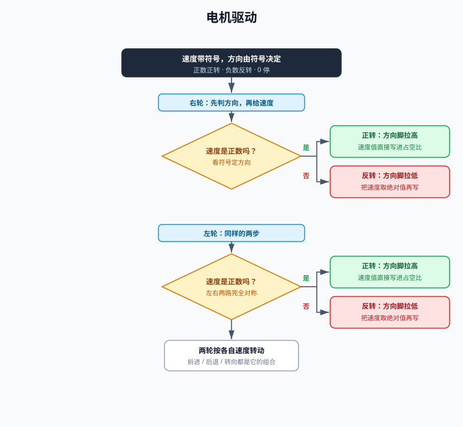

### 项目 2：电机驱动与调速

#### **1. 简介：**

{width=520px}

上一课的车还只是个会发光的摆件，这一课它第一次自己动。

先看一个绕不过去的矛盾：直流电机只有两根线，接上电池就转，对调就反转。可教程要的不只是**转**和**反着转**，还要**转得慢一点**。主控引脚只会输出高或低，没有中间档位，那三成的速度是从哪来的？

办法是把"一直给电"改成"给一下、停一下，快速重复"。扩展板那颗 DRV8835 里有两组 **H 型**开关，负责把电机两根线在正接、反接、断开之间切换；快慢则看一个周期里通电时间占多大比例，这个比例叫**占空比**，占三成，电机拿到的平均电压就是三成。切换频率取到 1 kHz，人耳听不到这个声音，电机也来不及跟着停转，只感受到一个平稳的平均力。

速度因此可以用一个带符号的数表示：正数往前走、负数往后退、给 0 就停，后面每一课都沿用这个约定。上电后车先停住、点阵显示笑脸，随后前进两秒、后退两秒、原地右转和左转各一秒半，每段之间停半秒；最后一段把占空比从 0 一点点加上去再降回 0，车速由慢到快、再由快停住，点阵里的爱心同步滚动。

#### **2. 所需清单：**

本课用到的器件：

|     |     |
| :---: | :---: |
| {width=200px}<br><span style="font-size:0.85em">DRV8835 电机扩展板 ×1</span> | {width=200px}<br><span style="font-size:0.85em">履带底盘总成（履带 + 电机 + 轮子） ×1</span> |
| {width=200px}<br><span style="font-size:0.85em">8×16 LED 点阵屏 ×1</span> | {width=200px}<br><span style="font-size:0.85em">ESP32-S3 开发板 ×1</span> |
> ⚠️ **电机出厂就装在底盘上，第 2 章只是把扩展板叠插到主控，本表只作对照，不用拆；下面的接线说明只标清接线方式，供对照，不必拆装。完整物料见 1.4 套件清单。**
#### **3. 参数：**

| 项目 | 参数 |
| --- | --- |
| A 路（丝印 AIN/AEN，物理左轮） | 方向脚 IO38，调速脚 IO21 |
| B 路（丝印 BIN/BEN，物理右轮） | 方向脚 IO40，调速脚 IO41 |
| 速度范围 | −255 ～ +255（负数反转，0 停车） |
| 直行速度 | SPEED_RUN = 150 |
| 转向速度 | SPEED_TURN = 150 |
| PWM 频率 / 位数 | 1 kHz，8 位（ledcAttach） |
| 调速演示 | 占空比 0 → 255 → 0，步进 5，每步 20 ms |
| 调试串口 | 115200 |

> 说明：速度 150 是实测能越过启动死区、两轮阻力较小的值，实际使用时可按地面情况微调。

#### **4. 接线说明：**

| 电机 | 路数（丝印） | 方向脚 | 调速脚（PWM） |
| --- | :---: | :---: | :---: |
| 左电机（物理左轮） | A 路（AIN/AEN） | IO38 | IO21 |
| 右电机（物理右轮） | B 路（BIN/BEN） | IO40 | IO41 |

点阵信号线同第 1 课：CLK = IO9，DIN = IO8。


#### **5. 流程图：**

速度带符号，判一个分支就把方向脚和占空比一起定下来：



#### **6. 测试代码：**

```cpp
// ===== 引脚 =====
// 点阵屏
#define CLK_Pin 9   // 时钟
#define DIN_Pin 8   // 数据

// 电机驱动
#define MOTOR_AIN 38  // 左电机方向
#define MOTOR_AEN 21  // 左电机调速
#define MOTOR_BIN 40  // 右电机方向
#define MOTOR_BEN 41  // 右电机调速

// ===== 速度参数 =====
#define SPEED_RUN  150  // 直行速度，0~255
#define SPEED_TURN 150  // 原地转向速度，0~255

// ===== 点阵字模（16 列 × 8 行）=====
// 爱心：直行
unsigned char heart[] = {
  0x00, 0x00, 0x00, 0x00, 0x08, 0x1c, 0x3e, 0x7c,
  0x7c, 0x3e, 0x1c, 0x08, 0x00, 0x00, 0x00, 0x00
};

// 向下箭头：后退
unsigned char arrow_down[] = {
  0x00, 0x00, 0x00, 0x00, 0x10, 0x30, 0x7e, 0xfe,
  0xfe, 0x7e, 0x30, 0x10, 0x00, 0x00, 0x00, 0x00
};

// 向左箭头：左转
unsigned char arrow_left[] = {
  0x00, 0x00, 0x00, 0x18, 0x3c, 0x7e, 0xff, 0x18,
  0x18, 0x18, 0x18, 0x18, 0x18, 0x00, 0x00, 0x00
};

// 向右箭头：右转
unsigned char arrow_right[] = {
  0x00, 0x00, 0x00, 0x18, 0x18, 0x18, 0x18, 0x18,
  0x18, 0xff, 0x7e, 0x3c, 0x18, 0x00, 0x00, 0x00
};

// 笑脸：停车待机、调速滚动
unsigned char smile[] = {
  0x00, 0x00, 0x1C, 0x02, 0x02, 0x02, 0x5C, 0x40, 
  0x40, 0x5C, 0x02, 0x02, 0x02, 0x1C, 0x00, 0x00
};

// ===== 点阵驱动 =====
void IIC_start() {
  digitalWrite(CLK_Pin, HIGH);
  delayMicroseconds(3);
  digitalWrite(DIN_Pin, HIGH);
  delayMicroseconds(3);
  digitalWrite(DIN_Pin, LOW);
  delayMicroseconds(3);
}

void IIC_send(unsigned char send_data) {
  for (int i = 0; i < 8; i++) {
    digitalWrite(CLK_Pin, LOW);
    delayMicroseconds(3);
    digitalWrite(DIN_Pin, (send_data & 0x01) ? HIGH : LOW);
    delayMicroseconds(3);
    digitalWrite(CLK_Pin, HIGH);
    delayMicroseconds(3);
    send_data >>= 1;
  }
}

void IIC_end() {
  digitalWrite(CLK_Pin, LOW);
  delayMicroseconds(3);
  digitalWrite(DIN_Pin, LOW);
  delayMicroseconds(3);
  digitalWrite(CLK_Pin, HIGH);
  delayMicroseconds(3);
  digitalWrite(DIN_Pin, HIGH);
  delayMicroseconds(3);
}

void matrix_display(unsigned char matrix_value[]) {
  IIC_start();
  IIC_send(0x40); // 写数据模式，地址自增
  IIC_end();
  
  IIC_start();
  IIC_send(0xC0); // 从地址 0 开始写
  for (int i = 0; i < 16; i++) {
    IIC_send(matrix_value[i]);
  }
  IIC_end();
  
  IIC_start();
  IIC_send(0x8A); // 开显示，最大亮度
  IIC_end();
}

// 字模左移 shift 列后显示
void matrix_display_scroll(unsigned char base_pattern[], int shift) {
  unsigned char scroll_data[16];
  for (int i = 0; i < 16; i++) {
    scroll_data[i] = base_pattern[(i + shift) % 16];
  }
  matrix_display(scroll_data);
}

// ===== 电机驱动 =====
// 速度带符号：正转 / 反转 / 0 停
void driveMotors(int rightSpeed, int leftSpeed) {
  rightSpeed  = constrain(rightSpeed,  -255, 255);
  leftSpeed = constrain(leftSpeed, -255, 255);

  if (rightSpeed >= 0) {
    digitalWrite(MOTOR_BIN, HIGH);
    ledcWrite(MOTOR_BEN, rightSpeed);
  } else {
    digitalWrite(MOTOR_BIN, LOW);
    ledcWrite(MOTOR_BEN, -rightSpeed);
  }

  if (leftSpeed >= 0) {
    digitalWrite(MOTOR_AIN, HIGH);
    ledcWrite(MOTOR_AEN, leftSpeed);
  } else {
    digitalWrite(MOTOR_AIN, LOW);
    ledcWrite(MOTOR_AEN, -leftSpeed);
  }
}

// 每个动作同时刷新点阵图案
void goForward(int speed) {
  matrix_display(heart);        // 前进：爱心
  driveMotors(speed, speed);
}

void goBackward(int speed) {
  matrix_display(arrow_down);   // 后退：向下箭头
  driveMotors(-speed, -speed);
}

void spinRight(int speed) {
  matrix_display(arrow_left);   // 原地右转，点阵显示左箭头
  driveMotors(-speed, speed);
}

void spinLeft(int speed) {
  matrix_display(arrow_right);  // 原地左转，点阵显示右箭头
  driveMotors(speed, -speed);
}

void stopCar() {
  matrix_display(smile);        // 停车：笑脸
  driveMotors(0, 0);
}

// ===== 初始化 =====
void setup() {
  Serial.begin(115200);

  // 点阵上电清屏
  pinMode(CLK_Pin, OUTPUT);
  pinMode(DIN_Pin, OUTPUT);
  digitalWrite(CLK_Pin, HIGH);
  digitalWrite(DIN_Pin, HIGH);
  unsigned char clear_data[16] = {0};
  matrix_display(clear_data);

  // 方向脚输出，调速脚启用 PWM
  pinMode(MOTOR_BIN, OUTPUT);
  pinMode(MOTOR_AIN, OUTPUT);
  pinMode(MOTOR_BEN, OUTPUT);
  pinMode(MOTOR_AEN, OUTPUT);
  ledcAttach(MOTOR_BEN, 1000, 8);  // 1 kHz，8 位
  ledcAttach(MOTOR_AEN, 1000, 8);

  // 上电停车并显示笑脸
  stopCar();
  Serial.println("电机驱动实验开始，1 秒后动作");
  delay(1000);
}

// ===== 主循环 =====
void loop() {
  // 直行 2 s
  Serial.println("前进（显示爱心）");
  goForward(SPEED_RUN);
  delay(2000);

  stopCar();
  delay(500);

  // 后退 2 s
  Serial.println("后退（显示向下箭头）");
  goBackward(SPEED_RUN);
  delay(2000);

  stopCar();
  delay(500);

  // 原地右转 1.5 s
  Serial.println("原地右转");
  spinRight(SPEED_TURN);
  delay(1500);

  stopCar();
  delay(500);

  // 原地左转 1.5 s
  Serial.println("原地左转");
  spinLeft(SPEED_TURN);
  delay(1500);

  stopCar();
  delay(1000);

  // 调速：占空比 0→255→0，点阵同步滚动
  int scroll_step = 0;

  Serial.println("加速：占空比 0 -> 255");
  for (int duty = 0; duty <= 255; duty += 5) {
    driveMotors(duty, duty);
    if (duty % 20 == 0) {
      matrix_display_scroll(heart, scroll_step++);
    }
    delay(20);
  }

  Serial.println("减速：占空比 255 -> 0");
  for (int duty = 255; duty >= 0; duty -= 5) {
    driveMotors(duty, duty);
    if (duty % 20 == 0) {
      matrix_display_scroll(heart, scroll_step++);
    }
    delay(20);
  }

  stopCar();
  Serial.println("停止，2 秒后进入下一轮");
  delay(2000);
}
```

#### **7. 代码解释：**

**(1) 六个引脚，两类用途**

```cpp
#define CLK_Pin 9   // 时钟
#define DIN_Pin 8   // 数据

#define MOTOR_AIN 38  // 左电机方向
#define MOTOR_AEN 21  // 左电机调速
#define MOTOR_BIN 40  // 右电机方向
#define MOTOR_BEN 41  // 右电机调速
```

点阵占两根，电机占四根。电机每路两根脚：`IN` 接 H 桥的方向输入，管正转还是反转；`EN` 接使能端，管转多快。A 路是左轮，B 路是右轮，这个对应关系在整套教程里不变。

**(2) 两个速度参数**

```cpp
#define SPEED_RUN  150  // 直行速度，0~255
#define SPEED_TURN 150  // 原地转向速度，0~255
```

150 约等于 59% 占空比。这是一组折中值：再低，履带在瓷砖上可能带不动车；再高，起停会明显发蹿。真正的门槛跟电量、地面材质都有关系，换场地要重试。

**(3) `driveMotors()` 是唯一碰引脚的地方**

```cpp
void driveMotors(int rightSpeed, int leftSpeed) {
  rightSpeed  = constrain(rightSpeed,  -255, 255);
  leftSpeed = constrain(leftSpeed, -255, 255);
```

签名是 `driveMotors(int rightSpeed, int leftSpeed)`，**右轮在前**，和"先左后右"的阅读习惯相反，后面四个动作函数全按这个顺序传参。`constrain()` 把两个值夹在 ±255 之间，超出的部分直接削平，免得写进 PWM 时溢出。

**(4) 符号定方向，绝对值给 PWM**

```cpp
  if (rightSpeed >= 0) {
    digitalWrite(MOTOR_BIN, HIGH);
    ledcWrite(MOTOR_BEN, rightSpeed);
  } else {
    digitalWrite(MOTOR_BIN, LOW);
    ledcWrite(MOTOR_BEN, -rightSpeed);
  }
```

H 桥要两样东西：方向脚 `BIN` 决定电流往哪边走，调速脚 `BEN` 决定走多快。`ledcWrite()` 只认 0～255，塞负数会变成一个很大的无符号值，电机狂转。所以这里先判符号写方向脚，再把绝对值写进 PWM——`-rightSpeed` 那个负号就是干这个的。

左轮那一段（`AIN`/`AEN`）与上面完全对称，只是换了两根引脚。

**(5) 四个动作都是 `driveMotors()` 的包装**

```cpp
void goForward(int speed) {
  matrix_display(heart);        // 前进：爱心
  driveMotors(speed, speed);
}

void goBackward(int speed) {
  matrix_display(arrow_down);   // 后退：向下箭头
  driveMotors(-speed, -speed);
}

void spinRight(int speed) {
  matrix_display(arrow_left);   // 原地右转，点阵显示左箭头
  driveMotors(-speed, speed);
}

void spinLeft(int speed) {
  matrix_display(arrow_right);  // 原地左转，点阵显示右箭头
  driveMotors(speed, -speed);
}

void stopCar() {
  matrix_display(smile);        // 停车：笑脸
  driveMotors(0, 0);
}
```

每个函数两件事：先换点阵图案，再给两个轮子派速度。`spinRight` 传的是（−speed, +speed）——右轮倒、左轮进，车原地右转；它显示的却是左箭头，因为车身往右转时，从车上看方向就是向左。四个动作的差值只有符号，把这四行背下来，后面的避障、循迹课全是调它们。

`stopCar()` 传 `(0, 0)`，两路 PWM 写 0，方向脚保持不变。

**(6) `ledcAttach()` 里的 1 kHz 和 8 位**

```cpp
  ledcAttach(MOTOR_BEN, 1000, 8);  // 1 kHz，8 位
  ledcAttach(MOTOR_AEN, 1000, 8);
```

第二个参数是 PWM 频率，1 kHz 高于人耳听觉下限的一段，电机不会发出可听的啸叫。第三个是分辨率，8 位就是 0～255 共 256 档，这就是 `constrain(±255)` 里那个 255 的来历。想更细可以改 10 位（0～1023），但 `driveMotors()` 的限幅和所有速度常量都得跟着改，本套教程统一用 8 位。

`setup()` 里四个脚都设成了 `OUTPUT`，包括两个调速脚——`ledcAttach()` 不会替你改引脚方向，漏了 `pinMode()` 电机不转。

**(7) 主循环的四段动作**

```cpp
  Serial.println("前进（显示爱心）");
  goForward(SPEED_RUN);
  delay(2000);

  stopCar();
  delay(500);
```

直行、后退、右转、左转各来一遍，每段之间插 `stopCar()` 加 500 ms 停顿。停一下是有用的：车有惯性，紧接着反向会给 H 桥一个较大的反向电流，中间断开半秒能缓一下，动作之间也看得清。

**(8) 调速斜坡**

```cpp
  for (int duty = 0; duty <= 255; duty += 5) {
    driveMotors(duty, duty);
    if (duty % 20 == 0) {
      matrix_display_scroll(heart, scroll_step++);
    }
    delay(20);
  }
```

`duty` 每次加 5、每步停 20 ms，从 0 爬到 255 大约 1 秒，这就是"慢慢给油"。减速那段把 `duty += 5` 换成 `-= 5`，其余一样。

`duty % 20 == 0` 让点阵每涨 20 档才换一帧。不加这个判断，51 次循环会把 16 帧滚完三遍多，看着像乱闪。`matrix_display_scroll()` 和第一课的滚动是同一套取模逻辑，只是把"算一帧"单独抽成了函数，主循环传一个递增的 `scroll_step` 进去就行。

#### **8. 运行现象：**

上电后先显示笑脸并停车，1 秒后进入循环，依次执行：

1. 前进 2 秒（点阵爱心）；
2. 停车 0.5 秒（笑脸）；
3. 后退 2 秒（点阵向下箭头）；
4. 停车 0.5 秒；
5. 原地右转 1.5 秒（点阵显示向左箭头）；
6. 停车 0.5 秒；
7. 原地左转 1.5 秒（点阵显示向右箭头）；
8. 停车 1 秒；
9. 调速：占空比 0→255→0，车速随占空比平滑变化，点阵爱心同步滚动；
10. 停车 2 秒后回到第 1 步。

串口同步打印当前动作（115200）。车按**前进—后退—右转—左转—调速**跑一轮，点阵图标跟着动作换就对了。

> 【图片待补】四个动作的运行现象图：前进、后退、左转、右转各拍一张，能同时看到车与点阵图标。

#### **9. 常见问题解决：**

(1) 轮子嗡嗡响就是不转：速度给低了，没越过启动死区。`SPEED_RUN`、`SPEED_TURN` 给到 150 这个量级，别用十几二十。

(2) 转向和预期相反：别急着改程序，先按 2.3.1 的接线表核对 A/B 两路和左右轮，确认 A 路带的是左轮。

(3) 只往一个方向转、换向没反应：`setMotor()` 只写 PWM 不管方向，方向脚还停在上一轮的值。换向必须走 `forward()` / `back()` 这类带 `digitalWrite()` 的包装。

(4) 上电就冲出去：`setup()` 末尾漏了 `stopCar()`，或者 `ledcAttach()` 之后没先把占空比给 0。
