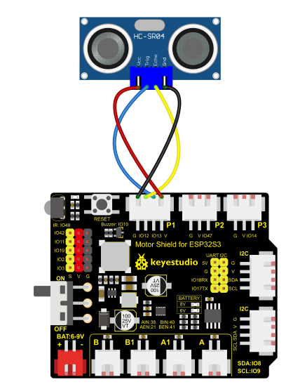
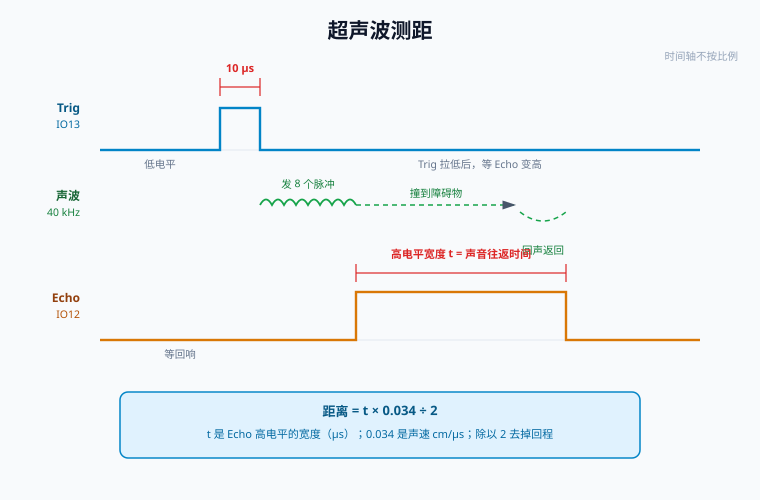

### 项目 3：超声波测距

#### **1. 简介：**

{width=520px}

蝙蝠在漆黑的洞里靠喊一声、听回声，判断前面有没有墙。超声波模块做的是同一件事，只是把声音换成人耳听不见的 40 kHz。

模块前面有两只筒：一只负责喊，一只负责听。主控给出一个 10 微秒的脉冲，喊的那只就发出八个周期的超声波；声波撞到障碍物弹回来，被听的那只收到，它随即把**从喊到听见**这段时间变成一段高电平。这段高电平有多宽，声音就跑了一个来回。

距离因此只有一句算式：`时间 × 声速 ÷ 2`。声速取 0.034 厘米每微秒，除以 2 是因为声音去了一趟还得回来。本课不判断、不避障，只把距离稳稳读出来，每秒往串口打一行：手靠近数值变小、远离变大；正前方什么都没有时，打出来的是 0，表示这一轮没测到距离，并不代表车头贴着墙。


#### **2. 所需清单：**

本课用到的器件：

|     |     |     |
| :---: | :---: | :---: |
| {width=170px}<br><span style="font-size:0.85em">超声波模块（带外壳） ×1</span> | {width=170px}<br><span style="font-size:0.85em">DRV8835 电机扩展板 ×1</span> | {width=170px}<br><span style="font-size:0.85em">ESP32-S3 开发板 ×1</span> |
> ⚠️ **超声波在第 2 章随云台一起装好了，本表只作对照，不用拆；下面的接线说明只标清接线方式，供对照，不必拆装。完整物料见 1.4 套件清单。**
#### **3. 参数：**

| 项目 | 参数 |
| --- | --- |
| 模块 | HC-SR04 超声波测距模块 |
| Trig（触发脚） | IO13 |
| Echo（回响脚） | IO12 |
| 触发脉冲宽度 | 10 µs |
| 声速系数 | 0.034 cm/µs |
| 有效量程 | 2–300 cm（超范围置 0） |
| 测量周期 | 1000 ms |
| 调试串口 | 115200 |

> **接线**：超声波用套件配的 4P 双头线直插扩展板顶部的超声波座（丝印 `G` `IO12` `IO13` `V`），不用一根根接杜邦线，详见 2.3.5 节。

#### **4. 接线说明：**

| 超声波引脚 | 主控 GPIO |
| --- | :---: |
| Trig | IO13 |
| Echo | IO12 |

> **注意**：接线图中的元器件只用于说明接线关系，实际接线时不需要把清单中带外壳的元器件拆开。




#### **5. 流程图：**

一次测距由三段时序拼成，Echo 的宽度就是**声音往返的时间**：



#### **6. 测试代码：**

```cpp
// 超声波引脚
const int trigPin = 13;  // 触发，IO13
const int echoPin = 12;  // 回响，IO12

// 测量中间量
long duration;   // 往返时间（µs）
int distance;    // 距离（cm）

void setup() {
  // 波特率 115200
  Serial.begin(115200);
  
  pinMode(trigPin, OUTPUT); // Trig 输出
  pinMode(echoPin, INPUT);  // Echo 输入
}

void loop() {
  // 先拉低，保证起始电平干净
  digitalWrite(trigPin, LOW);
  delayMicroseconds(2);

  // 10 µs 高脉冲触发发波
  digitalWrite(trigPin, HIGH);
  delayMicroseconds(10);
  digitalWrite(trigPin, LOW);

  // Echo 高电平宽度即往返时间
  duration = pulseIn(echoPin, HIGH);

  // 声速 0.034 cm/µs，除以 2 去掉回程
  distance = duration * 0.034 / 2;
    
  // 量程 2~300 cm，超范围置 0
  if(distance < 2 || distance > 300){
    distance = 0;
  }

  // 串口输出
  Serial.print("距离：");
  Serial.print(distance);
  Serial.println(" cm");

  // 1 s 测一次
  delay(1000);
}
```

#### **7. 代码解释：**

**1. 触发：一个 10 µs 的高脉冲**

```cpp
digitalWrite(trigPin, LOW);
delayMicroseconds(2);
digitalWrite(trigPin, HIGH);
delayMicroseconds(10);
digitalWrite(trigPin, LOW);
```

模块只认"高电平持续 10 µs 以上"这一个信号，看到就开始发 8 个 40 kHz 的超声波周期。前面那 2 µs 拉低是先把引脚摁到确定的低电平——上一轮结束时引脚停在哪不确定，不拉这一下，模块可能把残余电平当成一次触发。

**2. 测回响：`pulseIn()` 数高电平有多宽**

```cpp
duration = pulseIn(echoPin, HIGH);
```

`pulseIn()` 会一直等：先等 Echo 变高（等回波开始），再计高电平持续了多少微秒（等回波结束），返回值就是这个微秒数。默认超时 1 秒，等不到就返回 0。

这一次调用是**阻塞**的。前方空旷时没有回波，函数会老老实实等满 1 秒，主循环跟着卡 1 秒。第 13 课把它改成带 25 ms 超时的版本，就是为了网页不被它拖住。

**3. 换算：为什么是 0.034 再除以 2**

```cpp
distance = duration * 0.034 / 2;
```

声速约 340 m/s，换成厘米每微秒就是 0.034 cm/µs。`duration` 是"发出去到收回来"的总时间，声波走了**来回两趟**，所以乘完还要除以 2 才是单程距离。

量程判断那两行是补漏：

```cpp
if(distance < 2 || distance > 300){
  distance = 0;
}
```

模块标称 2～300 cm。超出这个范围的值（比如没回波时算出来的 170 cm 假数据、或者贴着墙的 0.5 cm）不可信，统一按 0 处理——本课只是打印出来看，第 4 课避障时 0 会被当成"前方有障碍"，这个约定要记住。

**4. 公式里为什么是 0.034 和 /2**

- 声速 340 m/s = 34000 cm/s = 0.034 cm/µs。
- `pulseIn()` 量的是**发出 → 碰到物体 → 返回**的往返时间，单程只有一半，所以除以 2。
- 代入几个值：10 cm 目标 duration ≈ 588 µs；1 m 目标 ≈ 5882 µs；3 m 目标 ≈ 17.6 ms。
- 300 cm 是这颗模块的实际上限，超过以后回波太弱，`pulseIn()` 可能读到 0 或一段噪声，所以 `distance < 2 || distance > 300` 一律置 0，宁可报"无效"也不报假数。
- `pulseIn()` 默认超时 1 s；真丢回波时这一轮会卡住 1 s，这是第 3 课能接受、第 4 课必须避开的情况。

**5. 三种读数分别代表什么**

| 显示 | 含义 | 原因 |
| --- | --- | --- |
| 0 | 无效 | 超量程、没回波、或物体太近吸收了声波 |
| 2～300 | 有效 | 正常范围 |
| 忽大忽小 | 干扰 | 目标面倾斜、软质衣物吸声、附近有另一颗超声波在发波 |

#### **8. 运行现象：**

打开串口监视器（波特率 115200），每秒输出一行距离值，格式为**距离：XX cm**：

- 正前方无障碍或距离超过 300 cm 时，显示**距离：0 cm**；
- 用手或书本在车前移动，数值随距离变化，靠近时变小、远离时变大。

> 【图片待补】串口监视器输出距离值的截图，展示几行不同距离的数据。

> 【图片待补】用遮挡物在超声波前测距的实物图。

#### **9. 常见问题解决：**

(1) 手靠近时数值变小、远离时变大，且读数不怎么跳，说明测距正常。

(2) 读数一直是 0：先把 4P 插头拔下来重插一遍，确认没插反、插到底；插紧了还是 0，再查 Trig / Echo 有没有接反。

(3) 数值乱跳：看测量周期里有没有东西挡着，或者周围环境噪声太大。
