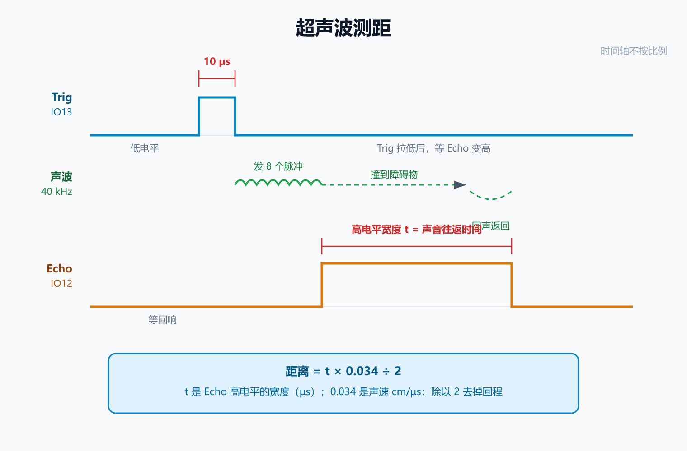

### Project 3: Ultrasonic Distance Measurement

#### **1. Introduction:**

{width=520px}

A bat in a pitch-dark cave shouts and listens for the echo to tell whether a wall is ahead. An ultrasonic module does the same thing, except that it uses a sound too high for human ears to hear: 40 kHz.

On the front of the module are two tubes: one does the shouting, the other the listening. The controller sends a 10-microsecond pulse, and the sending tube emits eight cycles of ultrasound. The sound bounces off an obstacle and comes back to the listening tube, which turns the time from shout to echo into a HIGH pulse. The width of that HIGH pulse is exactly the time the sound spent on its round trip.

The distance is then just one formula: time × speed of sound ÷ 2. The speed of sound is taken as 0.034 cm/µs, and you divide by 2 because the sound goes out and comes back. This lesson does no judging and no obstacle avoidance — it simply reads the distance steadily and prints a line to the serial port every second: bring your hand closer and the number falls, move it away and the number rises. With nothing straight ahead, it prints 0, meaning no distance was measured this round — not that the car's nose is against a wall.

#### **2. Parts List:**
The parts used in this lesson:

|     |     |     |
| :---: | :---: | :---: |
| {width=170px}<br><span style="font-size:0.85em">Ultrasonic module ×1</span> | {width=170px}<br><span style="font-size:0.85em">DRV8835 motor expansion board ×1</span> | {width=170px}<br><span style="font-size:0.85em">ESP32-S3 development board ×1</span> |
> ⚠️ **The ultrasonic module was already installed together with the pan-tilt in Chapter 2. This table is for reference only — nothing needs to be removed; the wiring notes below merely show how the connections are made, again for reference, so no assembly or disassembly is required. For the complete parts list, see the kit list in Section 1.4.**
#### **3. Parameters:**
| Item | Parameter |
| --- | --- |
| Module | HC-SR04 ultrasonic distance measurement module |
| Trig (trigger pin) | IO13 |
| Echo (echo pin) | IO12 |
| Trigger pulse width | 10 µs |
| Valid measuring range | 2–300 cm (out of range → 0) |
| Measurement cycle | 1000 ms |
| Debug serial | 115200 |


#### **4. Wiring:**

| Ultrasonic pin | Controller GPIO |
| --- | :---: |
| Trig | IO13 |
| Echo | IO12 |

> **Note**: the components in the wiring diagram serve only to illustrate the connections. In practice you do not need to open up any of the housed components in the parts list.


#### **5. Flowchart:**

A single measurement is built from three timed stages, and the width of the Echo pulse is the **round-trip time of the sound**:



#### **6. Test Code:**
```cpp
// Ultrasonic module pins
const int trigPin = 13;  // Trigger, IO13
const int echoPin = 12;  // Echo, IO12

// Measurement variables
long duration;   // Round-trip time (µs)
int distance;    // Distance (cm)

void setup() {
  // Baud rate 115200
  Serial.begin(115200);
  
  pinMode(trigPin, OUTPUT); // Trig output
  pinMode(echoPin, INPUT);  // Echo input
}

void loop() {
  // Pull low first for a clean start level
  digitalWrite(trigPin, LOW);
  delayMicroseconds(2);

  // 10 µs high pulse triggers emission
  digitalWrite(trigPin, HIGH);
  delayMicroseconds(10);
  digitalWrite(trigPin, LOW);

  // Echo HIGH pulse width is the round-trip time
  duration = pulseIn(echoPin, HIGH);

  // Speed of sound 0.034 cm/µs, divide by 2 to remove the return trip
  distance = duration * 0.034 / 2;
    
  // Measuring range 2~300 cm, set 0 if out of range
  if(distance < 2 || distance > 300){
    distance = 0;
  }

  // Serial output
  Serial.print("Distance: ");
  Serial.print(distance);
  Serial.println(" cm");

  // Measure once per 1 s
  delay(1000);
}
```

#### **7. Code Explanation:**
**1. Trigger: a 10 µs HIGH pulse**

```cpp
  // Pull low first for a clean start level
  digitalWrite(trigPin, LOW);
  delayMicroseconds(2);

  // 10 µs high pulse triggers emission
  digitalWrite(trigPin, HIGH);
  delayMicroseconds(10);
  digitalWrite(trigPin, LOW);
```

The module recognizes just one signal — HIGH for at least 10 µs — on seeing which it emits eight 40 kHz ultrasonic cycles. The 2 µs pull-low beforehand forces the pin to a definite LOW level: where it ended the previous round is uncertain, and without this pull the module might mistake a leftover level for a trigger.

**2. Reading the echo: `pulseIn()` counts how wide the HIGH pulse is**

```cpp
  // Echo HIGH pulse width is the round-trip time
  duration = pulseIn(echoPin, HIGH);
```

`pulseIn()` simply waits: first for Echo to go HIGH (the echo starting), then it counts how many microseconds the HIGH level lasts (the echo ending) and returns that number. The default timeout is 1 second; if nothing arrives it returns 0.

This call is **blocking**. With open space ahead and no echo, the function waits out the full second and the main loop stalls along with it. Lesson 13 rewrites it with a 25 ms timeout precisely so that the web page is not held up.

**3. The conversion: why 0.034 and then divide by 2**

```cpp
  // Speed of sound 0.034 cm/µs, divide by 2 to remove the return trip
  distance = duration * 0.034 / 2;
```

The speed of sound is about 340 m/s, which works out to 0.034 cm/µs. `duration` is the total time from sending to receiving; the sound has travelled **there and back**, so after multiplying you still divide by 2 to get the one-way distance.

The two range-check lines close a loophole:

```cpp
  // Measuring range 2~300 cm, set 0 if out of range
  if(distance < 2 || distance > 300){
    distance = 0;
  }
```

The module is rated for 2–300 cm. Values outside that range — a bogus 170 cm from a missing echo, or 0.5 cm with the sensor pressed against a wall — are not trustworthy and are all treated as 0. This lesson only prints them for you to observe, but in Lesson 4's obstacle avoidance a 0 is taken as "obstacle ahead", so keep that convention in mind.

**4. Why the formula uses 0.034 and /2**

- Speed of sound: 340 m/s = 34,000 cm/s = 0.034 cm/µs.
- `pulseIn()` measures the **send → hit the object → return** round trip, of which one leg is only half, hence the division by 2.
- A few worked values: a target at 10 cm gives duration ≈ 588 µs; at 1 m ≈ 5882 µs; at 3 m ≈ 17.6 ms.
- 300 cm is the practical ceiling of this module; beyond it the echo is too weak and `pulseIn()` may read 0 or noise, so `distance < 2 || distance > 300` forces the result to 0 — better to report "invalid" than a fake number.
- `pulseIn()` times out after 1 s by default; a genuinely lost echo stalls that round for a full second. That is acceptable in Lesson 3 but something Lesson 4 has to avoid.

**5. What the three kinds of reading mean**

| Reading | Meaning | Cause |
| --- | --- | --- |
| 0 | Invalid | Out of range, no echo, or an object so close it absorbs the sound |
| 2–300 | Valid | Normal range |
| Jumping up and down | Interference | A slanted target surface, soft fabric absorbing the sound, or another ultrasonic module emitting nearby |

#### **8. Expected Behavior:**

With the Serial Monitor open (baud rate 115200), a distance value is printed once per second in the form **Distance: XX cm**:

- With nothing ahead or a distance beyond 300 cm, it shows **Distance: 0 cm**;
- With a hand or a book moved in front of the car, the value follows the distance, falling as the object comes closer and rising as it moves away.

> [Image to be added] Screenshot of the Serial Monitor printing distance values, with several lines at different distances.

> [Image to be added] Photo of measuring distance with an object held in front of the ultrasonic module.

#### **9. Troubleshooting:**

(1) The value drops as your hand approaches and rises as it moves away, with fairly steady readings — distance measurement is working.

(2) The reading stays at 0: unplug the 4P connector and reseat it, checking it is not reversed and is pushed all the way in; if it is still 0, check whether Trig and Echo are swapped.

(3) The value jumps around: check whether something is in the way during a measurement cycle, or whether the surroundings are too noisy.
