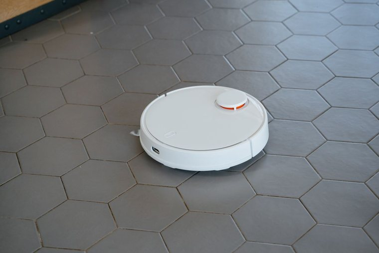
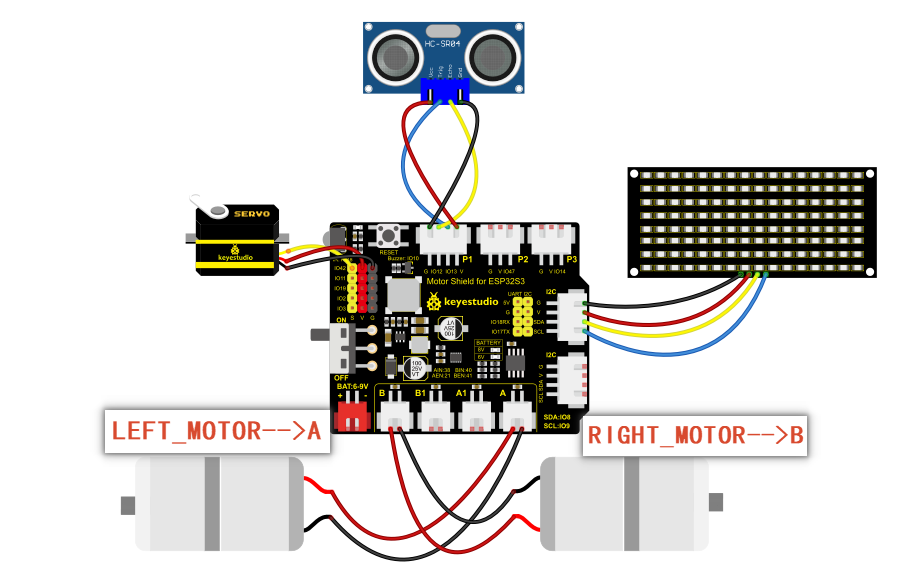
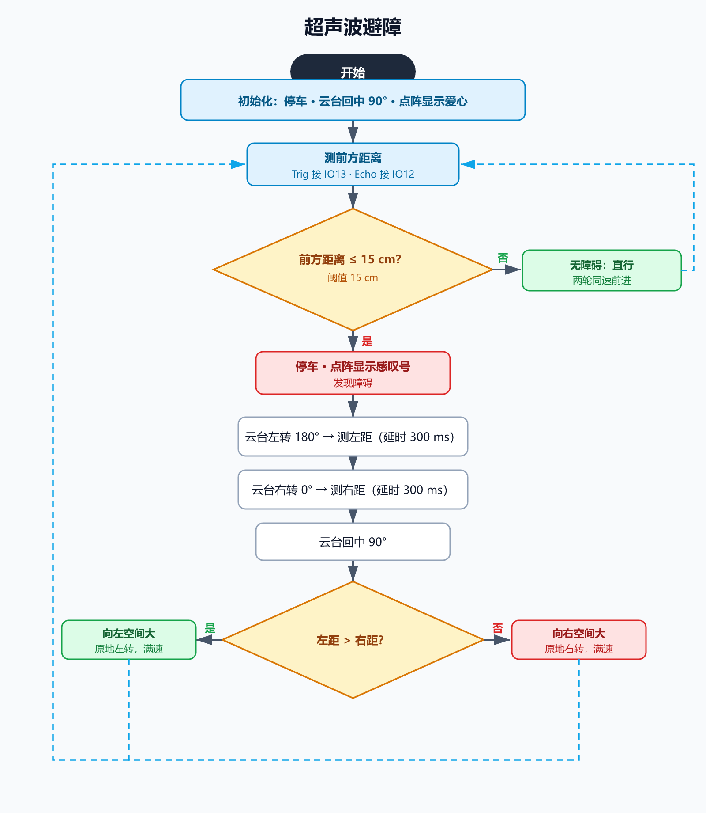

### Project 4: Ultrasonic Obstacle Avoidance

#### **1. Introduction:**

{width=520px}

Ultrasound for eyes, a servo for a neck, motors for legs, and the dot matrix for a face — all four parts take the stage together for the first time: the car reads the road for itself and decides which way to go around.

There is only one line of judgement: anything within 15 cm ahead counts as an obstacle. Past that line the car does not push stubbornly forward — it stops, swings the pan-tilt to each side for one reading apiece, and heads toward whichever side is more open. Between the two readings it leaves 300 ms so the servo can settle, and only then do the numbers count.

Eight actions chain together one after the other: go straight, measure distance, stop, look left, look right, compare, turn, return to center. Get that order straight and the code that follows writes itself.

A book stood up in front of the car is all you need to try it: with the way clear it drives straight and the dot matrix shows a heart; push it to within 15 cm of the book and it stops, flashes an exclamation mark, turns the pan-tilt to one side with a looking-left icon, measures, turns to the other side with a looking-right icon, measures again, compares both sides, turns toward the more open side for half a second, recenters and carries on. Move the book to the car's other side and it will go around the opposite way.

#### **2. Parts list:**

The parts used in this lesson:

|     |     |     |
| :---: | :---: | :---: |
| {width=170px}<br><span style="font-size:0.85em">Ultrasonic module (with housing) ×1</span> | {width=170px}<br><span style="font-size:0.85em">9G servo (180°, with cross horn) ×1</span> | {width=170px}<br><span style="font-size:0.85em">DRV8835 motor expansion board ×1</span> |
| {width=170px}<br><span style="font-size:0.85em">Tracked chassis assembly ×1</span> | {width=170px}<br><span style="font-size:0.85em">8×16 LED dot matrix display ×1</span> | {width=170px}<br><span style="font-size:0.85em">ESP32-S3 development board ×1</span> |
> ⚠️ **These parts were already fitted on the car in Chapter 2. This table is for reference only — nothing needs to be taken off and put back; the wiring notes below merely show how the connections are made, again for reference, so no assembly or disassembly is required. For the complete parts list, see the kit list in Section 1.4.**
#### **3. Parameters:**

| Item | Value |
| --- | --- |
| Ultrasonic | Trig = IO13, Echo = IO12 |
| Pan-tilt servo | IO42, 50 Hz, pulse width 500–2400 µs for 0–180° |
| Obstacle threshold | closeDistance = 15 cm (≤ 15 cm counts as an obstacle) |
| Left/right measuring angle | 180° left, 0° right, return to 90° center after measuring |
| Servo settling delay | 300 ms after each turn |
| Forward speed | goForward(150) |
| Turning speed | spinLeft / spinRight(255), for 500 ms |
| Dot matrix pins | CLK = IO9, DIN = IO8 |
| Debug serial | 115200 |

#### **4. Wiring:**

| Module | Pin | Controller GPIO |
| --- | --- | :---: |
| Ultrasonic | Trig / Echo | IO13 / IO12 |
| Pan-tilt servo | Signal | IO42 |
| Left motor (channel A, AIN/AEN) | Direction / speed | IO38 / IO21 |
| Right motor (channel B, BIN/BEN) | Direction / speed | IO40 / IO41 |
| Dot matrix | CLK / DIN | IO9 / IO8 |

> **Note**: the components in the wiring diagram serve only to illustrate the connections. In practice you do not need to open up any of the housed components in the parts list.

> **Note**: the ESP32Servo library uses `ESP32PWM::allocateTimer(0)` to allocate a timer dedicated to the servo, avoiding conflicts with the motor PWM.



#### **5. Flowchart:**

The main loop has a single chain of decisions: measure ahead first and keep going if there is room; if not, stop, look to each side, turn toward the wider one, then go back to measuring.



#### **6. Test code:**

```cpp
#include <ESP32Servo.h>  // Servo library

Servo myServo;  // Pan-tilt servo

// ===== Dot matrix display pins =====
#define CLK_Pin 9   // Clock, connect to dot matrix CLK
#define DIN_Pin 8   // Data, connect to dot matrix DIN

// ===== Ultrasonic module pins =====
const int trigPin = 13;  // Trigger, IO13
const int echoPin = 12;  // Echo, IO12

// Servo signal, GPIO42
const int servoPin = 42;

// ===== Distance thresholds =====
// Less than 15 cm counts as an obstacle; stop and measure left/right
const long closeDistance = 15;

long rightDistance = 0;  // Right-side distance
long leftDistance = 0;   // Left-side distance

// ===== Motor pins =====
#define MOTOR_AIN 38  // Left motor direction
#define MOTOR_AEN 21  // Left motor speed control
#define MOTOR_BIN 40  // Right motor direction
#define MOTOR_BEN 41  // Right motor speed control

// ===== Font bitmaps (16 columns x 8 rows) =====
// Heart: forward
unsigned char heart[] = {
  0x00, 0x00, 0x00, 0x00, 0x08, 0x1c, 0x3e, 0x7c,
  0x7c, 0x3e, 0x1c, 0x08, 0x00, 0x00, 0x00, 0x00
};

// Exclamation mark: obstacle ahead
unsigned char alert_sign[] = {
  0x00, 0x00, 0x00, 0x00, 0x00, 0x00, 0x00, 0x5f,
  0x5f, 0x00, 0x00, 0x00, 0x00, 0x00, 0x00, 0x00
};

// Look left: measure distance turning left
unsigned char look_left[] = {
  0x00, 0x00, 0x3c, 0x4e, 0x4e, 0x42, 0x3c, 0x00,
  0x00, 0x3c, 0x4e, 0x4e, 0x42, 0x3c, 0x00, 0x00
};

// Look right: measure distance turning right
unsigned char look_right[] = {
  0x00, 0x00, 0x3c, 0x42, 0x4e, 0x4e, 0x3c, 0x00,
  0x00, 0x3c, 0x42, 0x4e, 0x4e, 0x3c, 0x00, 0x00
};

// Down arrow: backward
unsigned char arrow_down[] = {
  0x00, 0x00, 0x00, 0x00, 0x10, 0x30, 0x7e, 0xfe,
  0xfe, 0x7e, 0x30, 0x10, 0x00, 0x00, 0x00, 0x00
};

// Left arrow: turn left
unsigned char arrow_left[] = {
  0x00, 0x00, 0x00, 0x18, 0x3c, 0x7e, 0xff, 0x18,
  0x18, 0x18, 0x18, 0x18, 0x18, 0x00, 0x00, 0x00
};

// Right arrow: turn right
unsigned char arrow_right[] = {
  0x00, 0x00, 0x00, 0x18, 0x18, 0x18, 0x18, 0x18,
  0x18, 0xff, 0x7e, 0x3c, 0x18, 0x00, 0x00, 0x00
};

void setup() {
  Serial.begin(115200);
  Serial.println("Ultrasonic obstacle avoidance started");

  // Initialize dot matrix pins and clear display
  pinMode(CLK_Pin, OUTPUT);
  pinMode(DIN_Pin, OUTPUT);
  digitalWrite(CLK_Pin, HIGH);
  digitalWrite(DIN_Pin, HIGH);
  unsigned char clear_data[16] = {0};
  matrix_display(clear_data);

  pinMode(trigPin, OUTPUT);  // Trig output
  pinMode(echoPin, INPUT);   // Echo input

  // Direction pins as output
  pinMode(MOTOR_BIN, OUTPUT);
  pinMode(MOTOR_AIN, OUTPUT);

  // Speed pins PWM: 1 kHz, 8-bit
  ledcAttach(MOTOR_BEN, 1000, 8);
  ledcAttach(MOTOR_AEN, 1000, 8);

  // Stop on power on
  stopCar();

  // Dedicated servo timer to avoid conflict with motor PWM
  ESP32PWM::allocateTimer(0);
  myServo.setPeriodHertz(50);  // Servo 50 Hz
  // Pulse width 500~2400 µs corresponds to 0~180° (SG90 type)
  // For larger servos like MG995, just use attach(servoPin)
  myServo.attach(servoPin, 500, 2400);

  // Return to center and show the idle pattern
  myServo.write(90);
  matrix_display(heart);
  delay(1000);
}

void loop() {
  // Measure the distance ahead
  long distance = getDistance();

  Serial.print("Distance ahead: ");
  Serial.print(distance);
  Serial.println(" cm");

  if (distance <= closeDistance) {
    // Obstacle: stop and show the exclamation mark
    stopCar();
    matrix_display(alert_sign);
    delay(150);

    // Turn pan-tilt to one side and measure that side
    matrix_display(look_left);
    myServo.write(180);            // Pan-tilt turns to 180°
    delay(300);                    // Wait for the servo to reach position
    rightDistance = getDistance();
    delay(100);

    // Turn pan-tilt to the other side and measure that side
    matrix_display(look_right);
    myServo.write(0);              // Pan-tilt turns to 0°
    delay(300);
    leftDistance = getDistance();
    delay(100);

    myServo.write(90);             // Return to face forward

    // Turn toward the side with more space
    if (rightDistance > leftDistance) {
      spinRight(255);
    } else {
      spinLeft(255);
    }
    delay(500);

  } else {
    // No obstacle, keep moving forward
    goForward(150);
  }

  delay(100);
}

// Measure distance, return centimeters
int getDistance() {
  long duration;  // Round-trip time (µs)
  int distance;   // Distance (cm)

  // Pull low first for a clean start level
  digitalWrite(trigPin, LOW);
  delayMicroseconds(2);

  // 10 µs high pulse triggers emission
  digitalWrite(trigPin, HIGH);
  delayMicroseconds(10);
  digitalWrite(trigPin, LOW);

  // Echo HIGH pulse width is the round-trip time
  duration = pulseIn(echoPin, HIGH);

  // Speed of sound 0.034 cm/µs, divide by 2 to remove the return trip
  distance = duration * 0.034 / 2;

  // Set 0 if outside 2~300 cm
  if (distance < 2 || distance > 300) {
    distance = 0;
  }

  return distance;
}

// ===== Motor control =====
// Signed speed: forward / reverse / 0 stop
void driveMotors(int rightSpeed, int leftSpeed) {
  rightSpeed  = constrain(rightSpeed,  -255, 255);  // Clamp to ±255
  leftSpeed = constrain(leftSpeed, -255, 255);

  // Right wheel (channel B)
  if (rightSpeed >= 0) {
    digitalWrite(MOTOR_BIN, HIGH);
    ledcWrite(MOTOR_BEN, rightSpeed);
  } else {
    digitalWrite(MOTOR_BIN, LOW);
    ledcWrite(MOTOR_BEN, -rightSpeed);  // Direction is set by the direction pin; here only the duty cycle is given
  }

  // Left wheel (channel A)
  if (leftSpeed >= 0) {
    digitalWrite(MOTOR_AIN, HIGH);
    ledcWrite(MOTOR_AEN, leftSpeed);
  } else {
    digitalWrite(MOTOR_AIN, LOW);
    ledcWrite(MOTOR_AEN, -leftSpeed);
  }
}

// Each action is bound to a dot matrix pattern
void goForward(int speed)  {
  matrix_display(heart);        // Forward: heart
  driveMotors(speed, speed);
}

void goBackward(int speed) {
  matrix_display(arrow_down);   // Backward: down arrow
  driveMotors(-speed, -speed);
}

void spinRight(int speed)  {
  matrix_display(arrow_left);   // Spot turn right, dot matrix shows left arrow
  driveMotors(-speed, speed);
}

void spinLeft(int speed)   {
  matrix_display(arrow_right);  // Spot turn left, dot matrix shows right arrow
  driveMotors(speed, -speed);
}

void stopCar() {
  driveMotors(0, 0);            // Stop: duty cycle set to zero
}

// ===== Dot matrix driver (software I2C) =====
// Write the 16-byte font bitmap to the dot matrix display buffer
void matrix_display(unsigned char matrix_value[]) {
  // 0x40: write data mode, auto-increment address
  IIC_start();
  IIC_send(0x40);
  IIC_end();

  // 0xC0: display buffer start address 0
  IIC_start();
  IIC_send(0xC0);

  // Write 16 columns consecutively
  for (int i = 0; i < 16; i++) {
    IIC_send(matrix_value[i]);
  }
  IIC_end();

  // 0x8A: turn on display, maximum brightness
  IIC_start();
  IIC_send(0x8A);
  IIC_end();
}

// Start condition: DIN falling edge while CLK is HIGH
void IIC_start() {
  digitalWrite(CLK_Pin, HIGH);
  delayMicroseconds(3);
  digitalWrite(DIN_Pin, HIGH);
  delayMicroseconds(3);
  digitalWrite(DIN_Pin, LOW);
  delayMicroseconds(3);
}

// Send 1 byte, LSB first: set data when CLK is LOW, sample on rising edge
void IIC_send(unsigned char send_data) {
  for (int i = 0; i < 8; i++) {
    digitalWrite(CLK_Pin, LOW);
    delayMicroseconds(3);

    if (send_data & 0x01) {
      digitalWrite(DIN_Pin, HIGH);
    } else {
      digitalWrite(DIN_Pin, LOW);
    }
    delayMicroseconds(3);

    digitalWrite(CLK_Pin, HIGH);
    delayMicroseconds(3);

    send_data = send_data >> 1;
  }
}

// Stop condition: DIN rising edge while CLK is HIGH
void IIC_end() {
  digitalWrite(CLK_Pin, LOW);
  delayMicroseconds(3);
  digitalWrite(DIN_Pin, LOW);
  delayMicroseconds(3);
  digitalWrite(CLK_Pin, HIGH);
  delayMicroseconds(3);
  digitalWrite(DIN_Pin, HIGH);
  delayMicroseconds(3);
}
```

#### **7. Code walkthrough:**

**(1) The servo object and its dedicated pin**

```cpp
#include <ESP32Servo.h>  // Servo library

Servo myServo;  // Pan-tilt servo

// ===== Dot matrix display pins =====
#define CLK_Pin 9   // Clock, connect to dot matrix CLK
#define DIN_Pin 8   // Data, connect to dot matrix DIN

// ===== Ultrasonic module pins =====
const int trigPin = 13;  // Trigger, IO13
const int echoPin = 12;  // Echo, IO12

// Servo signal, GPIO42
const int servoPin = 42;
```

`Servo myServo;` declares a servo object, and every servo action below goes through it. The ESP32 has no hardware Servo timer like the Arduino Uno's, so you must use `ESP32Servo.h` — including `Servo.h` instead makes the compile fail immediately.

**(2) One threshold and two variables for distances**

```cpp
const long closeDistance = 15;

long rightDistance = 0;  // Right-side distance
long leftDistance = 0;   // Left-side distance
```

`closeDistance = 15` is the only decision line in this lesson: at 15 cm or less the code takes the avoidance branch, otherwise it goes straight. Lesson 5's following car works with four thresholds; here we keep the simple "either go or dodge" model.

The two distance variables use `long` rather than `int` to match the intermediate values inside `getDistance()` — `duration` there is a `long`, so using the wider type throughout saves you converting back and forth.

**(3) `getDistance()`: wrapping Lesson 3's measurement in a function**

```cpp
int getDistance() {
  long duration;  // Round-trip time (µs)
  int distance;   // Distance (cm)
```

Inside, the function is just like the previous lesson: pull low → 10 µs pulse → `pulseIn()` → ×0.034÷2 → set out-of-range readings to 0. The only difference is the final `return distance;`.

It is a function because this lesson needs **three measurements in a row** — front, left and right. As a function, three calls in the main loop are enough; written out flat you would have three identical blocks, and changing one would easily leave the other two untouched. `duration` and `distance` are declared inside the function, so each call gets fresh copies and they cannot contaminate one another.

**(4) Servo initialization in setup**

```cpp
  // Dedicated servo timer to avoid conflict with motor PWM
  ESP32PWM::allocateTimer(0);
  myServo.setPeriodHertz(50);  // Servo 50 Hz
  // Pulse width 500~2400 µs corresponds to 0~180° (SG90 type)
  // For larger servos like MG995, just use attach(servoPin)
  myServo.attach(servoPin, 500, 2400);
```

`allocateTimer(0)` reserves a hardware timer just for the servo — the motors already occupy the LEDC channels, and without a separate timer they compete for resources, showing up as a jittery servo or erratic motor speed. `setPeriodHertz(50)` is the standard servo period: a frame every 20 ms, with the pulse width deciding the angle.

`attach(pin, 500, 2400)` sets the pulse-width range to 500–2400 µs. Small servos like the SG90 commonly use 500–2400 or 500–2500 µs; with 500–2400 you cannot reach the extreme angles, but neither are you likely to grind the gears against the mechanical stops. With a larger servo such as the MG995 you can simply call `attach(servoPin)` and take the library's defaults.

**(5) The skeleton of loop: measure once, then split into two paths**

```cpp
void loop() {
  // Measure the distance ahead
  long distance = getDistance();

  Serial.print("Distance ahead: ");
  Serial.print(distance);
  Serial.println(" cm");

  if (distance <= closeDistance) {
```

The whole lesson's logic is this one fork: with distance greater than 15 cm it takes the `goForward(150)` in the `else` branch, and at 15 cm or less it enters the avoidance branch. `delay(100)` sits at the end of `loop()`, so every round lasts at least 100 ms and the serial port will not be flooded.

A zero here has two possible sources: something genuinely close ahead, or open space with no echo at all (the "out of range returns 0" convention set in Lesson 3). Both satisfy `<= 15` and both make the car stop and look around. This is not a bug — ultrasound simply cannot tell the two apart. Distinguishing them would take an extra check, such as recording whether `pulseIn()` timed out; this course does not go into it.

**(6) The avoidance branch: stop, then look left and right once each**

```cpp
    stopCar();
    matrix_display(alert_sign);
    delay(150);

    matrix_display(look_left);
    myServo.write(180);            // Pan-tilt turns to 180°
    delay(300);                    // Wait for the servo to reach position
    rightDistance = getDistance();
    delay(100);

    matrix_display(look_right);
    myServo.write(0);              // Pan-tilt turns to 0°
    delay(300);
    leftDistance = getDistance();
    delay(100);

    myServo.write(90);             // Return to face forward
```

First stop, switch the dot matrix to the exclamation mark, and wait 150 ms for the car to settle — it has inertia, and turning the head before it has stopped gives you a slanted measuring direction.

The pattern paired with `write(180)` is `look_left` (looking left), yet the value read goes into a variable called `rightDistance`; later `write(0)` goes with `look_right` and the variable `leftDistance`. **One of the two names is backwards** — no error will be raised, but it does affect the side-picking decision below. To check, lift the car off the ground and manually call `write(180)` to see which way the pan-tilt turns; that is quicker than reading the code.

Neither of the two `delay(300)` calls can be dropped: `myServo.write()` only tells the servo its target angle — the servo still has to travel there, and a 9G servo takes about 0.3 s to swing 180°. Measure before it arrives and you will still get the distance from the previous direction.

The two `delay(100)` calls that follow are a second wait: after the servo has settled, the last ultrasonic pulse still echoes around in the cavity, so give the sound a moment to die away or the reading comes out low.

**(7) Picking a side: turn toward the one with more space**

```cpp
    if (rightDistance > leftDistance) {
      spinRight(255);
    } else {
      spinLeft(255);
    }
    delay(500);
```

Compare the two readings and turn toward the larger one, at the full speed of 255. On a tie it takes the `else` — turning left. That is no typo; it gives the car a definite behavior when both sides are blocked, which is better than standing still.

`delay(500)` is the duration of the turn. With no encoder in the code, how far it turns can only be estimated as speed × time: 500 ms at full speed comes out around 60–90°; as the battery drops or the floor gets slippery, the same time produces a smaller angle. This is the only adjustable quantity in the lesson — add time if the turn falls short.

#### **8. What you should see:**

After power on, the pan-tilt returns to center, the dot matrix displays a heart and the car drives straight; each round prints **Distance ahead: XX cm** to the serial port:

1. **No obstacle** (distance > 15 cm): keep going straight, heart on the dot matrix.
2. **Obstacle ahead** (distance ≤ 15 cm): stop and flash the exclamation mark; swing the pan-tilt to one side, show the **look-left** icon and measure, then swing to the other side, show **look-right** and measure; compare the two distances, turn for 500 ms toward the side with more space, then recenter and carry straight on.

If the car steers around an obstacle in front instead of pushing against it, and the dot matrix state changes along with the actions, it is running correctly.

> [Image to be added] Photos of the running states — going straight, stopping at an obstacle, measuring to the left, measuring to the right, and turning to go around — one of each.

> [Image to be added] Screenshot of the serial distance output, showing how the values change before and after an obstacle.

#### **9. Troubleshooting:**

(1) The way ahead is plainly clear, yet the car stops, lights the exclamation mark and looks from side to side: `getDistance()` returns 0 when out of range, and 0 also satisfies `<= 15 cm`, so it is read as an obstacle. Change the condition to `distance > 0 && distance <= closeDistance` to keep 0 out.

(2) The pan-tilt turns but the reading is not straight to the side: you measured before the servo reached its position after `write(180)`. Those two `delay(300)` calls cannot be skipped — wait for the pan-tilt to settle before reading, and the direction will line up.

(3) While driving straight the nose stays crooked and the ultrasonic sensor looks off to an angle: you forgot `write(90)` to recenter after measuring left and right. Add that line after the distance comparison.

(4) The left/right decision is always backwards: the `look_left` pattern goes with `rightDistance`, so one of the two names is reversed. Lift the car off the ground and call `write(180)` manually to see which way the pan-tilt turns — quicker than reading the code.
