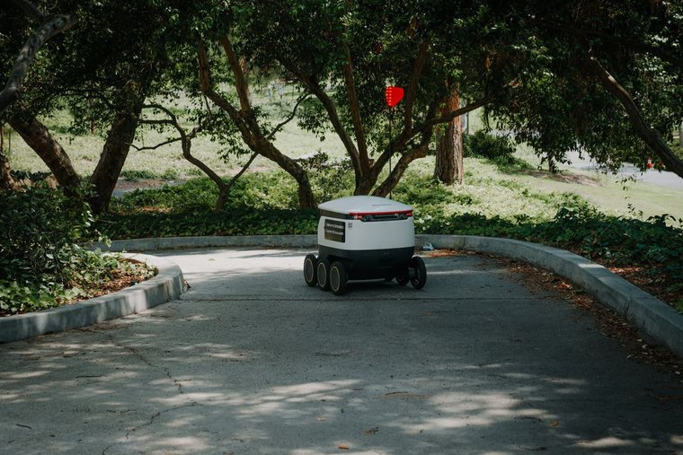
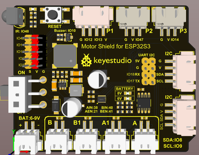
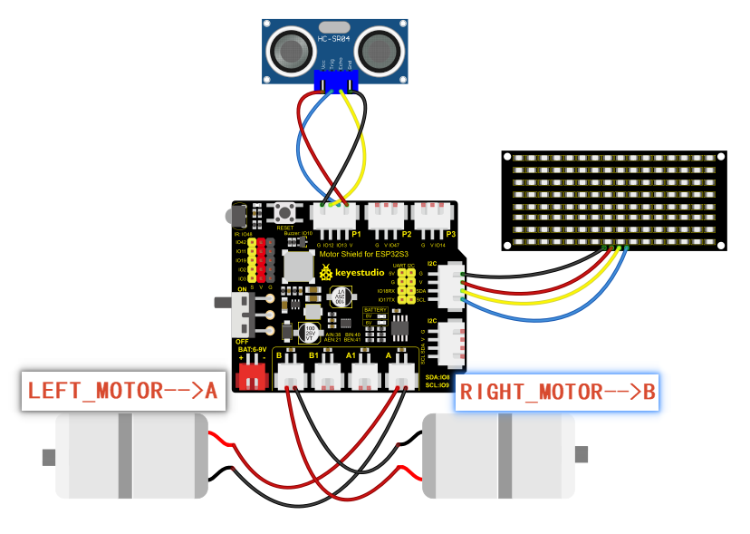
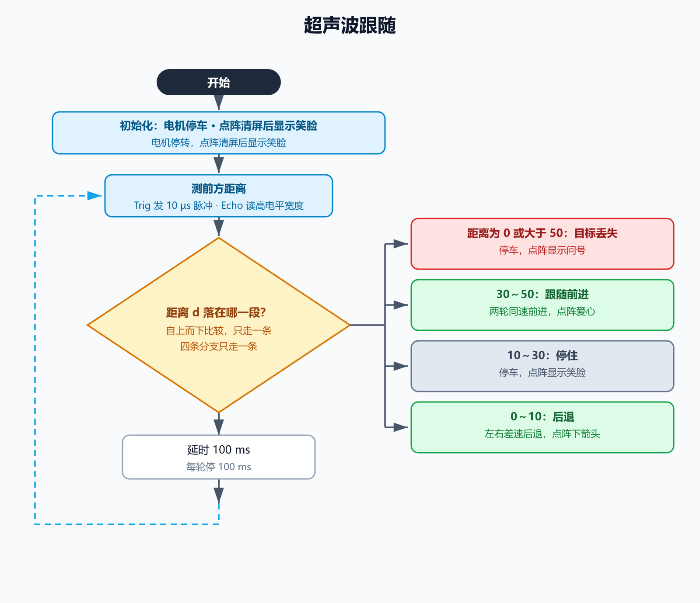

### 项目 5：超声波跟随

#### **1. 简介：**

{width=520px}

第 4 课的车遇到障碍会绕开走，这一课反过来，让它主动跟着人走：手伸到车头前 40 厘米，车跟上来；手往后退，它往前追；贴近到 10 厘米以内，它反而往后缩；手一拿走，它停住，点阵上跳出一个问号。

眼睛还是云台上那只超声波模块，每 100 毫秒往前打一发，用回声算出距离，再把这一个数字分成四段：30 到 50 厘米跟着走，10 到 30 厘米等着，10 厘米以内后退，超过 50 厘米或者读不到就当目标丢了。

四段各对应一个动作和一张表情——爱心、笑脸、下箭头、问号。没有遥控器，也没有循迹线，车只凭这一个数字决定进退；手掌在车前推近再拉远，能看到它在这四段之间来回切。

#### **2. 所需清单：**

本课用到的器件：

|     |     |     |
| :---: | :---: | :---: |
| {width=170px}<br><span style="font-size:0.85em">超声波模块（带外壳） ×1</span> | {width=170px}<br><span style="font-size:0.85em">8×16 LED 点阵屏 ×1</span> | {width=170px}<br><span style="font-size:0.85em">DRV8835 电机扩展板 ×1</span> |
| {width=170px}<br><span style="font-size:0.85em">履带底盘总成（履带 + 电机 + 轮子） ×1</span> | {width=170px}<br><span style="font-size:0.85em">ESP32-S3 开发板 ×1</span> |  |
> ⚠️ **这些器件在第 2 章已经装好在车上，本表只作对照，不用拆下来重装；下面的接线说明只标清接线方式，供对照，不必拆装。完整物料见 1.4 套件清单。**
#### **3. 参数：**

| 项目 | 参数 |
| --- | --- |
| 跟随区间 | 30～50 cm，前进 |
| 停止区间 | 10～30 cm，停车显示笑脸 |
| 后退区间 | 小于 10 cm，后退 |
| 目标丢失 | 大于 50 cm 或读数无效，停车显示问号 |
| 测距周期 | 100 ms |
| 前进速度 | 左右轮各 150 |
| 后退速度 | 左轮 105、右轮 150（后退时车身略偏） |
| 串口波特率 | 115200 |
| 点阵图标 | 爱心=跟随，笑脸=停止，下箭头=后退，问号=丢失 |

#### **4. 接线说明：**

| 模块 | 引脚 | 主控 GPIO |
| --- | --- | :---: |
| 超声波 | Trig | IO13 |
| 超声波 | Echo | IO12 |
| 点阵 | CLK | IO9 |
| 点阵 | DIN | IO8 |
| 左轮电机 | AIN（方向） | IO38 |
| 左轮电机 | AEN（调速） | IO21 |
| 右轮电机 | BIN（方向） | IO40 |
| 右轮电机 | BEN（调速） | IO41 |

> **注意**：接线图中的元器件只用于说明接线关系，实际接线时不需要把清单中带外壳的元器件拆开。



#### **5. 流程图：**

主循环只有一条判断链，四个区间各对应一组动作：



#### **6. 测试代码：**

```cpp
// ===== 点阵屏引脚 =====
#define CLK_Pin 9   // 时钟，接点阵 CLK
#define DIN_Pin 8   // 数据，接点阵 DIN

// ===== 超声波引脚 =====
const int trigPin = 13;  // 触发脚，接 IO13
const int echoPin = 12;  // 回响脚，接 IO12

// ===== 距离档位（cm）=====
// 跟随按三个阈值分档
const long safeDistance = 30;   // 30~50：跟随
const long closeDistance = 10;  // 小于 10：后退
const long maxDistance = 50;    // 大于 50：目标丢失

// ===== 电机引脚 =====
#define MOTOR_AIN 38  // 左电机方向
#define MOTOR_AEN 21  // 左电机调速
#define MOTOR_BIN 40  // 右电机方向
#define MOTOR_BEN 41  // 右电机调速

// ===== 字模（16 列 × 8 行）=====
// 爱心：跟随前进
unsigned char heart[] = {
  0x00, 0x00, 0x00, 0x00, 0x08, 0x1c, 0x3e, 0x7c,
  0x7c, 0x3e, 0x1c, 0x08, 0x00, 0x00, 0x00, 0x00
};

// 笑脸：距离合适，停止
unsigned char smile[] = {
  0x00, 0x00, 0x1C, 0x02, 0x02, 0x02, 0x5C, 0x40,
  0x40, 0x5C, 0x02, 0x02, 0x02, 0x1C, 0x00, 0x00
};

// 向下箭头：太近后退
unsigned char arrow_down[] = {
  0x00, 0x00, 0x00, 0x00, 0x10, 0x30, 0x7e, 0xfe,
  0xfe, 0x7e, 0x30, 0x10, 0x00, 0x00, 0x00, 0x00
};

// 问号：目标丢失
unsigned char question_mark[] = {
  0x00, 0x00, 0x00, 0x00, 0x00, 0x04, 0x02, 0x51,
  0x59, 0x06, 0x00, 0x00, 0x00, 0x00, 0x00, 0x00
};

void setup() {
  Serial.begin(115200);
  Serial.println("超声波跟随启动");

  // 点阵引脚初始化并清屏
  pinMode(CLK_Pin, OUTPUT);
  pinMode(DIN_Pin, OUTPUT);
  digitalWrite(CLK_Pin, HIGH);
  digitalWrite(DIN_Pin, HIGH);
  unsigned char clear_data[16] = {0};
  matrix_display(clear_data);

  pinMode(trigPin, OUTPUT);  // Trig 输出
  pinMode(echoPin, INPUT);   // Echo 输入

  // 方向脚输出
  pinMode(MOTOR_BIN, OUTPUT);
  pinMode(MOTOR_AIN, OUTPUT);

  // 调速脚 PWM：1 kHz，8 位
  ledcAttach(MOTOR_BEN, 1000, 8);
  ledcAttach(MOTOR_AEN, 1000, 8);

  // 上电停车并显示笑脸
  stopMotor();
  matrix_display(smile);
}

void loop() {
  // 测前方距离
  long distance = getDistance();

  Serial.print("当前距离：");
  Serial.print(distance);
  Serial.println(" cm");

  if (distance > safeDistance && distance <= maxDistance) {
    // 30~50 cm：跟随前进
    forward(150, 150);

  } else if (distance >= closeDistance && distance <= safeDistance) {
    // 10~30 cm：停止
    stopMotor();
    matrix_display(smile);

  } else if (distance < closeDistance && distance > 0) {
    // 小于 10 cm：后退
    // 左右差速，后退时车身略偏
    back(105, 150);

  } else {
    // 大于 50 cm 或读数无效：停车显示问号
    stopMotor();
    matrix_display(question_mark);
  }

  // 100 ms 测一次
  delay(100);
}

// 测距，返回厘米
int getDistance() {
  long duration;  // 往返时间（µs）
  int distance;   // 距离（cm）

  // 先拉低，保证起始电平干净
  digitalWrite(trigPin, LOW);
  delayMicroseconds(2);

  // 10 µs 高脉冲触发发波
  digitalWrite(trigPin, HIGH);
  delayMicroseconds(10);
  digitalWrite(trigPin, LOW);

  // Echo 高电平宽度即往返时间
  duration = pulseIn(echoPin, HIGH);

  // 声速 0.034 cm/µs，除以 2 去掉回程
  distance = duration * 0.034 / 2;

  // 超出 2~300 cm 置 0
  if (distance < 2 || distance > 300) {
    distance = 0;
  }

  return distance;
}

// ===== 电机控制 =====

// 直接写左右轮 PWM（0~255）
void setMotor(int rightSpeed, int leftSpeed) {
  ledcWrite(MOTOR_BEN, rightSpeed);
  ledcWrite(MOTOR_AEN, leftSpeed);
}

// 前进：方向脚拉高并显示爱心
void forward(int rightSpeed, int leftSpeed) {
  matrix_display(heart);
  digitalWrite(MOTOR_BIN, HIGH);
  digitalWrite(MOTOR_AIN, HIGH);
  setMotor(rightSpeed, leftSpeed);
}

// 后退：方向脚拉低并显示向下箭头
void back(int rightSpeed, int leftSpeed) {
  matrix_display(arrow_down);
  digitalWrite(MOTOR_BIN, LOW);
  digitalWrite(MOTOR_AIN, LOW);
  setMotor(rightSpeed, leftSpeed);
}

// 停止：速度置 0
void stopMotor() {
  setMotor(0, 0);
}

// ===== 点阵驱动（软件模拟 I2C）=====

// 将 16 字节字模写入点阵屏显存
void matrix_display(unsigned char matrix_value[]) {
  // 0x40：写数据模式，地址自增
  IIC_start();
  IIC_send(0x40);
  IIC_end();

  // 0xC0：显存起始地址 0
  IIC_start();
  IIC_send(0xC0);

  // 连写 16 列
  for (int i = 0; i < 16; i++) {
    IIC_send(matrix_value[i]);
  }
  IIC_end();

  // 0x8A：开显示，亮度最大
  IIC_start();
  IIC_send(0x8A);
  IIC_end();
}

// 起始条件：CLK 高电平期间 DIN 下降沿
void IIC_start() {
  digitalWrite(CLK_Pin, HIGH);
  delayMicroseconds(3);
  digitalWrite(DIN_Pin, HIGH);
  delayMicroseconds(3);
  digitalWrite(DIN_Pin, LOW);
  delayMicroseconds(3);
}

// 发送 1 字节，低位在前：CLK 低时置数据，上升沿采样
void IIC_send(unsigned char send_data) {
  for (int i = 0; i < 8; i++) {
    digitalWrite(CLK_Pin, LOW);
    delayMicroseconds(3);

    if (send_data & 0x01) {
      digitalWrite(DIN_Pin, HIGH);
    } else {
      digitalWrite(DIN_Pin, LOW);
    }
    delayMicroseconds(3);

    digitalWrite(CLK_Pin, HIGH);
    delayMicroseconds(3);

    send_data = send_data >> 1;
  }
}

// 停止条件：CLK 高电平期间 DIN 上升沿
void IIC_end() {
  digitalWrite(CLK_Pin, LOW);
  delayMicroseconds(3);
  digitalWrite(DIN_Pin, LOW);
  delayMicroseconds(3);
  digitalWrite(CLK_Pin, HIGH);
  delayMicroseconds(3);
  digitalWrite(DIN_Pin, HIGH);
  delayMicroseconds(3);
}
```

#### **7. 代码解释：**

**(1) 三个阈值划出四段**

```cpp
const long safeDistance = 30;   // 30~50：跟随
const long closeDistance = 10;  // 小于 10：后退
const long maxDistance = 50;    // 大于 50：目标丢失
```

三个数把距离切成四段：小于 10 后退、10～30 停、30～50 跟随前进、大于 50 视为目标丢失。数值之间的顺序是这套逻辑的全部，改一个就要重新想清楚相邻两段还接不接得上。

**(2) 测距直接复用第 3 课的写法**

```cpp
long distance = getDistance();
```

这一句在 `loop()` 开头，每轮循环都跑一次。`getDistance()` 内部与第 3 课逐字一致：拉低 → 10 µs 脉冲 → `pulseIn()` → ×0.034÷2 → 超量程置 0。返回 0 的含义也一样——要么没回波，要么太近，都不可信。

**(3) 四条 `if` 从上往下比，只走一条**

```cpp
  if (distance > safeDistance && distance <= maxDistance) {
    // 30~50 cm：跟随前进
    forward(150, 150);

  } else if (distance >= closeDistance && distance <= safeDistance) {
    // 10~30 cm：停止
    stopMotor();
    matrix_display(smile);

  } else if (distance < closeDistance && distance > 0) {
    // 小于 10 cm：后退
    back(105, 150);

  } else {
    // 大于 50 cm 或读数无效：停车显示问号
    stopMotor();
    matrix_display(question_mark);
  }
```

四个判断靠 `else if` 串成一条链，前面的条件一旦成立，后面的就不再看。所以**顺序不能换**：把"小于 10"提到最前面，30～50 那段就会被它先截走一部分。

每个条件的上下界都写全了（`> 30` 配 `<= 50`，不是只写上限），所以 30 这个点只会落进第二档，不会两档都进。

最后一档 `else` 兜的是两种情况：距离大于 50 cm，或者**读数等于 0**。注意第三条特意加了 `distance > 0`——没这个判断，0 cm 会满足 `distance < closeDistance`，车会把"前方空旷没回波"当成"贴脸障碍"然后猛退。加了 `> 0` 之后，0 就掉到 `else`，显示问号、原地不动，这是对"数据不可信"最保守的处理。

**(4) `setMotor()` 只写 PWM，不碰方向**

```cpp
void setMotor(int rightSpeed, int leftSpeed) {
  ledcWrite(MOTOR_BEN, rightSpeed);
  ledcWrite(MOTOR_AEN, leftSpeed);
}
```

这是底层，只干一件事：把两个绝对值写进 PWM。方向脚它一根都不碰，所以两个参数必须是正数——`ledcWrite()` 收负数会溢出成一个很大的值。

和第 2 课的 `driveMotors()` 比，这里**不做符号判断**。方向交给上层：`forward()` 把两根方向脚拉高，`back()` 把它们拉低。

**(5) 方向脚在 `forward()` / `back()` 里定**

```cpp
void forward(int rightSpeed, int leftSpeed) {
  matrix_display(heart);
  digitalWrite(MOTOR_BIN, HIGH);
  digitalWrite(MOTOR_AIN, HIGH);
  setMotor(rightSpeed, leftSpeed);
}

void back(int rightSpeed, int leftSpeed) {
  matrix_display(arrow_down);
  digitalWrite(MOTOR_BIN, LOW);
  digitalWrite(MOTOR_AIN, LOW);
  setMotor(rightSpeed, leftSpeed);
}
```

顺序是"先定方向、再给速度、顺手换图"。两根方向脚一起动，所以只能直着走或直着退，这课不需要转弯。

只调 `setMotor()` 而方向脚还停在上一轮的值，车会按上一次的方向跑——这是调试时最常踩的坑。

**(6) 后退时左右给得不一样**

```cpp
    back(105, 150);
```

差速不是写错了。直线后退时车会一路退到彻底看不见障碍，然后猛地停住；右边给 150、左边给 105，让它退的同时车头往一侧偏，退出来就带着一个角度，下一轮更容易看到空档。

第 4 课的避障是"停下来左看右看"，这课是"边退边偏"，两种思路都对。

**(7) 100 ms 的节拍**

```cpp
  delay(100);
```

一个循环 100 ms，每秒测 10 次。目标以 1 m/s 靠近时，两轮之间只移动 10 cm，小于最窄的那一档（10 cm），不会整档跳过去。把 `delay` 改大到 300 ms 以上，快速靠近的物体会直接从"跟随"跳进"贴脸"，中间那档停不住。

#### **8. 运行现象：**

上电后点阵先亮笑脸，串口每 100 ms 打印一行：

```text
超声波跟随启动
当前距离：42 cm
当前距离：41 cm
当前距离：18 cm
当前距离：7 cm
当前距离：0 cm
```

对着车头做四个动作，能看到四种反馈：

| 手的动作 | 距离读数 | 车的行为 | 点阵 |
| --- | --- | --- | --- |
| 停在 30～50 cm | 30～50 | 向前跟 | 爱心 |
| 停在 10～30 cm | 10～30 | 停住 | 笑脸 |
| 贴到 10 cm 以内 | 小于 10 | 往后退 | 向下箭头 |
| 手掌拿开 | 0 或大于 50 | 停住 | 问号 |

> 【图片待补】串口监视器里四段距离读数的截图，能看出跟随、停止、后退三种状态切换。

如果车在你靠近时反而往前冲，先查超声波两根线有没有插反：Trig 和 Echo 对调后读数会一直是 0。

#### **9. 常见问题解决：**

(1) 手越靠近车反而往前冲：Trig 和 Echo 接反了，读数一直是 0。按接线表把 4P 头的两根信号线换回来。

(2) 手在 30 cm 附近晃，车在前进和停车之间来回抽：三档阈值贴得太紧，`safeDistance` 和 `maxDistance` 之间留够余量。

(3) 车一直显示问号不动：串口里的距离是 0 或者大于 50 cm，两种情况都落进最后的 `else`。手放到 10～50 cm 之间再试；想跟得更远，把 `maxDistance` 加到 60。

(4) 后退时车总是往一侧偏：`back(105, 150)` 左右差速是故意的，让它退出来带个角度，不是故障。
