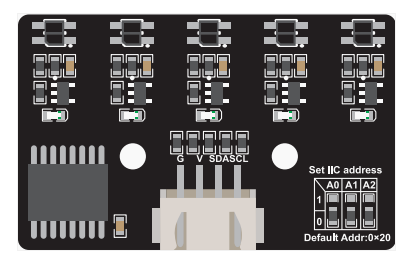

### Project 6: Line-Tracking Sensor

#### **1. Introduction:**

Turn the Mini Tracked Tank V4.0 over and you'll find five small black blocks along the side that faces the ground. Each one hides a pair of infrared tubes: one shines down, the other watches the light that bounces back. A white surface reflects; a black line swallows the light. The receiver turns that difference into a clean HIGH or LOW.

Giving each of those five sensors its own pin would eat up the controller board's spare pins, so they all hang off a single PCF8574 and send their readings back over just two wires (IO8, IO9). Those five channels are really five bits inside one byte, and put together they make a single number from 0 to 31.

Before letting the car run, just print the five channels to the serial port, one line every 200 ms. Put the car on white paper and all five read 0; cover one sensor with a finger or a strip of black tape and that bit becomes 1; lay the whole row across a black line and all five become 1.

Those five 0s and 1s, laid out from left to right, are the car's entire knowledge of the floor beneath it — and the next lesson will drive using nothing else.

#### **2. Parts List:**
Parts used in this lesson:

|     |     |
| :---: | :---: |
| <br><span style="font-size:0.85em">Mini tracked tank robot bottom assembly ×1</span> | <br><span style="font-size:0.85em">DRV8835 motor expansion board ×1</span> |
| <br><span style="font-size:0.85em">ESP32-S3 development board ×1</span> | <br><span style="font-size:0.85em">5-way IIC line-tracking sensor module ×1</span> |

> ⚠️ **This sensor was already fixed in place and wired when the chassis was assembled in Chapter 2. This table is for reference only — do not remove it. The wiring notes below only show how the connections are made, for reference; no disassembly is needed. For the full parts list, see 1.4 Kit List.**

#### **3. Parameters:**
| Item | Parameter |
| --- | --- |
| Expansion chip | PCF8574, I2C to 8-bit parallel |
| I2C address | 0x20 (A2, A1 and A0 all tied to ground) |
| SDA / SCL | IO8 / IO9 |
| Bus speed | 400 kHz (fast mode) |
| Channels used | 5: P4 P0 P1 P2 P3 (left → right) |
| Logic level | 0 when over a black line, inverted to 1 in code |
| Print period | 200 ms |

#### **4. Wiring:**

| Signal | Controller GPIO | Notes |
| --- | :---: | --- |
| SDA | IO8 | Shared with the dot matrix DIN; the dot matrix is not used in this lesson |
| SCL | IO9 | Shared with the dot matrix CLK; the dot matrix is not used in this lesson |
| VCC | 5V | Supplied by the expansion board |
| GND | GND | Common ground |


#### **5. Flowchart:**

The read takes only three steps, but bit order and inversion are the two easiest things to get wrong:


#### **6. Test Code:**
```cpp
#include <Wire.h>
#include <PCF8574.h>

PCF8574 pcf8574(0x20);

#define OUTA P4  // Far left
#define OUTB P0  // Left
#define OUTC P1  // Center
#define OUTD P2  // Right
#define OUTE P3  // Far right

void setup() {
  Serial.begin(115200);
  Wire.begin();
  Wire.setClock(400000);

  pcf8574.begin();
  pcf8574.pinMode(OUTA, INPUT);
  pcf8574.pinMode(OUTB, INPUT);
  pcf8574.pinMode(OUTC, INPUT);
  pcf8574.pinMode(OUTD, INPUT);
  pcf8574.pinMode(OUTE, INPUT);

  delay(1000);
}

void loop() {
  PCF8574::DigitalInput val = pcf8574.digitalReadAll();

  int A = !val.p4; // Far left
  int B = !val.p0; // Left
  int C = !val.p1; // Center
  int D = !val.p2; // Right
  int E = !val.p3; // Far right

  Serial.printf("A:%d  B:%d  C:%d  D:%d  E:%d\n", A, B, C, D, E);

  delay(200);
}
```

#### **7. Code Explanation:**
**(1) Two header files and one chip object**

```cpp
#include <Wire.h>
#include <PCF8574.h>

PCF8574 pcf8574(0x20);
```

The five infrared pairs of the line-tracking sensor don't connect to the controller directly; they all go to a single PCF8574. That chip is an 8-bit I2C-to-parallel port, and `0x20` is its slave address — there are jumpers on the board to change it, so change this number too if you move them. With just the SDA/SCL two wires, the controller can read all eight pins at once.

**(2) The five pin numbers are not in sequential order**

```cpp
#define OUTA P4  // Far left
#define OUTB P0  // Left
#define OUTC P1  // Center
#define OUTD P2  // Right
#define OUTE P3  // Far right
```

The far-left channel is **P4**; the other four are P0 to P3. That's fixed by the expansion board's wiring and can't be changed. If you map P0–P4 to "left to right" in order, every position will be off by one and the line tracking in Lesson 7 will immediately run off the track.

**(3) Raising I2C to 400 kHz**

```cpp
  Wire.begin();
  Wire.setClock(400000);
```

These lines are in `setup()` and run only once at power-on. With no arguments, `Wire.begin()` uses the default pins IO8/IO9 — exactly the ones shared with the dot matrix. That's fine when the lessons are run separately; in Lesson 15 both have to live in one program, so `Wire.end()` is used to hand the bus back and forth.

`setClock(400000)` raises I2C to 400 kHz (fast mode), the PCF8574's upper limit. At the default 100 kHz a read takes 0.9 ms while line tracking needs a 5 ms cycle; after the speed-up, one byte takes only about 45 µs.

**(4) Declare them as inputs before reading**

```cpp
  pcf8574.begin();
  pcf8574.pinMode(OUTA, INPUT);
  pcf8574.pinMode(OUTB, INPUT);
  pcf8574.pinMode(OUTC, INPUT);
  pcf8574.pinMode(OUTD, INPUT);
  pcf8574.pinMode(OUTE, INPUT);
```

These six lines are also in `setup()`, right after `Wire.begin()`. PCF8574 pins are quasi-bidirectional: they drive strongly as outputs, but as inputs you must first write a 1 to put them in a high-impedance state so an external circuit can pull the line low. The library's `pinMode(pin, INPUT)` writes that 1 for you.

**Skip this and every reading comes back 0**. It looks as if all five sensors are on the line, when in fact the pins are holding themselves down. None of the five lines can be omitted.

**(5) Read all 8 bits in one go, not five separate reads**

```cpp
  PCF8574::DigitalInput val = pcf8574.digitalReadAll();
```

`digitalReadAll()` issues one I2C read and returns all eight pins packed into a struct, with each pin as one bit (`val.p0` … `val.p7`). Calling `digitalRead()` bit by bit also works, but that's five I2C transactions and five times slower.

P5 to P7 are unused; their readings are meaningless, so ignore them.

**(6) Every channel needs a `!`**

```cpp
  int A = !val.p4; // Far left
  int B = !val.p0; // Left
  int C = !val.p1; // Center
  int D = !val.p2; // Right
  int E = !val.p3; // Far right
```

When an infrared pair is over a black line the reflection is weak and the module reads it as LOW — **seeing a line returns 0**. If you fed 0 straight into your logic, everything downstream would be inverted, so all five are negated here to make "1 = line detected".

**(7) `printf` prints the five values**

```cpp
  Serial.printf("A:%d  B:%d  C:%d  D:%d  E:%d\n", A, B, C, D, E);
```

`printf` is C's formatted output; `%d` is the placeholder for an integer, and the five `%d`s match the five variables that follow in order. The two spaces in between keep the numbers aligned in the Serial Monitor so you can see at a glance which channel changed.

**(8) One read every 200 ms**

```cpp
  delay(200);
```

Five lines per second make it easy to see which channel changes first as you draw a line. Remove the delay and the Serial Monitor scrolls too fast to read, which makes judgement harder, not easier.

#### **8. Expected Behavior:**

After power-on the Serial Monitor prints a line every 200 ms; the five numbers correspond to the five sensors from left to right:

```text
A:0  B:0  C:1  D:0  E:0
A:0  B:1  C:1  D:0  E:0
A:0  B:1  C:0  D:1  E:0
A:1  B:1  C:1  D:1  E:1
```

With the car on white paper all five read 0; with a finger or a piece of black tape under one sensor that position reads 1; with the whole row over a black line all five read 1.

> [Image to be added] A photo of the whole car sitting on the black line-tracking tape with all five serial readings at 1 (including the Serial Monitor).

#### **9. Troubleshooting:**

(1) All five numbers in the Serial Monitor stay at 0, unchanged by a finger: first check that the line-tracking board's 4P plug is fully seated, then check whether SDA / SCL are reversed. `Wire.begin()` uses IO8/IO9; reversing them won't damage the board, but you won't read a single byte.

(2) Readings occasionally jump: the sensors sit too high or the ambient light is too strong. Line tracking relies on reflected light; keep the sensors 5–8 mm above the floor. Direct noon sunlight makes them read white constantly, so move into the shade and try again.

(3) All five are 0 or all five are 1: all 0 means no power or I2C failed to start; all 1 means all five channels are over a black line, or the sensors are so close to the floor that they're touching it.
