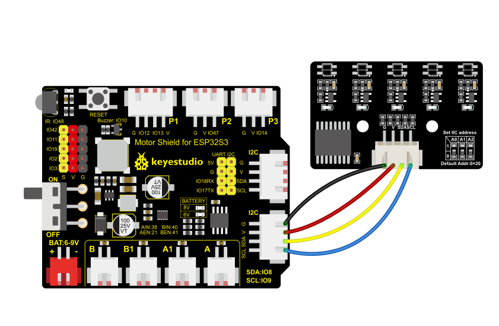
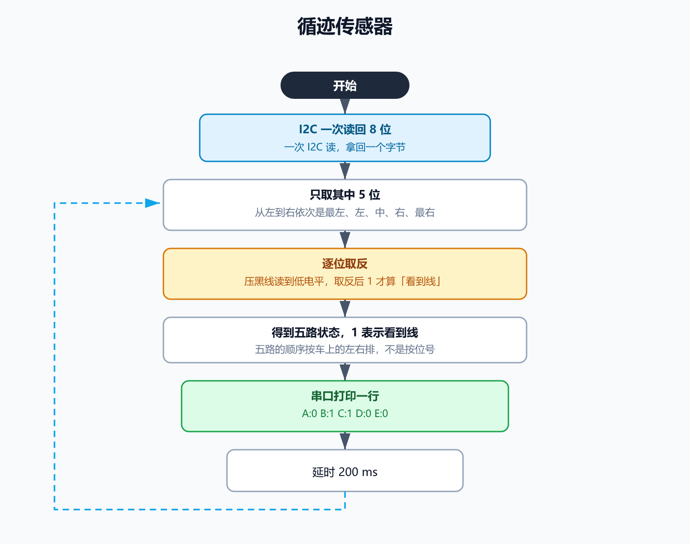

### 项目 6：循迹传感器

#### **1. 简介：**

把车翻过来，朝地面那一面有一排五只黑色小方块。每只里面是一对红外管：一只往下照，一只看反射回来的光——地面白就反光，黑就吸掉，接收管把这个差别变成高电平或低电平。

五只探头要是各占一根引脚，主控又得腾地方，所以它们全挂在一颗 PCF8574 上，只用两根线（IO8、IO9）把读数送回来。这五路其实是一个字节里的五个位，拼起来就是从 0 到 31 的一个数。

先不急着让车跑，只把五路读数打到串口上，每 200 毫秒一行。车放在白纸上五个都是 0；用手指或黑胶带挡在哪颗探头下面，对应那一位就变 1；整排压在黑线上，五个全变 1。

五个 0 和 1 从左到右排开，就是车对脚下地面的全部认知——下一课开车要靠它。

#### **2. 所需清单：**

本课用到的器件：

|   |   |   |
| :---: | :---: | :---: |
| {width=170px}<br><span style="font-size:0.85em">履带底盘总成（含循迹传感器） ×1</span> | {width=170px}<br><span style="font-size:0.85em">DRV8835 电机扩展板 ×1</span> | {width=170px}<br><span style="font-size:0.85em">ESP32-S3 开发板 ×1</span> |

> ⚠️ **这套传感器在第 2 章装配底盘时已经固定好、线也走好了，本表只作对照，不用拆；下面的接线说明只标清接线方式，供对照，不必拆装。完整物料见 1.4 套件清单。**
我

#### **3. 参数：**

| 项目 | 参数 |
| --- | --- |
| 扩展芯片 | PCF8574，I2C 转 8 位并行 |
| I2C 地址 | 0x20（A2 A1 A0 全接地） |
| SDA / SCL | IO8 / IO9 |
| 总线速率 | 400 kHz（快速模式） |
| 使用通道 | 5 路：P4 P0 P1 P2 P3（左 → 右） |
| 电平逻辑 | 压黑线读 0，代码取反后为 1 |
| 打印周期 | 200 ms |

#### **4. 接线说明：**

| 信号 | 主控 GPIO | 说明 |
| --- | :---: | --- |
| SDA | IO8 | 与点阵 DIN 共用，本课不用点阵 |
| SCL | IO9 | 与点阵 CLK 共用，本课不用点阵 |
| VCC | 5V | 由扩展板供给 |
| GND | GND | 共地 |



#### **5. 流程图：**

读取流程只有三步，但位序和取反两处最容易弄错：



#### **6. 测试代码：**

```cpp
#include <Wire.h>
#include <PCF8574.h>

PCF8574 pcf8574(0x20);

#define OUTA P4  // 最左
#define OUTB P0  // 左
#define OUTC P1  // 中
#define OUTD P2  // 右
#define OUTE P3  // 最右

void setup() {
  Serial.begin(115200);
  Wire.begin();
  Wire.setClock(400000);

  pcf8574.begin();
  pcf8574.pinMode(OUTA, INPUT);
  pcf8574.pinMode(OUTB, INPUT);
  pcf8574.pinMode(OUTC, INPUT);
  pcf8574.pinMode(OUTD, INPUT);
  pcf8574.pinMode(OUTE, INPUT);

  delay(1000);
}

void loop() {
  PCF8574::DigitalInput val = pcf8574.digitalReadAll();

  int A = !val.p4; // 最左
  int B = !val.p0; // 左
  int C = !val.p1; // 中
  int D = !val.p2; // 右
  int E = !val.p3; // 最右

  Serial.printf("A:%d  B:%d  C:%d  D:%d  E:%d\n", A, B, C, D, E);

  delay(200);
}
```

#### **7. 代码解释：**

**(1) 两个头文件和一个芯片对象**

```cpp
#include <Wire.h>
#include <PCF8574.h>

PCF8574 pcf8574(0x20);
```

循迹传感器的五对红外管不是直接接主控，而是全接到一颗 PCF8574 上。这颗芯片是 8 位 I2C 转并行口，`0x20` 是它的从机地址——板上有跳线可以改，改了就跟着改这个数。主控只用 SDA/SCL 两根线，就能一次读到 8 个引脚的电平。

**(2) 五路引脚的编号不是按顺序排的**

```cpp
#define OUTA P4  // 最左
#define OUTB P0  // 左
#define OUTC P1  // 中
#define OUTD P2  // 右
#define OUTE P3  // 最右
```

最左边那一路接的是 **P4**，剩下四路才是 P0～P3。这是扩展板布线定的，改不了。按 P0～P4 的顺序去对应"最左到最右"，读出来的位置会整体错一位，第 7 课的循迹会直接跑飞。

**(3) I2C 提到 400 kHz**

```cpp
  Wire.begin();
  Wire.setClock(400000);
```

这三句写在 `setup()` 里，上电只跑一次。`Wire.begin()` 不传参数时用的是默认引脚 IO8/IO9——正好和点阵共用。两课分开上没事，第 15 课要把它们塞进同一个程序，就得靠 `Wire.end()` 交替让路。

`setClock(400000)` 把 I2C 提到 400 kHz（快速模式），这是 PCF8574 的上限。默认的 100 kHz 读一次要 0.9 ms，循迹要 5 ms 读一轮，提速之后读一个字节只要约 45 µs。

**(4) 先说"当输入用"，再读**

```cpp
  pcf8574.begin();
  pcf8574.pinMode(OUTA, INPUT);
  pcf8574.pinMode(OUTB, INPUT);
  pcf8574.pinMode(OUTC, INPUT);
  pcf8574.pinMode(OUTD, INPUT);
  pcf8574.pinMode(OUTE, INPUT);
```

这六句也在 `setup()` 里，紧跟在 `Wire.begin()` 后面。PCF8574 的引脚是"准双向"的：输出时是强驱动，输入时必须先写 1 把它放成高阻态，外部电路才能把电平拉低。库里的 `pinMode(pin, INPUT)` 就是替你写这个 1。

**漏掉这一步读到全是 0**，看起来像"五路都压线"，其实是引脚被自己摁住了。五条一条都不能少。

**(5) 一次读回 8 位，不是读 5 次**

```cpp
  PCF8574::DigitalInput val = pcf8574.digitalReadAll();
```

`digitalReadAll()` 发一次 I2C 读，把 8 个引脚打包成一个结构体回来，里面每个引脚是一个位（`val.p0` … `val.p7`）。逐位调用 `digitalRead()` 也能用，但那是 5 次 I2C 事务，慢 5 倍。

P5～P7 这三路空着，读回来的值没有意义，不管它。

**(6) 每一路都要加 `!`**

```cpp
  int A = !val.p4; // 最左
  int B = !val.p0; // 左
  int C = !val.p1; // 中
  int D = !val.p2; // 右
  int E = !val.p3; // 最右
```

红外对管压到黑线上时反射弱，模块把这判成低电平——**看到线读到的是 0**。直接拿 0 去做判断，后面写逻辑全是反的，所以这里统一取反，让"1 = 看到线"。

取反只在这一处做，后面所有代码都按"1 有线"来理解，不要一会儿反一会儿不反。

拿白纸和黑胶带各扫一遍就能验证这一步：白纸上每一位都应是 1，黑线上对应位变 0。只有某一位始终不变，才是那一路的发射管或接收管坏了；五路全不变，先查 I2C 地址（0x20）和接线。

**(7) `printf` 打印五个值**

```cpp
  Serial.printf("A:%d  B:%d  C:%d  D:%d  E:%d\n", A, B, C, D, E);
```

`printf` 是 C 语言的格式化输出，`%d` 是整数的占位符，五个 `%d` 依次对上后面五个变量。中间那两个空格是为了让串口监视器里的数字对齐，方便肉眼比对哪一路变了。

**(8) 200 ms 读一轮**

```cpp
  delay(200);
```

每秒 5 行，划线时能看清是哪一路先变。去掉这个延时，串口会刷屏快到看不清，反而不好判断。

#### **8. 运行现象：**

上电后串口每 200 ms 打印一行，五个数字对应从左到右五个探头：

```text
A:0  B:0  C:1  D:0  E:0
A:0  B:1  C:1  D:0  E:0
A:0  B:1  C:0  D:1  E:0
A:1  B:1  C:1  D:1  E:1
```

把车放在白纸上，五个都是 0；用手指或黑胶带挡在某一颗探头下面，对应位置变 1；把整排压在黑线上，五个全变 1。

> 【图片待补】整车压在黑色循迹线上、串口五行全为 1 的实拍图（含串口画面）。

两个常见现象：

- 五个数一直是 0，手指挡上去也不变——先查 4P 插头有没有插到底，再查 SDA / SCL 是否插反。I2C 接反不会烧，但一个字节也读不回来。
- 读数偶尔跳变——探头离地太高（正常 5～8 mm）或环境光太强。循迹传感器靠反射光工作，正午的太阳直射会让它一直读到白。

#### **9. 常见问题解决：**

(1) 串口里五个数一直是 0，手指挡上去也不变：先查循迹板的 4P 插头有没有插到底，再看 SDA / SCL 是不是插反。`Wire.begin()` 用的是 IO8/IO9，接反不会烧板子，但一个字节也读不回来。

(2) 读数偶尔跳变：探头离地太高或者环境光太强。循迹靠反射光工作，探头离地保持 5～8 mm，正午太阳直射会让它一直读到白，挪到阴影里再试。

(3) 某一位始终不变、其余正常：那一路上要么是发射管、要么是接收管坏了。拿白纸和黑胶带各扫一遍，正常的话白纸上每一位都是 1、黑线上对应位变 0。

(4) 五路全 0 或全 1：全 0 是没插电或者 I2C 没起来；全 1 是五路都压着黑线，或者探头离地太近贴着地面。
