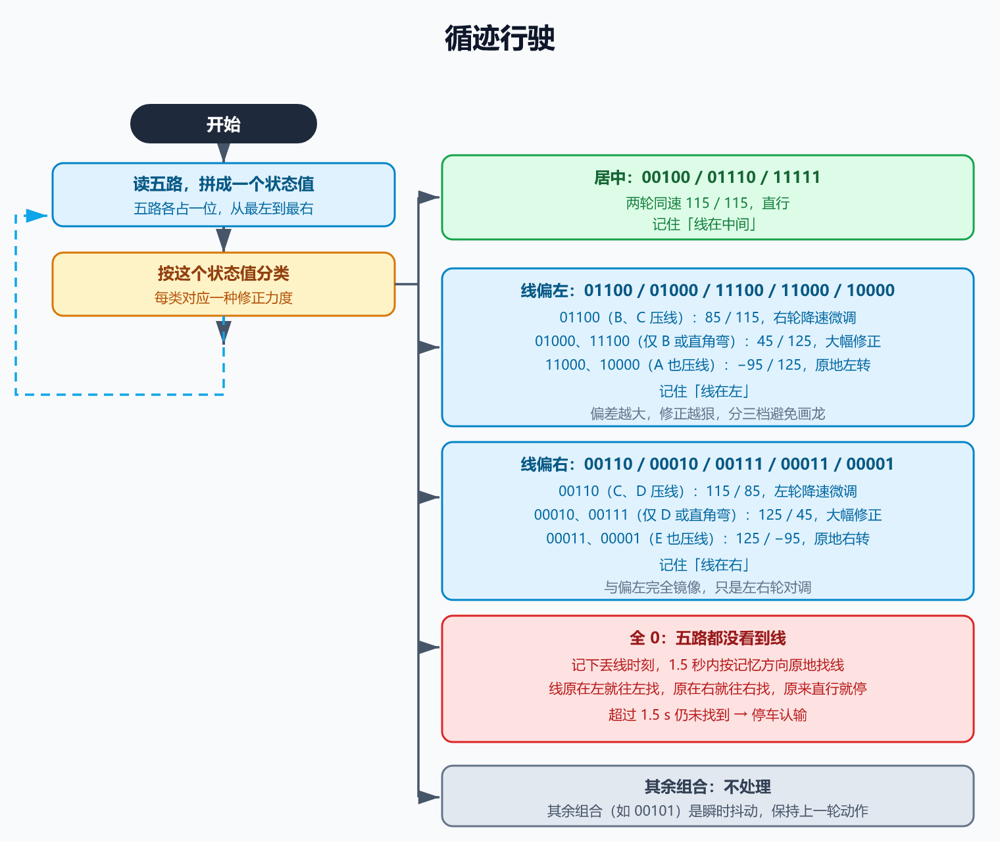

### 项目 7：循迹行驶

#### **1. 简介：**

把车摆上黑色跑道，按下复位，它自己跑完一圈：直道快、缓弯内侧减速贴回去、直角弯内侧反转原地拧过去。上一课只是把五路读数打到串口，现在这些读数要真正去开车了。

线在哪边，全靠车底那五只探头。五个 0 和 1 拼起来是 32 种组合，实际跑起来常遇到十来种，每种对应一组轮速：压中线两轮同速；偏一点就压内侧、放外侧；偏得多就让内侧反转，把车身拧回来。

线跑丢了也有办法。接缝、反光、过弯抬头，都会让五只探头同时读到白，车记着上一次线在左边还是右边，按原方向再找 1.5 秒；找到了接着跑，找不到才停。

车压在线上直着走，往旁边推它，它会自己拐回来；把线断开一截，它也会沿着原方向冲过去，1.5 秒后才停下认输。

#### **2. 所需清单：**

本课用到的器件：

|     |     |     |
| :---: | :---: | :---: |
| {width=170px}<br><span style="font-size:0.85em">履带底盘总成（含循迹传感器） ×1</span> | {width=170px}<br><span style="font-size:0.85em">DRV8835 电机扩展板 ×1</span> | {width=170px}<br><span style="font-size:0.85em">ESP32-S3 开发板 ×1</span> |
> ⚠️ **本课不新增器件，全都是第 2 章装好的东西，不用拆；下面的接线说明只标清接线方式，供对照，不必拆装。完整物料见 1.4 套件清单。**
#### **3. 参数：**

| 项目 | 参数 |
| --- | --- |
| 直行速度 | 115 |
| 微调速度 | 内侧 85、外侧 115 |
| 急转速度 | 内侧 45、外侧 125 |
| 原地转速度 | 内侧反转 95、外侧正转 125 |
| 丢线记忆时限 | 1500 ms |
| 控制周期 | 5 ms |
| 速度范围 | −255 ～ +255（负数即反转） |

#### **4. 接线说明：**

| 信号 | 主控 GPIO |
| --- | :---: |
| SDA（循迹） | IO8 |
| SCL（循迹） | IO9 |
| 左轮 AIN / AEN | IO38 / IO21 |
| 右轮 BIN / BEN | IO40 / IO41 |


#### **5. 流程图：**

五位编码 `state` 是整个程序的分岔口，先看这张图再读 `switch`：



#### **6. 测试代码：**

```cpp
#include <Wire.h>
#include <PCF8574.h>

PCF8574 pcf8574(0x20);

#define OUTA P4  // 最左
#define OUTB P0  // 左
#define OUTC P1  // 中
#define OUTD P2  // 右
#define OUTE P3  // 最右

#define MOTOR_AIN 38  // A 路方向
#define MOTOR_AEN 21  // A 路 PWM
#define MOTOR_BIN 40  // B 路方向
#define MOTOR_BEN 41  // B 路 PWM

// ===== 循迹速度 =====
#define BASE_SPEED   115  // 直行基础速度
#define RECOVER_IN   95   // 急转时内侧轮反转速度
#define RECOVER_OUT  125  // 急转时外侧轮正转速度

// ===== 状态记忆 =====
uint8_t lastDir = 0;            // 0 直行，1 线在左，2 线在右
unsigned long lostStartTime = 0;// 丢线起始时刻

// 左右电机映射：A 路接左轮、B 路接右轮
void driveMotors(int leftSpeed, int rightSpeed) {
  leftSpeed = constrain(leftSpeed, -255, 255);
  rightSpeed = constrain(rightSpeed, -255, 255);

  if (rightSpeed >= 0) {
    digitalWrite(MOTOR_BIN, HIGH);
    ledcWrite(MOTOR_BEN, rightSpeed);
  } else {
    digitalWrite(MOTOR_BIN, LOW);
    ledcWrite(MOTOR_BEN, -rightSpeed);
  }

  if (leftSpeed >= 0) {
    digitalWrite(MOTOR_AIN, HIGH);
    ledcWrite(MOTOR_AEN, leftSpeed);
  } else {
    digitalWrite(MOTOR_AIN, LOW);
    ledcWrite(MOTOR_AEN, -leftSpeed);
  }
}

void setup() {
  Serial.begin(115200);
  Wire.begin();
  Wire.setClock(400000);

  pinMode(MOTOR_BIN, OUTPUT);
  pinMode(MOTOR_AIN, OUTPUT);
  pinMode(MOTOR_BEN, OUTPUT);
  pinMode(MOTOR_AEN, OUTPUT);

  ledcAttach(MOTOR_BEN, 1000, 8);
  ledcAttach(MOTOR_AEN, 1000, 8);

  pcf8574.begin();
  pcf8574.pinMode(OUTA, INPUT);
  pcf8574.pinMode(OUTB, INPUT);
  pcf8574.pinMode(OUTC, INPUT);
  pcf8574.pinMode(OUTD, INPUT);
  pcf8574.pinMode(OUTE, INPUT);

  driveMotors(0, 0);
  delay(2000);
}

void loop() {
  PCF8574::DigitalInput val = pcf8574.digitalReadAll();

  int A = !val.p4; // 最左
  int B = !val.p0; // 左
  int C = !val.p1; // 中
  int D = !val.p2; // 右
  int E = !val.p3; // 最右

  uint8_t state = (A << 4) | (B << 3) | (C << 2) | (D << 1) | E;

  // 压到线即清零丢线计时
  if (state != 0b00000) {
    lostStartTime = 0;
  }

  switch (state) {
    // 居中直行
    case 0b00100:
    case 0b01110:
    case 0b11111:
      driveMotors(BASE_SPEED, BASE_SPEED);
      lastDir = 0;
      break;

    // 偏左：右轮降速微调
    case 0b01100: // B、C 压线
      driveMotors(85, BASE_SPEED); // 右轮降速贴回黑线
      lastDir = 1;
      break;

    // 偏左：大幅修正
    case 0b01000: // 仅 B 压线
    case 0b11100: // 左直角弯
      driveMotors(45, RECOVER_OUT);
      lastDir = 1;
      break;

    // 严重偏左：原地左转
    case 0b11000:
    case 0b10000:
      driveMotors(-RECOVER_IN, RECOVER_OUT);
      lastDir = 1;
      break;

    // 偏右：左轮降速微调
    case 0b00110: // C、D 压线
      driveMotors(BASE_SPEED, 85); // 左轮降速贴回黑线
      lastDir = 2;
      break;

    // 偏右：大幅修正
    case 0b00010: // 仅 D 压线
    case 0b00111: // 右直角弯
      driveMotors(RECOVER_OUT, 45);
      lastDir = 2;
      break;

    // 严重偏右：原地右转
    case 0b00011:
    case 0b00001:
      driveMotors(RECOVER_OUT, -RECOVER_IN);
      lastDir = 2;
      break;

    // 全部脱线：按记忆方向找线
    case 0b00000:
      if (lostStartTime == 0) {
        lostStartTime = millis(); // 记录丢线时刻
      }
      // 1.5 s 内按记忆方向找线
      if (millis() - lostStartTime < 1500) {
        if (lastDir == 1) {
          driveMotors(-RECOVER_IN, RECOVER_OUT); // 线原在左，左转找回
        } else if (lastDir == 2) {
          driveMotors(RECOVER_OUT, -RECOVER_IN); // 线原在右，右转找回
        } else {
          driveMotors(0, 0); // 原为直行，停车
        }
      } else {
        // 超时未找到，停车
        driveMotors(0, 0);
      }
      break;

    default:
      break;
  }

  delay(5);
}
```

#### **7. 代码解释：**

**(1) 五路读入，拼成一个字节**

```cpp
  int A = !val.p4; // 最左
  int B = !val.p0; // 左
  int C = !val.p1; // 中
  int D = !val.p2; // 右
  int E = !val.p3; // 最右

  uint8_t state = (A << 4) | (B << 3) | (C << 2) | (D << 1) | E;
```

`A` 是最左、`E` 是最右。左移把五路排成 `ABCDE` 五个二进制位，`|` 把它们拼进同一个字节。于是"哪几路看到线"就变成一个 0～31 的数字，`switch` 可以直接按数字分支，不用写五层嵌套 `if`。

比如 `0b00100` 是只有中间 C 压线（正常直行），`0b11000` 是最左和第二路都压线（偏左很多）。

**(2) 三个速度常量**

```cpp
#define BASE_SPEED   115  // 直行基础速度
#define RECOVER_IN   95   // 急转时内侧轮反转速度
#define RECOVER_OUT  125  // 急转时外侧轮正转速度
```

`BASE_SPEED 115` 约 45% 占空比，是正常跑线的速度。急转时内侧轮给 `-95`（反转）、外侧给 `125`（正转），靠这个 30 的差值把车头掰回来。三个数都是调出来的，跟车重、地面、电量都有关。

**(3) `driveMotors()` 的参数顺序和上一课相反**

```cpp
void driveMotors(int leftSpeed, int rightSpeed) {
```

第 2 课是 `driveMotors(rightSpeed, leftSpeed)`，**这课是左轮在前**。两个函数长得几乎一样，参数顺序是反的。抄代码时如果只改函数体不看签名，车会左右颠倒：想直行没事（两个值一样），一想转弯就往反方向拐。每次用之前先看一眼签名。

**(4) 有信号就把丢线计时清零**

```cpp
  if (state != 0b00000) {
    lostStartTime = 0;
  }
```

只要还有一路看到线，计时就清零。等五路全 0 进到 `case 0b00000`，才把当前时刻记进 `lostStartTime`——所以这个变量记的永远是"这一轮丢线是从什么时候开始的"。

另一个记忆变量 `lastDir` 不在这一句里，它在下面每个 `switch` 分支的末尾被赋值，专门留给"五路全 0"时判断该往哪边找。

**(5) 居中与微调**

```cpp
    case 0b00100:
    case 0b01110:
    case 0b11111:
      driveMotors(BASE_SPEED, BASE_SPEED);
      lastDir = 0;
      break;

    case 0b01100: // B、C 压线
      driveMotors(85, BASE_SPEED); // 右轮降速贴回黑线
      lastDir = 1;
      break;
```

三个"居中"状态合成一档：只有 C 压线、B+C 压线、五路全压线（过黑胶带之类的宽线），都按直行处理。

偏左一点点（B、C 压线）时，右轮从 115 降到 85，左轮不动，车头自然往右偏回线上。这一档的差速只有 30，修得轻。

**(6) 急转：内侧轮反转**

```cpp
    case 0b01000: // 仅 B 压线
    case 0b11100: // 左直角弯
      driveMotors(45, RECOVER_OUT);
      lastDir = 1;
      break;

    case 0b11000:
    case 0b10000:
      driveMotors(-RECOVER_IN, RECOVER_OUT);
      lastDir = 1;
      break;
```

偏得更多时两档递进：先让左轮降到 45、右轮升到 125；再严重（A 也压线了）就让左轮反转 95、右轮正转 125，车原地左转。

偏差越大，修正越狠。只用一个固定差速会出两种毛病：差速太小，过弯转不过来直接冲出去；差速太大，直线上一点点抖动就猛打方向，车走成"S"形。分三档就是在这两头之间找平衡。

右侧那三组是左侧的镜像，左右轮对调、数字不变。

**(7) 五路全 0：按记忆方向找 1.5 秒**

```cpp
    case 0b00000:
      if (lostStartTime == 0) {
        lostStartTime = millis(); // 记录丢线时刻
      }
      // 1.5 s 内按记忆方向找线
      if (millis() - lostStartTime < 1500) {
        if (lastDir == 1) {
          driveMotors(-RECOVER_IN, RECOVER_OUT); // 线原在左，左转找回
        } else if (lastDir == 2) {
          driveMotors(RECOVER_OUT, -RECOVER_IN); // 线原在右，右转找回
        } else {
          driveMotors(0, 0); // 原为直行，停车
        }
      } else {
        // 超时未找到，停车
        driveMotors(0, 0);
      }
      break;
```

丢线在跑道上很常见——接缝、反光、过弯时车头抬起来，都会瞬间五路全 0。要是立刻停车，车会一路走走停停。给 1.5 秒，让它按刚才的方向继续转着找，多数情况能自己找回来；超过 1.5 秒还没找到，说明真的跑出去了，才停车认输。

`lastDir` 就是这里用的：1 表示线刚才在左边，2 在右边，0 表示原来在直行。没有它，丢线之后不知道该往哪边转，只能原地停。

这个 1.5 秒是调出来的：太短，正常过弯也会被判成丢线；太长，冲出去之后要空转很久才停。

**(8) 5 ms 一轮**

```cpp
  delay(5);
```

每秒 200 次判断，比车实际能转的速度快得多，所以修正不会滞后。去掉这个延时，I2C 会被读到饱和，反而拖慢整体节奏。

#### **8. 运行现象：**

串口在 setup 里只打印一次启动信息，跑起来后不再输出——`loop()` 里没有 `Serial.print`，5 ms 一轮的节奏留给电机。

| 场景 | 现象 |
| --- | --- |
| 车压中线 | 直行，速度 115 |
| 缓弯 | 内侧轮降速，车身平滑贴回 |
| 直角弯 | 内侧轮短暂反转，原地拧过去 |
| 冲出线头 | 原地转向找线，1.5 s 内找到就继续 |
| 彻底脱线 | 1.5 s 后停车 |

> 【图片待补】小车在 A2 寻迹跑道上完整跑一圈的实拍图（可拍弯道与直道各一张）。

调车时按这个顺序试：

1. 先让车在直线上跑，如果左右画龙，说明 `BASE_SPEED` 偏高或探头离地太远，降到 100 再试。
2. 再过缓弯，如果车切内道冲出去，把 `RECOVER_OUT` 从 125 提到 135，让外侧轮转得更快。
3. 最后试直角弯，如果车在原地拧却拧不过去，把 `RECOVER_IN` 从 95 提到 110，反转那侧更有力。

车往反方向拐，是 A、B 两路电机线接反了：把两个电机的 2P 插头对调即可，不用改代码。

#### **9. 常见问题解决：**

(1) 车在直线上左右画龙：把 `BASE_SPEED` 从 115 往下降，比如 100 再试；同时看看探头是不是离地太远——放得高反射弱，方向也容易飘。

(2) 过缓弯时切内道冲出去：把 `RECOVER_OUT` 从 125 提到 135，外侧轮转得更快，车身能贴回线上。

(3) 直角弯里原地拧却拧不过去：把 `RECOVER_IN` 从 95 提到 110，反转那一侧更有力。

(4) 整个车往反方向拐：先查 A、B 两路电机线是不是接反，把两个电机的 2P 插头对调就行，不用改代码；线没问题再看 `driveMotors()` 的两个参数，它规定左轮在前。

(5) 出弯之后车乱转、找不到线：五路全 0 后它会按 `lastDir` 记忆的方向找 1.5 秒，超过就停车。如果这段路经常丢线，把查找时间从 1500 加到 2000。
