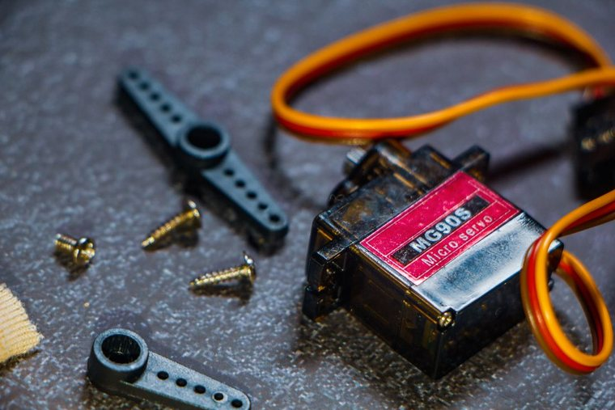
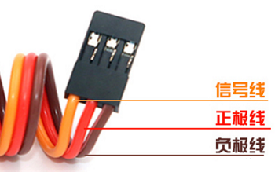
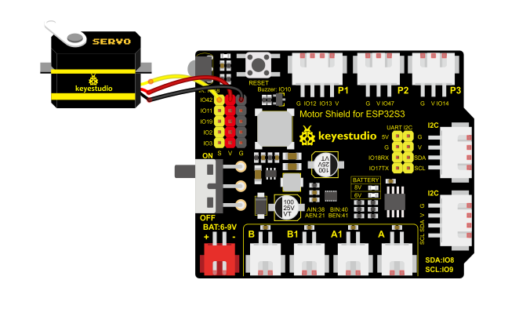
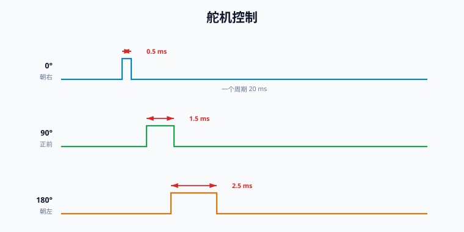

### 项目 8：舵机控制

#### **1. 简介：**

车头上立着一个黑色的小方块，托着超声波模块，它能左右转——这是整台车第一个「会转向的部件」。装车时 2.2.6 那一步要求先把它调到 90° 再装，就是为了让「正前方」对应程序里的 90°。

舵机和普通电机完全不是一类东西。普通电机你给电压它就转，断电才停；舵机内部有电位器测角度、有控制板做比较，你给它一个脉冲宽度，它就转到对应角度并**锁在那里**。手去掰它会感到明显的反抗，松手它自己弹回去。

这一课让它 0° 到 180° 来回扫一遍，看清转速和范围。

{width=520px}

#### **2. 所需清单：**

本课用到的器件：

|     |     |     |
| :---: | :---: | :---: |
| {width=170px}<br><span style="font-size:0.85em">9G 舵机（180°，配十字臂） ×1</span> | {width=170px}<br><span style="font-size:0.85em">DRV8835 电机扩展板 ×1</span> | {width=170px}<br><span style="font-size:0.85em">ESP32-S3 开发板 ×1</span> |
> ⚠️ **舵机在第 2 章已按 90° 调中后装好，本表只作对照，不用拆；下面的接线说明只标清接线方式，供对照，不必拆装。完整物料见 1.4 套件清单。**
#### **3. 参数：**

| 项目 | 参数 |
| --- | --- |
| 型号 | 9G 微型舵机，行程 180° |
| 信号脚 | IO42 |
| 控制频率 | 50 Hz（周期 20 ms） |
| 脉宽范围 | 500～2500 µs |
| 角度对应 | 500 µs ≈ 0°，1500 µs ≈ 90°，2500 µs ≈ 180° |
| 扫描步进 | 每度一次，步间延时 15 ms |
| 全行程耗时 | 约 2.7 s（180 度 × 15 ms） |

#### **4. 接线说明：**

| 舵机线 | 颜色（常见） | 接到 |
| --- | --- | --- |
| 信号 | 橙 / 黄 | IO42 |
| 电源 | 红 | 5V |
| 地 | 棕 / 黑 | GND |






#### **5. 流程图：**

舵机的「角度」不是一个数字，而是一段高电平的宽度。每 20 ms 来一个脉冲，高电平持续 0.5～2.5 ms，舵机内部据此判断目标角度：



#### **6. 测试代码：**

```cpp
#include <ESP32Servo.h>

const int PAN_SERVO_PIN = 42; // 云台舵机信号
const int STEP_DELAY    = 15; // 每度延时（ms），越小越快

Servo panServo;

void setup() {
  Serial.begin(115200);

  // 分配硬件定时器
  ESP32PWM::allocateTimer(0);
  ESP32PWM::allocateTimer(1);
  ESP32PWM::allocateTimer(2);
  ESP32PWM::allocateTimer(3);

  // 50 Hz，脉宽 500~2500 µs
  panServo.setPeriodHertz(50);
  panServo.attach(PAN_SERVO_PIN, 500, 2500);

  // 归零
  panServo.write(0);
  Serial.println("云台舵机已启动，开始在 0°~180° 之间来回转动...");
  delay(1000);
}

void loop() {
  // 0° → 180°
  for (int pos = 0; pos <= 180; pos += 1) {
    panServo.write(pos);
    delay(STEP_DELAY);
  }
  delay(500); // 停顿 0.5 s

  // 180° → 0°
  for (int pos = 180; pos >= 0; pos -= 1) {
    panServo.write(pos);
    delay(STEP_DELAY);
  }
  delay(500); // 停顿 0.5 s
}
```

#### **7. 代码解释：**

**(1) 两个常量和舵机对象**

```cpp
const int PAN_SERVO_PIN = 42; // 云台舵机信号
const int STEP_DELAY    = 15; // 每度延时（ms），越小越快

Servo panServo;
```

引脚 42 是云台的信号线。`STEP_DELAY` 是逐度扫描时每步停多久，15 ms 是试出来的节奏，后面两段循环都用它。`Servo panServo;` 声明舵机对象，所有动作通过它发。

**(2) 四行 `allocateTimer` 不是可有可无的**

```cpp
  ESP32PWM::allocateTimer(0);
  ESP32PWM::allocateTimer(1);
  ESP32PWM::allocateTimer(2);
  ESP32PWM::allocateTimer(3);
```

这四行写在 `setup()` 里，`attach()` 之前。ESP32 的 PWM 靠硬件定时器产生，舵机要 50 Hz、电机要 1 kHz，两者抢同一批定时器。`allocateTimer()` 是把四个定时器先划给舵机库专用——不写这四行，`attach()` 有可能失败，表现是舵机一动不动、串口也不报错。

四个定时器都分出去看着浪费，是因为后面要同时带两个舵机（云台 + 夹爪），一个舵机吃一个定时器，留着更省事。

**(3) `setPeriodHertz(50)` 和 `attach()` 的两个数字**

```cpp
  panServo.setPeriodHertz(50);
  panServo.attach(PAN_SERVO_PIN, 500, 2500);
```

50 Hz 就是 20 ms 一个周期，这是所有模拟舵机的标准。`attach()` 的后两个参数是脉宽下限和上限（微秒）：0° 对应 500 µs，180° 对应 2500 µs，中间线性插值。库替你算好了，`write()` 里只写角度。

这两个数跟舵机型号有关。9G 舵机写 500/2500 有时会顶到机械限位、发出"哒哒"的堵转声，那就往中间收成 600/2400 再试。

**(4) 上电先归零**

```cpp
  panServo.write(0);
```

`write(0)` 让云台先转到一端，作为后面扫描的起点。上电时不写这一句，舵机会停在断电前的位置，第一次扫描的起点就不确定了。

注意 `write()` 是"给目标"，不是"转到位"——它立刻返回，舵机自己慢慢转过去。所以每次大角度跳转之后都得自己补一个 `delay()`，否则下一条指令会盖掉还没走完的动作。

顺带说清一件事：`write(90)` 只是让舵机转到"脉宽中点"，装到车上是不是正前方，取决于舵机臂的齿位。装配有偏差就按第 2 章的办法重新找中位，别用改角度的方式硬凑——那样第 4 课测出来的左右距离会一直是偏的。

**(5) 0° → 180°：逐度扫过去**

```cpp
  for (int pos = 0; pos <= 180; pos += 1) {
    panServo.write(pos);
    delay(STEP_DELAY);
  }
```

直接 `write(180)` 舵机会以最大速度冲向目标，云台上还压着超声波模块，惯性会把支架拽得直晃。一度一步、每步 15 ms，180 度走完约 2.7 秒，转得稳，也方便肉眼看角度和方向的对应关系。

`STEP_DELAY` 改小转得更快，但小于 10 ms 之后舵机跟不上指令，会出现一顿一顿的抖动。舵机转速由内部电机决定，改延时只是改"下指令的密度"，不能真的让它转得更快。

**(6) 180° → 0°：回扫**

```cpp
  for (int pos = 180; pos >= 0; pos -= 1) {
    panServo.write(pos);
    delay(STEP_DELAY);
  }
```

回程和去程完全对称，只是方向反过来。两段加起来正好扫完一个来回。

**(7) 两个 500 ms 停顿**

```cpp
  delay(500); // 停顿 0.5 s
```

扫到端点停半秒，让舵机走完最后一步、也让超声波模块的晃动停下来。一轮 = 2.7 + 0.5 + 2.7 + 0.5 ≈ 6.4 秒。

#### **8. 运行现象：**

上电时舵机会先「咔」一下转到 0°，然后开始匀速扫向 180°，串口打印：

```text
云台舵机已启动，开始在 0°~180° 之间来回转动...
```

| 阶段 | 现象 |
| --- | --- |
| 上电瞬间 | 转到 0°（朝右），轻微抖动后稳定 |
| 0° → 180° | 约 2.7 s 扫过，超声波从右扫到左 |
| 到 180° | 停 0.5 s |
| 180° → 0° | 同样 2.7 s 扫回 |
| 循环 | 不断往复 |

> 【图片待补】舵机扫到两端极限位置时的实拍图各一张。

**注意**：舵机转到两端时如果一直响，立刻断电。堵转电流能到 700 mA 以上，会拖垮整车的 5V，主控跟着复位。这时候把 `attach()` 的 500/2500 改成 600/2400 再试。

调中位的做法（装车前或换舵机后要做）见 2.1 节，可以用 `Servo_return_to_center_90.ino` 或对应的 `.py` 让它停在 90°。

#### **9. 常见问题解决：**

(1) 上电舵机一点不动：先查信号线是不是接在 IO42。插错脚或者忘了接，舵机收不到 PWM 自然不转；如果串口还跟着重启，多半是 `allocateTimer()` 没写，定时器和电机 PWM 抢资源。

(2) 转起来一顿一顿：`STEP_DELAY` 太小，舵机跟不上指令。改到 15 ms 以上，小于 10 ms 就会抖。

(3) 只扫半程就回头：循环条件写错了。`for (int pos = 0; pos <= 180; pos += 1)` 里的 180 被改成 90 就只扫一半。

(4) 转到两端一直响：顶到机械限位在堵转，电流能到 700 mA 以上，会拖垮整车的 5V。把 `attach()` 的 500/2500 改成 600/2400 再试。
