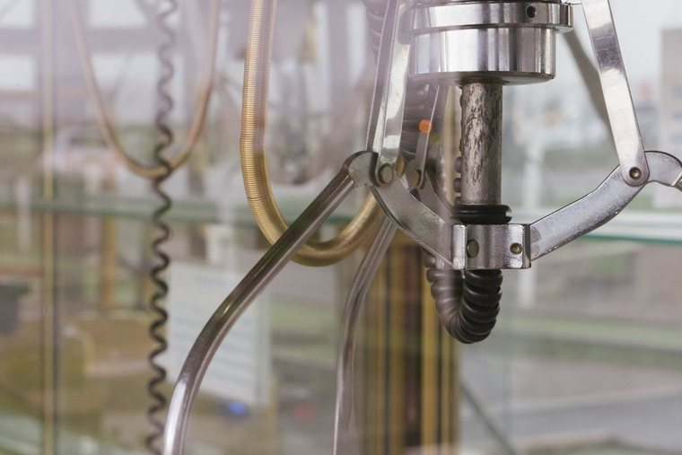
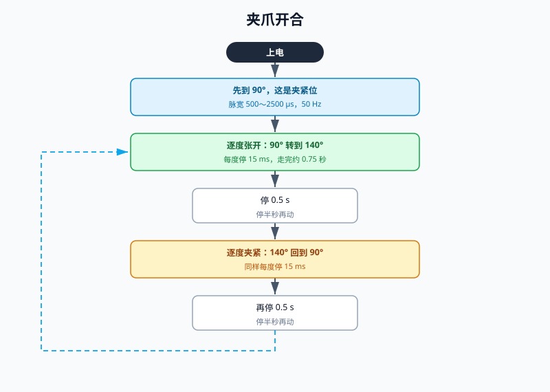

### 项目 9：夹爪控制与抓取

#### **1. 简介：**

车头前面挂着一副爪子：两片亚克力爪片，由一个舵机带动。它只有两个状态——90° 合拢、140° 张开，却是后面抓取物块（第 17 课）和踢球（第 16 课）的基础。

这一课先让爪子空着开合几次，看清两个角度对应的开口，再塞一块橡皮、一个纸团进去，试试夹得住什么。夹爪不是万能的：开口只有二十多毫米，夹持力来自舵机的堵转扭矩，太软的会滑，太硬的会顶住。

要注意的是，夹爪用的舵机和第 8 课的云台是同一种 9G，但行程只走 90°～140° 这 50°，不是 0°～180°。上电先写到 90°，也不能写成 0°——那里是机械死点，齿轮会一直较劲。

{width=520px}

#### **2. 所需清单：**

本课用到的器件：

|     |     |     |
| :---: | :---: | :---: |
| {width=170px}<br><span style="font-size:0.85em">大型机械夹（半成品） ×1</span> | {width=170px}<br><span style="font-size:0.85em">9G 舵机（180°，配十字臂） ×1</span> | {width=170px}<br><span style="font-size:0.85em">DRV8835 电机扩展板 ×1</span> |
| {width=170px}<br><span style="font-size:0.85em">ESP32-S3 开发板 ×1</span> |  |  |
> ⚠️ **夹爪在第 2 章就装好了，本表只作对照，不用拆；下面的接线说明只标清接线方式，供对照，不必拆装。完整物料见 1.4 套件清单。**
#### **3. 参数：**

| 项目 | 参数 |
| --- | --- |
| 信号脚 | IO11 |
| 控制频率 | 50 Hz |
| 脉宽范围 | 500～2500 µs |
| 夹紧角度 | 90° |
| 张开角度 | 140° |
| 开合步进 | 每度一次，步间延时 15 ms |
| 单程耗时 | 约 0.75 s（50 度 × 15 ms） |

#### **4. 接线说明：**

| 舵机线 | 颜色（常见） | 接到 |
| --- | --- | --- |
| 信号 | 橙 / 黄 | IO11 |
| 电源 | 红 | 5V |
| 地 | 棕 / 黑 | GND |


#### **5. 流程图：**

夹爪没有分支，只有一段四拍循环：张开、等、夹紧、等。等的时间决定动作是否看得清。



#### **6. 测试代码：**

```cpp
#include <ESP32Servo.h>

const int CLAW_SERVO_PIN = 11; // 夹爪舵机信号
const int STEP_DELAY     = 15; // 每度延时（ms），越小越快

Servo clawServo;

void setup() {
  Serial.begin(115200);

  // 分配硬件定时器
  ESP32PWM::allocateTimer(0);
  ESP32PWM::allocateTimer(1);
  ESP32PWM::allocateTimer(2);
  ESP32PWM::allocateTimer(3);

  // 50 Hz，脉宽 500~2500 µs
  clawServo.setPeriodHertz(50);
  clawServo.attach(CLAW_SERVO_PIN, 500, 2500);

  // 初始 90°
  clawServo.write(90);
  Serial.println("夹爪舵机已启动，开始在 90°~140° 之间来回开合...");
  delay(1000);
}

void loop() {
  // 90° → 140°
  for (int pos = 90; pos <= 140; pos += 1) {
    clawServo.write(pos);
    delay(STEP_DELAY);
  }
  delay(500); // 停顿 0.5 s

  // 140° → 90°
  for (int pos = 140; pos >= 90; pos -= 1) {
    clawServo.write(pos);
    delay(STEP_DELAY);
  }
  delay(500); // 停顿 0.5 s
}
```

#### **7. 代码解释：**

**(1) 两个常量**

```cpp
const int CLAW_SERVO_PIN = 11; // 夹爪舵机信号
const int STEP_DELAY     = 15; // 每度延时（ms），越小越快
```

和第 8 课的云台舵机比，改的就是引脚：云台在 42，夹爪在 11。`STEP_DELAY` 也一样是 15，逐度走一圈的速度没变。

**(2) 四个定时器全部分给舵机**

```cpp
  ESP32PWM::allocateTimer(0);
  ESP32PWM::allocateTimer(1);
  ESP32PWM::allocateTimer(2);
  ESP32PWM::allocateTimer(3);
```

这四行写在 `setup()` 里。ESP32-S3 一共四个硬件定时器，`attach()` 之前先全部分给舵机库，避免和电机的 LEDC 抢资源。不分配直接 attach，舵机可能抖动或者干脆不动。

**(3) 50 Hz 和 500～2500 µs**

```cpp
  clawServo.setPeriodHertz(50);
  clawServo.attach(CLAW_SERVO_PIN, 500, 2500);
```

50 Hz 是舵机的标准周期：20 ms 一帧，高电平宽度决定角度。`attach()` 的三个参数是引脚、最小脉宽、最大脉宽。第 8 课的云台写的是 500～2400，这课写到 2500——同一个 9G 舵机，上限放宽一点能多转几度，用不用得到看机械行程。

**(4) 上电先写 90°**

```cpp
  clawServo.write(90);
```

夹爪的机械结构决定：**90° 两片爪子合到最近，140° 张到最大**。所以 90° 是夹紧位，不是 0°。

上电写 90° 而不是 0°，是因为 0° 会把爪子压在死点上，齿轮一直较劲，时间长了容易扫齿。同理，通电状态下别用手硬掰爪子——齿轮在受力，容易崩齿；要确认机械行程，先断电，断电后没有力矩，可以随便掰。

**(5) 90° → 140°：逐度张开**

```cpp
  for (int pos = 90; pos <= 140; pos += 1) {
    clawServo.write(pos);
    delay(STEP_DELAY);
  }
```

每次加 1°，写完停 15 ms，50 步走完约 0.75 秒。云台慢慢转是为了不晃，夹爪慢慢开是为了**让球有时间滚进爪心**——直接 `write(140)` 爪子"啪"一下弹开，球还没进来就停了。

`delay(15)` 不是在"等舵机到位"，舵机自己会转；它是让每度的 PWM 更新之间有间隔，指令刷太快舵机会抖。

**(6) 140° → 90°：逐度闭合**

```cpp
  for (int pos = 140; pos >= 90; pos -= 1) {
    clawServo.write(pos);
    delay(STEP_DELAY);
  }
```

回程和去程完全对称，只是方向反过来。慢慢合上同样是为了让球有时间归位——快合会把球弹飞或者夹空。

夹紧力由舵机的堵转扭矩决定，不由角度决定：夹到球以后写 90° 和写 85° 的力是一样的，都会顶到堵转。所以不用为了"夹更紧"把角度往下压，压多了只会扫齿。

**(7) 两个 500 ms 停顿**

```cpp
  delay(500); // 停顿 0.5 s
```

张开到底停半秒，合上到底也停半秒，让人看清楚动作。一轮 = 750 + 500 + 750 + 500 = 2.5 秒，一分钟 24 次开合。

这课只是验证机构。真实用途是"夹住 → 抬起 → 松开"，第 16、17 课才会把夹爪接进任务里——夹住之后立刻去干别的，而不是继续来回摆。

#### **8. 运行现象：**

上电时爪子先合到 90°，然后开始开合循环，串口打印：

```text
夹爪舵机已启动，开始在 90°~140° 之间来回开合...
```

| 阶段 | 现象 |
| --- | --- |
| 上电瞬间 | 合到 90°，爪子完全闭合 |
| 90° → 140° | 张开，约 0.75 s |
| 到 140° | 停 0.5 s |
| 140° → 90° | 合拢，约 0.75 s |
| 循环 | 不断开合 |

> 【图片待补】夹爪开合过程中间帧的实拍图（约 115°）。

#### **9. 常见问题解决：**

(1) 上电爪子完全没反应：先查夹爪舵机的信号线是不是接在 IO11，插错脚或者忘了接，爪子不会动。串口还跟着重启的话，是 `allocateTimer()` 没写，定时器被电机 PWM 抢走了。

(2) 爪子张得太大夹不住东西：把张开角从 140 往回调小一点，比如 130，张角收一点反而夹得更稳。夹紧角别低于 85，顶到机械极限舵机会一直较劲发热。

(3) 合上时「啪」一下、球被弹飞：逐度扫描被改成了直接 `write(90)`。中间那 0.75 秒是留给球滚进爪心的，`STEP_DELAY` 别改成 0。

(4) 爪子停在某个角度一直嗡嗡响：顶死了。断电后用手掰一下确认机械行程，把 90 或 140 往回收几度。
