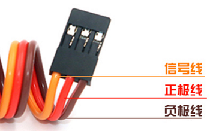
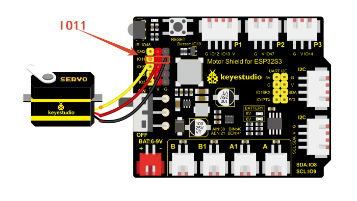
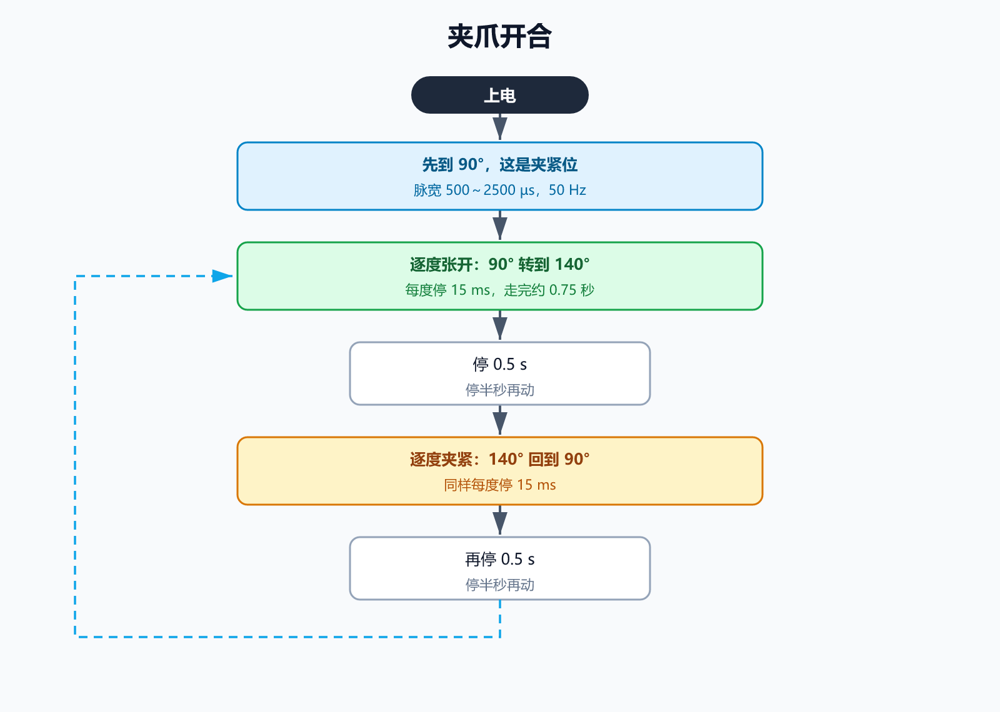

### Project 9: Gripper Control and Grabbing

#### **1. Introduction:**

{width=520px}

There's a gripper on the front of the car: two 3D-printed fingers driven by a 9G servo. It only has two poses — closed at 90°, open at 140° — and the object grabbing and ball kicking later on both rely on those two angles.

It's the same model as the one on the pan-tilt, but only 90° to 140° of its travel is used — 50° in all. At 90° the two fingers are pressed together; at 140° they open more than twenty millimetres, just enough for an eraser or a paper ball.

Run it open and closed a few times with nothing in the jaws, until you can see what opening each angle gives, then put something in and try what it can hold.

At power-on the fingers first close to 90°, then open and close, taking about 0.75 s each way and pausing half a second at each end; the serial port prints one startup line.

#### **2. Required Parts:**

Parts used in this lesson:

|     |     |     |
| :---: | :---: | :---: |
| {width=170px}<br><span style="font-size:0.85em">Large mechanical gripper (partly assembled) ×1</span> | {width=170px}<br><span style="font-size:0.85em">9G servo (180°, with cross horn) ×1</span> | {width=170px}<br><span style="font-size:0.85em">DRV8835 motor driver expansion board ×1</span> |
| {width=170px}<br><span style="font-size:0.85em">ESP32-S3 development board ×1</span> |  |  |
> ⚠️ **The gripper was already installed in Chapter 2. This table is for reference only — do not remove it. The wiring notes below only show how the connections are made, for reference; no disassembly is needed. For the full parts list, see 1.4 Kit List.**
#### **3. Parameters:**

| Item | Parameter |
| --- | --- |
| Signal pin | IO11 |
| Control frequency | 50 Hz |
| Pulse width range | 500–2500 µs |
| Grip angle | 90° |
| Open angle | 140° |
| Open/close step | One step per degree, 15 ms between steps |
| One-way time | About 0.75 s (50 steps × 15 ms) |

#### **4. Wiring:**

| Servo wire | Colour (typical) | Connected to |
| --- | --- | --- |
| Signal | Orange / yellow | IO11 |
| Power | Red | 5V |
| Ground | Brown / black | GND |






#### **5. Flowchart:**

The gripper has no branches, just a four-beat loop: open, wait, close, wait. The waits decide whether the movement is easy to see.



#### **6. Test Code:**

```cpp
#include <ESP32Servo.h>

const int CLAW_SERVO_PIN = 11; // Gripper servo signal
const int STEP_DELAY     = 15; // Delay per degree (ms), smaller is faster

Servo clawServo;

void setup() {
  Serial.begin(115200);

  // Allocate hardware timers
  ESP32PWM::allocateTimer(0);
  ESP32PWM::allocateTimer(1);
  ESP32PWM::allocateTimer(2);
  ESP32PWM::allocateTimer(3);

  // 50 Hz, pulse width 500~2500 µs
  clawServo.setPeriodHertz(50);
  clawServo.attach(CLAW_SERVO_PIN, 500, 2500);

  // Initial 90°
  clawServo.write(90);
  Serial.println("Gripper servo started, opening and closing repeatedly between 90° and 140°...");
  delay(1000);
}

void loop() {
  // 90° → 140°
  for (int pos = 90; pos <= 140; pos += 1) {
    clawServo.write(pos);
    delay(STEP_DELAY);
  }
  delay(500); // Pause 0.5 s

  // 140° → 90°
  for (int pos = 140; pos >= 90; pos -= 1) {
    clawServo.write(pos);
    delay(STEP_DELAY);
  }
  delay(500); // Pause 0.5 s
}
```

#### **7. Code Explanation:**

**(1) Two constants**

```cpp
const int CLAW_SERVO_PIN = 11; // Gripper servo signal
const int STEP_DELAY     = 15; // Delay per degree (ms), smaller is faster
```

Compared with the pan-tilt servo in Lesson 8, only the pin changes: 42 for the pan-tilt, 11 for the gripper. `STEP_DELAY` is still 15, so the degree-by-degree speed is unchanged.

**(2) All four timers go to the servos**

```cpp
  ESP32PWM::allocateTimer(0);
  ESP32PWM::allocateTimer(1);
  ESP32PWM::allocateTimer(2);
  ESP32PWM::allocateTimer(3);
```

These four lines are in `setup()`. The ESP32-S3 has four hardware timers in total; assign all of them to the servo library before `attach()` so they don't compete with the motors' LEDC. Attach without allocating and the servo may jitter or simply not move.

**(3) 50 Hz and 500–2500 µs**

```cpp
  clawServo.setPeriodHertz(50);
  clawServo.attach(CLAW_SERVO_PIN, 500, 2500);
```

50 Hz is the standard servo period: one 20 ms frame, with the HIGH width deciding the angle. The three arguments of `attach()` are the pin, the minimum pulse width and the maximum. The pan-tilt in Lesson 8 uses 500–2400; here it goes to 2500 — the same 9G servo, but a slightly higher ceiling gains a few more degrees, useful or not depending on the mechanical travel.

**(4) Write 90° at power-on**

```cpp
  clawServo.write(90);
```

The gripper's mechanics decide it: **at 90° the two fingers are closest, at 140° they are widest open**. So 90° is the gripping position, not 0°.

We write 90° rather than 0° at power-on because 0° pushes the fingers onto a dead point, leaving the gears straining and eventually stripping them. For the same reason, never force the fingers by hand while powered — the gears are under load and teeth can break. To check the mechanical travel, cut the power first: with no torque you can move the fingers freely.

**(5) 90° → 140°: opening one degree at a time**

```cpp
  for (int pos = 90; pos <= 140; pos += 1) {
    clawServo.write(pos);
    delay(STEP_DELAY);
  }
```

Add 1° each time and pause 15 ms after each write; 50 steps take about 0.75 seconds. The pan-tilt moves slowly to avoid wobbling; the gripper opens slowly to **give the ball time to roll into the fingers** — a direct `write(140)` snaps the jaws open with a "pop", and the movement stops before the ball has arrived.

`delay(15)` isn't "waiting for the servo to arrive" — the servo moves itself. It puts a gap between each degree's PWM update; issue commands too fast and the servo jitters.

**(6) 140° → 90°: closing one degree at a time**

```cpp
  for (int pos = 140; pos >= 90; pos -= 1) {
    clawServo.write(pos);
    delay(STEP_DELAY);
  }
```

The return is exactly symmetrical, only reversed. Closing slowly also gives the ball time to settle — close quickly and it gets flicked away or you clamp on empty air.

Gripping force comes from the servo's stall torque, not from the angle: once the ball is held, writing 90° and writing 85° apply the same force — both end in a stall. So don't lower the angle to "grip tighter"; push it too far and all you get is stripped gears.

**(7) Two 500 ms pauses**

```cpp
  delay(500); // Pause 0.5 s
```

Half a second at full open and another at full close make the movement easy to follow. One cycle = 750 + 500 + 750 + 500 = 2.5 seconds, or 24 open-close cycles a minute.

This lesson only verifies the mechanism. Its real use is "grip → lift → release"; Lessons 16 and 17 will bring the gripper into the actual tasks — once it has grabbed something it moves on to the next step instead of swinging back and forth.

#### **8. What You'll See:**

At power-on the fingers close to 90°, then the open-close loop begins and the Serial Monitor prints:

```text
Gripper servo started, opening and closing repeatedly between 90 and 140 degrees...
```

| Stage | What happens |
| --- | --- |
| At power-on | Closes to 90°, fingers fully together |
| 90° → 140° | Opens in about 0.75 s |
| At 140° | Pauses for 0.5 s |
| 140° → 90° | Closes in about 0.75 s |
| Loop | Repeats continuously |

> [Image to be added] A photo of the gripper midway through its movement (around 115°).

#### **9. Troubleshooting:**

(1) The fingers don't move at all at power-on: first check that the gripper servo's signal wire is on IO11 — wrong pin or no connection and nothing moves. If the Serial Monitor restarts too, `allocateTimer()` is missing and the timers have been taken over by the motor PWM.

(2) The fingers open too wide to hold anything: reduce the open angle from 140 to something like 130 — a smaller opening actually grips more securely. Don't take the grip angle below 85; at the mechanical limit the servo strains and heats up.

(3) The jaws snap shut with a **pop** and the ball flies away: the degree-by-degree sweep was replaced by a direct `write(90)`. That 0.75-second interval is what gives the ball time to roll into the fingers, so don't set `STEP_DELAY` to 0.

(4) The fingers buzz at a certain angle: they're stalled. Cut the power and move them by hand to check the mechanical travel, then pull 90 or 140 back a few degrees.
