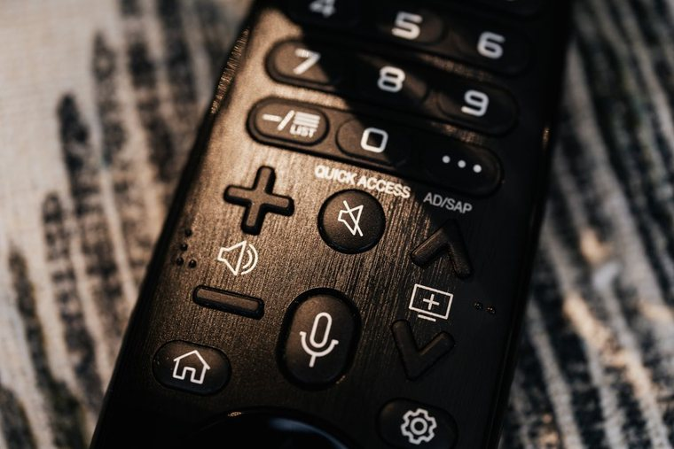
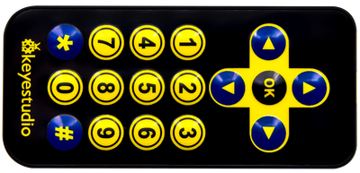
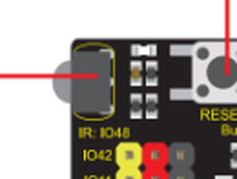
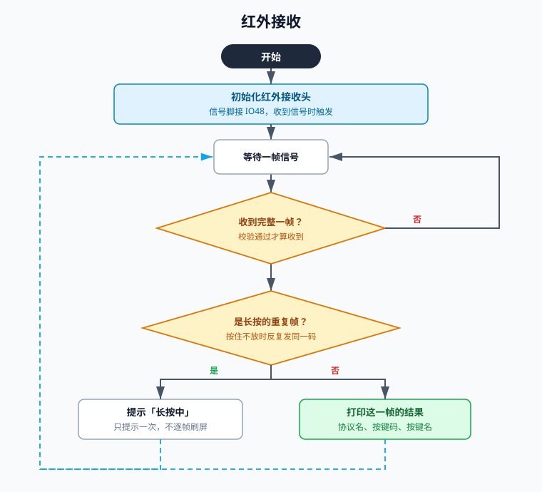

### 项目 10：红外接收

#### **1. 简介：**

家里的电视遥控器、空调遥控器、玩具遥控器，用的都是红外。它们发出的不是「一个信号」，而是一串每秒钟闪烁三万八千次的不可见光——人眼看不到，但接收头能把它解成一串 0 和 1。

这一课不控制任何东西，只做一件事：让车听懂遥控器。按下方向键，串口打印出这个键的码值；按住不放，你能看到「长按」和「按一下」在数据上的区别。

码值这一关必须过，因为**每只遥控器的码值都不完全一样**。资料包里写的是 70 / 21 / 68 / 67 / 64，但你手上这只可能是别的数。所以代码里的 `keyName()` 只是「按已知码值翻译」，真正准的是串口打印出来的那个数字。下一课的遥控车要拿这些数字去改宏定义。

{width=520px}

#### **2. 所需清单：**

本课用到的器件：

|     |     |     |
| :---: | :---: | :---: |
| {width=170px}<br><span style="font-size:0.85em">17 键红外遥控器（JMFP-4） ×1</span> | {width=170px}<br><span style="font-size:0.85em">红外接收头 ×1</span> | {width=170px}<br><span style="font-size:0.85em">DRV8835 电机扩展板 ×1</span> |
| {width=170px}<br><span style="font-size:0.85em">ESP32-S3 开发板 ×1</span> |  |  |
> ⚠️ **接收头在扩展板上，本表只作对照，不用拆；下面的接线说明只标清接线方式，供对照，不必拆装。完整物料见 1.4 套件清单。**
#### **3. 参数：**

| 项目 | 参数 |
| --- | --- |
| 接收脚 | IO48 |
| 载波频率 | 38 kHz |
| 协议 | NEC |
| 串口波特率 | 115200 |
| 已收录键值 | 上 70、下 21、左 68、右 67、OK 64 |
| 重复帧标志 | `IRDATA_FLAGS_IS_REPEAT` |
| 依赖库 | `IRremote` |

#### **4. 接线说明：**

| 接收头引脚 | 接到 |
| --- | :---: |
| OUT / S | IO48 |
| VCC | 5V |
| GND | GND |

#### **5. 流程图：**

接收和解码是两件事：`IrReceiver.decode()` 负责把光信号还原成一帧数据，`decodedIRData` 里才有协议、码值、是否长按这些字段。



#### **6. 测试代码：**

```cpp
#include <IRremote.hpp>  // 红外解码库

// 红外接收头，IO48
#define IR_RECEIVE_PIN 48

// 遥控器按键码值
// 批次不同码值可能不同，以串口打印为准
#define KEY_UP    70
#define KEY_DOWN  21
#define KEY_LEFT  68
#define KEY_RIGHT 67
#define KEY_STOP  64

void setup() {
  Serial.begin(115200);
  delay(1000);  // 等串口稳定

  Serial.println("红外接收实验开始，把遥控器对准车头");
  IrReceiver.begin(IR_RECEIVE_PIN, DISABLE_LED_FEEDBACK);
  Serial.println("等待按键……");
}

void loop() {
  // 收到一帧可解码信号
  if (IrReceiver.decode()) {
    uint8_t cmd = IrReceiver.decodedIRData.command;
    bool holding = IrReceiver.decodedIRData.flags & IRDATA_FLAGS_IS_REPEAT;
    static bool lastHolding = false;  // 上一帧是否长按，避免重复打印

    if (holding) {
      // 长按会周期性重发同一码
      if (!lastHolding) {
        Serial.println("（长按中，后面不再逐帧打印）");
      }
    } else {
      Serial.print("协议：");
      Serial.print(getProtocolString(IrReceiver.decodedIRData.protocol));
      Serial.print("   按键码：");
      Serial.print(cmd);
      Serial.print("（0x");
      Serial.print(cmd, HEX);
      Serial.print("）   ");
      Serial.println(keyName(cmd));
    }
    lastHolding = holding;

    IrReceiver.resume();  // 必须调用，否则只能收到一帧
  }
}

// 按键码转中文名
const char* keyName(uint8_t cmd) {
  switch (cmd) {
    case KEY_UP:    return "上";
    case KEY_DOWN:  return "下";
    case KEY_LEFT:  return "左";
    case KEY_RIGHT: return "右";
    case KEY_STOP:  return "OK / 停止";
    default:        return "";
  }
}
```

#### **7. 代码解释：**

**(1) 接收头引脚和五个键值宏**

```cpp
#define IR_RECEIVE_PIN 48

#define KEY_UP    70
#define KEY_DOWN  21
#define KEY_LEFT  68
#define KEY_RIGHT 67
#define KEY_STOP  64
```

`IR_RECEIVE_PIN 48` 是接收头的信号脚。下面五个宏是**这一款遥控器**的编码，不是通用值：换一把同型号的新遥控器，码值大概率还是这几个；换别的遥控器就得重新看串口打印的十六进制值，把这五行改掉。

文件开头有注释提醒"批次不同码值可能不同，以串口打印为准"，道理就在这。

**(2) `setup()` 里先等一秒**

```cpp
  Serial.begin(115200);
  delay(1000);  // 等串口稳定

  IrReceiver.begin(IR_RECEIVE_PIN, DISABLE_LED_FEEDBACK);
```

`Serial.begin()` 之后立刻打印，前几个字符有时会丢——USB 枚举还没完成。`delay(1000)` 是给串口留的时间。

`IrReceiver.begin()` 的第二个参数 `DISABLE_LED_FEEDBACK` 是关掉板载 LED 的接收闪烁。不关也能用，但每按一下闪一下，调试时容易跟电源指示灯看混。

**(3) `decode()` 是"问一句"，不是"等一帧"**

```cpp
  if (IrReceiver.decode()) {
```

这句话立刻返回：这一轮正好解出一帧完整信号就返回 `true`，没收到就返回 `false`，程序继续往下跑。

所以它是**非阻塞**的，主循环可以一边收红外一边干别的——第 11 课的遥控车就是靠这一点，在收不到按键时还能检查超时。`loop()` 里没有 `delay()`，一轮只有几微秒，人手按键的抖动会被完整记录下来。

**(4) 从一帧里取出两个有用的东西**

```cpp
    uint8_t cmd = IrReceiver.decodedIRData.command;
    bool holding = IrReceiver.decodedIRData.flags & IRDATA_FLAGS_IS_REPEAT;
```

`command` 是按键码，8 位，同一个按键每次发都一样。`flags` 里的 `IRDATA_FLAGS_IS_REPEAT` 位标记"这不是新按的，是长按的重复帧"。

NEC 协议下按住不放时，遥控器不会一直发完整帧，而是每 108 ms 发一个很短的重复帧。所以**长按收到的还是同一个 `cmd`，区别只在 flags**。不判这个位，长按会被当成连按几十次。

一帧完整信号是 67.5 ms（9 ms 引导 + 4.5 ms 间隔 + 32 位数据）。

收到乱码时先看 `protocol`：不是 NEC 就说明遥控器用了别的协议；再看 `command` 是否每次都不一样——不一样通常是供电不稳或接收头被强光直射。太阳光、白炽灯里都有 38 kHz 附近的成分，会把信号淹掉。

**(5) `static` 让变量记住上一帧**

```cpp
    static bool lastHolding = false;  // 上一帧是否长按，避免重复打印
```

`static` 让局部变量在两次 `loop()` 之间保住值——普通局部变量每轮都会重新初始化成 `false`，起不到"记住上一帧"的作用。

它的用途是只打印一次"长按中"。长按一秒会来 9 个重复帧，不拦一下，串口会被这行刷满，真正想看的码值全被顶走。

**(6) 三个打印项**

```cpp
      Serial.print("协议：");
      Serial.print(getProtocolString(IrReceiver.decodedIRData.protocol));
      Serial.print("   按键码：");
      Serial.print(cmd);
      Serial.print("（0x");
      Serial.print(cmd, HEX);
      Serial.print("）   ");
      Serial.println(keyName(cmd));
```

`getProtocolString()` 把协议号翻成 `NEC` 这样的名字。同一个码值打印了两种进制：十进制给你对照 `#define`，十六进制方便和遥控器资料上的表比对——改宏时用哪个都行，注意十六进制那个带 `0x` 前缀。

`Serial.print(cmd, HEX)` 的第二个参数是进制，不加就是十进制。

**(7) `resume()` 不调用，就只收得到第一帧**

```cpp
    IrReceiver.resume();  // 必须调用，否则只能收到一帧
```

库收到一帧后会停下来等你处理，`resume()` 是告诉它"处理完了，去接下一帧"。少了这一句，现象很典型：按第一个键有输出，之后怎么按都没反应，像接收头坏了一样。这是本课最容易漏的一行。

**(8) `keyName()` 查表**

```cpp
const char* keyName(uint8_t cmd) {
  switch (cmd) {
    case KEY_UP:    return "上";
    case KEY_DOWN:  return "下";
    case KEY_LEFT:  return "左";
    case KEY_RIGHT: return "右";
    case KEY_STOP:  return "OK / 停止";
    default:        return "";
  }
}
```

返回类型是 `const char*`，`return "上"` 返回的是字符串常量的地址，不是把字符串拷出来。`default` 返回空串，遇到没定义的码值不会打印乱码，也不会崩。

`switch` 比一串 `if` 好读：一个码值对一个名字，改起来只动对应那行。

#### **8. 运行现象：**

上电后串口打印：

```text
红外接收实验开始，把遥控器对准车头
等待按键……
```

对准车头按方向键：

```text
协议：NEC   按键码：70（0x46）   上
协议：NEC   按键码：21（0x15）   下
协议：NEC   按键码：68（0x44）   左
协议：NEC   按键码：67（0x43）   右
协议：NEC   按键码：64（0x40）   OK / 停止
```

按住「上」不放：

```text
协议：NEC   按键码：70（0x46）   上
（长按中，后面不再逐帧打印）
```

> 【图片待补】串口监视器里连续按五个方向键的完整输出截图。

#### **9. 常见问题解决：**

按了没反应，按顺序查三件事：

(1) 遥控器里有没有电池，电池仓的塑料片有没有抽掉。

(2) 接收头的受光面是不是被外壳挡住。它需要「看见」遥控器，隔一层茶色亚克力可以，隔一层黑塑料不行。

(3) 距离。红外在室内有效距离约 8 m，但正对强光（阳光、白炽灯）时会被淹没，缩短到 1 m 以内。
