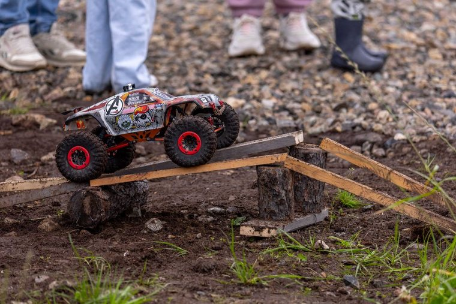
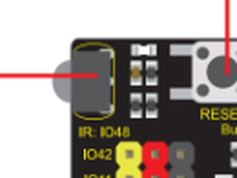
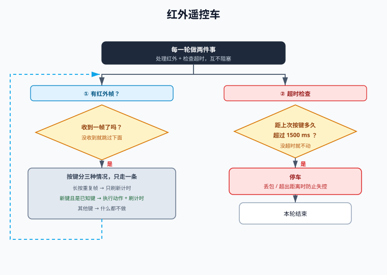

### 项目 11：红外遥控车

#### **1. 简介：**

给车装一只遥控器。方向键按下就走，松开就停——听起来简单，做起来有个坑：红外是单向的，车没法「回话」，你怎么知道它还听不听得见？

答案是加一个超时。每次收到有效按键就记一下时间，超过 1.5 s 没有新指令就自动停车。这样即使遥控器没电、被挡住、或者你走出有效距离，车也不会一头撞在墙上继续跑。

还有一个细节：NEC 协议按住不放时只发重复帧，重复帧本身带着「还是这个键」的信息，但不带「按了多久」。所以代码里重复帧只用来刷新超时计时，不重复执行动作。

{width=520px}

#### **2. 所需清单：**

本课用到的器件：

|     |     |     |
| :---: | :---: | :---: |
| {width=200px}<br><span style="font-size:0.85em">17 键红外遥控器（JMFP-4） ×1</span> | {width=200px}<br><span style="font-size:0.85em">红外接收头 ×1</span> | {width=200px}<br><span style="font-size:0.85em">DRV8835 电机扩展板 ×1</span> |
| {width=200px}<br><span style="font-size:0.85em">ESP32-S3 开发板 ×1</span> | {width=200px}<br><span style="font-size:0.85em">履带底盘总成 ×1</span> |  |
> ⚠️ **全是第 2 章装好的器件，本表只作对照，不用拆；下面的接线说明只标清接线方式，供对照，不必拆装。完整物料见 1.4 套件清单。**
#### **3. 参数：**

| 项目 | 参数 |
| --- | --- |
| 接收脚 | IO48 |
| 直行速度 | 180 |
| 原地转速度 | 180 |
| 指令超时 | 1500 ms |
| 键值 | 上 70、下 21、左 68、右 67、OK 64 |
| 循环周期 | 无延时，靠 `decode()` 自身节流 |

#### **4. 接线说明：**

| 信号 | 主控 GPIO |
| --- | :---: |
| 红外接收 OUT | IO48 |
| 左轮 AIN / AEN | IO38 / IO21 |
| 右轮 BIN / BEN | IO40 / IO41 |

#### **5. 流程图：**

主循环做两件事：有信号就处理，没信号就看超时。两件事互不阻塞，所以车不会因为等按键而停住响应：



#### **6. 测试代码：**

```cpp
#include <IRremote.hpp>  // 红外解码库

// ===== 引脚 =====
#define IR_RECEIVE_PIN 48  // 红外接收头，IO48

#define MOTOR_AIN 38  // A 路方向
#define MOTOR_AEN 21  // A 路调速
#define MOTOR_BIN 40  // B 路方向
#define MOTOR_BEN 41  // B 路调速

// ===== 速度 =====
#define SPEED_RUN  180  // 直行
#define SPEED_TURN 180  // 原地转

// ===== 遥控器键值 =====
// 换遥控器后需按串口打印值修改
#define KEY_UP    70
#define KEY_DOWN  21
#define KEY_LEFT  68
#define KEY_RIGHT 67
#define KEY_STOP  64

// 指令超时（ms）自动停车，遥控器失联时避免失控
#define STOP_AFTER 1500

unsigned long lastKeyTime = 0;  // 最后有效按键时刻

void setup() {
  Serial.begin(115200);
  delay(1000);

  Serial.println("红外遥控车启动，用方向盘控制");
  IrReceiver.begin(IR_RECEIVE_PIN, DISABLE_LED_FEEDBACK);

  pinMode(MOTOR_BIN, OUTPUT);
  pinMode(MOTOR_AIN, OUTPUT);
  ledcAttach(MOTOR_BEN, 1000, 8);
  ledcAttach(MOTOR_AEN, 1000, 8);

  stopCar();  // 上电停车
}

void loop() {
  if (IrReceiver.decode()) {
    uint8_t cmd = IrReceiver.decodedIRData.command;
    bool holding = IrReceiver.decodedIRData.flags & IRDATA_FLAGS_IS_REPEAT;

    if (holding) {
      // 长按只刷新超时计时
      lastKeyTime = millis();
    } else if (isKnownKey(cmd)) {
      handleKey(cmd);
      lastKeyTime = millis();
    }

    IrReceiver.resume();
  }

  // 超过 1.5 s 无有效按键即停车
  if (millis() - lastKeyTime > STOP_AFTER) {
    stopCar();
  }
}

// 按键处理
void handleKey(uint8_t cmd) {
  switch (cmd) {
    case KEY_UP:
      Serial.println("前进");
      goForward(SPEED_RUN);
      break;
    case KEY_DOWN:
      Serial.println("后退");
      goBackward(SPEED_RUN);
      break;
    case KEY_LEFT:
      Serial.println("左转");
      spinLeft(SPEED_TURN);
      break;
    case KEY_RIGHT:
      Serial.println("右转");
      spinRight(SPEED_TURN);
      break;
    case KEY_STOP:
      Serial.println("停车");
      stopCar();
      break;
    default:
      break;
  }
}

// 是否为已定义按键
bool isKnownKey(uint8_t cmd) {
  return cmd == KEY_UP || cmd == KEY_DOWN || cmd == KEY_LEFT ||
         cmd == KEY_RIGHT || cmd == KEY_STOP;
}

// ===== 电机驱动 =====
// A 路接左轮、B 路接右轮，与第 7 课一致
// 若左右相反，互换下面两段
void driveMotors(int leftSpeed, int rightSpeed) {
  leftSpeed  = constrain(leftSpeed,  -255, 255);
  rightSpeed = constrain(rightSpeed, -255, 255);

  // A 路：左轮
  if (rightSpeed >= 0) {
    digitalWrite(MOTOR_BIN, HIGH);
    ledcWrite(MOTOR_BEN, rightSpeed);
  } else {
    digitalWrite(MOTOR_BIN, LOW);
    ledcWrite(MOTOR_BEN, -rightSpeed);
  }

  // B 路：右轮
  if (leftSpeed >= 0) {
    digitalWrite(MOTOR_AIN, HIGH);
    ledcWrite(MOTOR_AEN, leftSpeed);
  } else {
    digitalWrite(MOTOR_AIN, LOW);
    ledcWrite(MOTOR_AEN, -leftSpeed);
  }
}

void goForward(int speed)  { driveMotors(speed, speed); }    // 前进：两轮同速正转
void goBackward(int speed) { driveMotors(-speed, -speed); }  // 后退：两轮同速反转
void spinLeft(int speed)   { driveMotors(-speed, speed); }   // 左转：左轮后退、右轮前进
void spinRight(int speed)  { driveMotors(speed, -speed); }   // 右转：左轮前进、右轮后退
void stopCar()             { driveMotors(0, 0); }            // 停：占空比归零
```

#### **7. 代码解释：**

**(1) 引脚、速度、键值**

```cpp
#define IR_RECEIVE_PIN 48  // 红外接收头，IO48

#define SPEED_RUN  180  // 直行
#define SPEED_TURN 180  // 原地转

#define KEY_UP    70
#define KEY_DOWN  21
#define KEY_LEFT  68
#define KEY_RIGHT 67
#define KEY_STOP  64
```

180 约 71% 占空比，比循迹的 115 高——遥控要的是"按下去立刻动"，不需要循迹那种细腻的修正余量。

五个键值和第 10 课完全一样，是从那一课串口打印的结果抄过来的。换遥控器就要重抄一遍。

**(2) `loop()` 里是两件独立的事**

```cpp
void loop() {
  if (IrReceiver.decode()) {
    ...
    IrReceiver.resume();
  }

  // 超过 1.5 s 无有效按键即停车
  if (millis() - lastKeyTime > STOP_AFTER) {
    stopCar();
  }
}
```

两个 `if` 平级，没有嵌套。收不到红外时第一个 `if` 直接跳过，第二个照样执行——这就是"互不阻塞"的意思。

如果把超时检查写进 `if (decode())` 里面，一旦没有按键就永远进不去，车会一直保持上一个动作冲下去。这是本课结构上最关键的一点。

**(3) 长按只刷计时，不重复执行**

```cpp
    if (holding) {
      // 长按只刷新超时计时
      lastKeyTime = millis();
    } else if (isKnownKey(cmd)) {
      handleKey(cmd);
      lastKeyTime = millis();
    }
```

长按方向键时，遥控器每 108 ms 发一个重复帧。如果每一帧都调 `handleKey()`，等于每秒重发 9 次"前进"，串口被刷满，电机指令也被反复重设。

这里长按只做一件事：把 `lastKeyTime` 往后推，让超时别触发。动作本身在按下那一帧就已经执行过了。

**(4) `isKnownKey()` 为什么单独一个函数**

```cpp
bool isKnownKey(uint8_t cmd) {
  return cmd == KEY_UP || cmd == KEY_DOWN || cmd == KEY_LEFT ||
         cmd == KEY_RIGHT || cmd == KEY_STOP;
}
```

遥控器上还有数字键、音量键等一堆没定义的键。这些键按下去 `handleKey()` 会走到 `default: break;`，什么也不做——但它们**不该续命**。

所以时间戳只在 `isKnownKey()` 为真时才刷新：按了没用的键，1.5 秒后车照样停。这是安全设计，不是多余判断。

**(5) `handleKey()` 的五个 `case`**

```cpp
void handleKey(uint8_t cmd) {
  switch (cmd) {
    case KEY_UP:
      Serial.println("前进");
      goForward(SPEED_RUN);
      break;
```

一个键对一个动作，每个 `case` 都以 `break` 收尾。漏了 `break` 会"贯穿"到下一个 `case`：按"前进"结果执行了"后退"的代码。

`default: break;` 兜住所有没定义的码值——虽然 `isKnownKey()` 已经把那些键拦在外面了，双保险。

**(6) `lastKeyTime` 和 1.5 秒**

```cpp
unsigned long lastKeyTime = 0;  // 最后有效按键时刻
```

`millis()` 返回的是开机以来的毫秒数，类型是 `unsigned long`，所以这个变量必须用同类型存，用 `int` 装不下（约 24 天就溢出成负数）。

```cpp
#define STOP_AFTER 1500
```

红外是单向通信，遥控器发出去就完事，车不知道按键有没有被收到。手松开、遥控器没电、走出接收范围、被阳光直射干扰——这几种情况在车上看起来完全一样：再也收不到帧。

1.5 秒是"人能感觉到延迟"和"车不会冲太远"之间的折中。真车可以缩到 300 ms 更安全，但按键换向时会有一顿一顿的感觉。

方向键能一直按住，靠的也是这个：每收到一帧就重新计时，108 ms 一帧，计时器永远到不了 1500 ms；松手之后不再有帧，计时器走满就停。

**(7) `driveMotors()` 的参数顺序，以及一处写反的注释**

```cpp
void driveMotors(int leftSpeed, int rightSpeed) {
```

和循迹课一样，**左轮在前**，和第 2 课相反。

函数体里 `// A 路：左轮` 那行注释贴在 `if (rightSpeed >= 0)` 上方，位置是错的——那一段处理的是 `rightSpeed`，对应 B 路右轮。下面 `// B 路：右轮` 同样贴反了。

以 `MOTOR_AIN` / `MOTOR_BIN` 这两个名字为准，注释当没看见。这也是为什么第 2 课特意强调过参数顺序：这几个函数长得太像，注释又不可靠。

`stopCar()` 在超时分支里每轮都会被调用一次，看起来重复，其实就是不停地写 0——不写的话车会保持上一个 PWM 值继续跑。

#### **8. 运行现象：**

上电后串口打印 `红外遥控车启动，用方向盘控制`。按方向键：

| 按键 | 串口 | 车 |
| --- | --- | --- |
| ↑ | 前进 | 两轮同速正转 |
| ↓ | 后退 | 两轮同速反转 |
| ← | 左转 | 左轮反转、右轮正转，原地打转 |
| → | 右转 | 左轮正转、右轮反转 |
| OK | 停车 | 立即停 |

松手后约 1.5 s，车自己停下（串口不会再打印，因为 `stopCar()` 在超时分支里被静默调用）。

> 【图片待补】串口打印五个按键动作的连续截图。

如果按键动作对不上——按「上」车却后退——说明左右电机线接反了，或者 `driveMotors()` 的两个形参在调用时写反了。先用第 2 课的方法单独测电机，确认 A 路带的是左轮，再回来查这里。

遥控距离变短、偶尔没反应，多数是接收头被车壳挡住一角。它是侧面受光的，正对遥控器效果最好，装在底盘边缘朝前是合适的。

#### **9. 常见问题解决：**

(1) 按遥控器完全没动静、串口也不打印动作：键值不匹配。`KEY_UP = 70` 这几个宏是按配套遥控器定的，换一把遥控器码就变了。先看第 10 课串口打印出来的实际键值，照着改这几个宏。

(2) 动作和按键对不上，按「上」车却后退：左右电机线接反了，或者 `goForward()` 那两个参数写反。先用第 2 课的方法单独测电机，确认 A 路带的是左轮。

(3) 遥控距离变短、偶尔按了没反应：接收头被车壳挡住了一角。它是侧面受光的，装在底盘边缘朝前、别让外壳遮住，效果最好。

(4) 松手之后车还在跑：超时判断失效了。`STOP_AFTER` 是 1500 ms，确认 `loop()` 里那个 `if (millis() - lastKeyTime > STOP_AFTER)` 没被注释掉。

(5) 按一下只动一次、再按没反应：`IrReceiver.resume()` 没被调用。库收完一帧会停下来等你处理，不 resume 就只收得到第一帧。
