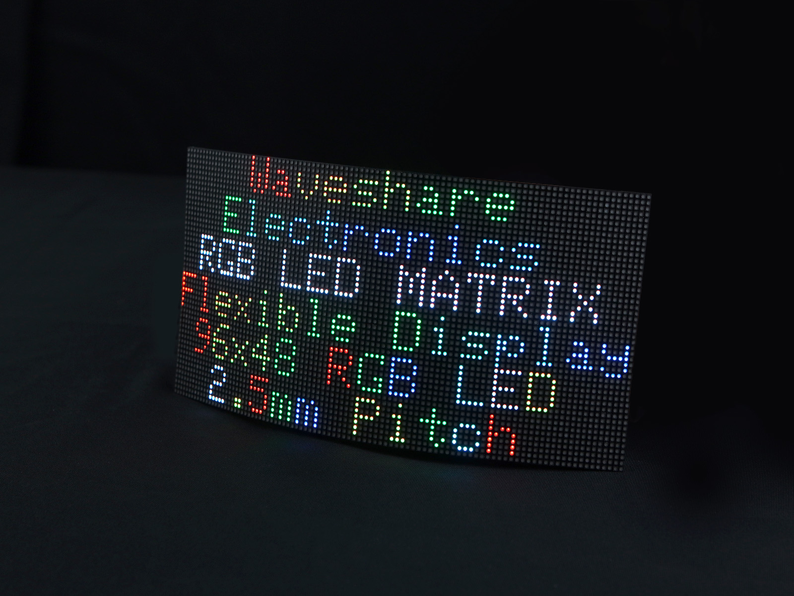
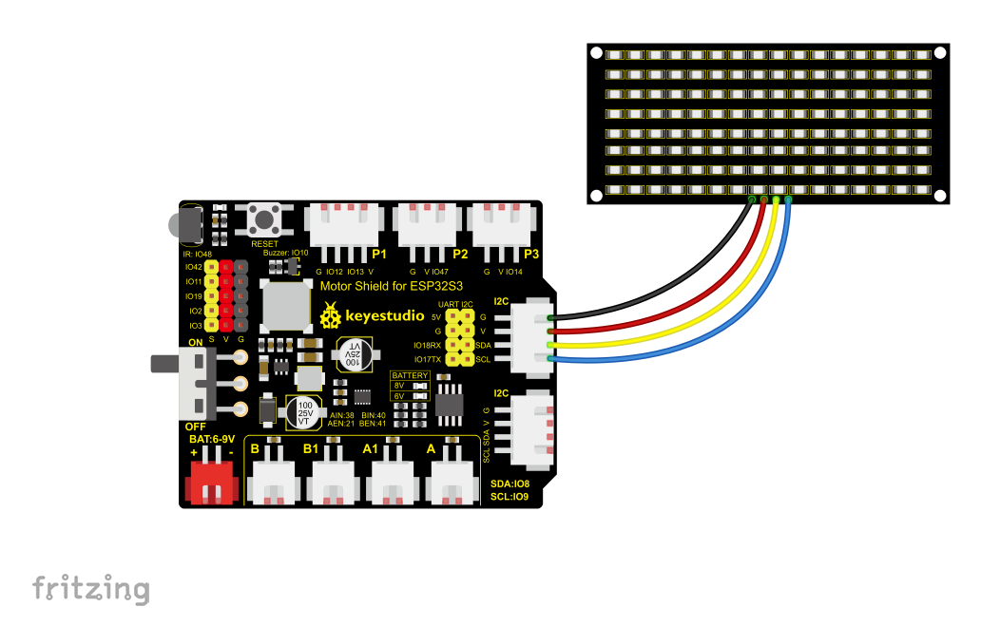
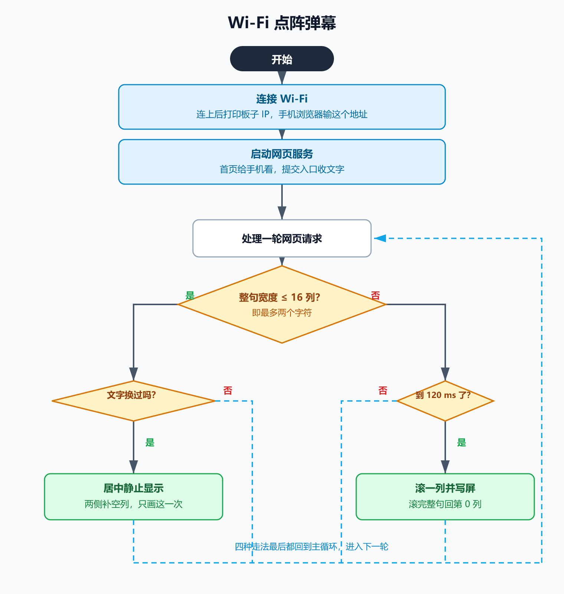

### 项目 12：Wi-Fi 点阵弹幕屏

#### **1. 简介：**

{width=520px}

第 1 课的点阵只能循环播几个写死的图案，现在把它变成一块弹幕屏：手机连上和车同一个 Wi-Fi，浏览器打开板子的地址，输入一句话，点发送，点阵上就滚出来了。

这块屏只有 16 列宽。字库里一个字母占 5 列，加上 1 列间隔就是 6 列，一屏顶多两个字——超过的必须滚起来，不滚就只剩半截。滚动每 120 毫秒挪一列，读起来刚好跟得上。

字库是幕后的主角：26 个字母加 10 个数字，每个字符 5 列，每列一个字节。想换一种字形，动的就是这些字节。

上电后串口打印板子拿到的地址，手机在同一个 Wi-Fi 下打开它，是一个输入框加一个发送按钮。发 HI，居中不动；发 LOVE，从右往左滚，滚完留一段空白再从头来。

#### **2. 所需清单：**

本课用到的器件：

|     |     |     |
| :---: | :---: | :---: |
| {width=170px}<br><span style="font-size:0.85em">8×16 LED 点阵屏 ×1</span> | {width=170px}<br><span style="font-size:0.85em">DRV8835 电机扩展板 ×1</span> | {width=170px}<br><span style="font-size:0.85em">ESP32-S3 开发板 ×1</span> |
| <span style="font-size:0.85em">2.4 GHz 无线路由器或手机热点 ×1</span> |  |  |
> ⚠️ **点阵在第 2 章就装好了，本表只作对照，不用拆；下面的接线说明只标清接线方式，供对照，不必拆装。完整物料见 1.4 套件清单。**
#### **3. 参数：**

| 项目 | 参数 |
| --- | --- |
| Wi-Fi 模式 | STA，仅 2.4 GHz |
| 网页端口 | 80 |
| 访问方式 | 浏览器打开串口打印的 IP |
| 字符集 | A ~ Z、0 ~ 9、空格，共 37 个 |
| 字库规格 | 5×7，每字符 5 列，每列 1 字节 |
| 字符占宽 | 6 列（5 列字模 + 1 列间隔） |
| 最大字符数 | 24 |
| 一屏容量 | 16 列，约 2 个字符 |
| 滚动间隔 | 120 ms / 列 |

#### **4. 接线说明：**

| 信号 | 主控 GPIO |
| --- | :---: |
| 点阵 CLK | IO9 |
| 点阵 DIN | IO8 |

这一课不用电机和传感器，只接点阵。Wi-Fi 是片内功能，不需要额外接线。



#### **5. 流程图：**

从手机点**发送**到点阵亮起来，中间要过四道关：



#### **6. 测试代码：**

> **上传前先改一处**：把下面 `WIFI_SSID`、`WIFI_PASS` 换成自己的 Wi-Fi 名称和密码，不改连不上。
>
> 另外两点要同时满足：Wi-Fi 必须是 **2.4 GHz**（板子不支持 5 GHz），手机和车要在**同一个局域网**——否则浏览器打不开板子的 IP。

> **本课工程有两个文件**：`12_WiFi_DotMatrix.ino` 和 `webpage.h`。网页的 HTML 全部放在 `webpage.h`，`.ino` 里只留 Arduino 逻辑；两个文件放在同一个文件夹，少一个编译不过。

```cpp
#include <WiFi.h>
#include <WebServer.h>
#include "webpage.h"  // 网页内容

// ===== Wi-Fi 配置 =====
// 仅支持 2.4 GHz
const char* WIFI_SSID = "你的WiFi名字";
const char* WIFI_PASS = "你的WiFi密码";

// ===== 点阵引脚 =====
#define CLK_Pin 9  // 时钟，接模块 CLK
#define DIN_Pin 8  // 数据，接模块 DIN

// ===== 滚动参数 =====
#define SCROLL_MS 120  // 每列滚动间隔（ms），越小越快
#define MAX_CHARS  24  // 最大字符数

// ===== 5×7 字库 =====
// 每字符 5 列，1 字节/列，bit0 为最上行，bit6 为最下行
// 索引 0~25 为 A~Z，26~35 为 0~9，36 为空格
const uint8_t FONT[37][5] = {
  {0x7E, 0x11, 0x11, 0x11, 0x7E},  // A
  {0x7F, 0x49, 0x49, 0x49, 0x36},  // B
  {0x3E, 0x41, 0x41, 0x41, 0x22},  // C
  {0x7F, 0x41, 0x41, 0x22, 0x1C},  // D
  {0x7F, 0x49, 0x49, 0x49, 0x41},  // E
  {0x7F, 0x09, 0x09, 0x09, 0x01},  // F
  {0x3E, 0x41, 0x49, 0x49, 0x7A},  // G
  {0x7F, 0x08, 0x08, 0x08, 0x7F},  // H
  {0x00, 0x41, 0x7F, 0x41, 0x00},  // I
  {0x20, 0x40, 0x41, 0x3F, 0x01},  // J
  {0x7F, 0x08, 0x14, 0x22, 0x41},  // K
  {0x7F, 0x40, 0x40, 0x40, 0x40},  // L
  {0x7F, 0x02, 0x0C, 0x02, 0x7F},  // M
  {0x7F, 0x04, 0x08, 0x10, 0x7F},  // N
  {0x3E, 0x41, 0x41, 0x41, 0x3E},  // O
  {0x7F, 0x09, 0x09, 0x09, 0x06},  // P
  {0x3E, 0x41, 0x51, 0x21, 0x5E},  // Q
  {0x7F, 0x09, 0x19, 0x29, 0x46},  // R
  {0x46, 0x49, 0x49, 0x49, 0x31},  // S
  {0x01, 0x01, 0x7F, 0x01, 0x01},  // T
  {0x3F, 0x40, 0x40, 0x40, 0x3F},  // U
  {0x1F, 0x20, 0x40, 0x20, 0x1F},  // V
  {0x3F, 0x40, 0x38, 0x40, 0x3F},  // W
  {0x63, 0x14, 0x08, 0x14, 0x63},  // X
  {0x07, 0x08, 0x70, 0x08, 0x07},  // Y
  {0x61, 0x51, 0x49, 0x45, 0x43},  // Z
  {0x3E, 0x51, 0x49, 0x45, 0x3E},  // 0
  {0x00, 0x42, 0x7F, 0x40, 0x00},  // 1
  {0x42, 0x61, 0x51, 0x49, 0x46},  // 2
  {0x21, 0x41, 0x45, 0x4B, 0x31},  // 3
  {0x18, 0x14, 0x12, 0x7F, 0x10},  // 4
  {0x27, 0x45, 0x45, 0x45, 0x39},  // 5
  {0x3C, 0x4A, 0x49, 0x49, 0x30},  // 6
  {0x01, 0x71, 0x09, 0x05, 0x03},  // 7
  {0x36, 0x49, 0x49, 0x49, 0x36},  // 8
  {0x06, 0x49, 0x49, 0x29, 0x1E},  // 9
  {0x00, 0x00, 0x00, 0x00, 0x00}   // 空格
};

WebServer server(80);      // 网页服务器
String msg = "HELLO";      // 待显示文字
int scrollPos = 0;         // 当前起始列
unsigned long lastScrollAt = 0;
bool needRedraw = true;    // 文字变化，静止显示需重绘

void setup() {
  // 两线拉高，总线置空闲
  pinMode(CLK_Pin, OUTPUT);
  pinMode(DIN_Pin, OUTPUT);
  digitalWrite(CLK_Pin, HIGH);
  digitalWrite(DIN_Pin, HIGH);

  Serial.begin(115200);
  delay(300);

  // 连接 Wi-Fi
  Serial.print("正在连接 ");
  Serial.println(WIFI_SSID);
  WiFi.mode(WIFI_STA);
  WiFi.begin(WIFI_SSID, WIFI_PASS);
  while (WiFi.status() != WL_CONNECTED) {
    delay(500);
    Serial.print(".");
  }
  Serial.println();
  Serial.print("弹幕屏就绪，手机打开：http://");
  Serial.println(WiFi.localIP());

  // 首页
  server.on("/", []() {
    server.send_P(200, "text/html; charset=utf-8", index_html);
  });

  // 接收文字
  server.on("/msg", []() {
    String t = server.arg("t");
    t.trim();
    t.toUpperCase();                       // 字库仅含大写
    if (t.length() > MAX_CHARS) {
      t = t.substring(0, MAX_CHARS);       // 超长截断
    }
    if (t.length() > 0) {
      msg = t;
      scrollPos = 0;            // 从最右列开始滚入
      needRedraw = true;        // 标记需重绘
    }
    server.sendHeader("Location", "/");     // 返回首页
    server.send(302, "text/plain", "");
  });

  server.begin();
}

void loop() {
  server.handleClient();  // 处理网页请求

  // ---- 一屏装得下：居中静止显示 ----
  if (textWidth() <= 16) {
    if (needRedraw) {     // 仅在文字变化时重绘
      renderStatic();
      needRedraw = false;
    }
    return;
  }

  // ---- 超出一屏：横向滚动 ----
  if (millis() - lastScrollAt < SCROLL_MS) return;
  lastScrollAt = millis();

  renderFrame(scrollPos);
  scrollPos++;

  // 滚完整句再留 16 列空白后循环
  int totalCols = textWidth() + 16;
  if (scrollPos >= totalCols) {
    scrollPos = 0;
  }
}

// ===== 宽度计算 =====
// 整句占用的列数
// 每字符 6 列，末字符不计间隔
int textWidth() {
  if (msg.length() == 0) return 0;
  return msg.length() * 6 - 1;
}

// ===== 静止显示 =====
// 整句居中显示在一屏 16 列内
void renderStatic() {
  int total = textWidth();
  int startCol = (16 - total) / 2;  // 左侧留空列数

  uint8_t cols[16];
  for (int i = 0; i < 16; i++) {
    int idx = i - startCol;                 // 映射到整句列号
    cols[i] = (idx >= 0) ? getColumn(idx) : 0;  // 句首之前补空
  }

  matrix_display(cols);
}

// ===== 渲染一帧 =====
// 从整句第 pos 列开始截取一屏
void renderFrame(int pos) {
  uint8_t cols[16];

  for (int i = 0; i < 16; i++) {
    cols[i] = getColumn(pos + i);
  }

  matrix_display(cols);
}

// 取整句第 idx 列
uint8_t getColumn(int idx) {
  if (idx < 0) return 0;                    // 尚未进入屏幕

  int charIdx = idx / 6;                    // 字符索引（每字符 6 列：5 列字模 + 1 列间隔）
  int colIdx  = idx % 6;                    // 字符内列号

  if (charIdx >= (int)msg.length()) return 0;  // 超出句尾
  if (colIdx >= 5) return 0;                   // 间隔列

  int fi = charToIndex(msg[charIdx]);
  return FONT[fi][colIdx];
}

// 字符转字库索引
int charToIndex(char c) {
  if (c >= 'A' && c <= 'Z') return c - 'A';       // A~Z → 0~25
  if (c >= '0' && c <= '9') return 26 + (c - '0'); // 0~9 → 26~35
  return 36;                                       // 其他字符按空格处理
}

// ===== 点阵驱动 =====
// 将 16 字节字模写入点阵屏显存
void matrix_display(unsigned char matrix_value[]) {
  // 0x40：写数据模式，地址自增
  IIC_start();
  IIC_send(0x40);
  IIC_end();

  // 0xC0：显存起始地址 0
  IIC_start();
  IIC_send(0xC0);

  // 连写 16 列
  for (int i = 0; i < 16; i++) {
    IIC_send(matrix_value[i]);
  }
  IIC_end();

  // 0x8A：开显示，亮度 8/16
  IIC_start();
  IIC_send(0x8A);
  IIC_end();
}

// 起始条件：CLK 高电平期间 DIN 下降沿
void IIC_start() {
  digitalWrite(CLK_Pin, HIGH);
  delayMicroseconds(3);
  digitalWrite(DIN_Pin, HIGH);
  delayMicroseconds(3);
  digitalWrite(DIN_Pin, LOW);
  delayMicroseconds(3);
}

// 发送 1 字节，低位在前：CLK 低时置数据，上升沿采样
void IIC_send(unsigned char send_data) {
  for (int i = 0; i < 8; i++) {
    digitalWrite(CLK_Pin, LOW);  // 拉低时钟，准备数据
    delayMicroseconds(3);

    // 从 bit0 起逐位发送
    if (send_data & 0x01) {
      digitalWrite(DIN_Pin, HIGH);
    } else {
      digitalWrite(DIN_Pin, LOW);
    }
    delayMicroseconds(3);

    digitalWrite(CLK_Pin, HIGH); // 拉高时钟，模块采样
    delayMicroseconds(3);

    send_data = send_data >> 1;  // 右移，取出下一位
  }
}

// 停止条件：CLK 高电平期间 DIN 上升沿
void IIC_end() {
  digitalWrite(CLK_Pin, LOW);
  delayMicroseconds(3);
  digitalWrite(DIN_Pin, LOW);
  delayMicroseconds(3);
  digitalWrite(CLK_Pin, HIGH);
  delayMicroseconds(3);
  digitalWrite(DIN_Pin, HIGH);
  delayMicroseconds(3);
}
```

#### **7. 代码解释：**

**(1) 账号、引脚、两个参数**

```cpp
const char* WIFI_SSID = "你的WiFi名字";
const char* WIFI_PASS = "你的WiFi密码";

#define CLK_Pin 9  // 时钟，接模块 CLK
#define DIN_Pin 8  // 数据，接模块 DIN

#define SCROLL_MS 120  // 每列滚动间隔（ms），越小越快
#define MAX_CHARS  24  // 最大字符数
```

两个 Wi-Fi 常量必须在编译前改成自己的，不改连不上。`SCROLL_MS 120` 是滚动时每列停留的时间，滚完 16 列要 1.92 秒；改 60 快一倍，但字会糊得看不清。`MAX_CHARS 24` 是输入上限，超了截断。

**(2) 字库：37 个字符，每个 5 列**

```cpp
const uint8_t FONT[37][5] = {
```

二维数组，第一维是 37 个字符（0～25 是 A～Z，26～35 是 0～9，36 是空格），第二维是 5 个字节——一个字符占 5 列，每个字节一位管一行，bit0 在最上。

点阵屏只有 8 行高，小写字母的上下伸展（b、p、g）在这个高度里画不出区别，所以字库只收大写、数字和空格。要加符号，就在 `FONT` 后面追加 5 个字节，并把索引号一起改。

**(3) 四个全局状态**

```cpp
String msg = "HELLO";      // 待显示文字
int scrollPos = 0;         // 当前起始列
unsigned long lastScrollAt = 0;
bool needRedraw = true;    // 文字变化，静止显示需重绘
```

这四个变量是网页回调和 `loop()` 之间唯一的通道：回调改 `msg`，`loop()` 读 `msg` 决定画什么。`scrollPos` 记滚动到第几列，`lastScrollAt` 记上一次滚动的时刻（不用 `delay`，靠 `millis()` 算间隔），`needRedraw` 标记"文字换了，静止画面要重画一次"。

**(4) `setup()`：连 Wi-Fi**

```cpp
  WiFi.mode(WIFI_STA);
  WiFi.begin(WIFI_SSID, WIFI_PASS);
  while (WiFi.status() != WL_CONNECTED) {
    delay(500);
    Serial.print(".");
  }
```

`WIFI_STA` 是"连别人的路由器"模式，不是自己做热点。`while` 循环会一直卡在这里直到连上，每半秒打一个点——连不上就一直打点，看到这个现象先查账号密码和 2.4 GHz。

连上之后打印的 `WiFi.localIP()` 就是手机要访问的地址。

**(5) 网页那部分：只负责把文字递进来**

```cpp
  server.on("/", []() {
    server.send_P(200, "text/html; charset=utf-8", INDEX_HTML);
  });

  server.on("/msg", []() {
    String t = server.arg("t");
    t.trim();                              // 去首尾空白
    t.toUpperCase();                       // 字库仅含大写
    if (t.length() > MAX_CHARS) {
      t = t.substring(0, MAX_CHARS);       // 超长截断
    }
    if (t.length() > 0) {
      msg = t;
      scrollPos = 0;
      needRedraw = true;
    }
    server.sendHeader("Location", "/");    // 跳回首页
    server.send(302, "text/plain", "");
  });

  server.begin();
```

这是 WebServer 库的标准写法，不是本课的重点，知道它干了什么就够了：`/` 把 `webpage.h` 里那段 HTML 发出去，`/msg` 接住手机提交的文字，**去空格、转大写、截到 24 个字符**（字库只有大写和数字），存进 `msg`，再 302 跳回首页——不跳的话按刷新会重复提交上一次的文字。

回调里只改三个全局变量，一帧都不画。真正画点在 `loop()` 里，也就是下面几节：这段文字怎么变成 16 列点阵上的画面。

**(6) `loop()`：装得下就静止**

```cpp
void loop() {
  server.handleClient();  // 处理网页请求

  // ---- 一屏装得下：居中静止显示 ----
  if (textWidth() <= 16) {
    if (needRedraw) {     // 仅在文字变化时重绘
      renderStatic();
      needRedraw = false;
    }
    return;
  }
```

`handleClient()` 必须每轮都调，网页才有响应——它只处理"有没有请求"，没有就立刻返回，不阻塞。

`loop()` 一秒跑几千轮。没有 `needRedraw` 这个标志，静止画面也会被重画几千次，每次都是 20 多次 GPIO 翻转 + 四段 I2C 时序，白白占着 CPU，网页响应也变慢。有这个标志，同一句话只画一次。

那个 `return` 也重要：装得下就直接结束这一轮，不往下走滚动逻辑。

**(7) `loop()`：装不下就滚动**

```cpp
  // ---- 超出一屏：横向滚动 ----
  if (millis() - lastScrollAt < SCROLL_MS) return;
  lastScrollAt = millis();

  renderFrame(scrollPos);
  scrollPos++;

  // 滚完整句再留 16 列空白后循环
  int totalCols = textWidth() + 16;
  if (scrollPos >= totalCols) {
    scrollPos = 0;
  }
}
```

用 `millis()` 判断间隔而不是 `delay(120)`：`delay` 会把整个 `loop()` 卡住，这期间网页请求没人处理，手机点提交要等半天。用时间戳比较，滚一列之后立刻返回，下一轮还能顺手处理请求。

`totalCols = textWidth() + 16` 是"整句宽度再加一屏空白"，滚到句尾之后屏幕空一遍再从头开始，看起来有节奏。

**(8) `textWidth()`：一个字符 6 列**

```cpp
int textWidth() {
  if (msg.length() == 0) return 0;
  return msg.length() * 6 - 1;
}
```

每个字符占 6 列：5 列点阵 + 1 列间隔。`-1` 是因为最后一个字符后面不需要间隔。

所以 `"AB"` 是 6+6−1 = 11 列，`"ABC"` 是 17 列——刚好超过 16，开始滚。16 列的屏最多放两个字符静止显示，三个起就滚。

**(9) 把整句映射到 16 列：`renderStatic()` 和 `renderFrame()`**

```cpp
void renderStatic() {
  int total = textWidth();
  int startCol = (16 - total) / 2;  // 左侧留空列数

  uint8_t cols[16];
  for (int i = 0; i < 16; i++) {
    int idx = i - startCol;                 // 映射到整句列号
    cols[i] = (idx >= 0) ? getColumn(idx) : 0;  // 句首之前补空
  }

  matrix_display(cols);
}

void renderFrame(int pos) {
  uint8_t cols[16];

  for (int i = 0; i < 16; i++) {
    cols[i] = getColumn(pos + i);
  }

  matrix_display(cols);
}
```

两个函数都只做一件事：**凑出 16 列数据，交给 `matrix_display()` 写屏**。区别只在起点的算法。

`renderStatic()` 要居中，先算左边该留几列空：`(16 - total) / 2`。整句 11 列时留 2 列，屏幕第 0、1 列是空的，文字从第 2 列开始。循环里 `i - startCol` 把"屏幕列号"换算成"整句列号"，前两列算出负数，说明还没到句首，直接补 0（灭）。

`renderFrame()` 用于滚动，起点是传进来的 `pos`：屏幕第 `i` 列取整句第 `pos + i` 列。`pos` 每帧加 1，整个窗口就往右移一列，看起来是文字向左走。句尾之后 `getColumn()` 返回 0，自然留白。

两个函数末尾都是 `matrix_display(cols)`——16 个字节一送，屏上就是这一帧。点阵驱动本身在第 1 课讲过，这里不再展开。

**(10) `getColumn()`：一次算一列**

```cpp
uint8_t getColumn(int idx) {
  int charIdx = idx / 6;                    // 第几个字符
  int colIdx  = idx % 6;                    // 字符内第几列
  if (charIdx >= (int)msg.length()) return 0;
  if (colIdx >= 5) return 0;                // 间隔列
  int fi = charToIndex(msg[charIdx]);
  return FONT[fi][colIdx];
}
```

滚动时每一帧只需要 16 列，没必要先把整句几百列拼进内存。给一个全局列号 `idx`，除 6 得字符下标、模 6 得字符内列号，直接去字库取。

`colIdx == 5` 是间隔列，返回 0（灭）；超出句尾也返回 0（留白）。除法和取余必须成对出现，只用其中一个就会串字。

`renderFrame(pos)` 就是 `for (i=0..15) cols[i] = getColumn(pos + i)`，把窗口从第 `pos` 列开始截 16 列出来。`renderStatic()` 则是先算居中偏移 `startCol`，再让 `i - startCol` 当全局列号。

**(11) `charToIndex()`：索引是连续排的**

```cpp
int charToIndex(char c) {
  if (c >= 'A' && c <= 'Z') return c - 'A';        // A~Z → 0~25
  if (c >= '0' && c <= '9') return 26 + (c - '0'); // 0~9 → 26~35
  return 36;                                       // 其他字符按空格
}
```

`'A' - 'A' = 0`、`'Z' - 'A' = 25`，字母靠 ASCII 连续性直接算出下标，不用查表。数字接在后面 26～35，第 37 项（下标 36）是空白，兜住所有字库里没有的字符——中文、标点、小写字母（已经被 `toUpperCase` 转掉了）都落到这一项。

#### **8. 运行现象：**

上电后串口打印：

```text
正在连接 你的WiFi名字
.....
弹幕屏就绪，手机打开：http://192.168.1.23
```

手机连同一个 Wi-Fi，浏览器输入这个地址，出现一个深色页面：输入框、**发送到点阵**按钮，下面两行说明。

| 输入 | 点阵表现 |
| --- | --- |
| `HI` | 居中静止显示 |
| `LOVE` | 从右往左滚动，滚完留 16 列空白再循环 |
| `HELLO WORLD` | 滚动，字符间距均匀 |

> 【图片待补】输入 `LOVE` 后点阵滚动到中间位置的实拍图。

#### **9. 常见问题解决：**

**Wi-Fi 连不上、网页打不开，按这个顺序查：**

(1) **账号密码换了没有**：代码开头的 `WIFI_SSID`、`WIFI_PASS` 还是占位符就烧进去，一定连不上，改成自己路由器的名称和密码。

(2) **串口一行字都没有**：按一下板子上的 RESET 键再试，可能是上一版程序卡住了。

{width=340px}

(3) **串口一直冒点、拿不到 IP**：Wi-Fi 连接失败。路由器必须是 **2.4 GHz**，5 GHz 板子不支持；没有 2.4 G 就开手机热点（热点默认 2.4 G）。

(4) **拿到 IP 但页面打不开**：地址要带 `http://`，IP 以串口打印的为准；手机必须连同一个 Wi-Fi，两边 IP 前三段要一样。

(5) **网段对、还是打不开**：进路由器后台把**AP 隔离**关掉，开了它同一 Wi-Fi 下的设备互相访问不了。
