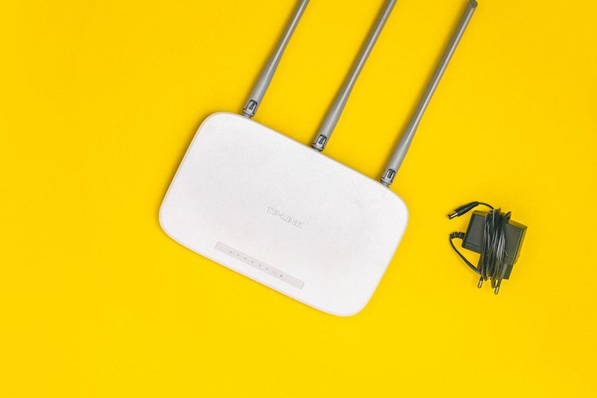
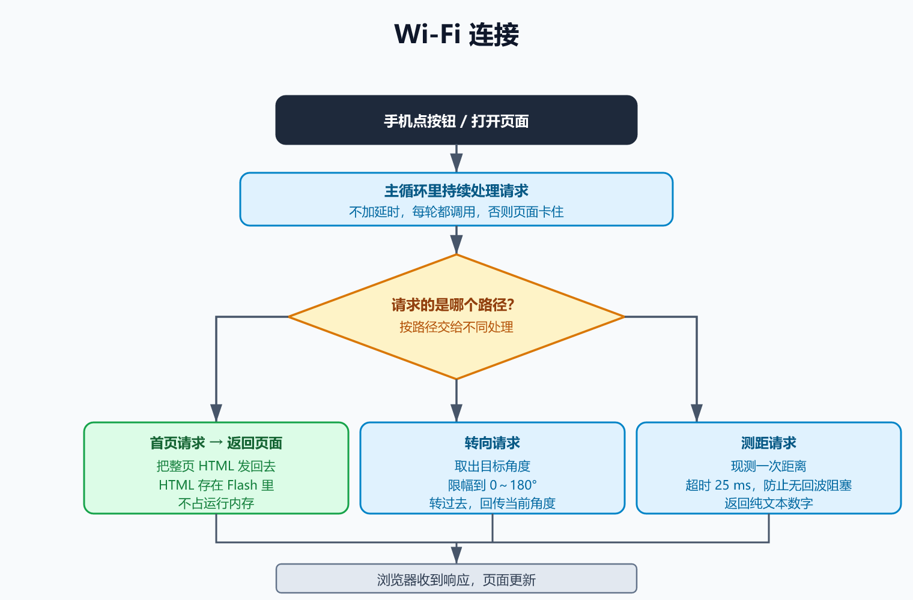

### 项目 13：Wi-Fi 连接与遥控

#### **1. 简介：**

{width=520px}

第 12 课的网页只能往点阵上送字，这一课的网页要真的伸手去动硬件：手机屏幕上三个按钮转云台、一个按钮量距离，读数直接回到页面上，不用再盯串口。

链路很短：按下按钮，浏览器发出一条带参数的请求，板子收到后转舵机、或者量一次距离，再把结果当文本回给浏览器。局域网上一个来回是毫秒级的，看起来的延迟主要在舵机自己转过去的那点时间。

整节课车都不跑，只有云台和超声波听网页指挥，电机要到下一课才接进来。页面和动作还分成了两份文件：一份写页面长什么样，一份写每个按钮做什么，改界面不用碰动作。

板子连上路由器后，串口打印出它拿到的地址；手机在同一个 Wi-Fi 下打开这个地址，页面上半部写着当前云台角度，下半部写着前方距离。点左 180°，探头转向左边，角度数字跟着变成 180；点中 90° 回到正前方；点右 0° 转到右边；点测一次距离，-- 先变成三个点，随后给出厘米数。

#### **2. 所需清单：**

本课用到的器件：

|     |     |     |
| :---: | :---: | :---: |
| {width=200px}<br><span style="font-size:0.85em">9G 舵机（180°，配十字臂） ×1</span> | {width=200px}<br><span style="font-size:0.85em">超声波模块（带外壳） ×1</span> | {width=200px}<br><span style="font-size:0.85em">DRV8835 电机扩展板 ×1</span> |
| {width=200px}<br><span style="font-size:0.85em">ESP32-S3 开发板 ×1</span> | <span style="font-size:0.85em">2.4 GHz 无线路由器或手机热点 ×1</span> |  |
> ⚠️ **云台与超声波在第 2 章就装好了，本表只作对照，不用拆；下面的接线说明只标清接线方式，供对照，不必拆装。完整物料见 1.4 套件清单。**
#### **3. 参数：**

| 项目 | 参数 |
| --- | --- |
| Wi-Fi 模式 | STA，仅 2.4 GHz |
| 网页端口 | 80 |
| 云台信号脚 | IO42 |
| 云台范围 | 0°～180°（0° 指右、180° 指左） |
| 超声波 Trig / Echo | IO13 / IO12 |
| 测距超时 | 25 ms |
| 指令接口 | `/pan?angle=N`、`/distance` |
| 返回格式 | `text/plain` |

#### **4. 接线说明：**

| 信号 | 主控 GPIO |
| --- | :---: |
| 云台舵机信号 | IO42 |
| 超声波 Trig | IO13 |
| 超声波 Echo | IO12 |

> **注意**：接线图中的元器件只用于说明接线关系，实际接线时不需要把清单中带外壳的元器件拆开。


#### **5. 流程图：**

网页请求进来后，`server.handleClient()` 按网址找到对应的回调，执行完再返回：



#### **6. 测试代码：**

> **上传前先改一处**：把下面 `WIFI_SSID`、`WIFI_PASS` 换成自己的 Wi-Fi 名称和密码，不改连不上。
>
> 另外两点要同时满足：Wi-Fi 必须是 **2.4 GHz**（板子不支持 5 GHz），手机和车要在**同一个局域网**——否则浏览器打不开板子的 IP。

> **本课工程有两个文件**：`13_WiFi_Connection.ino` 和 `webpage.h`。网页的 HTML 全部放在 `webpage.h`，`.ino` 里只留 Arduino 逻辑；两个文件放在同一个文件夹，少一个编译不过。

```cpp
#include <WiFi.h>
#include <WebServer.h>
#include <ESP32Servo.h>
#include "webpage.h"  // 网页内容

// ===== Wi-Fi =====
// 仅支持 2.4 GHz
const char* WIFI_SSID = "你的WiFi名字";
const char* WIFI_PASS = "你的WiFi密码";

// ===== 引脚 =====
// 云台舵机；安装方向为 0° 指右、180° 指左
#define PAN_SERVO_PIN 42  // 云台舵机

const int trigPin = 13;  // 超声波触发
const int echoPin = 12;  // 超声波回响

WebServer server(80);  // 网页服务，80 端口
Servo panServo;
int panAngle = 90;     // 当前云台角度，上电回中

// 本课只用舵机与超声波，不驱动电机

void setup() {
  Serial.begin(115200);
  delay(500);

  // 超声波
  pinMode(trigPin, OUTPUT);
  pinMode(echoPin, INPUT);

  // 云台舵机
  ESP32PWM::allocateTimer(0);
  panServo.setPeriodHertz(50);
  panServo.attach(PAN_SERVO_PIN, 500, 2500);
  panServo.write(90);

  // Station 模式连接路由器
  Serial.print("正在连接 ");
  Serial.println(WIFI_SSID);
  WiFi.mode(WIFI_STA);
  WiFi.begin(WIFI_SSID, WIFI_PASS);

  // 阻塞等待连接成功
  while (WiFi.status() != WL_CONNECTED) {
    delay(500);
    Serial.print(".");
  }
  Serial.println();
  Serial.println("WiFi 已连接");
  Serial.print("板子的 IP：");
  Serial.println(WiFi.localIP());   // 手机浏览器访问此地址

  // 网页路由
  server.on("/", []() {
    server.send_P(200, "text/html; charset=utf-8", index_html);
  });

  server.on("/pan", []() {
    int a = server.arg("angle").toInt();
    a = constrain(a, 0, 180);   // 限幅 0~180
    panAngle = a;
    panServo.write(a);
    server.send(200, "text/plain", String(a));  // 回传当前角度
  });

  server.on("/distance", []() {
    server.send(200, "text/plain", String(getDistance()));
  });

  server.begin();
  Serial.println("网页服务已启动，手机浏览器打开上面的 IP");
}

void loop() {
  server.handleClient();  // 必须持续调用
}

// 测距
int getDistance() {
  long duration;
  int distance;

  digitalWrite(trigPin, LOW);
  delayMicroseconds(2);
  digitalWrite(trigPin, HIGH);
  delayMicroseconds(10);
  digitalWrite(trigPin, LOW);

  // 25 ms 超时，防止无回波时阻塞
  duration = pulseIn(echoPin, HIGH, 25000);
  distance = duration * 0.034 / 2;

  if (distance < 2 || distance > 300) {
    distance = 0;
  }
  return distance;
}
```

#### **7. 代码解释：**

**(1) 三个库**

```cpp
#include <WiFi.h>
#include <WebServer.h>
#include <ESP32Servo.h>
#include "webpage.h"  // 网页内容
```

前两个是 Wi-Fi 和网页服务，第三个是舵机。`"webpage.h"` 加引号表示这是当前文件夹里的文件，不是从库里加载的。

**(2) 账号和引脚**

```cpp
const char* WIFI_SSID = "你的WiFi名字";
const char* WIFI_PASS = "你的WiFi密码";

#define PAN_SERVO_PIN 42  // 云台舵机

const int trigPin = 13;  // 超声波触发
const int echoPin = 12;  // 超声波回响
```

账号密码必须改成自己的，并且只支持 2.4 GHz。三个引脚和第 3、8 课一致：超声波 Trig 13、Echo 12，云台 42。

注释里"0° 指右、180° 指左"是装配方向，第 4 课左右选边就靠这个约定。

**(3) `server` 对象和两个全局状态**

```cpp
WebServer server(80);  // 网页服务，80 端口
Servo panServo;
int panAngle = 90;     // 当前云台角度，上电回中
```

`WebServer server(80)` 里的 80 是 HTTP 默认端口，浏览器输 `http://IP` 时自动连这个端口，所以地址里不用写 `:80`。

`panAngle` 只在 `/pan` 回调里被写、别处没读，看着像多余。它是留给第 14、15 课的：那两个程序要在别的地方知道"云台现在朝哪"，比如避障时判断左右。这一课先把它存下来，是给后面铺路。

**(4) `setup()`：超声波和舵机先就位**

```cpp
  pinMode(trigPin, OUTPUT);
  pinMode(echoPin, INPUT);

  ESP32PWM::allocateTimer(0);
  panServo.setPeriodHertz(50);
  panServo.attach(PAN_SERVO_PIN, 500, 2500);
  panServo.write(90);
```

和第 8 课完全一样：分一个定时器、50 Hz、500～2500 µs、上电回中 90°。本课不驱动电机，所以 `ledcAttach` 和电机引脚一行都没有。

**(5) 连 Wi-Fi：这里允许阻塞**

```cpp
  WiFi.mode(WIFI_STA);
  WiFi.begin(WIFI_SSID, WIFI_PASS);

  // 阻塞等待连接成功
  while (WiFi.status() != WL_CONNECTED) {
    delay(500);
    Serial.print(".");
  }
```

`while` 会一直卡到连上，每半秒打一个点。这一处阻塞是可以接受的——网页服务还没启动，没有请求要处理。连不上就一直打点，看到这个现象先查账号密码、2.4 GHz 和路由器有没有开 DHCP。

连上之后打印的 `WiFi.localIP()` 就是手机要访问的地址。

**(6) 首页：`send_P` 从 Flash 发**

```cpp
  server.on("/", []() {
    server.send_P(200, "text/html; charset=utf-8", index_html);
  });
```

`server.on(路径, 函数)` 只是登记，不是执行：它把"收到 `/` 这样的请求就调这个函数"记进路由表，登记完一行代码都没跑。真正的执行发生在 `loop()` 的 `handleClient()` 里。

`send_P()` 的 `_P` 就是"从 PROGMEM 发"，边读边往网络上送，不整块拷进内存。`200` 是"成功"，写成 `404` 网页内容再对也显示不出来；`charset=utf-8` 少了，页面上的中文全成方块。

**(7) `/pan`：手动改 URL 也顶不坏舵机**

```cpp
  server.on("/pan", []() {
    int a = server.arg("angle").toInt();
    a = constrain(a, 0, 180);   // 限幅 0~180
    panAngle = a;
    panServo.write(a);
    server.send(200, "text/plain", String(a));  // 回传当前角度
  });
```

`server.arg("angle")` 取 URL 里的参数，`toInt()` 把字符串转数字。

**`constrain()` 这行不能省**：网页上的滑块本来是 0～180，但 URL 是手可以改的，随便敲个 `?angle=500` 就能把舵机顶到限位上去，齿轮会响。限幅之后无论传什么，写进舵机的都是合法角度。

回的是纯文本不是网页，因为这个接口是给网页里的 JS 调的，回一段 HTML 反而要多解析一次。

**(8) `/distance`：回一个数字**

```cpp
  server.on("/distance", []() {
    server.send(200, "text/plain", String(getDistance()));
  });
```

`String(getDistance())` 把整数转成字符串再发。网页里的 JS 收到 `"25"` 这样的文本，`parseInt` 一下就拿到数值。

**(9) `pulseIn()` 多了第三个参数**

```cpp
  duration = pulseIn(echoPin, HIGH, 25000);
```

第 3 课是两参数版本，默认超时 1 秒。这里加了 25 ms——**这一课最关键的改动**。

原因在阻塞上：前方空旷时没有回波，两参数版本会死等 1 秒，这一秒里 `handleClient()` 一次都没跑，手机上的页面就卡住不动。25 ms 够 300 cm 的往返（约 17.5 ms），超过就返回 0，主循环立刻继续。代价是超过 4 米的目标测不到——本来也不在量程内。

**(10) `loop()` 里只有一行**

```cpp
void loop() {
  server.handleClient();  // 必须持续调用
}
```

它监听 80 端口，收到请求就按路径去路由表里查，找到对应函数再调用。必须每轮都跑，加一句 `delay(1000)` 手机页面就会卡住一秒才响应。

这一行也是第 14、15 课的基础：那两个程序会在这行前后塞进电机控制和状态机，`handleClient()` 始终保持在最前面。

#### **8. 运行现象：**

上电后串口打印：

```text
正在连接 你的WiFi名字
.....
WiFi 已连接
板子的 IP：192.168.1.23
网页服务已启动，手机浏览器打开上面的 IP
```

手机打开这个地址，看到页面：

| 操作 | 现象 |
| --- | --- |
| 点**左 180°** | 云台转向左边，页面角度变成 180 |
| 点**中 90°** | 云台回正前方 |
| 点**右 0°** | 云台转向右边 |
| 点**测一次距离** | 数值从 `--` 变成当前距离（cm） |

> 【图片待补】云台转到左右两端时手机页面与实车同框的实拍图。

#### **9. 常见问题解决：**

**Wi-Fi 连不上、网页打不开，按这个顺序查：**

(1) **账号密码换了没有**：代码开头的 `WIFI_SSID`、`WIFI_PASS` 还是占位符就烧进去，一定连不上，改成自己路由器的名称和密码。

(2) **串口一行字都没有**：按一下板子上的 RESET 键再试，可能是上一版程序卡住了。

{width=340px}

(3) **串口一直冒点、拿不到 IP**：Wi-Fi 连接失败。路由器必须是 **2.4 GHz**，5 GHz 板子不支持；没有 2.4 G 就开手机热点（热点默认 2.4 G）。

(4) **拿到 IP 但页面打不开**：地址要带 `http://`，IP 以串口打印的为准；手机必须连同一个 Wi-Fi，两边 IP 前三段要一样。

(5) **网段对、还是打不开**：进路由器后台把**AP 隔离**关掉，开了它同一 Wi-Fi 下的设备互相访问不了。

(6) 页面能打开但按钮没反应，打开浏览器开发者工具看 Network：如果请求一直是 pending，说明 `loop()` 被别的东西卡住了；如果返回 404，说明 `server.on()` 里的路径和网页里写的 `fetch` 地址不一致（注意有没有前导斜杠）。
