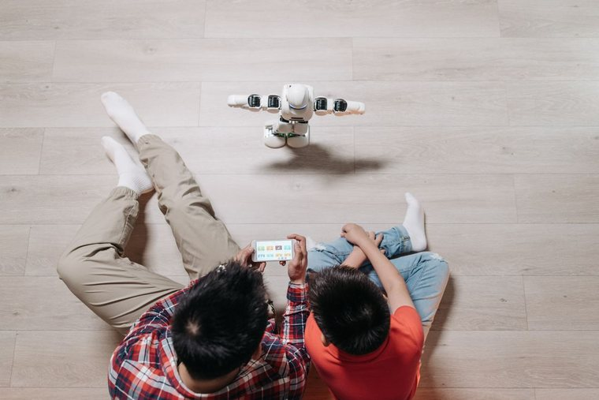
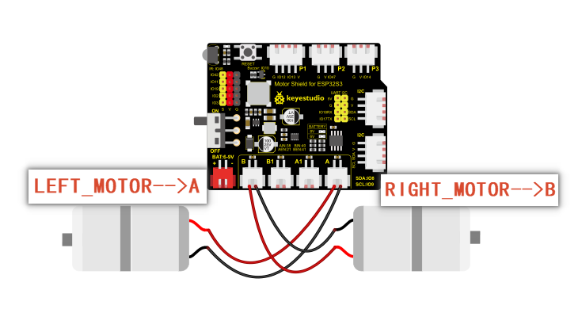
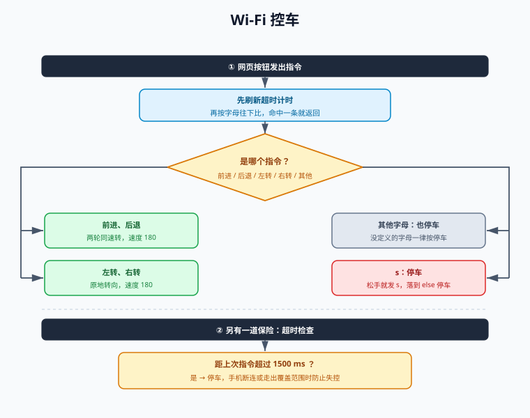

### 项目 14：Wi-Fi 控车

#### **1. 简介：**

手机当遥控器，但这次控制的是车。页面上一组方向键，按下去车走，松开车停——比红外遥控器好用的地方在于，Wi-Fi 没有方向性，隔着墙、背对着车也能控制，只要还在同一个局域网里。

代价是延迟不可控。Wi-Fi 的包要经过路由器转发，走一圈 20～100 ms，遇到信道拥挤还会丢包。所以这一课的代码里有一条跟红外遥控车一样的规则：**1.5 s 没有新指令就自动停车**。丢包、手机锁屏、走出信号范围，车都自己停住，不会一路冲下去。

另一个与红外不同的地方是按键方式。红外是「按一下发一帧」，网页按钮是「按下、松开各触发一次」。代码里把方向键和「松手」拆成两条指令：`d=f` 是前进，`d=s` 是停。松手时浏览器一定发 `d=s`，但为防这个包丢了，超时保护仍然保留。

{width=520px}

#### **2. 所需清单：**

本课用到的器件：

|     |     |
| :---: | :---: |
| {width=200px}<br><span style="font-size:0.85em">DRV8835 电机扩展板 ×1</span> | {width=200px}<br><span style="font-size:0.85em">履带底盘总成 ×1</span> |
| {width=200px}<br><span style="font-size:0.85em">ESP32-S3 开发板 ×1</span> | <span style="font-size:0.85em">2.4 GHz 无线路由器或手机热点 ×1</span> |
> ⚠️ **全是第 2 章装好的器件，本表只作对照，不用拆；下面的接线说明只标清接线方式，供对照，不必拆装。完整物料见 1.4 套件清单。**
#### **3. 参数：**

| 项目 | 参数 |
| --- | --- |
| 网页端口 | 80 |
| 直行速度 | 180 |
| 原地转速度 | 180 |
| 指令超时 | 1500 ms |
| 指令格式 | `/cmd?d=f|b|l|r|s` |
| 左轮 AIN / AEN | IO38 / IO21 |
| 右轮 BIN / BEN | IO40 / IO41 |

#### **4. 接线说明：**

| 信号 | 主控 GPIO |
| --- | :---: |
| 左轮 AIN（方向） | IO38 |
| 左轮 AEN（调速） | IO21 |
| 右轮 BIN（方向） | IO40 |
| 右轮 BEN（调速） | IO41 |

这一课不接传感器，只接电机。Wi-Fi 是片内功能。



#### **5. 流程图：**

从手指按下到轮子转起来，中间隔着浏览器、路由器和板子三层：



#### **6. 测试代码：**

> **上传前先改一处**：把下面 `WIFI_SSID`、`WIFI_PASS` 换成自己的 Wi-Fi 名称和密码，不改连不上。
>
> 另外两点要同时满足：Wi-Fi 必须是 **2.4 GHz**（板子不支持 5 GHz），手机和车要在**同一个局域网**——否则浏览器打不开板子的 IP。

> **本课工程有两个文件**：`14_WiFi_Car_Control.ino` 和 `webpage.h`。网页的 HTML 全部放在 `webpage.h`，`.ino` 里只留 Arduino 逻辑；两个文件放在同一个文件夹，少一个编译不过。

```cpp
#include <WiFi.h>
#include <WebServer.h>
#include "webpage.h"  // 网页内容

// ===== Wi-Fi =====
// 仅支持 2.4 GHz
const char* WIFI_SSID = "你的WiFi名字";
const char* WIFI_PASS = "你的WiFi密码";

// ===== 引脚 =====
#define MOTOR_AIN 38  // A 路方向
#define MOTOR_AEN 21  // A 路调速
#define MOTOR_BIN 40  // B 路方向
#define MOTOR_BEN 41  // B 路调速

// ===== 速度 =====
#define SPEED_RUN  180  // 直行
#define SPEED_TURN 180  // 原地转

// 指令超时（ms）自动停车
// 网络丢包或手机锁屏时防止失控
#define STOP_AFTER 1500

WebServer server(80);
unsigned long lastCmdTime = 0;

void setup() {
  Serial.begin(115200);
  delay(500);

  pinMode(MOTOR_BIN, OUTPUT);
  pinMode(MOTOR_AIN, OUTPUT);
  ledcAttach(MOTOR_BEN, 1000, 8);
  ledcAttach(MOTOR_AEN, 1000, 8);
  stopCar();

  Serial.print("正在连接 ");
  Serial.println(WIFI_SSID);
  WiFi.mode(WIFI_STA);
  WiFi.begin(WIFI_SSID, WIFI_PASS);

  // 阻塞等待连接成功
  while (WiFi.status() != WL_CONNECTED) {
    delay(500);
    Serial.print(".");
  }
  Serial.println();
  Serial.println("WiFi 已连接");
  Serial.print("板子的 IP：");
  Serial.println(WiFi.localIP());   // 手机浏览器访问此地址

  server.on("/", []() {
    server.send_P(200, "text/html; charset=utf-8", index_html);
  });

  // 网页按钮统一入口，d 为方向
  server.on("/cmd", []() {
    String d = server.arg("d");
    runCmd(d);
    server.send(200, "text/plain", "ok");
  });

  server.begin();
  Serial.println("遥控车已就绪");
}

void loop() {
  server.handleClient();  // 必须持续调用

  // 超时停车
  if (millis() - lastCmdTime > STOP_AFTER) {
    stopCar();
  }
}

// 指令分发
void runCmd(String d) {
  lastCmdTime = millis();   // 刷新超时计时

  if (d == "f") {
    Serial.println("前进");
    goForward(SPEED_RUN);
  } else if (d == "b") {
    Serial.println("后退");
    goBackward(SPEED_RUN);
  } else if (d == "l") {
    Serial.println("左转");
    spinLeft(SPEED_TURN);
  } else if (d == "r") {
    Serial.println("右转");
    spinRight(SPEED_TURN);
  } else {
    Serial.println("停车");
    stopCar();
  }
}

// ===== 电机驱动 =====
// A 路接左轮、B 路接右轮，与第 7 课一致
// 若左右相反，互换下面两段
void driveMotors(int leftSpeed, int rightSpeed) {
  leftSpeed  = constrain(leftSpeed,  -255, 255);
  rightSpeed = constrain(rightSpeed, -255, 255);

  if (rightSpeed >= 0) {
    digitalWrite(MOTOR_BIN, HIGH);
    ledcWrite(MOTOR_BEN, rightSpeed);
  } else {
    digitalWrite(MOTOR_BIN, LOW);
    ledcWrite(MOTOR_BEN, -rightSpeed);
  }

  if (leftSpeed >= 0) {
    digitalWrite(MOTOR_AIN, HIGH);
    ledcWrite(MOTOR_AEN, leftSpeed);
  } else {
    digitalWrite(MOTOR_AIN, LOW);
    ledcWrite(MOTOR_AEN, -leftSpeed);
  }
}

void goForward(int speed)  { driveMotors(speed, speed); }
void goBackward(int speed) { driveMotors(-speed, -speed); }
void spinLeft(int speed)   { driveMotors(-speed, speed); }
void spinRight(int speed)  { driveMotors(speed, -speed); }
void stopCar()             { driveMotors(0, 0); }
```

#### **7. 代码解释：**

**(1) 一个接口管五个动作**

```cpp
  server.on("/cmd", []() {
    String d = server.arg("d");
    runCmd(d);
    server.send(200, "text/plain", "ok");
  });
```

不再给每个方向开一个路径，而是统一走 `/cmd`，用参数 `d` 区分：`f` 前进、`b` 后退、`l` 左转、`r` 右转、`s` 停车（以及任何没定义的字母，都当停车）。

第 13 课是"一个功能一个路径"（`/pan`、`/distance`），这课动作多、每个动作只有一行，合成一个入口更省事。

**(2) 网页那边只有一句**

```javascript
function go(d){
  fetch('/cmd?d='+d).catch(e=>{});
}
```

`fetch` 发一个 GET 请求，参数直接拼在网址里。`.catch(e=>{})` 吞掉所有错误——手机断网、板子重启都会让请求失败，不吞的话控制台一片红，但车该怎么跑还怎么跑。

请求是异步的（`fetch` 不等待返回），所以手指按住按钮时不会因为等上一次响应而卡顿。

用 GET 不用 POST，是因为 GET 的参数就在网址里，服务端一行 `server.arg()` 就能取，省掉解析请求体的代码。代价是参数会出现在浏览历史和日志里——控制指令不敏感，用 GET 最省事。

**(3) `lastCmdTime` 必须在分支之前刷**

```cpp
void runCmd(String d) {
  lastCmdTime = millis();   // 刷新超时计时

  if (d == "f") {
```

注意这句在第一个 `if` 之前，不在每个分支里。放前面意味着**任何** `d` 都算"车还连得上"，包括停车和那些没定义的字母。

放分支里就会出问题：发 `s` 停车时不刷计时，1.5 秒后超时判断又调一次 `stopCar()`——虽然结果一样，但语义乱了。

这一点和第 11 课的红外车相反。红外那边只有**已知键**才刷计时，因为在遥控器上按到数字键是误触，不该续命；网页这边按钮是固定的，能发出请求就说明手机还连着。

**(4) 五个动作的 `if` 链**

```cpp
  if (d == "f") {
    Serial.println("前进");
    goForward(SPEED_RUN);
  } else if (d == "b") {
    Serial.println("后退");
    goBackward(SPEED_RUN);
  } else if (d == "l") {
    Serial.println("左转");
    spinLeft(SPEED_TURN);
  } else if (d == "r") {
    Serial.println("右转");
    spinRight(SPEED_TURN);
  }
```

四个方向各一支，用 `else if` 串起来。参数是 `String`，所以比较用双引号包起来的字符串 `"f"`，不是字符 `'f'`——写成单引号 C++ 会报类型不匹配。

**(5) `s` 落在 `else` 里**

```cpp
  } else {
    Serial.println("停车");
    stopCar();
  }
```

`runCmd()` 里没有 `if (d == "s")` 这一支。网页上所有按钮的 `onpointerup`（松手）都发 `s`，它一路走到最后的 `else` 才停车。

好处是任何打错的字母也当停车处理——**默认往安全的方向兜底**。

**(6) `loop()` 里两件事，和红外课同一个结构**

```cpp
void loop() {
  server.handleClient();  // 必须持续调用

  // 超时停车
  if (millis() - lastCmdTime > STOP_AFTER) {
    stopCar();
  }
}
```

第一件处理网络请求，第二件查超时，两个 `if` 平级。`STOP_AFTER` 也是 1500 ms，和红外课一样。

超时在这里的作用比红外更明显：手机走出 Wi-Fi 覆盖、锁屏、浏览器切到后台，`fetch` 都不再发出，但车不会知道——它只会看到"再也没有 `/cmd` 请求进来"。1.5 秒一到就停车，避免车顶着墙一直跑。

松手到真正停住之间最多 1.5 秒，这段时间车还在跑，是追尾的高发窗口，测试时手别离开电源。

手机上长按按钮，浏览器默认会弹"选择文字/复制"的菜单，还会把长按当成滚动页面的手势。`touch-action:none` 把这些默认行为关掉，`onpointerdown` 才能稳稳地按住持续生效。

前面两个 `user-select:none` 是同一个目的：禁止选中文字，否则长按会选中按钮上的字。

#### **8. 运行现象：**

串口打印：

```text
正在连接 你的WiFi名字
.....
WiFi 已连接
板子的 IP：192.168.1.23
遥控车已就绪
```

手机页面上一组方向键，按住不放车持续走，松手立停。

| 操作 | 串口 | 车 |
| --- | --- | --- |
| 按 ↑ | 前进 | 两轮正转 |
| 按 ↓ | 后退 | 两轮反转 |
| 按 ← | 左转 | 原地左转 |
| 按 → | 右转 | 原地右转 |
| 松手 / 按停 | 停车 | 立即停 |
| 强行关掉手机 Wi-Fi | 无输出 | 1.5 s 后自己停 |

> 【图片待补】手机上方向键页面与小车行驶的同框实拍图。

#### **9. 常见问题解决：**

**Wi-Fi 连不上、网页打不开，按这个顺序查：**

(1) **账号密码换了没有**：代码开头的 `WIFI_SSID`、`WIFI_PASS` 还是占位符就烧进去，一定连不上，改成自己路由器的名称和密码。

(2) **串口一行字都没有**：按一下板子上的 RESET 键再试，可能是上一版程序卡住了。

{width=340px}

(3) **串口一直冒点、拿不到 IP**：Wi-Fi 连接失败。路由器必须是 **2.4 GHz**，5 GHz 板子不支持；没有 2.4 G 就开手机热点（热点默认 2.4 G）。

(4) **拿到 IP 但页面打不开**：地址要带 `http://`，IP 以串口打印的为准；手机必须连同一个 Wi-Fi，两边 IP 前三段要一样。

(5) **网段对、还是打不开**：进路由器后台把「AP 隔离」关掉，开了它同一 Wi-Fi 下的设备互相访问不了。

(6) 车动起来一顿一顿的，多半是路由器信号弱或者 2.4G 信道拥挤。把手机和车挪近一点，或者进路由器后台换一个信道（1、6、11 三个互不重叠）。如果转弯时一侧轮子明显慢，先查电池电压——Wi-Fi 发射瞬间电流能到 300 mA，电池电量低时电压被拉垮，PWM 输出跟着塌。
