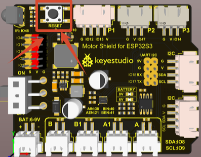

### Project 14: Wi-Fi Car Control

#### **1. Introduction:**

{width=520px}

Use the phone as a remote — this time to drive the car. A direction pad on the page: hold a key and the car goes, release and it stops. Unlike an IR remote, Wi-Fi has no directionality — it works through a wall or from behind the car, as long as everything is on the same LAN.

The price is a variable delay. A command makes a round trip through the router — a few tens of milliseconds when things are quiet, over a hundred when the network is busy, and sometimes the packet is simply lost. So use the same rule as the IR remote control car: stop automatically if no new command arrives within 1.5 s.

The buttons behave differently too. An IR remote sends one frame per press; a web button fires once on press and once on release, so forward and stop are two separate commands — and the browser always sends the stop on release.

Hold up and both tracks run at the same speed forward; press left and the two sides run in opposite directions to spin left in place; release and the car stops at once. Turn off the phone's Wi-Fi and the car will stop by itself 1.5 s later.

#### **2. Parts Needed:**

Parts used in this lesson:

|     |     |
| :---: | :---: |
| {width=200px}<br><span style="font-size:0.85em">DRV8835 motor driver expansion board ×1</span> | {width=200px}<br><span style="font-size:0.85em">Tracked chassis assembly ×1</span> |
| {width=200px}<br><span style="font-size:0.85em">ESP32-S3 development board ×1</span> | <span style="font-size:0.85em">2.4 GHz wireless router or phone hotspot ×1</span> |
> ⚠️ **All parts were installed back in Chapter 2; this table is for reference only — there is nothing to take apart. The wiring notes below only show how the connections are made, for reference; no assembly or disassembly is required. For the complete parts list, see 1.4 Kit Parts List.**
#### **3. Parameters:**

| Item | Value |
| --- | --- |
| Web page port | 80 |
| Straight travel speed | 180 |
| Spin-in-place speed | 180 |
| Command timeout | 1500 ms |
| Command format | `/cmd?d=f|b|l|r|s` |
| Left wheel AIN / AEN | IO38 / IO21 |
| Right wheel BIN / BEN | IO40 / IO41 |

#### **4. Wiring:**

| Signal | Controller GPIO |
| --- | :---: |
| Left wheel AIN (direction) | IO38 |
| Left wheel AEN (speed) | IO21 |
| Right wheel BIN (direction) | IO40 |
| Right wheel BEN (speed) | IO41 |

This lesson wires no sensors, only the motors. Wi-Fi is built into the chip.


#### **5. Flowchart:**

Between a finger touching the screen and the wheels turning, the signal passes through three layers — browser, router and board:


#### **6. Test Code:**

> **Before uploading, change one thing**: replace `WIFI_SSID` and `WIFI_PASS` below with your own Wi-Fi name and password — otherwise it won't connect.
>
> Two more conditions must hold at the same time: the Wi-Fi must be **2.4 GHz** (the board doesn't support 5 GHz), and the phone and the robot must be on the **same LAN** — otherwise the browser can't open the board's IP.

> **This project has two files**: `14_WiFi_Car_Control.ino` and `webpage.h`. All the page HTML lives in `webpage.h`; the `.ino` keeps only the Arduino logic. Put both files in the same folder — if one is missing, compilation fails.

```cpp
#include <WiFi.h>
#include <WebServer.h>
#include "webpage.h"  // Web page content

// ===== Wi-Fi =====
// Only supports 2.4 GHz
const char* WIFI_SSID = "Your WiFi name";
const char* WIFI_PASS = "Your WiFi password";


// ===== Pins =====
#define MOTOR_AIN 38  // Channel A direction
#define MOTOR_AEN 21  // Channel A speed control
#define MOTOR_BIN 40  // Channel B direction
#define MOTOR_BEN 41  // Channel B speed control

// ===== Speed =====
#define SPEED_RUN  180  // Forward
#define SPEED_TURN 180  // Spin in place

// Auto-stop when a command times out (ms)
// Prevents loss of control on packet loss or when the phone screen locks
#define STOP_AFTER 1500

WebServer server(80);
unsigned long lastCmdTime = 0;

void setup() {
  Serial.begin(115200);
  delay(500);

  pinMode(MOTOR_BIN, OUTPUT);
  pinMode(MOTOR_AIN, OUTPUT);
  ledcAttach(MOTOR_BEN, 1000, 8);
  ledcAttach(MOTOR_AEN, 1000, 8);
  stopCar();

  Serial.print("Connecting to ");
  Serial.println(WIFI_SSID);
  WiFi.mode(WIFI_STA);
  WiFi.begin(WIFI_SSID, WIFI_PASS);

  // Block until the connection succeeds
  while (WiFi.status() != WL_CONNECTED) {
    delay(500);
    Serial.print(".");
  }
  Serial.println();
  Serial.println("WiFi connected");
  Serial.print("Board IP: ");
  Serial.println(WiFi.localIP());   // Open this address in a phone browser

  server.on("/", []() {
    server.send_P(200, "text/html; charset=utf-8", index_html);
  });

  // Single entry point for web page buttons; d is the direction
  server.on("/cmd", []() {
    String d = server.arg("d");
    runCmd(d);
    server.send(200, "text/plain", "ok");
  });

  server.begin();
  Serial.println("Remote control car is ready");
}

void loop() {
  server.handleClient();  // Must be called continuously

  // Stop on timeout
  if (millis() - lastCmdTime > STOP_AFTER) {
    stopCar();
  }
}

// Command dispatch
void runCmd(String d) {
  lastCmdTime = millis();   // Refresh the timeout timer

  if (d == "f") {
    Serial.println("Forward");
    goForward(SPEED_RUN);
  } else if (d == "b") {
    Serial.println("Backward");
    goBackward(SPEED_RUN);
  } else if (d == "l") {
    Serial.println("Turn left");
    spinLeft(SPEED_TURN);
  } else if (d == "r") {
    Serial.println("Turn right");
    spinRight(SPEED_TURN);
  } else {
    Serial.println("Stop");
    stopCar();
  }
}

// ===== Motor driver =====
// Channel A drives the left wheel, channel B the right wheel, as in Lesson 7
// If left and right are reversed, swap the two sections below
void driveMotors(int leftSpeed, int rightSpeed) {
  leftSpeed  = constrain(leftSpeed,  -255, 255);
  rightSpeed = constrain(rightSpeed, -255, 255);

  if (rightSpeed >= 0) {
    digitalWrite(MOTOR_BIN, HIGH);
    ledcWrite(MOTOR_BEN, rightSpeed);
  } else {
    digitalWrite(MOTOR_BIN, LOW);
    ledcWrite(MOTOR_BEN, -rightSpeed);
  }

  if (leftSpeed >= 0) {
    digitalWrite(MOTOR_AIN, HIGH);
    ledcWrite(MOTOR_AEN, leftSpeed);
  } else {
    digitalWrite(MOTOR_AIN, LOW);
    ledcWrite(MOTOR_AEN, -leftSpeed);
  }
}

void goForward(int speed)  { driveMotors(speed, speed); }
void goBackward(int speed) { driveMotors(-speed, -speed); }
void spinLeft(int speed)   { driveMotors(-speed, speed); }
void spinRight(int speed)  { driveMotors(speed, -speed); }
void stopCar()             { driveMotors(0, 0); }
```

#### **7. Code Explanation:**

**(1) One endpoint for five actions**

```cpp
  server.on("/cmd", []() {
    String d = server.arg("d");
    runCmd(d);
    server.send(200, "text/plain", "ok");
  });
```

Instead of opening a separate path for every direction, everything goes through `/cmd`, with the parameter `d` telling them apart: `f` forward, `b` backward, `l` turn left, `r` turn right, `s` stop (and any undefined letter is also treated as stop).

Project 13 used "one path per feature" (`/pan`, `/distance`); here there are many actions and each is only a line or two, so a single entry point is simpler.

**(2) Just one line on the web side**

```javascript
function go(d){
  fetch('/cmd?d='+d).catch(e=>{});
}
```

`fetch` sends a GET request with the parameters appended directly to the URL. `.catch(e=>{})` swallows all errors — if the phone loses its connection or the board reboots the request fails; without the catch the console turns red, but the robot keeps doing whatever it was doing.

The request is asynchronous (`fetch` doesn't wait for the response), so holding a button doesn't stutter while waiting for the previous one to come back.

GET rather than POST because GET parameters sit right in the URL and a single line of `server.arg()` retrieves them, saving the code needed to parse a request body. The cost is that the parameters appear in browsing history and logs — control commands aren't sensitive, so GET is the easy choice.

**(3) `lastCmdTime` must be refreshed before the branches**

```cpp
void runCmd(String d) {
  lastCmdTime = millis();   // Refresh the timeout timer

  if (d == "f") {
```

Notice this line sits before the first `if`, not inside each branch. Putting it up front means **any** `d` counts as "the robot is still reachable", including stop and those undefined letters.

Put it inside a branch and you get a problem: sending `s` to stop wouldn't refresh the timer, so 1.5 seconds later the timeout would call `stopCar()` again — the result is the same, but the meaning gets muddled.

This is the opposite of the IR car in Project 11. There only **known keys** refreshed the timer, because hitting a number key on the remote is an accidental touch and shouldn't keep the car alive; on the web page the buttons are fixed, so being able to send a request at all means the phone is still connected.

**(4) The `if` chain for five actions**

```cpp
  if (d == "f") {
    Serial.println("Forward");
    goForward(SPEED_RUN);
  } else if (d == "b") {
    Serial.println("Backward");
    goBackward(SPEED_RUN);
  } else if (d == "l") {
    Serial.println("Turn left");
    spinLeft(SPEED_TURN);
  } else if (d == "r") {
    Serial.println("Turn right");
    spinRight(SPEED_TURN);
  }
```

Four directions each get a branch, chained with `else if`. The parameter is a `String`, so comparisons use the double-quoted string `"f"`, not the character `'f'` — single quotes would make C++ report a type mismatch.

**(5) `s` falls into `else`**

```cpp
  } else {
    Serial.println("Stop");
    stopCar();
  }
```

There is no `if (d == "s")` branch in `runCmd()`. Every button on the page sends `s` on `onpointerup` (release), and it falls all the way through to the final `else` to stop.

The upside is that any mistyped letter is treated as stop as well — **the default fails safe**.

**(6) Two things in `loop()`, the same structure as the IR lesson**

```cpp
void loop() {
  server.handleClient();  // Must be called continuously

  // Stop on timeout
  if (millis() - lastCmdTime > STOP_AFTER) {
    stopCar();
  }
}
```

The first handles network requests, the second checks the timeout; the two `if`s are siblings. `STOP_AFTER` is also 1500 ms, just like in the IR lesson.

The timeout matters more here than with IR: when the phone walks out of Wi-Fi coverage, locks its screen or switches the browser to the background, `fetch` stops being sent — but the robot has no idea. All it sees is "no more `/cmd` requests coming in". When 1.5 seconds are up it stops, so it doesn't keep driving into a wall.

At most 1.5 seconds pass between releasing the button and actually stopping; during that window the robot is still moving, a prime moment for a rear-end collision, so keep a hand near the power while testing.

On a phone, long-pressing a button brings up the browser's default "select text / copy" menu and is also treated as a page-scroll gesture. `touch-action:none` disables those defaults so `onpointerdown` can reliably keep the command active.

The two `user-select:none` rules serve the same purpose: prevent text selection, otherwise a long press would select the label on the button.

#### **8. What You'll See:**

The serial port prints:

```text
Connecting Your WiFi name
.....
WiFi connected
Board IP: 192.168.1.23
Remote control car ready
```

The phone page shows a direction pad; hold a button and the robot keeps moving, release and it stops immediately.

| Action | Serial | Robot |
| --- | --- | --- |
| Press ↑ | Forward | Both wheels rotate forward |
| Press ↓ | Backward | Both wheels rotate in reverse |
| Press ← | Turn left | Spin in place to the left |
| Press → | Turn right | Spin in place to the right |
| Release / press stop | Stop | Stops immediately |
| Force the phone's Wi-Fi off | No output | Stops by itself after 1.5 s |

> [Image to be added] A photo of the direction-pad page on the phone alongside the robot actually driving.

#### **9. Troubleshooting:**

**If Wi-Fi won't connect or the page won't open, check in this order:**

(1) **Did you change the credentials?** If `WIFI_SSID` and `WIFI_PASS` at the top of the code are still placeholders when you flash, it will never connect; replace them with your router's name and password.

(2) **Nothing at all on serial?** Press the RESET button on the board and try again — the previous sketch may be stuck.

{width=340px}

(3) **Dots keep printing on serial, no IP?** Wi-Fi connection failed. The router must be **2.4 GHz**; the board doesn't support 5 GHz. If you have no 2.4 G network, turn on a phone hotspot (hotspots default to 2.4 G).

(4) **Got an IP but the page won't open?** The address must include `http://`, and the IP must be the one printed on serial; the phone must be on the same Wi-Fi, and the first three octets of both IPs must match.

(5) **Same subnet but still won't open?** Log in to the router settings and turn off **AP isolation**; when it's enabled, devices on the same Wi-Fi can't reach one another.

(6) The robot moves in jerks, usually because the router signal is weak or the 2.4 G channel is crowded. Move the phone and robot closer together, or log in to the router and switch channels (1, 6 and 11 don't overlap). If one wheel is noticeably slower when turning, check the battery voltage first — the Wi-Fi transmitter can draw 300 mA in bursts, and a low battery sags under that load, dragging the PWM output down with it.
