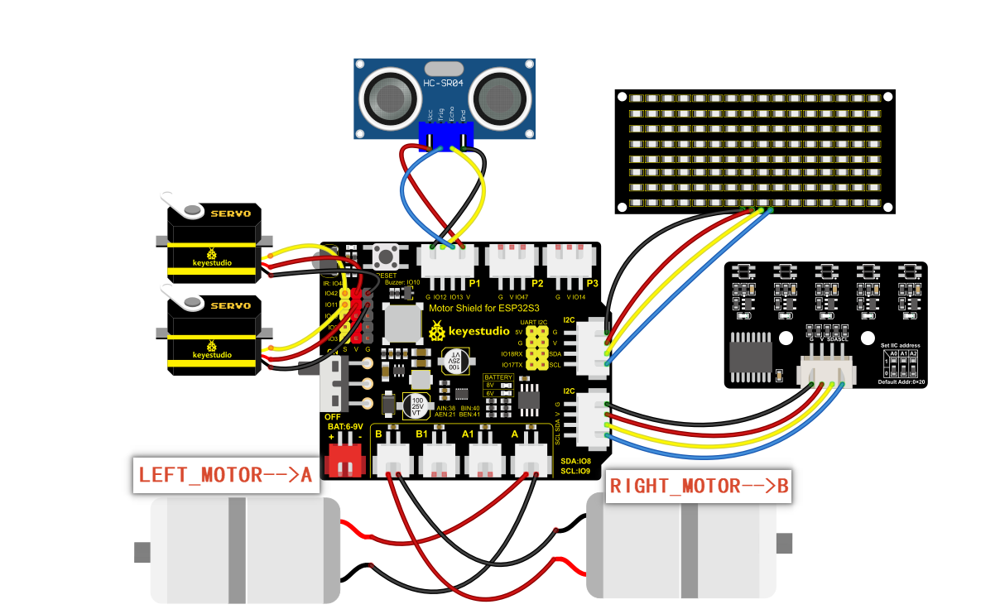
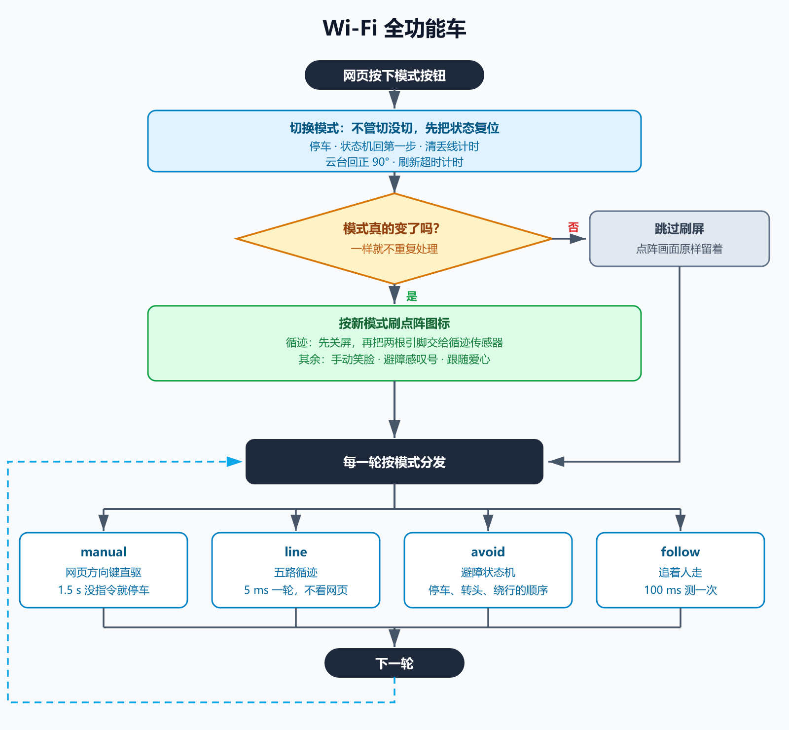

### Project 15: Wi-Fi Multi-Function Car

#### **1. Introduction:**

The code from the first fourteen lessons comes together here in one sketch: manual remote control, line tracking, obstacle avoidance and following, four modes switched on the same web page, with the dot matrix changing its expression to match and the pan-tilt and gripper always at your command. At more than six hundred lines, it is the longest program in the book.

All four functions work fine on their own, but put them together and the first thing you hit is a fight over the same lines: the dot matrix holds IO8 and IO9, and the line-tracking sensor's bus uses those same two pins. The fix is to claim the lines by mode with time-division multiplexing — while tracking, hand them to the sensor and let the dot matrix step aside; in every other mode, reverse the arrangement.

The second problem is waiting. Obstacle avoidance turns a servo, pauses for 300 ms, then measures a distance, and during that wait the web page freezes. The fix is to break avoidance into five steps, each doing just one thing and advancing on a timer, so nothing has to wait for anything else. Every mode switch also gets its own cleanup: stop the car, recenter the pan-tilt, clear the previous mode's memory, and only then enter the new mode.

Four mode buttons sit at the top of the phone page. Manual mode shows a smiley on the dot matrix, line tracking blanks the screen, obstacle avoidance shows an exclamation mark, and following shows a heart. The moment you switch, the car stops briefly and the pan-tilt returns to center before it starts moving in the new mode.

#### **2. Parts List:**

Parts used in this lesson:

|     |     |     |
| :---: | :---: | :---: |
| {width=170px}<br><span style="font-size:0.85em">ESP32-S3 development board ×1</span> | {width=170px}<br><span style="font-size:0.85em">DRV8835 motor expansion board ×1</span> | {width=170px}<br><span style="font-size:0.85em">Tracked chassis assembly (with line-tracking sensor) ×1</span> |
| {width=170px}<br><span style="font-size:0.85em">Ultrasonic module (with housing) ×1</span> | {width=170px}<br><span style="font-size:0.85em">8×16 LED dot matrix display ×1</span> | {width=170px}<br><span style="font-size:0.85em">9G servo (180°) ×2</span> |
| <span style="font-size:0.85em">2.4 GHz Wi-Fi router or phone hotspot ×1</span> |  |  |
> ⚠️ **All parts were assembled in Chapter 2; this table is only for reference and nothing needs to be taken apart. The wiring notes below only show how the connections are made, also for reference — no disassembly is needed. For the full parts list, see 1.4 Kit Contents.**
#### **3. Parameters:**

| Item | Parameter |
| --- | --- |
| Operating mode | manual / line / avoid / follow |
| Manual timeout | 1500 ms |
| Line-tracking straight speed | 115 |
| Line-tracking sharp turn | Inner wheel reverse 95, outer wheel 125 |
| Following range | Move forward at 30–50 cm, back up below 10 cm |
| Obstacle threshold | Below 15 cm counts as an obstacle |
| Obstacle-avoidance states | AV_GO → AV_LEFT → AV_RIGHT → AV_TURN → AV_TURNING |
| Pan-tilt step | 15° per step |
| Gripper angle | Open 140°, closed 90° |
| Dot matrix and line tracking | Share IO8 / IO9, exclusively claimed by mode |

#### **4. Wiring:**

| Module | Pin | Controller GPIO |
| --- | --- | :---: |
| Left wheel motor | AIN / AEN | IO38 / IO21 |
| Right wheel motor | BIN / BEN | IO40 / IO41 |
| Ultrasonic | Trig / Echo | IO13 / IO12 |
| Dot matrix | CLK / DIN | IO9 / IO8 |
| Line-tracking I2C | SCL / SDA | IO9 / IO8 |
| Pan-tilt servo | Signal | IO42 |
| Gripper servo | Signal | IO11 |

> **Note**: The components in the wiring diagram are only there to show the connections; you do not need to take the cased parts from the parts list apart when wiring.

**IO8 / IO9 appear twice** and that is no typo: the dot matrix uses a **"fake I2C"** built from software-timed GPIO, while line tracking uses real hardware I2C. Both claim the same pin pair, and the code switches between them by time-division multiplexing.



#### **5. Flowchart:**

The main loop dispatches by mode; `carMode` decides which of the four is running:



#### **6. Test Code:**

> **Change one thing before uploading**: replace `ssid` and `password` below with your own Wi-Fi name and password, or the connection will fail.
>
> Two more conditions must both hold: the Wi-Fi must be **2.4 GHz** (the board does not support 5 GHz), and the phone and the car must be on the **same LAN** — otherwise the browser cannot open the board's IP address.

> **This lesson's project has two files**: `15_WiFi_MultiFunction.ino` and `webpage.h`. All the web page HTML lives in `webpage.h`; the `.ino` holds only the Arduino logic. Put both files in the same folder — compilation fails if either is missing.

```cpp
#include <WiFi.h>
#include <WebServer.h>
#include <ESP32Servo.h>
#include <Wire.h>
#include <PCF8574.h>
#include "webpage.h"  // Web page content

// ===== Wi-Fi =====
// Only 2.4 GHz is supported
const char* ssid = "Your WiFi name";
const char* password = "Your WiFi password";

// ===== Global objects =====
WebServer server(80);  // Web server
Servo myClaw;          // Gripper servo
Servo myPan;           // Pan-tilt servo

// ===== Motor pins =====
// Channel A drives the left wheel, channel B the right wheel (verified on the car)
// A/B are driver board channel numbers, not left/right
#define MOTOR_AIN 38  // Channel A direction: left wheel
#define MOTOR_AEN 21  // Channel A speed: left wheel
#define MOTOR_BIN 40  // Channel B direction: right wheel
#define MOTOR_BEN 41  // Channel B speed: right wheel

// ===== Dot matrix pins =====
// 8x16 dot matrix, software-simulated timing, no device address
// Shares io8/io9 with the line-tracking module's SDA/SCL
// Only refresh the display when switching modes to avoid interfering with the line-tracking bus
#define CLK_Pin 9   // Clock, connect to dot matrix CLK
#define DIN_Pin 8   // Data, connect to dot matrix DIN

// ===== Ultrasonic pins =====
const int trigPin = 13;  // Trigger
const int echoPin = 12;  // Echo

// ===== Servos =====
const int PAN_PIN  = 42;           // Pan-tilt servo
const int CLAW_PIN = 11;           // Gripper servo
const int CLAW_OPEN_ANGLE  = 140;  // Open
const int CLAW_CLOSE_ANGLE = 90;   // Closed
const int SERVO_STEP = 15;         // Pan-tilt step angle per move
int servoAngle = CLAW_CLOSE_ANGLE; // Current gripper angle, closed on power on
int panAngle = 90;                 // Current pan-tilt angle, faces straight ahead on power on
                                   // 0° points right, 180° points left

// ===== Line-tracking module (PCF8574) =====
PCF8574 pcf8574(0x20);
#define OUTA P4  // Far left
#define OUTB P0  // Left
#define OUTC P1  // Center
#define OUTD P2  // Right
#define OUTE P3  // Far right

const int BASE_SPEED = 115;  // Line-tracking straight speed
const int SPIN_SPEED = 125;  // Outer wheel speed for sharp turns
const int INNER_SPEED = 95;  // Inner wheel for sharp turns (reverse)
uint8_t lastDir = 0;         // 0 straight, 1 line on left, 2 line on right
unsigned long lostStartTime = 0;

// Dot matrix and line tracking share io8/io9, exclusively by mode:
//   Line-tracking mode -> display off, io8/io9 go to I2C
//   Other modes -> release I2C, io8/io9 go to dot matrix

// ===== Following parameters =====
const long safeDistance = 30;        // 30-50: following
const long closeDistanceFollow = 10; // Less than 10: back up
const long maxDistance = 50;         // Greater than 50: target lost

// ===== Obstacle avoidance parameters =====
const long closeDistanceAvoid = 15;  // Less than 15: treated as an obstacle
long leftDistance = 0;               // Left-side distance
long rightDistance = 0;              // Right-side distance

// ===== Operating modes =====
String carMode = "manual";  // Modes: manual / line / avoid / follow

// Manual mode command timeout (ms)
#define MANUAL_TIMEOUT 1500
unsigned long lastCmdTime = 0;

// Obstacle avoidance state machine, avoids blocking the web page
enum AvoidStep { AV_GO, AV_LEFT, AV_RIGHT, AV_TURN, AV_TURNING };
AvoidStep avStep = AV_GO;
unsigned long avTime = 0;

// ===== Dot matrix font bitmaps =====
// 16 bytes correspond to 16 columns, each byte's 8 bits to 8 rows in a column, 1 = on, 0 = off

// Smiling face: manual
unsigned char smile[] = {
  0x00, 0x00, 0x1C, 0x02, 0x02, 0x02, 0x5C, 0x40,
  0x40, 0x5C, 0x02, 0x02, 0x02, 0x1C, 0x00, 0x00
};

// Down arrow: spare for line tracking
// Display off in current line-tracking mode, not used for now
unsigned char arrow_down[] = {
  0x00, 0x00, 0x00, 0x00, 0x10, 0x30, 0x7E, 0xFE,
  0xFE, 0x7E, 0x30, 0x10, 0x00, 0x00, 0x00, 0x00
};

// Exclamation mark: obstacle avoidance
unsigned char alert_sign[] = {
  0x00, 0x00, 0x00, 0x00, 0x00, 0x00, 0x00, 0x5F,
  0x5F, 0x00, 0x00, 0x00, 0x00, 0x00, 0x00, 0x00
};

// Heart: following
unsigned char heart[] = {
  0x00, 0x00, 0x00, 0x00, 0x08, 0x1C, 0x3E, 0x7C,
  0x7C, 0x3E, 0x1C, 0x08, 0x00, 0x00, 0x00, 0x00
};

// ===== Dot matrix driver (software-simulated timing) =====

// Start condition: DIN pulled LOW while CLK is HIGH
void IIC_start() {
  digitalWrite(DIN_Pin, HIGH);
  delayMicroseconds(5);
  digitalWrite(CLK_Pin, HIGH);
  delayMicroseconds(5);
  digitalWrite(DIN_Pin, LOW);
  delayMicroseconds(5);
  digitalWrite(CLK_Pin, LOW);
  delayMicroseconds(5);
}

// Send one byte, LSB first: set data while CLK is LOW, sample when HIGH
void IIC_send(unsigned char send_data) {
  for (int i = 0; i < 8; i++) {
    digitalWrite(CLK_Pin, LOW);
    delayMicroseconds(5);

    if (send_data & 0x01) digitalWrite(DIN_Pin, HIGH);
    else                  digitalWrite(DIN_Pin, LOW);
    delayMicroseconds(5);

    digitalWrite(CLK_Pin, HIGH);
    delayMicroseconds(5);

    send_data = send_data >> 1;
  }
  digitalWrite(CLK_Pin, LOW);
  delayMicroseconds(5);
}

// Stop condition: DIN pulled HIGH while CLK is HIGH
void IIC_end() {
  digitalWrite(CLK_Pin, LOW);
  delayMicroseconds(5);
  digitalWrite(DIN_Pin, LOW);
  delayMicroseconds(5);
  digitalWrite(CLK_Pin, HIGH);
  delayMicroseconds(5);
  digitalWrite(DIN_Pin, HIGH);
  delayMicroseconds(5);
}

// Write 16 bytes to the display buffer and turn the display on
// Just refresh the display, no bus ownership handling, about 3 ms
void matrix_write(unsigned char matrix_value[]) {
  // 0x40: write data mode, auto-increment address
  IIC_start();
  IIC_send(0x40);
  IIC_end();

  // 0xC0: start writing from column 0
  IIC_start();
  IIC_send(0xC0);
  for (int i = 0; i < 16; i++) {
    IIC_send(matrix_value[i]);
  }
  IIC_end();

  // 0x8F: display on, maximum brightness
  IIC_start();
  IIC_send(0x8F);
  IIC_end();
}

// 0x88: display off, display buffer contents retained
void matrix_off() {
  IIC_start();
  IIC_send(0x88);
  IIC_end();
}

// After refresh, pins remain with the dot matrix (not returned to I2C)
void matrix_show(unsigned char matrix_value[]) {
  Wire.end();                     // Release io8/io9 from I2C use
  pinMode(CLK_Pin, OUTPUT);
  pinMode(DIN_Pin, OUTPUT);
  digitalWrite(CLK_Pin, HIGH);
  digitalWrite(DIN_Pin, HIGH);

  matrix_write(matrix_value);     // Write to display
}

// Handle the dot matrix according to mode
// Line-tracking mode turns display off and hands io8/io9 to I2C
void showModeIcon() {
  if (carMode == "line") {
    Wire.end();
    pinMode(CLK_Pin, OUTPUT);
    pinMode(DIN_Pin, OUTPUT);
    matrix_off();                 // Turn display off

    Wire.begin();                 // Hand io8/io9 to line tracking
    Wire.setClock(400000);
    pcf8574.begin();
    return;
  }

  // Other modes do not use I2C
  if (carMode == "manual")     matrix_show(smile);       // Manual: smiling face
  else if (carMode == "avoid") matrix_show(alert_sign);  // Obstacle avoidance: exclamation mark
  else                         matrix_show(heart);       // Following: heart
}

// ===== Motor control =====

// Only write PWM, do not handle direction
// Parameters are left/right wheels, mapped internally to channels B/A
void setMotor(int leftSpeed, int rightSpeed) {
  ledcWrite(MOTOR_AEN, leftSpeed);    // Channel B: right wheel
  ledcWrite(MOTOR_BEN, rightSpeed);   // Channel A: left wheel
}

// Signed speed: forward / reverse
// Parameters are left/right wheels, mapped internally to channels B/A
// Used in line-tracking mode
void driveLine(int leftSpeed, int rightSpeed) {
  leftSpeed  = constrain(leftSpeed,  -255, 255);
  rightSpeed = constrain(rightSpeed, -255, 255);

  if (rightSpeed >= 0) {
    digitalWrite(MOTOR_BIN, HIGH);
    ledcWrite(MOTOR_BEN, rightSpeed);
  } else {
    digitalWrite(MOTOR_BIN, LOW);
    ledcWrite(MOTOR_BEN, -rightSpeed);
  }

  if (leftSpeed >= 0) {
    digitalWrite(MOTOR_AIN, HIGH);
    ledcWrite(MOTOR_AEN, leftSpeed);
  } else {
    digitalWrite(MOTOR_AIN, LOW);
    ledcWrite(MOTOR_AEN, -leftSpeed);
  }
}

// Forward: direction pin HIGH
void forward(int leftSpeed, int rightSpeed) {
  digitalWrite(MOTOR_BIN, HIGH);
  digitalWrite(MOTOR_AIN, HIGH);
  setMotor(leftSpeed, rightSpeed);
}

// Backward: direction pin LOW
void back(int leftSpeed, int rightSpeed) {
  digitalWrite(MOTOR_BIN, LOW);
  digitalWrite(MOTOR_AIN, LOW);
  setMotor(leftSpeed, rightSpeed);
}

// Turn left: right wheel forward, left wheel reverse
void left(int leftSpeed, int rightSpeed) {
  digitalWrite(MOTOR_BIN, HIGH);
  digitalWrite(MOTOR_AIN, LOW);
  setMotor(leftSpeed, rightSpeed);
}

// Turn right: right wheel reverse, left wheel forward
void right(int leftSpeed, int rightSpeed) {
  digitalWrite(MOTOR_BIN, LOW);
  digitalWrite(MOTOR_AIN, HIGH);
  setMotor(leftSpeed, rightSpeed);
}

// Stop
void stopMotor() {
  setMotor(0, 0);
}

// ===== Ultrasonic distance measurement =====
int getDistance() {
  long duration;
  int distance;

  digitalWrite(trigPin, LOW);
  delayMicroseconds(2);
  digitalWrite(trigPin, HIGH);
  delayMicroseconds(10);
  digitalWrite(trigPin, LOW);

  // 25 ms timeout to avoid blocking when there is no echo
  duration = pulseIn(echoPin, HIGH, 25000);
  distance = duration * 0.034 / 2;

  if (distance < 2 || distance > 300) {
    distance = 0;  // Out of range, set invalid
  }
  return distance;
}

// ===== 1. Line-tracking mode =====
void runLine() {
  static unsigned long lastRead = 0;
  if (millis() - lastRead < 5) return;  // Read once every 5 ms
  lastRead = millis();

  PCF8574::DigitalInput val = pcf8574.digitalReadAll();

  int A = !val.p4;
  int B = !val.p0;
  int C = !val.p1;
  int D = !val.p2;
  int E = !val.p3;

  uint8_t state = (A << 4) | (B << 3) | (C << 2) | (D << 1) | E;

  if (state != 0) {
    lostStartTime = 0;  // On the line, clear the line-lost timer
  }

  switch (state) {
    case 0b00100:
    case 0b01110:
    case 0b11111:
      driveLine(BASE_SPEED, BASE_SPEED);      // Centered, go straight
      lastDir = 0;
      break;

    case 0b01100:
      driveLine(85, BASE_SPEED);              // Left of line: slow right wheel
      lastDir = 1;
      break;

    case 0b01000:
    case 0b11100:
      driveLine(45, SPIN_SPEED);              // Far left of line
      lastDir = 1;
      break;

    case 0b11000:
    case 0b10000:
      driveLine(-INNER_SPEED, SPIN_SPEED);    // Far left: spin left in place
      lastDir = 1;
      break;

    case 0b00110:
      driveLine(BASE_SPEED, 85);              // Right of line: slow left wheel
      lastDir = 2;
      break;

    case 0b00010:
    case 0b00111:
      driveLine(SPIN_SPEED, 45);              // Far right of line
      lastDir = 2;
      break;

    case 0b00011:
    case 0b00001:
      driveLine(SPIN_SPEED, -INNER_SPEED);    // Far right: spin right in place
      lastDir = 2;
      break;

    case 0b00000:                             // All sensors off the line
      if (lostStartTime == 0) {
        lostStartTime = millis();
      }
      if (millis() - lostStartTime < 1500) {
        if (lastDir == 1)      driveLine(-INNER_SPEED, SPIN_SPEED);
        else if (lastDir == 2) driveLine(SPIN_SPEED, -INNER_SPEED);
        else                   stopMotor();
      } else {
        stopMotor();                          // Not found before timeout, stop
      }
      break;

    default:
      break;
  }
}

// ===== 2. Following mode =====
void runFollow() {
  static unsigned long lastCheck = 0;
  if (millis() - lastCheck < 100) return;
  lastCheck = millis();

  long d = getDistance();

  if (d > safeDistance && d <= maxDistance) {
    forward(150, 150);                        // 30-50 cm: go forward
  } else if (d < closeDistanceFollow && d > 0) {
    back(105, 150);                           // Less than 10 cm: back up
  } else {
    stopMotor();                              // Stop otherwise
  }
}

// ===== 3. Obstacle avoidance mode =====
// State machine executes step by step, no blocking
void runAvoidance() {
  switch (avStep) {
    case AV_GO: {
      long d = getDistance();
      if (d > 0 && d <= closeDistanceAvoid) {
        stopMotor();
        panAngle = 180;
        myPan.write(panAngle);        // Pan-tilt turns left
        avTime = millis();
        avStep = AV_LEFT;
      } else {
        forward(150, 150);            // No obstacle, go forward
      }
      break;
    }

    case AV_LEFT:
      if (millis() - avTime >= 300) { // Wait for servo to settle before measuring
        leftDistance = getDistance();
        panAngle = 0;
        myPan.write(panAngle);        // Pan-tilt turns right
        avTime = millis();
        avStep = AV_RIGHT;
      }
      break;

    case AV_RIGHT:
      if (millis() - avTime >= 300) {
        rightDistance = getDistance();
        panAngle = 90;
        myPan.write(panAngle);        // Pan-tilt returns to center
        avTime = millis();
        avStep = AV_TURN;
      }
      break;

    case AV_TURN:
      if (millis() - avTime >= 100) {
        if (leftDistance > rightDistance) left(255, 255);   // Turn toward the side with more space
        else                              right(255, 255);
        avTime = millis();
        avStep = AV_TURNING;
      }
      break;

    case AV_TURNING:
      if (millis() - avTime >= 500) { // Re-measure 0.5 s after turning
        stopMotor();
        avStep = AV_GO;
      }
      break;
  }
}

// ===== Mode switching =====
void setMode(String m) {
  if (m == "manual" || m == "line" || m == "avoid" || m == "follow") {
    bool changed = (carMode != m);   // Whether the mode actually changed
    carMode = m;
    stopMotor();      // Stop before changing mode
    avStep = AV_GO;
    lostStartTime = 0;
    panAngle = 90;
    myPan.write(90);  // Pan-tilt returns to center
    lastCmdTime = millis();

    Serial.print("Switched to mode: ");
    Serial.println(carMode);

    // Only refresh the display when the mode changes
    // Avoid repeatedly occupying the line-tracking I2C bus
    if (changed) showModeIcon();
  }
}

// ===== Web page request handling =====
void handleCmd() {
  // Mode switch request
  if (server.hasArg("mode")) {
    setMode(server.arg("mode"));
    server.send(200, "text/plain", "OK");
    return;
  }

  // Action command
  String moveCommand = server.arg("move");

  // Pan-tilt and gripper: available in any mode
  if (moveCommand == "servo_plus") {
    panAngle = min(180, panAngle + SERVO_STEP);   // Turn left
    myPan.write(panAngle);
  }
  else if (moveCommand == "servo_minus") {
    panAngle = max(0, panAngle - SERVO_STEP);     // Turn right
    myPan.write(panAngle);
  }
  else if (moveCommand == "claw_open") {
    servoAngle = CLAW_OPEN_ANGLE;
    myClaw.write(servoAngle);
  }
  else if (moveCommand == "claw_close") {
    servoAngle = CLAW_CLOSE_ANGLE;
    myClaw.write(servoAngle);
  }
  else {
    // Driving command: switch back to manual first, then execute
    // Order cannot be reversed, setMode includes a stop
    if (carMode != "manual") {
      setMode("manual");
    }
    lastCmdTime = millis();

    if (moveCommand == "forward")       forward(180, 180);
    else if (moveCommand == "backward") back(180, 180);
    else if (moveCommand == "left")     left(180, 180);
    else if (moveCommand == "right")    right(180, 180);
    else if (moveCommand == "stop")     stopMotor();
  }

  server.send(200, "text/plain", "OK");
}

// ===== Initialization =====
void setup() {
  Serial.begin(115200);
  delay(500);

  // 1. Dot matrix: set both lines idle, then refresh
  // I2C is not initialized yet, call matrix_write directly
  pinMode(CLK_Pin, OUTPUT);
  pinMode(DIN_Pin, OUTPUT);
  digitalWrite(CLK_Pin, HIGH);
  digitalWrite(DIN_Pin, HIGH);
  matrix_write(smile);

  // 2. Motors
  pinMode(MOTOR_BIN, OUTPUT);
  pinMode(MOTOR_AIN, OUTPUT);
  ledcAttach(MOTOR_BEN, 1000, 8);  // 1 kHz, 8-bit
  ledcAttach(MOTOR_AEN, 1000, 8);
  stopMotor();

  // 3. Ultrasonic
  pinMode(trigPin, OUTPUT);
  pinMode(echoPin, INPUT);

  // 4. Two servos
  ESP32PWM::allocateTimer(0);
  ESP32PWM::allocateTimer(1);

  myPan.setPeriodHertz(50);
  myPan.attach(PAN_PIN, 500, 2500);
  myPan.write(90);

  myClaw.setPeriodHertz(50);
  myClaw.attach(CLAW_PIN, 500, 2500);
  myClaw.write(servoAngle);

  // 5. Line-tracking module
  Wire.begin();
  Wire.setClock(400000);
  pcf8574.begin();
  pcf8574.pinMode(OUTA, INPUT);
  pcf8574.pinMode(OUTB, INPUT);
  pcf8574.pinMode(OUTC, INPUT);
  pcf8574.pinMode(OUTD, INPUT);
  pcf8574.pinMode(OUTE, INPUT);

  // 6. Wi-Fi
  Serial.print("Connecting to ");
  Serial.println(ssid);
  WiFi.mode(WIFI_STA);
  WiFi.begin(ssid, password);

  while (WiFi.status() != WL_CONNECTED) {
    delay(500);
    Serial.print(".");
  }
  Serial.println();
  Serial.println("WiFi connected");
  Serial.print("Board IP: ");
  Serial.println(WiFi.localIP());

  // 7. Web page routes
  server.on("/", []() {
    server.send_P(200, "text/html; charset=utf-8", index_html);
  });
  server.on("/cmd", handleCmd);
  server.on("/distance", []() {
    server.send(200, "text/plain", String(getDistance()));
  });

  server.begin();
  Serial.println("Web server started, default manual mode");
}

// ===== Main loop =====
void loop() {
  server.handleClient();  // Handle web page requests

  if (carMode == "line") {
    runLine();
  } else if (carMode == "avoid") {
    runAvoidance();
  } else if (carMode == "follow") {
    runFollow();
  } else {
    // Manual mode: stop on timeout
    if (millis() - lastCmdTime > MANUAL_TIMEOUT) {
      stopMotor();
    }
  }
}
```

#### **7. Code Explanation:**

**(1) The trickiest part of the lesson: time-division multiplexing IO8 / IO9**

The dot matrix runs a software-emulated I2C on IO8 (DIN) and IO9 (CLK); the line-tracking sensor uses hardware I2C on IO8 (SDA) and IO9 (SCL) as well. Two protocols, one pin pair — **they cannot both be active at once**.

```cpp
#define CLK_Pin 9   // Clock, connect to dot matrix CLK
#define DIN_Pin 8   // Data, connect to dot matrix DIN
```

These two macros are the same as in Lesson 1, but here they fight `Wire` for the same pins. That is what makes every later `Wire.end()` / `Wire.begin()` meaningful — it is not a "re-initialization", but **taking the pins back from hardware I2C to use as plain GPIO, then handing them back when finished**.

**(2) `matrix_show()`: shut down hardware I2C before refreshing the display**

```cpp
void matrix_show(unsigned char matrix_value[]) {
  Wire.end();                     // Release io8/io9 from I2C use
  pinMode(CLK_Pin, OUTPUT);
  pinMode(DIN_Pin, OUTPUT);
  digitalWrite(CLK_Pin, HIGH);
  digitalWrite(DIN_Pin, HIGH);

  matrix_write(matrix_value);     // Write to display
}
```

`Wire.end()` turns off the hardware I2C peripheral, returning the pins to plain GPIO; they are then reconfigured as outputs and pulled HIGH, bringing the bus back to idle, before the dot matrix's own software timing takes over.

Without `Wire.end()`, `digitalWrite` changes the pin levels but the I2C peripheral is still attached to those two lines and pulls them back, leaving garbage on the display or no display at all.

Note that the function does not hand I2C back at the end — after the refresh the pins still belong to the dot matrix and are only returned just before the next line-tracking read (see the next section).

**(3) `showModeIcon()`: blank the display and return the bus in line-tracking mode**

```cpp
void showModeIcon() {
  if (carMode == "line") {
    Wire.end();
    pinMode(CLK_Pin, OUTPUT);
    pinMode(DIN_Pin, OUTPUT);
    matrix_off();                 // Turn display off

    Wire.begin();                 // Hand io8/io9 to line tracking
    Wire.setClock(400000);
    pcf8574.begin();
    return;
  }
```

Blanking the display itself needs the dot matrix's software timing, so I2C is stopped first; the moment that is done, `Wire.begin()` hands the pins back to line tracking, the bus is reset to 400 kHz and the PCF8574 re-initialized, and then the function `return`s — line-tracking mode shows no pattern at all.

`0x88` is the "display off" command (in `matrix_off()`): the content stays in the display buffer, it is simply not lit. Switch back to another mode and `0x8A` turns it on again immediately.

**(4) `setMode()`: clear leftovers before changing mode**

```cpp
void setMode(String m) {
  if (m == "manual" || m == "line" || m == "avoid" || m == "follow") {
    bool changed = (carMode != m);   // Whether the mode actually changed
    carMode = m;
    stopMotor();      // Stop before changing mode
    avStep = AV_GO;
    lostStartTime = 0;
    panAngle = 90;
    myPan.write(90);  // Pan-tilt returns to center
    lastCmdTime = millis();
```

The first line checks whether `m` is one of the four valid modes; an invalid string is simply discarded, so `carMode` never gets set to nonsense.

When switching, the old mode could be in any intermediate state: still driving forward, the pan-tilt stuck at 180°, or a lost-line timer already one second in. So four things happen together — stop the motors, reset the obstacle-avoidance state machine to its first step, clear the line-tracking lost-line timer, and recenter the pan-tilt.

`lastCmdTime = millis()` is in there too: without it, the timeout check right after a switch would stop the car immediately in manual mode, looking like "the button did nothing".

**(5) `changed` prevents repeated display refreshes**

```cpp
    if (changed) showModeIcon();
  }
}
```

Every mode request from the page calls `setMode()`, even if you tapped the current mode again. Without the `changed` check, tapping "line tracking" ten times refreshes the display ten times, each round thrashing the I2C bus with `Wire.end()` / `Wire.begin()`; line-tracking samples are interrupted and the car jitters in place.

**(6) Four modes share one `loop()`: timing with `static` instead of `delay`**

```cpp
void runLine() {
  static unsigned long lastRead = 0;
  if (millis() - lastRead < 5) return;  // Read once every 5 ms
  lastRead = millis();
```

`static` lets `lastRead` keep its value between calls — an ordinary local variable is re-initialized to 0 on every entry, so it cannot "remember when it last ran".

These two lines are the throttle shared by all four modes: on entry, check whether enough time has passed since the last run; if not, just `return` without reading a single byte over I2C.

Why not write `delay(5)` as in Lesson 7? `loop()` also calls `server.handleClient()`, and a `delay()` stall leaves the web page unresponsive. The four mode functions are called in turn; a `delay()` in any one of them drags down the other three and the page handling along with it.

The three modes run at different rhythms, each written into the first two lines of its own function:

| Mode | Criterion | Period |
| --- | --- | --- |
| `runLine()` | `millis() - lastRead < 5` | 5 ms (200 Hz) |
| `runFollow()` | `millis() - lastCheck < 100` | 100 ms (10 Hz) |
| `runAvoidance()` | Each state carries its own `avTime` | 300 / 100 / 500 ms |

Line tracking must be fast or the car runs off the line; following is fine at 10 Hz, same as face following; obstacle avoidance is slowest because it waits for the servo to reach position. All three rhythms coexist because "whoever enters checks its own clock and leaves if there is not enough time" — not because any function goes to sleep.

**(7) Obstacle avoidance changes from "waiting" to a state machine**

In Lesson 4, obstacle avoidance was a chain of `delay(300)` calls that left the program doing nothing for over a second. With web requests to serve at the same time, that will no longer do:

```cpp
    case AV_LEFT:
      if (millis() - avTime >= 300) { // Wait for servo to settle before measuring
        leftDistance = getDistance();
        panAngle = 0;
        myPan.write(panAngle);        // Pan-tilt turns right
        avTime = millis();
        avStep = AV_RIGHT;
      }
      break;
```

Each state does one thing and returns immediately; it only advances when its time is up. In between, `loop()` has spun hundreds of times and `handleClient()` has kept running.

**(8) Five states make up one cycle**

```cpp
    case AV_TURN:
      if (millis() - avTime >= 100) {
        if (leftDistance > rightDistance) left(255, 255);   // Turn toward the side with more space
        else                              right(255, 255);
        avTime = millis();
        avStep = AV_TURNING;
      }
      break;
```

`AV_GO` (move forward + measure ahead) → `AV_LEFT` (turn head 180°, wait 300 ms, take a reading) → `AV_RIGHT` (turn head 0°, wait 300 ms, take a reading) → `AV_TURN` (recenter, wait 100 ms, pick a side) → `AV_TURNING` (turn for 500 ms, then stop).

One full cycle of the five states takes about 1.2 seconds, sliced into five segments, with `loop()` free to handle web requests between every one — so the page never stalls. That is the entire payoff of replacing `delay` with a state machine.

**(9) Driving commands must switch back to manual first, and the order cannot be reversed**

```cpp
    if (carMode != "manual") {
      setMode("manual");
    }
    lastCmdTime = millis();

    if (moveCommand == "forward")       forward(180, 180);
```

To press "forward" while in line-tracking mode, you must leave tracking first; otherwise `runLine()` claims every pass of `loop()` and your manual command is overwritten on the next round.

**Switch mode first, then send the action** — the order cannot be flipped. `setMode()` contains a `stopMotor()` call; if you `forward()` before `setMode()`, the car is stopped the instant it starts moving, so "pressing forward only makes it twitch".

The four pan-tilt and gripper branches come first and do not touch the mode — whether you are tracking or avoiding obstacles, you can always turn the head and open or close the gripper.

**(10) `loop()`: one entry point, four branches**

```cpp
void loop() {
  server.handleClient();  // Handle web page requests

  if (carMode == "line") {
    runLine();
  } else if (carMode == "avoid") {
    runAvoidance();
  } else if (carMode == "follow") {
    runFollow();
  } else {
    // Manual mode: stop on timeout
    if (millis() - lastCmdTime > MANUAL_TIMEOUT) {
      stopMotor();
    }
  }
}
```

`handleClient()` always comes first, so the page responds in every mode. Only one of the four branches runs; `carMode` is the single switch.

The four modes run at very different tempos: manual has no period at all and is driven entirely by page commands, stopping if no new command arrives within `MANUAL_TIMEOUT` (1500 ms); line tracking runs every 5 ms (200 Hz) and must be fast; following runs every 100 ms (10 Hz), same as Lesson 5; obstacle avoidance is segmented by `avTime` and is the slowest, about 1.2 seconds per cycle.

There is not a single `delay()` anywhere in the lesson — not for lack of wanting, but because it is forbidden. `delay()` stalls the whole `loop()`; with all four modes sharing that one loop, a long `delay()` in any branch would freeze the web response along with it.

**(11) Two sets of motor functions: `driveLine()` and `setMotor()`**

```cpp
void setMotor(int leftSpeed, int rightSpeed) {
  ledcWrite(MOTOR_AEN, leftSpeed);    // Channel B: right wheel
  ledcWrite(MOTOR_BEN, rightSpeed);   // Channel A: left wheel
}
```

`setMotor()` only writes two PWM values and never touches the direction pins, so its arguments must be positive. Direction is decided upstream: `forward()` pulls both direction pins HIGH, `back()` LOW, and `left()` / `right()` set one HIGH and the other LOW. This is the approach from Lesson 5.

The two comments inside the function are swapped: `ledcWrite(MOTOR_AEN, ...)` drives channel A, the left wheel, yet the comment says "channel B: right wheel". Trust the names `MOTOR_AEN` / `MOTOR_BEN` instead — as in Lesson 11, the comments are not reliable.

Line-tracking mode uses a different set:

```cpp
void driveLine(int leftSpeed, int rightSpeed) {
  leftSpeed  = constrain(leftSpeed,  -255, 255);
  rightSpeed = constrain(rightSpeed, -255, 255);

  if (rightSpeed >= 0) {
    digitalWrite(MOTOR_BIN, HIGH);
    ledcWrite(MOTOR_BEN, rightSpeed);
  } else {
    digitalWrite(MOTOR_BIN, LOW);
    ledcWrite(MOTOR_BEN, -rightSpeed);
  }
```

The arguments are signed, and the function reads the sign and drives the direction pins itself — the approach from Lesson 7.

Keeping both sets is not leftover mess but a difference in needs: line tracking needs "reverse one side to spin in place" (`driveLine(-INNER_SPEED, SPIN_SPEED)`), so it must accept negative numbers; manual mode has only four fixed directions, where `setMotor` plus the `forward`-style wrappers is more straightforward.

The cost is that the argument order is easy to mix up: both sets put the left wheel first, but `setMotor` accepts only positive values while `driveLine` reads the sign. Check which one you are calling before editing.

#### **8. What You Will See:**

Serial output:

```text
Connecting to Your WiFi name
.....
WiFi connected
Board IP: 192.168.1.23
Web server started, default manual mode
```

The phone page has four mode buttons at the top, with direction keys and pan-tilt and gripper controls below.

| Mode | Dot matrix | Behavior |
| --- | --- | --- |
| Manual | Smiley | Drive with the direction keys; stops 1.5 s after release |
| Line tracking | Screen off | Follows the line on its own; the page can still switch modes |
| Obstacle avoidance | Exclamation mark | Stops at obstacles, looks left and right, then steers around |
| Following | Heart | Follows your hand 30–50 cm in front |

All four modes can be switched at any time; at the moment of switching the car stops briefly (the `stopMotor()` in `setMode()`), the pan-tilt recenters, and then it enters the new mode.

> [Image to be added] A collage of four screenshots showing the phone page switching among the four modes.

#### **9. Troubleshooting:**

**If Wi-Fi will not connect or the page will not open, check in this order:**

(1) **Did you change the credentials?** If `WIFI_SSID` and `WIFI_PASS` at the top of the code are still placeholders when you upload, the connection is guaranteed to fail. Replace them with your router's name and password.

(2) **Nothing at all in the Serial Monitor**: press the board's RESET button and try again; the previous sketch may be stuck.

{width=340px}

(3) **Dots keep printing but no IP appears**: Wi-Fi connection failed. The router must be **2.4 GHz** — the board does not support 5 GHz. If you have no 2.4 GHz band, use a phone hotspot (hotspots default to 2.4 GHz).

(4) **You have an IP but the page will not open**: include `http://` in the address and use the IP printed in the Serial Monitor; the phone must be on the same Wi-Fi, and the first three octets of both IPs must match.

(5) **Subnet matches but still no page**: log in to the router and turn off **AP isolation**; with it enabled, devices on the same Wi-Fi cannot reach each other.

(6) A blank dot matrix in line-tracking mode is normal — it is switched off on purpose to free IO8 / IO9 for the sensor, not a fault. Switch back to manual and it lights up again by itself.

(7) If the car does not move in line-tracking mode and there is no serial error, first check that the 4-pin tracking connector is seated firmly, then check that the car is not sitting off the line (with all five sensors at 0 and no direction history, the code stops the car).
