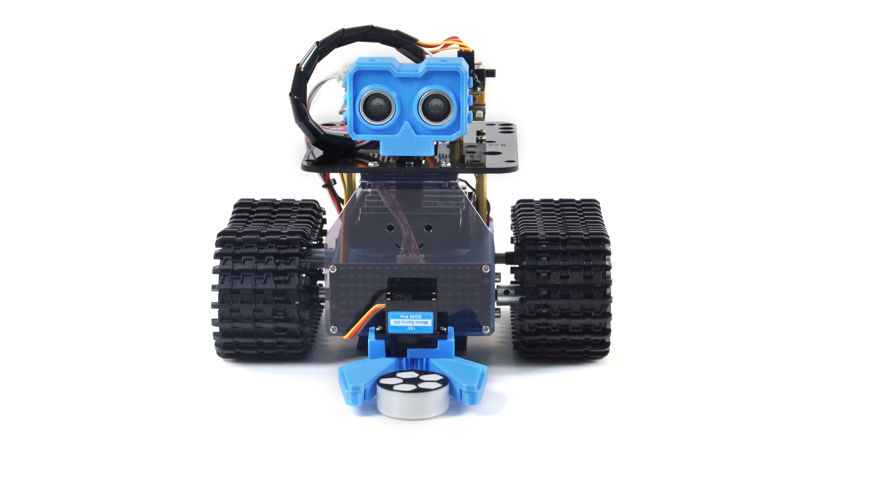
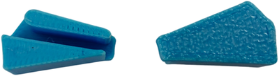
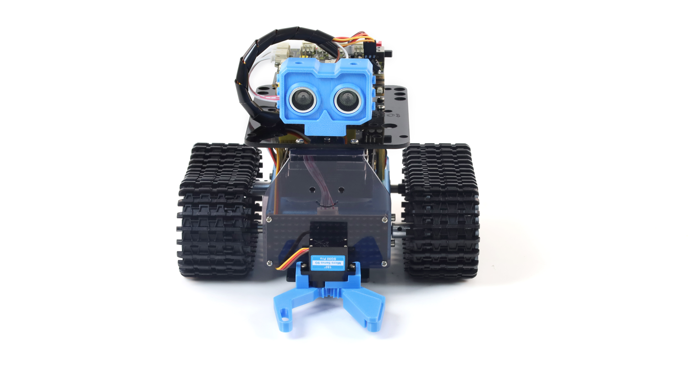
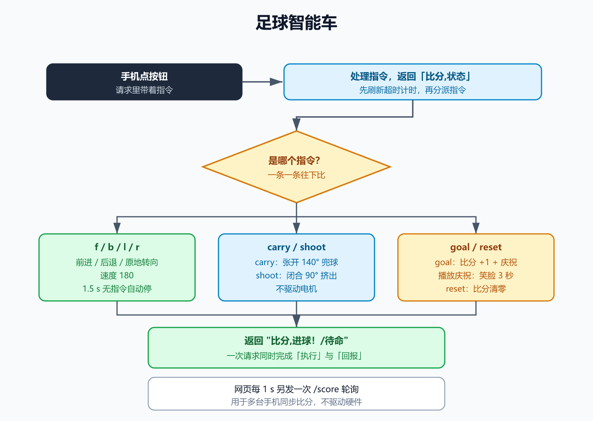

### 项目 16：DIY足球竞技小车

#### **1. 简介：**



一台车、一颗 3D 打印球、一个球门，就是一场比赛。如果和朋友一人有一台车可以当成竞技比赛来玩，因为这节课要做的不是会跑的车，而是会比赛的车：屏幕上有比分，进一个球点阵跳笑脸，三秒后回到待机，随时能清零重开。

夹爪在这里的用法和第 9 课不一样。第 9 课张开、合紧是给人看姿态；这里张开 140° 是把两片爪围成一个朝前的兜，球被兜在里面可以带着跑；合到 90° 时两片往里收，把球从兜里挤出去。

比分和表情都在车上算、车上存，网页只负责显示和发指令——路由器断了，车照样能开、能进球，只是手机上看不到分数。

按带球张爪、把球带到门线前，按射门合爪把球挤出，再按进球：点阵立刻变笑脸，三秒后回两只方眼，网页上的比分加一。

#### **2. 所需清单：**

本课用到的器件：

|     |     |     |
| :---: | :---: | :---: |
| {width=170px}<br><span style="font-size:0.85em">大型机械夹（半成品） ×1</span> | {width=170px}<br><span style="font-size:0.85em">3D 打印足球（直径 31.25mm） ×1</span> | {width=170px}<br><span style="font-size:0.85em">9G 舵机（180°，配十字臂） ×1</span> |
| {width=170px}<br><span style="font-size:0.85em">8×16 LED 点阵屏 ×1</span> | {width=170px}<br><span style="font-size:0.85em">DRV8835 电机扩展板 ×1</span> | {width=170px}<br><span style="font-size:0.85em">ESP32-S3 开发板 ×1</span> |
| {width=170px}<br><span style="font-size:0.85em">大型机械夹-发射套（左、右各一） ×1</span> | <span style="font-size:0.85em">2.4 GHz 无线路由器或手机热点 ×1</span> |  |
> ⚠️ **全部在第 2 章装好，本表只作对照，不用拆；下面的接线说明只标清接线方式，供对照，不必拆装。完整物料见 1.4 套件清单。**

#### **3. 参数：**

| 项目 | 参数 |
| --- | --- |
| 行驶速度 | 180 |
| 原地转速度 | 180 |
| 夹爪张开 | 140°（兜球） |
| 夹爪闭合 | 90°（射门） |
| 指令超时 | 1500 ms |
| 庆祝时长 | 3 s |
| 比分接口 | `/score` 返回**比分,状态** |
| 网页轮询 | 1 s / 次 |

#### **4. 接线说明：**

| 模块 | 引脚 | 主控 GPIO |
| --- | --- | :---: |
| 左轮 AIN / AEN | 方向 / 调速 | IO38 / IO21 |
| 右轮 BIN / BEN | 方向 / 调速 | IO40 / IO41 |
| 夹爪舵机 | 信号 | IO11 |
| 点阵 | CLK / DIN | IO9 / IO8 |

这一课不用超声波、不用循迹、不用云台，只保留**走 + 夹 + 显示**。


**机械夹安装步骤**



#### **5. 流程图：**

网页发指令、板子执行、回头把比分和表情报给网页，三者构成一个闭环：



#### **6. 测试代码：**

> **上传前先改一处**：把下面 `WIFI_SSID`、`WIFI_PASS` 换成自己的 Wi-Fi 名称和密码，不改连不上。
>
> 另外两点要同时满足：Wi-Fi 必须是 **2.4 GHz**（板子不支持 5 GHz），手机和车要在**同一个局域网**——否则浏览器打不开板子的 IP。

> **本课工程有两个文件**：`16_Soccer_Robot.ino` 和 `webpage.h`。网页的 HTML 全部放在 `webpage.h`，`.ino` 里只留 Arduino 逻辑；两个文件放在同一个文件夹，少一个编译不过。

```cpp
#include <WiFi.h>
#include <WebServer.h>
#include <ESP32Servo.h>
#include "webpage.h"  // 网页内容

// ===== Wi-Fi =====
// 仅支持 2.4 GHz
const char* WIFI_SSID = "你的WiFi名字";
const char* WIFI_PASS = "你的WiFi密码";

// ===== 电机引脚 =====
#define MOTOR_AIN 38  // A 路方向：左轮
#define MOTOR_AEN 21  // A 路调速：左轮
#define MOTOR_BIN 40  // B 路方向：右轮
#define MOTOR_BEN 41  // B 路调速：右轮

// ===== 夹爪舵机 =====
#define CLAW_SERVO_PIN 11  // 夹爪舵机，同第 9 课

// ===== 点阵引脚 =====
#define CLK_Pin 9  // 时钟，接模块 CLK
#define DIN_Pin 8  // 数据，接模块 DIN

// ===== 速度 =====
#define SPEED_RUN   180  // 行驶速度
#define SPEED_TURN  180  // 原地转向速度

// ===== 夹爪角度 =====
#define CLAW_OPEN   140  // 张开
#define CLAW_CLOSE   90  // 夹紧

// ===== 超时保护 =====
#define STOP_AFTER 1500  // 指令超时（ms）自动停车

// ===== 表情编号 =====
#define FACE_EYES  0  // 待机：眼睛
#define FACE_SMILE 1  // 进球：笑脸

// 16 字节对应 16 列，每字节 8 位对应一列 8 行

// 待机：两只方眼
unsigned char eyes[] = {
  0x00, 0x00, 0x00, 0x00, 0x1C, 0x1C, 0x00, 0x00,
  0x00, 0x00, 0x1C, 0x1C, 0x00, 0x00, 0x00, 0x00
};

// 笑脸：进球
unsigned char smile[] = {
  0x00, 0x00, 0x1C, 0x02, 0x02, 0x02, 0x5C, 0x40,
  0x40, 0x5C, 0x02, 0x02, 0x02, 0x1C, 0x00, 0x00
};

WebServer server(80);  // 网页服务器
Servo clawServo;       // 夹爪舵机

int score = 0;                      // 当前比分
unsigned long lastCmdTime = 0;      // 最后指令时刻
unsigned long smileUntil = 0;       // 笑脸结束时刻
int curFace = -1;                   // 当前表情，-1 表示未显示

void setup() {
  // 两线拉高，总线置空闲
  pinMode(CLK_Pin, OUTPUT);
  pinMode(DIN_Pin, OUTPUT);
  digitalWrite(CLK_Pin, HIGH);
  digitalWrite(DIN_Pin, HIGH);
  showFace(FACE_EYES);  // 上电显示待机表情

  // 电机引脚
  pinMode(MOTOR_BIN, OUTPUT);
  pinMode(MOTOR_AIN, OUTPUT);
  ledcAttach(MOTOR_BEN, 1000, 8);  // 1 kHz，8 位
  ledcAttach(MOTOR_AEN, 1000, 8);
  stopCar();

  // 夹爪：50 Hz，脉宽 500~2500 µs
  ESP32PWM::allocateTimer(0);
  clawServo.setPeriodHertz(50);
  clawServo.attach(CLAW_SERVO_PIN, 500, 2500);
  clawServo.write(CLAW_OPEN);  // 上电张开
  delay(300);

  // 连接 Wi-Fi
  Serial.begin(115200);
  delay(300);
  Serial.print("正在连接 ");
  Serial.println(WIFI_SSID);
  WiFi.mode(WIFI_STA);
  WiFi.begin(WIFI_SSID, WIFI_PASS);

  // 阻塞等待连接
  while (WiFi.status() != WL_CONNECTED) {
    delay(500);
    Serial.print(".");
  }
  Serial.println();
  Serial.println("WiFi 已连接");
  Serial.print("板子的 IP：");
  Serial.println(WiFi.localIP());  // 手机浏览器访问此地址

  // 首页
  server.on("/", []() {
    server.send_P(200, "text/html; charset=utf-8", index_html);
  });

  // 指令入口，d 为动作名
  server.on("/cmd", []() {
    String d = server.arg("d");
    server.send(200, "text/plain", runCmd(d));  // 返回"比分,状态"，网页直接用
  });

  // 比分查询，网页每秒轮询
  server.on("/score", []() {
    server.send(200, "text/plain", String(score) + "," + faceName());
  });

  server.begin();
  Serial.println("足球车已就绪");
}

void loop() {
  server.handleClient();  // 必须持续调用

  // 超时停车
  if (millis() - lastCmdTime > STOP_AFTER) {
    stopCar();
  }

  // 笑脸 3 s 后恢复待机
  if (smileUntil != 0 && millis() > smileUntil) {
    smileUntil = 0;
    showFace(FACE_EYES);
  }
}

// ===== 指令分发 =====
// 返回 "比分,状态"，供网页同步刷新
String runCmd(String d) {
  lastCmdTime = millis();  // 刷新超时计时

  if (d == "f") {
    goForward(SPEED_RUN);
  } else if (d == "b") {
    goBackward(SPEED_RUN);
  } else if (d == "l") {
    spinLeft(SPEED_TURN);
  } else if (d == "r") {
    spinRight(SPEED_TURN);
  } else if (d == "carry") {
    clawServo.write(CLAW_OPEN);   // 带球：张开
  } else if (d == "shoot") {
    clawServo.write(CLAW_CLOSE);  // 射门：闭合
  } else if (d == "goal") {
    score++;                        // 手动记分
    celebrate();                    // 播放庆祝表情
  } else if (d == "reset") {
    score = 0;                      // 清零
  } else {
    stopCar();                      // 其余指令一律停车
  }

  return String(score) + "," + faceName();
}

// ===== 夹爪用法 =====
// 两个状态对应两个动作：
//   张开 140°：球兜在爪内，行进时带球
//   闭合 90°：爪臂收拢挤出，即射门

// ===== 进球庆祝 =====
void celebrate() {
  showFace(FACE_SMILE);        // 切笑脸
  smileUntil = millis() + 3000;  // 3 s 后恢复
}

// 当前表情名，供网页显示
String faceName() {
  if (curFace == FACE_SMILE) return "进球！";
  return "待命";
}

// ===== 点阵显示 =====
// 仅表情变化时写屏
void showFace(int face) {
  if (face == curFace) return;  // 表情未变
  curFace = face;

  if (face == FACE_EYES) {
    matrix_display(eyes);   // 待机
  } else {
    matrix_display(smile);  // 笑脸
  }
}

// 将 16 字节字模写入点阵屏显存
void matrix_display(unsigned char matrix_value[]) {
  // 0x40：写数据模式，地址自增
  IIC_start();
  IIC_send(0x40);
  IIC_end();

  // 0xC0：显存起始地址 0
  IIC_start();
  IIC_send(0xC0);

  // 连写 16 列
  for (int i = 0; i < 16; i++) {
    IIC_send(matrix_value[i]);
  }
  IIC_end();

  // 0x8A：开显示，亮度最大
  IIC_start();
  IIC_send(0x8A);
  IIC_end();
}

// 起始条件：CLK 高电平期间 DIN 下降沿
void IIC_start() {
  digitalWrite(CLK_Pin, HIGH);
  delayMicroseconds(3);
  digitalWrite(DIN_Pin, HIGH);
  delayMicroseconds(3);
  digitalWrite(DIN_Pin, LOW);
  delayMicroseconds(3);
}

// 发送 1 字节，低位在前：CLK 低时置数据，上升沿采样
void IIC_send(unsigned char send_data) {
  for (int i = 0; i < 8; i++) {
    digitalWrite(CLK_Pin, LOW);  // 拉低时钟，准备数据
    delayMicroseconds(3);

    // 从 bit0 起逐位发送
    if (send_data & 0x01) {
      digitalWrite(DIN_Pin, HIGH);
    } else {
      digitalWrite(DIN_Pin, LOW);
    }
    delayMicroseconds(3);

    digitalWrite(CLK_Pin, HIGH); // 拉高时钟，模块采样
    delayMicroseconds(3);

    send_data = send_data >> 1;  // 右移，取出下一位
  }
}

// 停止条件：CLK 高电平期间 DIN 上升沿
void IIC_end() {
  digitalWrite(CLK_Pin, LOW);
  delayMicroseconds(3);
  digitalWrite(DIN_Pin, LOW);
  delayMicroseconds(3);
  digitalWrite(CLK_Pin, HIGH);
  delayMicroseconds(3);
  digitalWrite(DIN_Pin, HIGH);
  delayMicroseconds(3);
}

// ===== 电机驱动 =====
// A 路接左轮、B 路接右轮（与第 7 课一致）
// leftSpeed 写 B 路，rightSpeed 写 A 路
void driveMotors(int leftSpeed, int rightSpeed) {
  leftSpeed  = constrain(leftSpeed,  -255, 255);  // 右轮限幅
  rightSpeed = constrain(rightSpeed, -255, 255);  // 左轮限幅

  // A 路：左轮
  if (rightSpeed >= 0) {
    digitalWrite(MOTOR_BIN, HIGH);     // 拉高：正转
    ledcWrite(MOTOR_BEN, rightSpeed);  // 占空比 = 速度
  } else {
    digitalWrite(MOTOR_BIN, LOW);      // 拉低：反转
    ledcWrite(MOTOR_BEN, -rightSpeed); // 取绝对值
  }

  // B 路：右轮
  if (leftSpeed >= 0) {
    digitalWrite(MOTOR_AIN, HIGH);    // 拉高：正转
    ledcWrite(MOTOR_AEN, leftSpeed);  // 占空比 = 速度
  } else {
    digitalWrite(MOTOR_AIN, LOW);     // 拉低：反转
    ledcWrite(MOTOR_AEN, -leftSpeed); // 取绝对值
  }
}

// 基本动作
void goForward(int speed)  { driveMotors(speed, speed); }    // 前进：左右同速正转
void goBackward(int speed) { driveMotors(-speed, -speed); }  // 后退：左右同速反转
void spinLeft(int speed)   { driveMotors(-speed, speed); }   // 左转：左后退右前进
void spinRight(int speed)  { driveMotors(speed, -speed); }   // 右转：左前进右后退
void stopCar()             { driveMotors(0, 0); }            // 停止：占空比归零
```

#### **7. 代码解释：**

**(1) 引脚、速度、夹爪角度**

```cpp
#define MOTOR_AIN 38  // A 路方向：左轮
#define MOTOR_AEN 21  // A 路调速：左轮
#define MOTOR_BIN 40  // B 路方向：右轮
#define MOTOR_BEN 41  // B 路调速：右轮

#define CLAW_SERVO_PIN 11  // 夹爪舵机，同第 9 课

#define SPEED_RUN   180  // 行驶速度
#define SPEED_TURN  180  // 原地转向速度

#define CLAW_OPEN   140  // 张开
#define CLAW_CLOSE   90  // 夹紧
```

电机四根脚和第 2、11 课一样，夹爪在第 9 课验证过，这课直接搬过来。180 的速度也和第 11 课的遥控车一致——足球赛要的是反应快，不需要循迹那种细腻修正。

`CLAW_OPEN 140` / `CLAW_CLOSE 90` 就是第 9 课那两个角度，一个张到最大、一个夹到最紧。

**(2) 表情常量、两张字模、五个全局变量**

```cpp
#define FACE_EYES  0  // 待机：眼睛
#define FACE_SMILE 1  // 进球：笑脸
```

```cpp
int score = 0;                      // 当前比分
unsigned long lastCmdTime = 0;      // 最后指令时刻
unsigned long smileUntil = 0;       // 笑脸结束时刻
int curFace = -1;                   // 当前表情，-1 表示未显示
```

四个状态变量各管一件事：`score` 是比分，`lastCmdTime` 是超时判断的时刻，`smileUntil` 是笑脸什么时候该收，`curFace` 是"屏上现在是什么表情"，`-1` 表示还没显示过。

两个字模 `eyes[]` 和 `smile[]` 都是 16 字节，格式和第 1 课一样：一字节一列，bit0 在最上面。

**(3) `setup()`：上电先显示待机表情**

```cpp
  pinMode(CLK_Pin, OUTPUT);
  pinMode(DIN_Pin, OUTPUT);
  digitalWrite(CLK_Pin, HIGH);
  digitalWrite(DIN_Pin, HIGH);
  showFace(FACE_EYES);  // 上电显示待机表情
```

两线拉高置空闲，然后立刻画眼睛。这里用的是 `showFace()` 而不是 `matrix_display()`——`showFace()` 会顺手把 `curFace` 记成 `FACE_EYES`，后面再调它就不会重复刷屏。

**(4) `setup()`：夹爪张开，然后连 Wi-Fi**

```cpp
  clawServo.write(CLAW_OPEN);  // 上电张开
  delay(300);
```

上电就让爪子张开，等着接球。`delay(300)` 是给舵机转到位的时间，这 300 ms 在 `setup()` 里，网页还没启动，阻塞没有副作用。

后面连 Wi-Fi 的 `while` 循环和第 13、14 课一样，连上之后打印 IP 给手机访问。

**(5) 两条路由：`/cmd` 和 `/score`**

```cpp
  server.on("/cmd", []() {
    String d = server.arg("d");
    server.send(200, "text/plain", runCmd(d));  // 返回"比分,状态"，网页直接用
  });

  server.on("/score", []() {
    server.send(200, "text/plain", String(score) + "," + faceName());
  });
```

`/cmd` 收动作，`/score` 只查状态、不带动作。两条路由分开的好处是多台手机同时看比分：A 手机进球，B 手机最多 1 秒后轮询到新分数。

比分必须记在板子上。记在网页里，刷新一次就清零；记在服务端，手机、电脑同时开两个页面看到的才是同一个数。凡是"多端要看到同一个值"的状态，都应该放在板子这边。

**(6) `runCmd()`：执行 + 回报**

```cpp
String runCmd(String d) {
  lastCmdTime = millis();  // 刷新超时计时
```

`runCmd()` 的返回值不是 `void`，而是 `String`，最后一句是：

```cpp
  return String(score) + "," + faceName();
```

网页发一次"射门"，同一个响应里就把最新比分和表情状态带回来了，不用再发一次请求问"现在几比几"。省一次往返，手机上比分牌刷新更跟手。

`lastCmdTime` 照例放在最前面，任何指令都算"车还连得上"。

**(7) `runCmd()` 的八个分支**

```cpp
  if (d == "f") {
    goForward(SPEED_RUN);
  } else if (d == "b") {
    goBackward(SPEED_RUN);
  } else if (d == "l") {
    spinLeft(SPEED_TURN);
  } else if (d == "r") {
    spinRight(SPEED_TURN);
  } else if (d == "carry") {
    clawServo.write(CLAW_OPEN);   // 带球：张开
  } else if (d == "shoot") {
    clawServo.write(CLAW_CLOSE);  // 射门：闭合
  } else if (d == "goal") {
    score++;                        // 手动记分
    celebrate();                    // 播放庆祝表情
  } else if (d == "reset") {
    score = 0;                      // 清零
  } else {
    stopCar();                      // 其余指令一律停车
  }
```

前四个是行驶，中间两个是夹爪，后两个是记分，最后 `else` 兜底停车。

`carry` 和 `shoot` 只写舵机角度，一点 PWM 都不给电机。车是靠"张开兜住球 → 开过去 → 合拢挤出"这套机械动作完成射门的，不需要冲刺。想加"射门瞬间往前顶一下"，就在 `shoot` 里补一句 `goForward()` + 定时停车，但要注意别把自己顶出界。

**(8) `showFace()` 的去重**

```cpp
void showFace(int face) {
  if (face == curFace) return;  // 表情未变
  curFace = face;
```

刷一次点阵要 20 多次 GPIO 翻转加四段 I2C 时序，几十微秒。`loop()` 一秒几千轮，不去重就是几千次白刷，还会拖慢网页响应。

`curFace` 记的是"屏上现在是什么"，`-1` 表示什么都没显示。第一次调用必定会刷（`-1` 不等于任何表情），之后同一种表情反复调用都直接返回。

**(9) `faceName()`：把表情翻译给网页**

```cpp
String faceName() {
  if (curFace == FACE_SMILE) return "进球！";
  return "待命";
}
```

网页上那行状态文字就是从这里来的。`curFace` 是"屏上现在是什么表情"，`faceName()` 把它翻成中文：笑脸就是"进球！"，其余一律"待命"。

只判笑脸一种，是因为全课只有两种表情。它不看 `smileUntil`——3 秒到期后 `loop()` 会调 `showFace(FACE_EYES)`，`curFace` 跟着变，这里自然回到"待命"，不需要在两处都判时间。

**(10) `celebrate()` 和 `smileUntil`**

```cpp
void celebrate() {
  showFace(FACE_SMILE);        // 切笑脸
  smileUntil = millis() + 3000;  // 3 s 后恢复
}
```

`loop()` 里查：

```cpp
  if (smileUntil != 0 && millis() > smileUntil) {
    smileUntil = 0;
    showFace(FACE_EYES);
  }
```

如果庆祝里写 `delay(3000)`，这 3 秒内 `handleClient()` 一次都不跑，手机页面卡死，队友再按射门也没反应。记一个"到期时刻"然后在主循环里查，是这套教程里所有"等一会儿"的统一写法——第 7 课的丢线计时、第 15 课的避障状态机都是这个套路。

`smileUntil = 0` 是复位标记，表示"当前没有待恢复的庆祝"，避免下一轮又判一次到期。

**(11) `loop()`：两件定时的事**

```cpp
void loop() {
  server.handleClient();  // 必须持续调用

  // 超时停车
  if (millis() - lastCmdTime > STOP_AFTER) {
    stopCar();
  }
```

`STOP_AFTER 1500` 和第 11、14 课同一条规则：1.5 秒没收到指令就停车。三件事平级排在 `loop()` 里——处理请求、查超时、查笑脸到期，谁都不阻塞谁。

这也是为什么整课没有一句 `delay()`：任何一处阻塞，另外两件事都会被拖住。

#### **8. 运行现象：**

串口打印 `足球车已就绪`，点阵显示两只方眼（待机）。

| 操作 | 点阵 | 网页 |
| --- | --- | --- |
| 按方向键 | 不变（待机眼睛） | 车动 |
| 按**带球** | 不变 | 夹爪张开，可兜球 |
| 按**射门** | 不变 | 夹爪合拢，球被挤出 |
| 按**进球** | 立即变笑脸，3 s 后回眼睛 | 比分 +1，显示**进球！** |
| 按**清零** | 不变 | 比分归 0 |

> 【图片待补】进球瞬间点阵笑脸与手机比分 +1 的同框截图。

比赛时的实际打法：

1. **带球**张开爪子，把球兜进爪内。
2. 用方向键把球带到球门前，对准。
3. 按**射门**，爪子合拢把球挤出。
4. 球过门线后按**进球**，比分加一、点阵庆祝。

#### **9. 常见问题解决：**

**Wi-Fi 连不上、网页打不开，按这个顺序查：**

(1) **账号密码换了没有**：代码开头的 `WIFI_SSID`、`WIFI_PASS` 还是占位符就烧进去，一定连不上，改成自己路由器的名称和密码。

(2) **串口一行字都没有**：按一下板子上的 RESET 键再试，可能是上一版程序卡住了。

{width=340px}

(3) **串口一直冒点、拿不到 IP**：Wi-Fi 连接失败。路由器必须是 **2.4 GHz**，5 GHz 板子不支持；没有 2.4 G 就开手机热点（热点默认 2.4 G）。

(4) **拿到 IP 但页面打不开**：地址要带 `http://`，IP 以串口打印的为准；手机必须连同一个 Wi-Fi，两边 IP 前三段要一样。

(5) **网段对、还是打不开**：进路由器后台把**AP 隔离**关掉，开了它同一 Wi-Fi 下的设备互相访问不了。

(6) 如果射门时球往侧面跑，是车头没有正对球门——夹爪是往里收的，两侧受力不均就会把球推向一侧。倒车调整一下角度再射。
