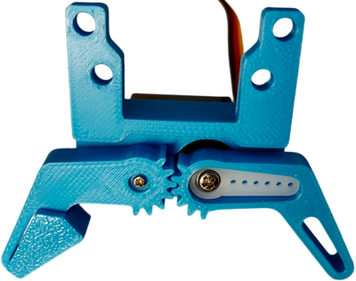
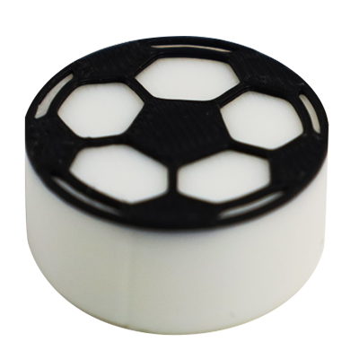
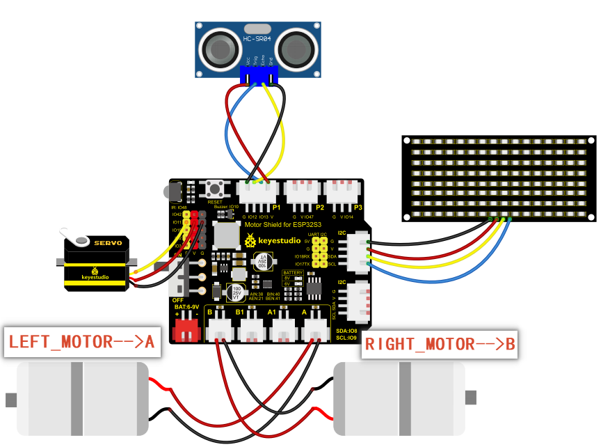

### Project 16: DIY Soccer Robot

#### **1. Introduction:**


One car, one 3D-printed ball and one goal make a match. If you and a friend each have a car, you can play it as a real competition — because what you build here is not a car that merely drives, but a car that plays: a score on the screen, a smiley on the dot matrix when you score, back to standby three seconds later, and a reset whenever you want to start over.

The gripper is used differently here than in Lesson 9. There, opening and closing was a pose to show off; here, opening to 140° arranges the two jaws into a forward-facing pocket that holds the ball while the car carries it, and closing to 90° draws the jaws inward to squeeze the ball out of the pocket.

The score and the expression are both computed and stored on the car; the web page only displays and sends commands — if the router drops, the car still drives and scores, you just cannot see the score on your phone.

Press Carry to open the gripper, bring the ball up to the goal line, press Shoot to close the gripper and push the ball out, then press Goal: the dot matrix turns into a smiley at once, goes back to two square eyes three seconds later, and the score on the page goes up by one.

#### **2. Parts List:**
Parts used in this lesson:

| Large mechanical gripper (partially assembled) ×1 | 3D-printed soccer ball (31.25 mm diameter) ×1 | 9G servo (180°, with cross horn) ×1 |
| :---: | :---: | :---: |
|  |  |  |
| 8×16 LED dot matrix display ×1 | DRV8835 motor expansion board ×1 | ESP32-S3 development board ×1 |
|  |  |  |
| Large gripper launcher sleeve (one left, one right) ×1 | 2.4 GHz Wi-Fi router or phone hotspot ×1 |  |
|  |  |  |
> ⚠️ **All parts were assembled in Chapter 2; this table is only for reference and nothing needs to be taken apart. The wiring notes below only show how the connections are made, also for reference — no disassembly is needed. For the full parts list, see 1.4 Kit Contents.**

#### **3. Parameters:**
| Item | Parameter |
| --- | --- |
| Driving speed | 180 |
| Spin-in-place speed | 180 |
| Gripper open | 140° (hold the ball) |
| Gripper closed | 90° (shoot) |
| Command timeout | 1500 ms |
| Celebration duration | 3 s |
| Score endpoint | `/score` returns **score,status** |
| Web page polling | Once every 1 s |

#### **4. Wiring:**

| Module | Pin | Controller GPIO |
| --- | --- | :---: |
| Left wheel AIN / AEN | Direction / speed | IO38 / IO21 |
| Right wheel BIN / BEN | Direction / speed | IO40 / IO41 |
| Gripper servo | Signal | IO11 |
| Dot matrix | CLK / DIN | IO9 / IO8 |

This lesson uses no ultrasonic module, no line tracking, and no pan-tilt — only **drive + grip + display**.



**Mechanical gripper installation steps**


#### **5. Flowchart:**

The page sends a command, the board executes it, then reports the score and expression back to the page — the three together form a closed loop:


#### **6. Test Code:**
> **Change one thing before uploading**: replace `WIFI_SSID` and `WIFI_PASS` below with your own Wi-Fi name and password, or the connection will fail.
>
> Two more conditions must both hold: the Wi-Fi must be **2.4 GHz** (the board does not support 5 GHz), and the phone and the car must be on the **same LAN** — otherwise the browser cannot open the board's IP address.

> **This lesson's project has two files**: `16_Soccer_Robot.ino` and `webpage.h`. All the web page HTML lives in `webpage.h`; the `.ino` holds only the Arduino logic. Put both files in the same folder — compilation fails if either is missing.

```cpp
#include <WiFi.h>
#include <WebServer.h>
#include <ESP32Servo.h>
#include "webpage.h"  // Web page content

// ===== Wi-Fi =====
// Only 2.4 GHz is supported
const char* WIFI_SSID = "Your WiFi name";
const char* WIFI_PASS = "Your WiFi password";

// ===== Motor pins =====
#define MOTOR_AIN 38  // Channel A direction: left wheel
#define MOTOR_AEN 21  // Channel A speed: left wheel
#define MOTOR_BIN 40  // Channel B direction: right wheel
#define MOTOR_BEN 41  // Channel B speed: right wheel

// ===== Gripper servo =====
#define CLAW_SERVO_PIN 11  // Gripper servo, same as Lesson 9

// ===== Dot matrix pins =====
#define CLK_Pin 9  // Clock, connect to module CLK
#define DIN_Pin 8  // Data, connect to module DIN

// ===== Speed =====
#define SPEED_RUN   180  // Driving speed
#define SPEED_TURN  180  // Spot-turn speed

// ===== Gripper angles =====
#define CLAW_OPEN   140  // Open
#define CLAW_CLOSE   90  // Closed

// ===== Timeout protection =====
#define STOP_AFTER 1500  // Auto-stop on command timeout (ms)

// ===== Expression numbers =====
#define FACE_EYES  0  // Standby: eyes
#define FACE_SMILE 1  // Goal scored: smiley

// 16 bytes correspond to 16 columns, each byte's 8 bits correspond to 8 rows in one column

// Standby: two square eyes
unsigned char eyes[] = {
  0x00, 0x00, 0x00, 0x00, 0x1C, 0x1C, 0x00, 0x00,
  0x00, 0x00, 0x1C, 0x1C, 0x00, 0x00, 0x00, 0x00
};

// Smiley: goal scored
unsigned char smile[] = {
  0x00, 0x00, 0x1C, 0x02, 0x02, 0x02, 0x5C, 0x40,
  0x40, 0x5C, 0x02, 0x02, 0x02, 0x1C, 0x00, 0x00
};

WebServer server(80);  // Web server
Servo clawServo;       // Gripper servo

int score = 0;                      // Current score
unsigned long lastCmdTime = 0;      // Time of the last command
unsigned long smileUntil = 0;       // Time when the smile ends
int curFace = -1;                   // Current expression, -1 means not shown

void setup() {
  // Pull both lines HIGH to set the bus idle
  pinMode(CLK_Pin, OUTPUT);
  pinMode(DIN_Pin, OUTPUT);
  digitalWrite(CLK_Pin, HIGH);
  digitalWrite(DIN_Pin, HIGH);
  showFace(FACE_EYES);  // Show standby expression on power on

  // Motor pins
  pinMode(MOTOR_BIN, OUTPUT);
  pinMode(MOTOR_AIN, OUTPUT);
  ledcAttach(MOTOR_BEN, 1000, 8);  // 1 kHz, 8-bit
  ledcAttach(MOTOR_AEN, 1000, 8);
  stopCar();

  // Gripper: 50 Hz, pulse width 500-2500 µs
  ESP32PWM::allocateTimer(0);
  clawServo.setPeriodHertz(50);
  clawServo.attach(CLAW_SERVO_PIN, 500, 2500);
  clawServo.write(CLAW_OPEN);  // Open on power on
  delay(300);

  // Connect to Wi-Fi
  Serial.begin(115200);
  delay(300);
  Serial.print("Connecting to ");
  Serial.println(WIFI_SSID);
  WiFi.mode(WIFI_STA);
  WiFi.begin(WIFI_SSID, WIFI_PASS);

  // Block until connected
  while (WiFi.status() != WL_CONNECTED) {
    delay(500);
    Serial.print(".");
  }
  Serial.println();
  Serial.println("WiFi connected");
  Serial.print("Board IP: ");
  Serial.println(WiFi.localIP());  // Open this address in a phone browser

  // Home page
  server.on("/", []() {
    server.send_P(200, "text/html; charset=utf-8", index_html);
  });

  // Command endpoint, d is the action name
  server.on("/cmd", []() {
    String d = server.arg("d");
    server.send(200, "text/plain", runCmd(d));  // Return "score,status" for direct use by the web page
  });

  // Score query, polled once per second by the web page
  server.on("/score", []() {
    server.send(200, "text/plain", String(score) + "," + faceName());
  });

  server.begin();
  Serial.println("Soccer car ready");
}

void loop() {
  server.handleClient();  // Must be called continuously

  // Stop on timeout
  if (millis() - lastCmdTime > STOP_AFTER) {
    stopCar();
  }

  // Smiley returns to standby after 3 s
  if (smileUntil != 0 && millis() > smileUntil) {
    smileUntil = 0;
    showFace(FACE_EYES);
  }
}

// ===== Command dispatch =====
// Return "score,status" for web page sync
String runCmd(String d) {
  lastCmdTime = millis();  // Refresh the timeout timer

  if (d == "f") {
    goForward(SPEED_RUN);
  } else if (d == "b") {
    goBackward(SPEED_RUN);
  } else if (d == "l") {
    spinLeft(SPEED_TURN);
  } else if (d == "r") {
    spinRight(SPEED_TURN);
  } else if (d == "carry") {
    clawServo.write(CLAW_OPEN);   // Dribbling: open
  } else if (d == "shoot") {
    clawServo.write(CLAW_CLOSE);  // Shooting: close
  } else if (d == "goal") {
    score++;                        // Manual scoring
    celebrate();                    // Play celebration expression
  } else if (d == "reset") {
    score = 0;                      // Reset to zero
  } else {
    stopCar();                      // Stop for all other commands
  }

  return String(score) + "," + faceName();
}

// ===== Gripper usage =====
// Two states correspond to two actions:
//   Open 140°: ball held in the gripper, dribble while moving
//   Closed 90°: gripper arms close and push the ball out, i.e. shoot

// ===== Goal celebration =====
void celebrate() {
  showFace(FACE_SMILE);        // Switch to smiley
  smileUntil = millis() + 3000;  // Restore after 3 s
}

// Current expression name, for the web page to display
String faceName() {
  if (curFace == FACE_SMILE) return "Goal!";
  return "Standby";
}

// ===== Dot matrix display =====
// Only refresh the display when the expression changes
void showFace(int face) {
  if (face == curFace) return;  // Expression unchanged
  curFace = face;

  if (face == FACE_EYES) {
    matrix_display(eyes);   // Standby
  } else {
    matrix_display(smile);  // Smiley
  }
}

// Write the 16-byte font bitmap into the dot matrix display buffer
void matrix_display(unsigned char matrix_value[]) {
  // 0x40: write data mode, auto-increment address
  IIC_start();
  IIC_send(0x40);
  IIC_end();

  // 0xC0: display buffer start address 0
  IIC_start();
  IIC_send(0xC0);

  // Write 16 columns consecutively
  for (int i = 0; i < 16; i++) {
    IIC_send(matrix_value[i]);
  }
  IIC_end();

  // 0x8A: display on, maximum brightness
  IIC_start();
  IIC_send(0x8A);
  IIC_end();
}

// Start condition: falling edge of DIN while CLK is HIGH
void IIC_start() {
  digitalWrite(CLK_Pin, HIGH);
  delayMicroseconds(3);
  digitalWrite(DIN_Pin, HIGH);
  delayMicroseconds(3);
  digitalWrite(DIN_Pin, LOW);
  delayMicroseconds(3);
}

// Send one byte, LSB first: set data while CLK is LOW, sample on rising edge
void IIC_send(unsigned char send_data) {
  for (int i = 0; i < 8; i++) {
    digitalWrite(CLK_Pin, LOW);  // Pull clock LOW to prepare data
    delayMicroseconds(3);

    // Send bit by bit starting from bit0
    if (send_data & 0x01) {
      digitalWrite(DIN_Pin, HIGH);
    } else {
      digitalWrite(DIN_Pin, LOW);
    }
    delayMicroseconds(3);

    digitalWrite(CLK_Pin, HIGH); // Pull clock HIGH for the module to sample
    delayMicroseconds(3);

    send_data = send_data >> 1;  // Shift right to get the next bit
  }
}

// Stop condition: rising edge of DIN while CLK is HIGH
void IIC_end() {
  digitalWrite(CLK_Pin, LOW);
  delayMicroseconds(3);
  digitalWrite(DIN_Pin, LOW);
  delayMicroseconds(3);
  digitalWrite(CLK_Pin, HIGH);
  delayMicroseconds(3);
  digitalWrite(DIN_Pin, HIGH);
  delayMicroseconds(3);
}

// ===== Motor driver =====
// Channel A drives the left wheel, channel B drives the right wheel (same as Lesson 7)
// leftSpeed goes to channel A, rightSpeed goes to channel B
void driveMotors(int leftSpeed, int rightSpeed) {
  leftSpeed  = constrain(leftSpeed,  -255, 255);  // Left wheel limit
  rightSpeed = constrain(rightSpeed, -255, 255);  // Right wheel limit

  // Channel B: right wheel
  if (rightSpeed >= 0) {
    digitalWrite(MOTOR_BIN, HIGH);     // Pull HIGH: forward rotation
    ledcWrite(MOTOR_BEN, rightSpeed);  // Duty cycle = speed
  } else {
    digitalWrite(MOTOR_BIN, LOW);      // Pull LOW: reverse rotation
    ledcWrite(MOTOR_BEN, -rightSpeed); // Take absolute value
  }

  // Channel A: left wheel
  if (leftSpeed >= 0) {
    digitalWrite(MOTOR_AIN, HIGH);    // Pull HIGH: forward rotation
    ledcWrite(MOTOR_AEN, leftSpeed);  // Duty cycle = speed
  } else {
    digitalWrite(MOTOR_AIN, LOW);     // Pull LOW: reverse rotation
    ledcWrite(MOTOR_AEN, -leftSpeed); // Take absolute value
  }
}

// Basic actions
void goForward(int speed)  { driveMotors(speed, speed); }    // Forward: both wheels forward at the same speed
void goBackward(int speed) { driveMotors(-speed, -speed); }  // Backward: both wheels reverse at the same speed
void spinLeft(int speed)   { driveMotors(-speed, speed); }   // Turn left: left wheel back, right wheel forward
void spinRight(int speed)  { driveMotors(speed, -speed); }   // Turn right: left wheel forward, right wheel back
void stopCar()             { driveMotors(0, 0); }            // Stop: duty cycle to zero
```

#### **7. Code Explanation:**
**(1) Pins, speed, and gripper angles**

```cpp
// ===== Motor pins =====
#define MOTOR_AIN 38  // Channel A direction: left wheel
#define MOTOR_AEN 21  // Channel A speed: left wheel
#define MOTOR_BIN 40  // Channel B direction: right wheel
#define MOTOR_BEN 41  // Channel B speed: right wheel

// ===== Gripper servo =====
#define CLAW_SERVO_PIN 11  // Gripper servo, same as Lesson 9

// ===== Dot matrix pins =====
#define CLK_Pin 9  // Clock, connect to module CLK
#define DIN_Pin 8  // Data, connect to module DIN

// ===== Speed =====
#define SPEED_RUN   180  // Driving speed
#define SPEED_TURN  180  // Spot-turn speed

// ===== Gripper angles =====
#define CLAW_OPEN   140  // Open
#define CLAW_CLOSE   90  // Closed
```

The four motor pins are the same as in Lessons 2 and 11, and the gripper was verified in Lesson 9, so this lesson simply carries them over. The speed of 180 also matches the remote-control car in Lesson 11 — a soccer match wants quick reactions, not the delicate corrections of line tracking.

`CLAW_OPEN 140` / `CLAW_CLOSE 90` are the two angles from Lesson 9: one fully open, the other fully closed.

**(2) Expression constants, two font bitmaps, and five global variables**

```cpp
#define FACE_EYES  0  // Standby: eyes
#define FACE_SMILE 1  // Goal scored: smiley
```

```cpp
int score = 0;                      // Current score
unsigned long lastCmdTime = 0;      // Time of the last command
unsigned long smileUntil = 0;       // Time when the smile ends
int curFace = -1;                   // Current expression, -1 means not shown
```

The four state variables each handle one thing: `score` is the score, `lastCmdTime` is the moment used for the timeout check, `smileUntil` is when the smiley should end, and `curFace` is "what expression is on the screen now", with `-1` meaning none has been shown yet.

Both font bitmaps, `eyes[]` and `smile[]`, are 16 bytes in the same format as Lesson 1: one byte per column, with bit 0 at the top.

**(3) `setup()`: show the standby expression at power-on**

```cpp
  pinMode(CLK_Pin, OUTPUT);
  pinMode(DIN_Pin, OUTPUT);
  digitalWrite(CLK_Pin, HIGH);
  digitalWrite(DIN_Pin, HIGH);
  showFace(FACE_EYES);  // Show standby expression on power on
```

The two lines are pulled HIGH to idle the bus, then the eyes are drawn immediately. This uses `showFace()` rather than `matrix_display()` — `showFace()` also records `curFace` as `FACE_EYES`, so later calls do not refresh the display again.

**(4) `setup()`: open the gripper, then connect to Wi-Fi**

```cpp
  clawServo.write(CLAW_OPEN);  // Open on power on
  delay(300);
```

The gripper opens at power-on, ready to receive the ball. `delay(300)` gives the servo time to reach position; because it is in `setup()` and the web server has not started, this blocking wait has no side effects.

The `while` loop that follows for Wi-Fi is the same as in Lessons 13 and 14; once connected it prints the IP for the phone to visit.

**(5) Two routes: `/cmd` and `/score`**

```cpp
  server.on("/cmd", []() {
    String d = server.arg("d");
    server.send(200, "text/plain", runCmd(d));  // Return "score,status" for direct use by the web page
  });

  server.on("/score", []() {
    server.send(200, "text/plain", String(score) + "," + faceName());
  });
```

`/cmd` accepts actions while `/score` only reports status and carries no action. Keeping the two routes separate lets several phones watch the same score: if phone A scores, phone B picks up the new number on its next poll, at most a second later.

The score must be kept on the board. Kept in the web page, it resets on every refresh; kept on the server, a phone and a computer opening two pages see the same number. Any state that "multiple devices must agree on" belongs on the board.

**(6) `runCmd()`: execute and report back**

```cpp
String runCmd(String d) {
  lastCmdTime = millis();  // Refresh the timeout timer
```

`runCmd()` does not return `void` but `String`, and its last statement is:

```cpp
  return String(score) + "," + faceName();
```

When the page sends "shoot", the same response carries the latest score and expression state back — no second request asking "what is the score now". That saves a round trip and makes the scoreboard feel more responsive on the phone.

`lastCmdTime` is still updated first, so any command means "the car is still reachable".

**(7) The eight branches of `runCmd()`**

```cpp
  if (d == "f") {
    goForward(SPEED_RUN);
  } else if (d == "b") {
    goBackward(SPEED_RUN);
  } else if (d == "l") {
    spinLeft(SPEED_TURN);
  } else if (d == "r") {
    spinRight(SPEED_TURN);
  } else if (d == "carry") {
    clawServo.write(CLAW_OPEN);   // Dribbling: open
  } else if (d == "shoot") {
    clawServo.write(CLAW_CLOSE);  // Shooting: close
  } else if (d == "goal") {
    score++;                        // Manual scoring
    celebrate();                    // Play celebration expression
  } else if (d == "reset") {
    score = 0;                      // Reset to zero
  } else {
    stopCar();                      // Stop for all other commands
  }
```

The first four are driving, the middle two are the gripper, the last two handle scoring, and the final `else` falls back to stopping.

`carry` and `shoot` only write servo angles and give the motors no PWM at all. Scoring is done by the mechanical sequence "open to pocket the ball → drive over → close to squeeze it out", no sprinting required. If you want "a little nudge forward at the moment of shooting", add a `goForward()` plus a timed stop inside `shoot`, but be careful not to push the ball out of bounds.

**(8) De-duplication in `showFace()`**

```cpp
void showFace(int face) {
  if (face == curFace) return;  // Expression unchanged
  curFace = face;
```

One dot matrix refresh takes more than 20 GPIO toggles plus four segments of I2C timing, tens of microseconds. `loop()` runs thousands of times a second; without de-duplication that is thousands of wasted refreshes, and the web response slows down too.

`curFace` records "what is on the screen now", with `-1` meaning nothing. The first call always refreshes (`-1` matches no expression); after that, repeated calls with the same expression simply return.

**(9) `faceName()`: translating the expression for the page**

```cpp
String faceName() {
  if (curFace == FACE_SMILE) return "Goal!";
  return "Standby";
}
```

The status line on the page comes from here. `curFace` is "what expression is on the screen now"; `faceName()` turns it into words: a smiley means "Goal!", everything else means "Standing by".

Only the smiley is checked because the whole lesson has just two expressions. It does not look at `smileUntil` — when three seconds are up `loop()` calls `showFace(FACE_EYES)`, `curFace` changes with it, and this function naturally returns to "Standing by" without needing a second time check.

**(10) `celebrate()` and `smileUntil`**

```cpp
void celebrate() {
  showFace(FACE_SMILE);        // Switch to smiley
  smileUntil = millis() + 3000;  // Restore after 3 s
}
```

Checked in `loop()`:

```cpp
  if (smileUntil != 0 && millis() > smileUntil) {
    smileUntil = 0;
    showFace(FACE_EYES);
  }
```

If the celebration used `delay(3000)`, `handleClient()` would not run once during those three seconds, the phone page would freeze, and a teammate pressing shoot again would get no response. Recording a "due time" and checking it in the main loop is the standard way this tutorial handles every "wait a while" — the lost-line timer in Lesson 7 and the obstacle-avoidance state machine in Lesson 15 both use the same pattern.

`smileUntil = 0` is the reset flag, meaning "no celebration pending", so the next round does not test for expiry again.

**(11) `loop()`: two timed tasks**

```cpp
void loop() {
  server.handleClient();  // Must be called continuously

  // Stop on timeout
  if (millis() - lastCmdTime > STOP_AFTER) {
    stopCar();
  }
```

`STOP_AFTER 1500` follows the same rule as Lessons 11 and 14: stop if no command arrives within 1.5 seconds. Three tasks sit at the same level in `loop()` — handle requests, check the timeout, check the smiley expiry — and none blocks another.

That is also why there is no `delay()` anywhere in the lesson: a blocking call in any one place drags the other two tasks down with it.

#### **8. Expected Behavior:**

The Serial Monitor prints "Soccer car ready" and the dot matrix shows two square eyes (standby).

| Action | Dot matrix | Web page |
| --- | --- | --- |
| Press a direction key | Unchanged (standby eyes) | Car moves |
| Press **Carry** | Unchanged | Gripper opens, ready to pocket the ball |
| Press **Shoot** | Unchanged | Gripper closes, ball is squeezed out |
| Press **Goal** | Instantly shows a smiley, back to eyes after 3 s | Score +1, displays **Goal!** |
| Press **Reset** | Unchanged | Score returns to 0 |

> [Image to be added] A screenshot showing the dot matrix smiley and the phone score +1 at the moment of a goal.

How the match is actually played:

1. **Carry** opens the gripper to pocket the ball.
2. Use the direction keys to bring the ball in front of the goal and line it up.
3. Press **Shoot** to close the gripper and squeeze the ball out.
4. Once the ball crosses the line, press **Goal** to add a point and celebrate on the dot matrix.

#### **9. Troubleshooting:**

**If Wi-Fi will not connect or the page will not open, check in this order:**

(1) **Did you change the credentials?** If `WIFI_SSID` and `WIFI_PASS` at the top of the code are still placeholders when you upload, the connection is guaranteed to fail. Replace them with your router's name and password.

(2) **Nothing at all in the Serial Monitor**: press the board's RESET button and try again; the previous sketch may be stuck.


(3) **Dots keep printing but no IP appears**: Wi-Fi connection failed. The router must be **2.4 GHz** — the board does not support 5 GHz. If you have no 2.4 GHz band, use a phone hotspot (hotspots default to 2.4 GHz).

(4) **You have an IP but the page will not open**: include `http://` in the address and use the IP printed in the Serial Monitor; the phone must be on the same Wi-Fi, and the first three octets of both IPs must match.

(5) **Subnet matches but still no page**: log in to the router and turn off **AP isolation**; with it enabled, devices on the same Wi-Fi cannot reach each other.

(6) If the ball veers sideways when you shoot, the nose is not square to the goal — the gripper closes inward, so uneven force on the two sides pushes the ball to one side. Back up, adjust the angle, and shoot again.
