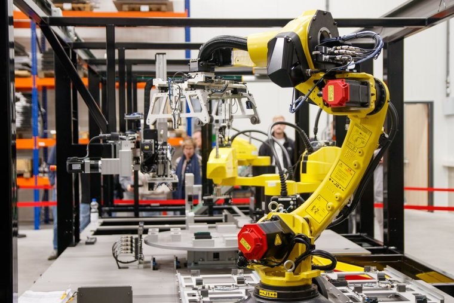
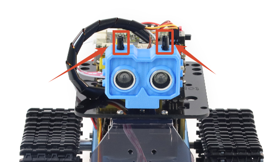
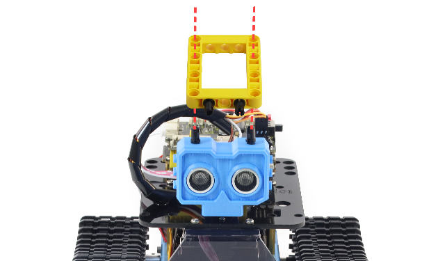
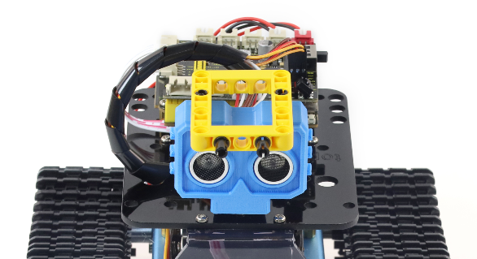
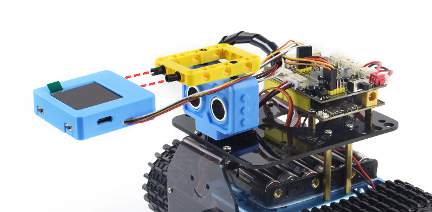
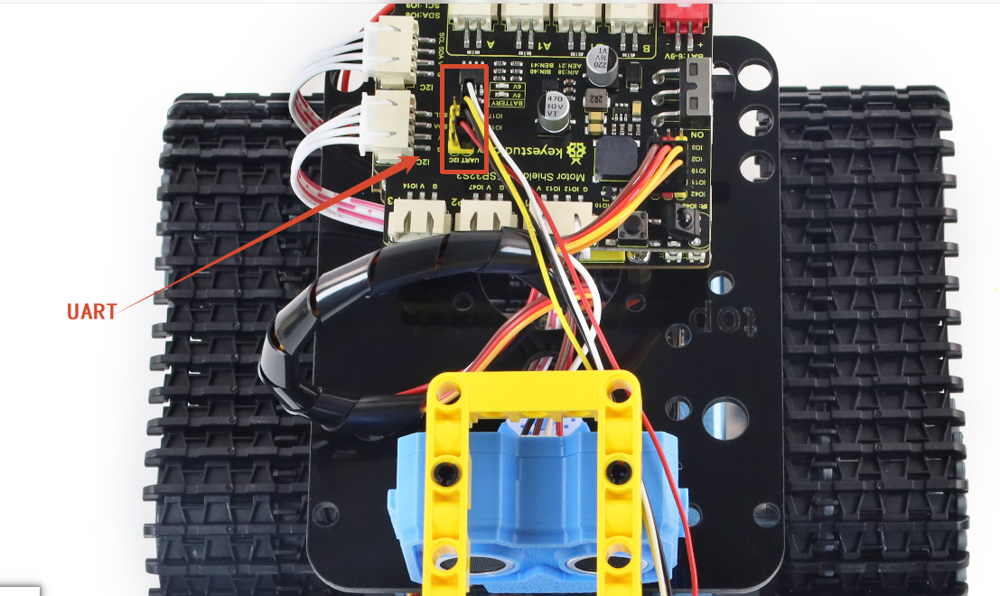
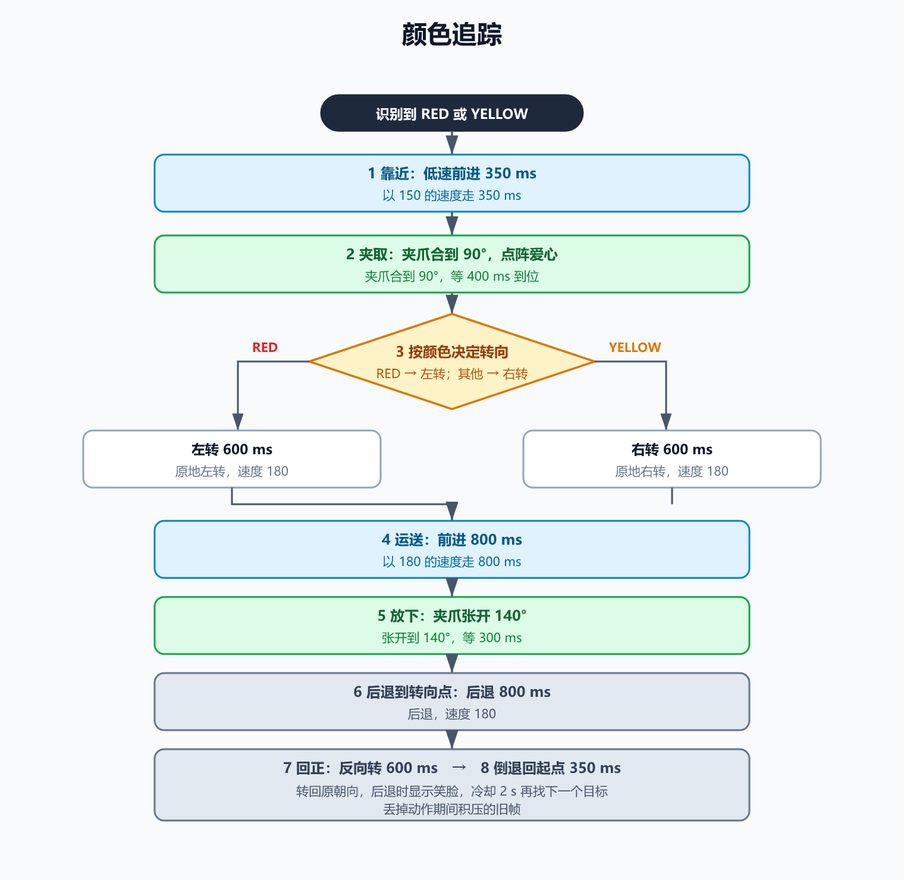

### Project 17: AI Vision Module: Color Tracking and Grabbing

#### **1. Introduction:**

{width=520px}

From this lesson on, the car can see colors. The little camera on the pan-tilt does not beam video back for the controller to analyze — it is a small computer in its own right. Recognition is finished inside the module, and all that comes back over serial is a single word: RED or YELLOW.

That decision shapes the whole lesson: the controller receives a line of text, not an image, so even a board with no camera interface can take on a vision task. The price is that the module says only which color it sees, not where the object is — movement has to be assembled out of timing and speed.

The sequence is therefore eight fixed-length steps: approach at low speed for 350 ms, stop, close the gripper to grab, turn left or right according to the color for 600 ms, drive forward for 800 ms to the drop zone, open the gripper to release, retrace the path, return to center, and finally back up another 350 ms to the starting point.

Put a red block 20 cm in front of the car and it walks through all eight steps on its own; swap in a yellow one and the third step becomes a right turn, with everything else the same. When it is done, the dot matrix returns to a smiley and waits for the next block.

#### **2. Parts List:**
Parts used in this lesson:

|     |     |     |
| :---: | :---: | :---: |
| {width=170px}<br><span style="font-size:0.85em">TinyVision AI vision camera ×1</span> | {width=170px}<br><span style="font-size:0.85em">9G servo (180°) ×2</span> | {width=170px}<br><span style="font-size:0.85em">Large mechanical gripper (partially assembled) ×1</span> |
| {width=170px}<br><span style="font-size:0.85em">Ultrasonic module ×1</span> | {width=170px}<br><span style="font-size:0.85em">DRV8835 motor expansion board ×1</span> | {width=170px}<br><span style="font-size:0.85em">8×16 LED dot matrix display ×1</span> |
| {width=170px}<br><span style="font-size:0.85em">ESP32-S3 development board ×1</span> |  |  |
#### **3. Parameters:**
| Item | Parameter |
| --- | --- |
| Module | TinyVision AI camera |
| Communication | Hardware serial 2, 9600 8N1 |
| Controller RX / TX | IO18 / IO17 |
| Recognition mode | `color` |
| Report format | `COLOR:RED` / `COLOR:YELLOW` / `COLOR:NONE` |
| Approach speed | 150 |
| Turning / transport speed | 180 |
| Approach duration | 350 ms |
| Turn duration | 600 ms |
| Transport duration | 800 ms |

#### **4. Wiring:**

For the last four lessons the modules all sit on the pan-tilt and turn with the servo; only the lens direction changes. Lessons 19 and 20 use mounting B, lens level and facing forward; Lessons 17 and 18 use mounting A, lens facing the ground. Before each lesson, remount the module as described in 2.2.9 — the UART wires are on the expansion board's right-hand header and need no rewiring when you change the orientation.

> **Note**: The components in the wiring diagram are only there to show the connections; you do not need to take the cased parts from the parts list apart when wiring.

| Vision module | Controller | Description |
| --- | :---: | --- |
| TX | IO18 | Module sends, controller receives |
| RX | IO17 | Controller sends, module receives |
| VCC | 5V | Module power |
| GND | GND | Must share a common ground |

| Signal | Controller GPIO |
| --- | :---: |
| Left wheel AIN / AEN | IO38 / IO21 |
| Right wheel BIN / BEN | IO40 / IO41 |
| Matrix CLK / DIN | IO9 / IO8 |
| Pan servo | IO42 |
| Claw servo | IO11 |

**Mounting A:**












TX to RX and RX to TX; wiring it as TX-TX also passes data through, but the module cannot receive commands from the controller and every `setMode()` call fails. If the Serial Monitor prints **Send -> MODE:COLOR** and nothing happens, this is the mistake.

#### **5. Flowchart:**

The eight actions after a color is recognized run in order, five on the outbound trip and three on the way back:



#### **6. Test Code:**
> **This lesson's project has three files**: `17_Color_Tracking.ino`, `AiCam.h`, and `AiCam.cpp`. All serial traffic and string parsing for the vision module live in `AiCam.cpp`; put all three files in the same folder — compilation fails if any is missing.

```cpp
#include <ESP32Servo.h>
#include "AiCam.h"  // Vision module driver

// ===== Motor pins =====
#define MOTOR_AIN 38  // Channel A direction: left wheel
#define MOTOR_AEN 21  // Channel A speed: left wheel
#define MOTOR_BIN 40  // Channel B direction: right wheel
#define MOTOR_BEN 41  // Channel B speed: right wheel

// ===== Servo pins =====
#define CLAW_SERVO_PIN 11  // Gripper servo, Lesson 9
#define PAN_SERVO_PIN  42  // Pan-tilt servo, Lesson 8

// ===== Vision module serial port =====
// Controller RX <- module TX, controller TX -> module RX, common ground required
#define CAM_RX 18  // Controller RX pin
#define CAM_TX 17  // Controller TX pin

// ===== Dot matrix pins =====
#define CLK_Pin 9  // Clock, connect to module CLK
#define DIN_Pin 8  // Data, connect to module DIN

// ===== Speed =====
#define SPEED_RUN      180  // Straight-line delivery speed
#define SPEED_TURN     180  // Spot-turn speed
#define SPEED_APPROACH 150  // Approach speed (low)

// ===== Angles =====
#define CLAW_OPEN   140  // Open
#define CLAW_CLOSE   90  // Closed
#define PAN_CENTER   90  // Pan-tilt centered

// ===== Action durations (ms, fine-tune for field and voltage) =====
#define T_APPROACH 350  // Approach duration
#define T_TURN     600  // Duration for a 90-degree spot turn
#define T_DELIVER  800  // Delivery duration

// ===== Expression numbers =====
#define FACE_EYES   0  // Eyes: standby
#define FACE_SMILE  1  // Smiley: target recognized or delivery complete
#define FACE_HEART  2  // Heart: gripped

// Standby: two square eyes, columns 4/5 and 10/11 lit on rows 2-4
unsigned char eyes[] = {
  0x00, 0x00, 0x00, 0x00, 0x1C, 0x1C, 0x00, 0x00,
  0x00, 0x00, 0x1C, 0x1C, 0x00, 0x00, 0x00, 0x00
};

// Smiley: 16 bytes correspond to 16 columns, each byte's 8 bits to 8 rows per column
unsigned char smile[] = {
  0x00, 0x00, 0x1C, 0x02, 0x02, 0x02, 0x5C, 0x40,
  0x40, 0x5C, 0x02, 0x02, 0x02, 0x1C, 0x00, 0x00
};

// Heart: same format as the smiley
unsigned char heart[] = {
  0x00, 0x00, 0x00, 0x00, 0x08, 0x1C, 0x3E, 0x7C,
  0x7C, 0x3E, 0x1C, 0x08, 0x00, 0x00, 0x00, 0x00
};

AiCam aiCam(CAM_RX, CAM_TX);  // Vision module instance
Servo clawServo;              // Gripper servo
Servo panServo;               // Pan-tilt servo

int curFace = -1;  // Current expression, -1 means not shown

void setup() {
  Serial.begin(115200);

  // Pull both lines HIGH to set the bus idle
  pinMode(CLK_Pin, OUTPUT);
  pinMode(DIN_Pin, OUTPUT);
  digitalWrite(CLK_Pin, HIGH);
  digitalWrite(DIN_Pin, HIGH);

  // Each servo uses a timer to avoid conflicts with motor PWM
  ESP32PWM::allocateTimer(0);
  ESP32PWM::allocateTimer(1);

  // Pan-tilt: 50 Hz, pulse width 500-2500 µs
  panServo.setPeriodHertz(50);
  panServo.attach(PAN_SERVO_PIN, 500, 2500);

  // Gripper: 50 Hz, pulse width 500-2500 µs
  clawServo.setPeriodHertz(50);
  clawServo.attach(CLAW_SERVO_PIN, 500, 2500);

  // Camera moves with pan-tilt, centers to face straight ahead
  panServo.write(PAN_CENTER);
  // Gripper open and on standby
  clawServo.write(CLAW_OPEN);

  // Motor pins
  pinMode(MOTOR_BIN, OUTPUT);
  pinMode(MOTOR_AIN, OUTPUT);
  ledcAttach(MOTOR_BEN, 1000, 8);  // 1 kHz, 8-bit
  ledcAttach(MOTOR_AEN, 1000, 8);
  stopCar();

  // Start the vision module in color recognition mode
  aiCam.begin();
  aiCam.setMode("color");

  // Show standby expression
  showFace(FACE_EYES);

  Serial.println("Color-tracking car ready, place a red or yellow block in front");
  delay(1000);  // Wait for servos to settle and module switch to complete
}

void loop() {
  aiCam.readSerial();  // Read the serial port each cycle

  String color = aiCam.getColor();  // Currently recognized color

  // No valid target or not red/yellow: stop and wait
  if (!aiCam.isColorValid() || (color != "RED" && color != "YELLOW")) {
    stopCar();
    showFace(FACE_EYES);  // Standby expression
    return;
  }

  Serial.print("Target recognized: ");
  Serial.println(color);

  showFace(FACE_SMILE);  // Show smiley
  aiCam.clearColor();    // Clear buffer to avoid repeated triggering

  pickAndDeliver(color);  // Run the pick-and-deliver sequence

  aiCam.flushInput();   // Discard data accumulated during the action
  aiCam.clearColor();   // Clear the buffer again
  showFace(FACE_EYES);  // Back to standby
  delay(2000);          // Cool down 2 s before searching for the next target
}

// ===== Pick and deliver =====
// Outbound: approach -> grip -> turn -> deliver -> release
// Return retraces the steps to the start in reverse order
void pickAndDeliver(String color) {
  // Outbound
  // 1. Approach at low speed
  Serial.println("1 Approaching");
  goForward(SPEED_APPROACH);
  delay(T_APPROACH);
  stopCar();

  // 2. Grip
  Serial.println("2 Gripping");
  clawServo.write(CLAW_CLOSE);
  delay(400);           // Wait for the servo to settle
  showFace(FACE_HEART); // Show heart

  // 3. Turn by color: red left, yellow right
  Serial.println("3 Turning to drop zone");
  if (color == "RED") {
    spinLeft(SPEED_TURN);  // Red: turn left
  } else {
    spinRight(SPEED_TURN);  // Yellow: turn right
  }
  delay(T_TURN);
  stopCar();

  // 4. Deliver
  Serial.println("4 Delivering");
  goForward(SPEED_RUN);
  delay(T_DELIVER);
  stopCar();

  // 5. Open gripper to unload
  Serial.println("5 Releasing");
  clawServo.write(CLAW_OPEN);
  delay(300);

  // Return
  // 6. Back to the turn point
  Serial.println("6 Backing to turn point");
  goBackward(SPEED_RUN);
  delay(T_DELIVER);
  stopCar();

  // 7. Straighten up
  Serial.println("7 Straightening");
  if (color == "RED") {
    spinRight(SPEED_TURN);  // Turn back in reverse
  } else {
    spinLeft(SPEED_TURN);  // Turn back in reverse
  }
  delay(T_TURN);
  stopCar();

  // 8. Back to the start
  Serial.println("8 Backing to start");
  goBackward(SPEED_APPROACH);
  delay(T_APPROACH);
  stopCar();

  showFace(FACE_SMILE);  // Show smiley
  Serial.println("Delivery complete, back at start");
}

// ===== Dot matrix display =====
// Only refresh the display when the expression changes
void showFace(int face) {
  if (face == curFace) return;  // Expression unchanged
  curFace = face;

  if (face == FACE_EYES) {
    matrix_display(eyes);   // Standby
  } else if (face == FACE_SMILE) {
    matrix_display(smile);  // Smiley
  } else {
    matrix_display(heart);  // Heart
  }
}

// Write the 16-byte font bitmap into the dot matrix display buffer
void matrix_display(unsigned char matrix_value[]) {
  // 0x40: write data mode, auto-increment address
  IIC_start();
  IIC_send(0x40);
  IIC_end();

  // 0xC0: display buffer start address 0
  IIC_start();
  IIC_send(0xC0);

  // Write 16 columns consecutively
  for (int i = 0; i < 16; i++) {
    IIC_send(matrix_value[i]);
  }
  IIC_end();

  // 0x8A: display on, maximum brightness
  IIC_start();
  IIC_send(0x8A);
  IIC_end();
}

// Start condition: falling edge of DIN while CLK is HIGH
void IIC_start() {
  digitalWrite(CLK_Pin, HIGH);
  delayMicroseconds(3);
  digitalWrite(DIN_Pin, HIGH);
  delayMicroseconds(3);
  digitalWrite(DIN_Pin, LOW);
  delayMicroseconds(3);
}

// Send one byte, LSB first: set data while CLK is LOW, sample on rising edge
void IIC_send(unsigned char send_data) {
  for (int i = 0; i < 8; i++) {
    digitalWrite(CLK_Pin, LOW);  // Pull clock LOW to prepare data
    delayMicroseconds(3);

    // Send bit by bit starting from bit0
    if (send_data & 0x01) {
      digitalWrite(DIN_Pin, HIGH);
    } else {
      digitalWrite(DIN_Pin, LOW);
    }
    delayMicroseconds(3);

    digitalWrite(CLK_Pin, HIGH); // Pull clock HIGH for the module to sample
    delayMicroseconds(3);

    send_data = send_data >> 1;  // Shift right to get the next bit
  }
}

// Stop condition: rising edge of DIN while CLK is HIGH
void IIC_end() {
  digitalWrite(CLK_Pin, LOW);
  delayMicroseconds(3);
  digitalWrite(DIN_Pin, LOW);
  delayMicroseconds(3);
  digitalWrite(CLK_Pin, HIGH);
  delayMicroseconds(3);
  digitalWrite(DIN_Pin, HIGH);
  delayMicroseconds(3);
}

// ===== Motor driver =====
// Channel A drives the left wheel, channel B drives the right wheel (same as Lesson 7)
// leftSpeed goes to channel A, rightSpeed goes to channel B
// First limit to ±255, then take the absolute value for the duty cycle
void driveMotors(int leftSpeed, int rightSpeed) {
  leftSpeed  = constrain(leftSpeed,  -255, 255);  // Left wheel limit
  rightSpeed = constrain(rightSpeed, -255, 255);  // Right wheel limit

  // Channel B: right wheel
  if (rightSpeed >= 0) {
    digitalWrite(MOTOR_BIN, HIGH);     // Pull HIGH: forward rotation
    ledcWrite(MOTOR_BEN, rightSpeed);  // Duty cycle = speed
  } else {
    digitalWrite(MOTOR_BIN, LOW);      // Pull LOW: reverse rotation
    ledcWrite(MOTOR_BEN, -rightSpeed); // Take absolute value
  }

  // Channel A: left wheel
  if (leftSpeed >= 0) {
    digitalWrite(MOTOR_AIN, HIGH);    // Pull HIGH: forward rotation
    ledcWrite(MOTOR_AEN, leftSpeed);  // Duty cycle = speed
  } else {
    digitalWrite(MOTOR_AIN, LOW);     // Pull LOW: reverse rotation
    ledcWrite(MOTOR_AEN, -leftSpeed); // Take absolute value
  }
}

// Basic actions
void goForward(int speed)  { driveMotors(speed, speed); }    // Forward: both wheels forward at the same speed
void goBackward(int speed) { driveMotors(-speed, -speed); }  // Backward: both wheels reverse at the same speed
void spinLeft(int speed)   { driveMotors(-speed, speed); }   // Turn left: left wheel back, right wheel forward
void spinRight(int speed)  { driveMotors(speed, -speed); }   // Turn right: left wheel forward, right wheel back
void stopCar()             { driveMotors(0, 0); }            // Stop: duty cycle to zero
```

#### **7. Code Explanation:**
**(1) The vision module sits on two serial pins**

```cpp
#include <ESP32Servo.h>
#include "AiCam.h"  // Vision module driver

// ===== Motor pins =====
#define MOTOR_AIN 38  // Channel A direction: left wheel
#define MOTOR_AEN 21  // Channel A speed: left wheel
#define MOTOR_BIN 40  // Channel B direction: right wheel
#define MOTOR_BEN 41  // Channel B speed: right wheel

// ===== Servo pins =====
#define CLAW_SERVO_PIN 11  // Gripper servo, Lesson 9
#define PAN_SERVO_PIN  42  // Pan-tilt servo, Lesson 8

// ===== Vision module serial port =====
// Controller RX <- module TX, controller TX -> module RX, common ground required
#define CAM_RX 18  // Controller RX pin
#define CAM_TX 17  // Controller TX pin
```

Pins 18 and 17 are the controller side of the link: the controller receives on 18 (from the module's TX) and sends on 17 (to the module's RX).

This module runs at 9600 baud and **cannot transmit images** — it processes the picture internally and only sends back the sentence "what color I see". So what the controller does, in essence, is "read a sentence, then perform a mechanical action according to it".

**(2) Speed and three durations**

```cpp
// ===== Speed =====
#define SPEED_RUN      180  // Straight-line delivery speed
#define SPEED_TURN     180  // Spot-turn speed
#define SPEED_APPROACH 150  // Approach speed (low)

// ===== Angles =====
#define CLAW_OPEN   140  // Open
#define CLAW_CLOSE   90  // Closed
#define PAN_CENTER   90  // Pan-tilt centered

// ===== Action durations (ms, fine-tune for field and voltage) =====
#define T_APPROACH 350  // Approach duration
#define T_TURN     600  // Duration for a 90-degree spot turn
#define T_DELIVER  800  // Delivery duration
```

The approach uses 150 rather than 180 — slower, so the distance covered in 350 ms lands more accurately. The three `T_` values are the answers to every "how far / how much" question in this lesson, all expressed in milliseconds.

These numbers can only be calibrated against the real floor: the same 600 ms turns 90° with a full battery and perhaps only 70° with a low one, showing up as "it lined up this morning but not this afternoon". The only way to make it stable is visual feedback, where the angle comes from "what you see" instead of "how long you turned".

**(3) `loop()`: read the serial port first, every round**

```cpp
  aiCam.readSerial();  // Read the serial port each cycle

  String color = aiCam.getColor();  // Currently recognized color
```

`readSerial()` gathers the characters from the vision module into a complete line before parsing — you cannot expect a whole frame to arrive at once, because serial data comes byte by byte and one `COLOR:RED` frame may straddle two calls to `loop()`.

`getColor()` returns the parsed result, or an empty string when nothing was recognized.

**(4) Return immediately when there is no target**

```cpp
  if (!aiCam.isColorValid() || (color != "RED" && color != "YELLOW")) {
    stopCar();
    showFace(FACE_EYES);  // Standby expression
    return;
  }
```

Both conditions are required: `isColorValid()` checks "did this frame parse successfully", and the second half checks "is the color red or yellow". Checking only the first would let green and blue be grabbed as targets too.

The `return` matters: with no target, end the round right there and touch none of the grabbing flow. Using `return` instead of wrapping the whole flow in an `if` keeps the main path one level less indented and easier to read.

**(5) Clear the buffer before starting an action**

```cpp
  showFace(FACE_SMILE);  // Show smiley
  aiCam.clearColor();    // Clear buffer to avoid repeated triggering

  pickAndDeliver(color);  // Run the pick-and-deliver sequence
```

Without this flush, `getColor()` would keep returning that earlier `"RED"`, and as soon as the car came back it would be judged as "seeing red" again — grabbing the same patch of thin air forever.

**(6) Outbound step 1: approach at low speed**

```cpp
  Serial.println("1 Approaching");
  goForward(SPEED_APPROACH);
  delay(T_APPROACH);
  stopCar();
```

Between seeing the target and reaching for the gripper there is no visual feedback at all — just "move at 150 for 350 ms". How far it goes is decided entirely by those two numbers.

**(7) Outbound step 2: grip**

```cpp
  Serial.println("2 Gripping");
  clawServo.write(CLAW_CLOSE);
  delay(400);           // Wait for the servo to settle
  showFace(FACE_HEART); // Show heart
```

`write()` only issues the command; the 400 ms gives the claw time to close. In Lesson 9 stepping degree by degree took 0.75 seconds; a single jump here is faster, but still needs enough time, or the car starts turning before the claw has the ball.

**(8) Outbound steps 3 to 5: turn, transport, unload**

```cpp
  Serial.println("3 Turning to drop zone");
  if (color == "RED") {
    spinLeft(SPEED_TURN);  // Red: turn left
  } else {
    spinRight(SPEED_TURN);  // Yellow: turn right
  }
  delay(T_TURN);
  stopCar();
```

Red turns left and yellow turns right — that is the rule of this course layout, and the only place in the lesson where a decision is made based on what was seen. The turn also relies on `T_TURN 600` to estimate the angle; there is no encoder.

Next come `goForward(SPEED_RUN)` + `delay(T_DELIVER)` to reach the drop zone, then `clawServo.write(CLAW_OPEN)` + `delay(300)` to release.

**(9) The three return steps mirror the outbound trip**

```cpp
  Serial.println("6 Backing to turn point");
  goBackward(SPEED_RUN);
  delay(T_DELIVER);
  stopCar();
```

Back up, turn back the opposite way, then back up to the start — all three durations exactly match the outbound ones, only the directions are reversed. In theory you land back where you began; in practice you are a few centimeters off, and after a few rounds you drift away entirely.

That is the price of fixed-length actions: no encoder, no distance measurement, how far you go is all milliseconds. High friction on a carpet halves the same 350 ms; a full battery against a nearly flat one changes speed by a third.

**(10) "Take out the trash" after each action**

```cpp
  aiCam.flushInput();   // Discard data accumulated during the action
  aiCam.clearColor();   // Clear the buffer again
  showFace(FACE_EYES);  // Back to standby
  delay(2000);          // Cool down 2 s before searching for the next target
```

These two lines are the easiest thing to miss in the lesson. During the seconds of a grab, the vision module keeps sending frames while the controller reads not a single byte, so everything piles up in the serial buffer (256 bytes by default — long since full). Read it when you get back and the first thing you get is a heap of stale data, very likely including that same `COLOR:RED`.

`flushInput()` throws the backlog away and `clearColor()` clears the parsed color flag once more — belt and braces. Without both, here is what you see: after one grab the car "sees" the same target again on the spot and keeps grabbing at air.

The 2-second cooldown is not for the car to rest but for the operator: after one grab, you have time to take the block away or set up the next one. Otherwise the car immediately lunges at whatever else is in view and looks out of control.

This lesson uses `delay()` throughout; during those few seconds the web page, ultrasonic module, and remote control are all unresponsive. That is the clearest limitation of the lesson and the reason the next one switches to a state machine.

#### **8. Expected Behavior:**

At power-on the Serial Monitor prints:

```text
Vision module serial port started
Send -> GET:MODE
Send -> GET:OUTPUT
Send -> MODE:COLOR
Color-tracking car ready, place a red or yellow block in front
```

With a red block 20 cm in front of the car, the following sequence runs:

| Step | Serial Monitor | Action |
| --- | --- | --- |
| 1 | Target recognized: RED | Dot matrix smiley, forward at low speed for 350 ms |
| 2 | 1 Approaching | Stop |
| 3 | 2 Gripping | Gripper closes to 90°, dot matrix heart |
| 4 | 3 Turning to drop zone | Turn left for 600 ms |
| 5 | 4 Delivering | Forward for 800 ms |
| 6 | 5 Releasing | Gripper opens |
| 7 | 6 Backing to turn point | Back up for 800 ms |
| 8 | 7 Straightening | Turn right for 600 ms |
| 9 | 8 Backing to start | Back up for 350 ms |
| 10 | Delivery complete, back at start | Dot matrix smiley |

A yellow block follows the same flow, except step 3 turns right.

> [Image to be added] A screenshot of the Serial Monitor printing the full ten-step sequence.

#### **9. Troubleshooting:**

(1) It keeps printing "Target recognized" but the car does not move — check whether `T_APPROACH` was changed to 0, or whether low battery voltage leaves the motors too weak to drive.

(2) Grabbing at air — the 350 ms of `T_APPROACH` depends on floor friction; on a carpet increase it to 500 ms. This is an inherent flaw of fixed-length actions; for stability add an ultrasonic closed loop.

(3) Wrong color recognized — the module is sensitive to lighting, and under warm light yellow is often read as red. Switch to white light or test in natural daylight.
