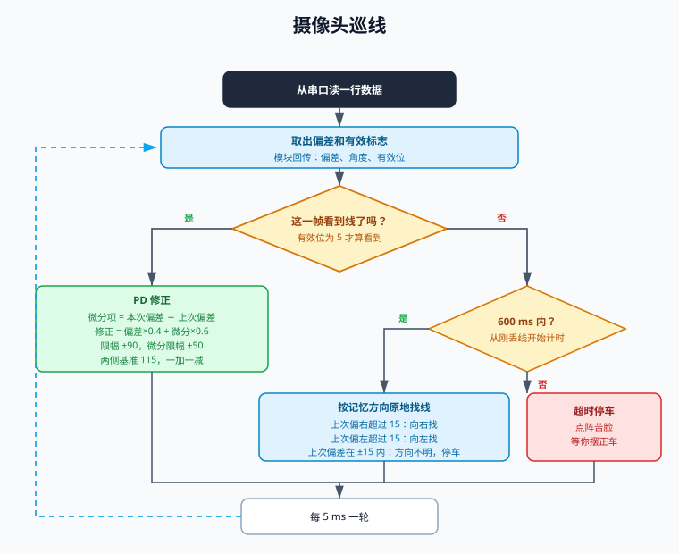

### 项目 18：AI 视觉模块：摄像头巡线

#### **1. 简介：**

{width=520px}

第 7 课用五只贴地的红外探头循迹，这里把眼睛抬起来——改用摄像头看线。镜头朝地面，能看到车头前方十几厘米的线，比贴地探头看得远，可以提前打方向。

模块回传的不是图像，是三个数：偏差、角度、有效位。偏差说线偏出画面中心多少，角度说线歪了多少，有效位等于 5 就表示这一帧真的看到了线。有这两个量，就能算左右轮该差多少速。

修正用的是比例加微分：偏差大就多打方向，偏差小就轻轻修；再加一项看偏差变得快不快，提前收住，车身才不会冲过中线再来回摆。直行基础速度 130，修正量最多 ±90。

上电后点阵先是一双眼睛，等线进入视野才变笑脸、开始沿线走；线跑出画面时它按记忆的方向原地找，找回来接着走，找不回来就停下、换一张苦脸。

#### **2. 所需清单：**

本课用到的器件：

|     |     |     |
| :---: | :---: | :---: |
| {width=170px}<br><span style="font-size:0.85em">TinyVision AI 视觉摄像头 ×1</span> | {width=170px}<br><span style="font-size:0.85em">DRV8835 电机扩展板 ×1</span> | {width=170px}<br><span style="font-size:0.85em">履带底盘总成 ×1</span> |
| {width=170px}<br><span style="font-size:0.85em">8×16 LED 点阵屏 ×1</span> | {width=170px}<br><span style="font-size:0.85em">ESP32-S3 开发板 ×1</span> |  |
#### **3. 参数：**

| 项目 | 参数 |
| --- | --- |
| 识别模式 | `line` |
| 回传格式 | `LINE:偏差,角度,有效位` |
| 有效标志 | 5 = 识别到线 |
| 直行基础速度 | 130 |
| 比例系数 KP | 0.4 |
| 微分系数 KD | 0.6 |
| 修正上限 | ±90 |
| 微分限幅 | ±50 |
| 找线速度 | 90 |
| 找线死区 | 15 |
| 找线超时 | 600 ms |
| 控制周期 | 5 ms |

#### **4. 接线说明：**

| 视觉模块 | 主控 | 说明 |
| --- | :---: | --- |
| TX | IO18 | 回传偏差数据 |
| RX | IO17 | 下发模式指令 |
| VCC / GND | 5V / GND | 供电与共地 |

| 信号 | 主控 GPIO |
| --- | :---: |
| 左轮 AIN / AEN | IO38 / IO21 |
| 右轮 BIN / BEN | IO40 / IO41 |


**装法A：**


#### **5. 流程图：**

有线和没线是两条完全不同的路径，先进哪条由**有效位**决定：



#### **6. 测试代码：**

> **本课工程有三个文件**：`18_Camera_Line_Tracking.ino`、`AiCam.h`、`AiCam.cpp`。视觉模块的串口收发和字符串解析都在 `AiCam.cpp` 里，三个文件放在同一个文件夹，少一个编译不过。

```cpp
#include "AiCam.h"  // 视觉模块驱动

// ===== 电机引脚 =====
#define MOTOR_AIN 38  // A 路方向：左轮
#define MOTOR_AEN 21  // A 路调速：左轮
#define MOTOR_BIN 40  // B 路方向：右轮
#define MOTOR_BEN 41  // B 路调速：右轮

// ===== 视觉模块串口 =====
// 主控 RX←模块 TX，主控 TX→模块 RX，需共地
// 按实际接线修改
#define CAM_RX 18  // 主控接收脚
#define CAM_TX 17  // 主控发送脚

// ===== 点阵引脚 =====
#define CLK_Pin 9  // 时钟，接模块 CLK
#define DIN_Pin 8  // 数据，接模块 DIN

// ===== 循线参数 =====
#define BASE_SPEED   130  // 直行基础速度
#define KP           0.4  // 比例系数
#define KD           0.6  // 微分系数，抑制超调
#define TURN_MAX      90  // 单侧修正上限
#define D_MAX         50  // 微分项限幅

// ===== 丢线找线 =====
#define SEARCH_SPEED  90  // 找线转速
#define SEARCH_DEAD   15  // 找线死区
#define LOST_TIMEOUT 600  // 找线超时（ms）

// ===== 有效标志 =====
#define LINE_OK 5  // 模块第三字段为 5 表示识别到线

// ===== 表情编号 =====
#define FACE_EYES     0  // 待机：眼睛
#define FACE_SMILE    1  // 跟线：笑脸
#define FACE_SURPRISE 2  // 找线：瞪眼
#define FACE_SAD      3  // 超时：苦脸

// 16 字节对应 16 列，每字节 8 位对应一列 8 行

// 待机：两只方眼
unsigned char eyes[] = {
  0x00, 0x00, 0x00, 0x00, 0x1C, 0x1C, 0x00, 0x00,
  0x00, 0x00, 0x1C, 0x1C, 0x00, 0x00, 0x00, 0x00
};

// 笑脸：跟线稳定
unsigned char smile[] = {
  0x00, 0x00, 0x1C, 0x02, 0x02, 0x02, 0x5C, 0x40,
  0x40, 0x5C, 0x02, 0x02, 0x02, 0x1C, 0x00, 0x00
};

// 瞪眼：正在找线
unsigned char surprise[] = {
  0x00, 0x00, 0x00, 0x00, 0x3E, 0x3E, 0x00, 0xC0,
  0xC0, 0x00, 0x3E, 0x3E, 0x00, 0x00, 0x00, 0x00
};

// 苦脸：找线超时
unsigned char sad[] = {
  0x00, 0x00, 0x00, 0x00, 0x08, 0x08, 0x80, 0x40,
  0x40, 0x80, 0x08, 0x08, 0x00, 0x00, 0x00, 0x00
};

AiCam aiCam(CAM_RX, CAM_TX);  // 视觉模块实例

int lastError = 0;            // 上次偏差，丢线时决定找线方向
bool hasLast = false;         // 是否已有上次偏差
unsigned long lostStart = 0;  // 丢线起始时刻，0 表示未丢线
int curFace = -1;             // 当前表情，-1 未显示

void setup() {
  // 两线拉高，总线置空闲
  pinMode(CLK_Pin, OUTPUT);
  pinMode(DIN_Pin, OUTPUT);
  digitalWrite(CLK_Pin, HIGH);
  digitalWrite(DIN_Pin, HIGH);

  // 电机引脚
  pinMode(MOTOR_BIN, OUTPUT);
  pinMode(MOTOR_AIN, OUTPUT);
  ledcAttach(MOTOR_BEN, 1000, 8);  // 1 kHz，8 位
  ledcAttach(MOTOR_AEN, 1000, 8);
  stopCar();                       // 上电停车

  // 显示待机表情
  showFace(FACE_EYES);

  // 启动视觉模块，循线模式
  aiCam.begin();
  aiCam.setMode("line");

  delay(1000);  // 等模式切换完成
}

void loop() {
  aiCam.readSerial();  // 每轮读取串口

  int offset = aiCam.getLineOffset();  // 偏差：负偏左，正偏右
  int valid  = aiCam.getLineValid();   // 有效标志，5 为识别到线

  if (valid == LINE_OK) {
    // 识别到线：PD 换算差速
    lostStart = 0;         // 清丢线计时
    showFace(FACE_SMILE);  // 显示笑脸

    int error = offset;  // 当前偏差

    // 微分项：偏差变化量，抑制超调
    int dError = 0;
    if (hasLast) {
      dError = error - lastError;
      dError = constrain(dError, -D_MAX, D_MAX);  // 限幅
    }

    // 差速 = P×偏差 + D×偏差变化
    int correction = (int)(error * KP + dError * KD);

    // 修正量限幅
    correction = constrain(correction, -TURN_MAX, TURN_MAX);

    // 修正为正（偏右）时左快右慢，车头右偏
    // 修正为负时相反
    driveMotors(BASE_SPEED + correction, BASE_SPEED - correction);

    lastError = error;  // 保存本次偏差
    hasLast = true;
  } else {
    // 未识别到线：按上次偏差方向找线
    if (lostStart == 0) {    // 刚丢线
      lostStart = millis();  // 开始计时
    }

    if (millis() - lostStart < LOST_TIMEOUT) {
      showFace(FACE_SURPRISE);  // 找线中

      // 死区内方向不明，停车
      if (lastError > SEARCH_DEAD) {
        driveMotors(SEARCH_SPEED, -SEARCH_SPEED);   // 线原在右：向右找
      } else if (lastError < -SEARCH_DEAD) {
        driveMotors(-SEARCH_SPEED, SEARCH_SPEED);   // 线原在左：向左找
      } else {
        stopCar();                                  // 方向不明，停车
      }
    } else {
      showFace(FACE_SAD);  // 找线超时
      stopCar();           // 脱线停车
    }
  }

  delay(5);  // 5 ms 一轮
}

// ===== 点阵显示 =====
// 仅表情变化时写屏
void showFace(int face) {
  if (face == curFace) return;  // 表情未变
  curFace = face;

  if (face == FACE_EYES) {
    matrix_display(eyes);       // 待机
  } else if (face == FACE_SMILE) {
    matrix_display(smile);      // 笑脸
  } else if (face == FACE_SURPRISE) {
    matrix_display(surprise);   // 瞪眼
  } else {
    matrix_display(sad);        // 苦脸
  }
}

// 将 16 字节字模写入点阵屏显存
void matrix_display(unsigned char matrix_value[]) {
  // 0x40：写数据模式，地址自增
  IIC_start();
  IIC_send(0x40);
  IIC_end();

  // 0xC0：显存起始地址 0
  IIC_start();
  IIC_send(0xC0);

  // 连写 16 列
  for (int i = 0; i < 16; i++) {
    IIC_send(matrix_value[i]);
  }
  IIC_end();

  // 0x8A：开显示，亮度最大
  IIC_start();
  IIC_send(0x8A);
  IIC_end();
}

// 起始条件：CLK 高电平期间 DIN 下降沿
void IIC_start() {
  digitalWrite(CLK_Pin, HIGH);
  delayMicroseconds(3);
  digitalWrite(DIN_Pin, HIGH);
  delayMicroseconds(3);
  digitalWrite(DIN_Pin, LOW);
  delayMicroseconds(3);
}

// 发送 1 字节，低位在前：CLK 低时置数据，上升沿采样
void IIC_send(unsigned char send_data) {
  for (int i = 0; i < 8; i++) {
    digitalWrite(CLK_Pin, LOW);  // 拉低时钟，准备数据
    delayMicroseconds(3);

    // 从 bit0 起逐位发送
    if (send_data & 0x01) {
      digitalWrite(DIN_Pin, HIGH);
    } else {
      digitalWrite(DIN_Pin, LOW);
    }
    delayMicroseconds(3);

    digitalWrite(CLK_Pin, HIGH); // 拉高时钟，模块采样
    delayMicroseconds(3);

    send_data = send_data >> 1;  // 右移，取出下一位
  }
}

// 停止条件：CLK 高电平期间 DIN 上升沿
void IIC_end() {
  digitalWrite(CLK_Pin, LOW);
  delayMicroseconds(3);
  digitalWrite(DIN_Pin, LOW);
  delayMicroseconds(3);
  digitalWrite(CLK_Pin, HIGH);
  delayMicroseconds(3);
  digitalWrite(DIN_Pin, HIGH);
  delayMicroseconds(3);
}

// ===== 电机驱动 =====
// A 路(38/21)接左轮、B 路(40/41)接右轮
// leftSpeed 写 A 路、rightSpeed 写 B 路；先限幅 ±255，再取绝对值给占空比
void driveMotors(int leftSpeed, int rightSpeed) {
  leftSpeed  = constrain(leftSpeed,  -255, 255);  // 左轮限幅
  rightSpeed = constrain(rightSpeed, -255, 255);  // 右轮限幅

  // A 路：左轮
  if (leftSpeed >= 0) {
    digitalWrite(MOTOR_AIN, HIGH);    // 拉高：正转
    ledcWrite(MOTOR_AEN, leftSpeed);  // 占空比 = 速度
  } else {
    digitalWrite(MOTOR_AIN, LOW);     // 拉低：反转
    ledcWrite(MOTOR_AEN, -leftSpeed); // 取绝对值
  }

  // B 路：右轮
  if (rightSpeed >= 0) {
    digitalWrite(MOTOR_BIN, HIGH);     // 拉高：正转
    ledcWrite(MOTOR_BEN, rightSpeed);  // 占空比 = 速度
  } else {
    digitalWrite(MOTOR_BIN, LOW);      // 拉低：反转
    ledcWrite(MOTOR_BEN, -rightSpeed); // 取绝对值
  }
}

// 基本动作
void goForward(int speed)  { driveMotors(speed, speed); }    // 前进：左右同速正转
void goBackward(int speed) { driveMotors(-speed, -speed); }  // 后退：左右同速反转
void spinLeft(int speed)   { driveMotors(-speed, speed); }   // 左转：左后退右前进
void spinRight(int speed)  { driveMotors(speed, -speed); }   // 右转：左前进右后退
void stopCar()             { driveMotors(0, 0); }            // 停止：占空比归零
```

#### **7. 代码解释：**

**(1) 八个参数决定车的性格**

```cpp
#define BASE_SPEED   130  // 直行基础速度
#define KP           0.4  // 比例系数
#define KD           0.6  // 微分系数，抑制超调
#define TURN_MAX      90  // 单侧修正上限
#define D_MAX         50  // 微分项限幅

#define SEARCH_SPEED  90  // 找线转速
#define SEARCH_DEAD   15  // 找线死区
#define LOST_TIMEOUT 600  // 找线超时（ms）
```

`BASE_SPEED 130` 是直行基线，左右轮在这个基础上加/减修正量。`KP 0.4` 负责"偏多少修多少"，`KD 0.6` 负责"正在往回走就少修一点"。后三个是限幅和保护，后面几节逐个讲。

**(2) 四个全局状态**

```cpp
int lastError = 0;            // 上次偏差，丢线时决定找线方向
bool hasLast = false;         // 是否已有上次偏差
unsigned long lostStart = 0;  // 丢线起始时刻，0 表示未丢线
int curFace = -1;             // 当前表情，-1 未显示
```

`lastError` 有两个用途：算微分要用它，丢线时也靠它判断该往哪边找。`hasLast` 是给它配的开关，下一节算微分时会用到。`lostStart = 0` 专门表示"现在没丢线"，所以判断用的是"是否等于 0"而不是时间差。

**(3) `loop()` 开头：取两个数**

```cpp
  aiCam.readSerial();  // 每轮读取串口

  int offset = aiCam.getLineOffset();  // 偏差：负偏左，正偏右
  int valid  = aiCam.getLineValid();   // 有效标志，5 为识别到线
```

`offset` 是线在画面里偏离中心多少，负偏左、正偏右，单位是像素。`valid` 是模块给的置信标志，`LINE_OK`（等于 5）表示这一帧确实看到了线。

两个数要分开取：`offset` 有值不代表可信，模块在没看到线时也会给一个数（通常是上一次的残留或 0），所以判断必须用 `valid`。

**(4) 识别到线：先清丢线计时**

```cpp
  if (valid == LINE_OK) {
    // 识别到线：PD 换算差速
    lostStart = 0;         // 清丢线计时
    showFace(FACE_SMILE);  // 显示笑脸

    int error = offset;  // 当前偏差
```

`lostStart = 0` 必须在这里清，不然上一轮丢线留下的时间戳会一直累加，车刚找回线又立刻被判成超时。

**(5) 微分项：`hasLast` 挡的是第一帧**

```cpp
    int dError = 0;
    if (hasLast) {
      dError = error - lastError;
      dError = constrain(dError, -D_MAX, D_MAX);  // 限幅
    }
```

`lastError` 初值是 0。如果第一帧直接算 `error - lastError`，而车正好偏在 −37，就得到一个 −37 的微分——这不是"变化量"，是凭空造出来的冲击，车会猛地甩一下。`hasLast` 让第一帧跳过微分，从第二帧起才算。

`constrain(dError, -D_MAX, D_MAX)` 是第一重限幅：摄像头偶尔会吐出一帧跳变的偏移（比如从 −10 跳到 +40），不限的话微分项会瞬间冲到几百，把修正量整个带飞。

**(6) 算修正量，再做两重限幅**

```cpp
    // 差速 = P×偏差 + D×偏差变化
    int correction = (int)(error * KP + dError * KD);

    // 修正量限幅
    correction = constrain(correction, -TURN_MAX, TURN_MAX);
```

`error * KP` 是比例项，`dError * KD` 是微分项，两项相加才是这一次要给多少修正。`(int)` 是因为 `KP`、`KD` 是小数，乘出来是浮点数，写进 PWM 前要转回整数。

`TURN_MAX 90` 是第二重限幅：`BASE_SPEED` 是 130，修正量超过 130 就会出现负速度——一侧轮子反转。调头时这是好事，但循迹时突然反转会把车拧停。限制在 ±90，单侧最高 130 + 90 = 220、最低 130 − 90 = 40，保证两侧始终同向转。

**(7) 修正的符号：左快右慢往右偏**

```cpp
    driveMotors(BASE_SPEED + correction, BASE_SPEED - correction);

    lastError = error;  // 保存本次偏差
    hasLast = true;
```

`driveMotors` 的第一个参数是左轮，第二个是右轮。`offset` 偏右为正，说明线在画面右边、车头偏左，要往右打——左轮加速、右轮减速，车头就向右摆回来了。修正量为正正好是这个方向。

最后两行是给下一轮用的：`lastError` 存下本次偏差，`hasLast` 置真，下一轮就能算微分了。

**(8) 丢线：按最后一次偏差的方向找**

```cpp
    // 未识别到线：按上次偏差方向找线
    if (lostStart == 0) {    // 刚丢线
      lostStart = millis();  // 开始计时
    }

    if (millis() - lostStart < LOST_TIMEOUT) {
      showFace(FACE_SURPRISE);  // 找线中
```

`lostStart == 0` 这个判断保证时间戳只记一次——第一次丢线时记下时刻，后面每轮都进来，但不会重新记。

用的是"最后一次看到线时偏哪边"，不是"现在偏哪边"——现在什么都没看到，没有偏差可言。刚才线在右边，就往右转着找。

**(9) 死区和超时**

```cpp
      // 死区内方向不明，停车
      if (lastError > SEARCH_DEAD) {
        driveMotors(SEARCH_SPEED, -SEARCH_SPEED);   // 线原在右：向右找
      } else if (lastError < -SEARCH_DEAD) {
        driveMotors(-SEARCH_SPEED, SEARCH_SPEED);   // 线原在左：向左找
      } else {
        stopCar();                                  // 方向不明，停车
      }
    } else {
      showFace(FACE_SAD);  // 找线超时
      stopCar();           // 脱线停车
    }
```

`SEARCH_DEAD = 15` 是死区：上次偏差在 ±15 以内说明车本来是直的，往哪边找都是瞎猜，干脆停下等人来摆。

超过 `LOST_TIMEOUT 600` ms 还没找到就认输。这个数比第 7 课的 1500 ms 短得多，因为摄像头看得远：五路开关要等车头压到线上才知道，摄像头在 30 cm 外就能看见，真丢线时车已经在线头外面了，多转无益。

**(10) `delay(5)` 定的是控制周期**

```cpp
  delay(5);  // 5 ms 一轮
}
```

一轮 5 ms，等于 200 Hz。`KP`、`KD` 都是按这个周期整定出来的——把 `delay(5)` 改成 `delay(20)`，同样的系数会显得"迟钝"，因为微分项的两次采样间隔变了四倍。改周期就得重调系数。

调系数本身也有顺序：先只留 `KP`，从 0.2 往上加，加到车能跟上弯道但开始左右摆；这时再加 `KD`，从 0.1 往上加，摆幅明显减小就停。反过来先加 `KD`，车会变得又慢又钝，看不出问题出在哪个系数。

#### **8. 运行现象：**

串口在 `setup()` 打印 `aiCam` 的启动信息，跑起来后不输出（`loop()` 里没有打印语句）。

| 状态 | 点阵 | 行为 |
| --- | --- | --- |
| 待机（刚上电） | 眼睛 | 等待线进入视野 |
| 识别到线 | 笑脸 | PD 循线，速度 130 |
| 丢线找线中 | 瞪眼 | 按记忆方向原地转 |
| 找线超时 | 苦脸 | 停车 |

> 【图片待补】小车用摄像头循迹跑完整圈的实拍图（直道 + 弯道各一张）。

调参按这个顺序：

1. **先调 KP**。把 KD 设为 0，从 0.2 开始往上加，直到车能跟线但过弯画龙。
2. **再加 KD**。从 0.3 起加，观察画龙是否收敛。KD 太大车会抖——每轮修正过猛，像抽筋。
3. **最后调速度**。`BASE_SPEED` 从 130 提到 150，如果弯道冲出去，说明速度超过了视野能覆盖的范围，退回来。

摄像头循迹对光线比红外敏感得多。地面反光、阴影边缘都可能被认成线。测试时用均匀的白炽灯或自然光，别在窗边有强反光的地方跑。

#### **9. 常见问题解决：**

(1) 串口一行数据都没有：先查接线。视觉模块的 TX 接主控 IO18、RX 接 IO17，两根要交叉；波特率 9600，对不上就是一堆乱码或者什么都收不到。

(2) 车过弯画龙、左右摆：调 `KP` 和 `KD`。现在 `KP = 0.4`、`KD = 0.6`，先把 KD 固定、把 KP 往下压到车能跟住线，再加 KD 收敛摆动；KD 给太大车会发抖。

(3) 老丢线、转半天找不回来：看 `SEARCH_DEAD = 15`、`SEARCH_SPEED = 90` 和 `LOST_TIMEOUT = 600`。死区太小会来回找，超时太短就直接停车。地面反光或阴影边缘也常被认成线，换均匀白光再测。

(4) 车一直朝一侧偏、怎么调都不正：摄像头装歪了，或者模块给的中心值和实际画面中心不一致。把车摆正、对着直线看一眼 `offset` 是不是接近 0，差得多就微调模块的安装角度。
