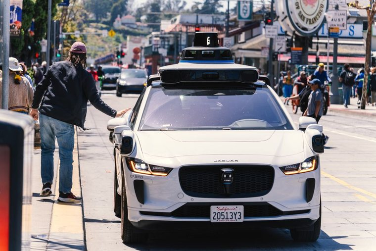
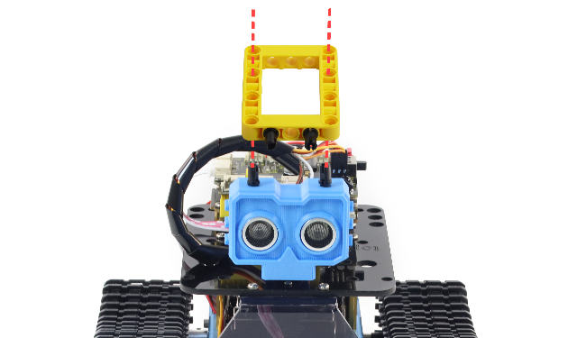
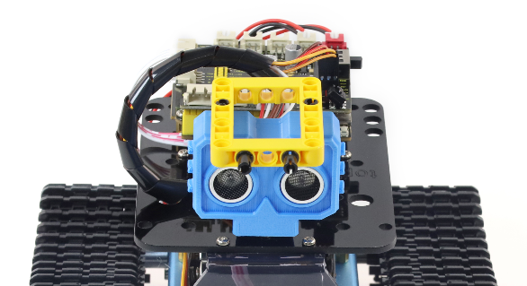
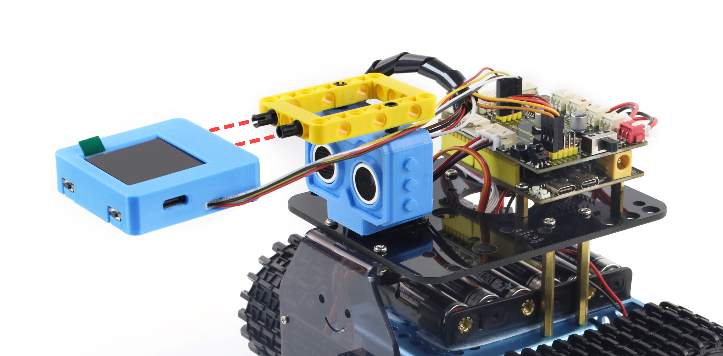
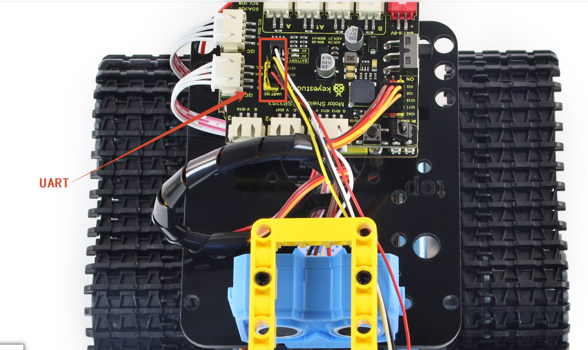

### Project 18: AI Vision Module: Camera Line Tracking

#### **1. Introduction:**

{width=520px}

In Lesson 7 the car followed a line with five infrared sensors pressed to the floor. Now lift the eyes: a camera aimed at the ground sees the line further ahead than a ground-hugging probe can, so the car can start steering before it is already on top of the line.

The module still sends no picture — it sends three numbers: how far the line sits from the center of the frame, how tilted it is, and a validity flag that equals 5 only when this frame really saw the line. With two of those you can work out how much the left and right wheels should differ in speed.

The correction uses proportional plus derivative: a big error means a big steering correction, a small error a gentle one; one more term watches how fast the error is changing and eases off early, so the body doesn't overshoot the centerline and swing back and forth. The straight-line base speed is 130, and the correction is capped at ±90.

At power-on the dot matrix shows a pair of eyes; it changes to a smiley only when the line enters view and tracking begins. Lose the line and it searches on the spot using its memory; find it again and it carries on, but if the search times out it stops and shows a frown.

#### **2. Parts List:**

Parts used in this lesson:

|     |     |     |
| :---: | :---: | :---: |
| {width=170px}<br><span style="font-size:0.85em">TinyVision AI vision camera ×1</span> | {width=170px}<br><span style="font-size:0.85em">DRV8835 motor expansion board ×1</span> | {width=170px}<br><span style="font-size:0.85em">Tracked chassis assembly ×1</span> |
| {width=170px}<br><span style="font-size:0.85em">8×16 LED dot matrix display ×1</span> | {width=170px}<br><span style="font-size:0.85em">ESP32-S3 development board ×1</span> |  |
#### **3. Parameters:**

| Item | Parameter |
| --- | --- |
| Recognition mode | `line` |
| Report format | `LINE:offset,angle,valid` |
| Valid flag | 5 = line recognized |
| Base straight speed | 130 |
| Proportional coefficient KP | 0.4 |
| Derivative coefficient KD | 0.6 |
| Correction limit | ±90 |
| Derivative limit | ±50 |
| Search speed | 90 |
| Search dead zone | 15 |
| Search timeout | 600 ms |
| Control period | 5 ms |

#### **4. Wiring:**

| Vision module | Controller | Description |
| --- | :---: | --- |
| TX | IO18 | Reports offset data |
| RX | IO17 | Sends mode commands |
| VCC / GND | 5V / GND | Power and common ground |

| Signal | Controller GPIO |
| --- | :---: |
| Left wheel AIN / AEN | IO38 / IO21 |
| Right wheel BIN / BEN | IO40 / IO41 |


**Mounting A:**












#### **5. Flowchart:**

Having a line and not having one are two completely different paths; which one you enter is decided by the **valid flag**:


#### **6. Test Code:**

> **This lesson's project has three files**: `18_Camera_Line_Tracking.ino`, `AiCam.h`, and `AiCam.cpp`. All serial traffic and string parsing for the vision module live in `AiCam.cpp`; put all three files in the same folder — compilation fails if any is missing.

```cpp
#include "AiCam.h"  // Vision module driver

// ===== Motor pins =====
#define MOTOR_AIN 38  // Channel A direction: left wheel
#define MOTOR_AEN 21  // Channel A speed: left wheel
#define MOTOR_BIN 40  // Channel B direction: right wheel
#define MOTOR_BEN 41  // Channel B speed: right wheel

// ===== Vision module serial port =====
// Controller RX <- module TX, controller TX -> module RX, common ground required
// Modify according to actual wiring
#define CAM_RX 18  // Controller RX pin
#define CAM_TX 17  // Controller TX pin

// ===== Dot matrix pins =====
#define CLK_Pin 9  // Clock, connect to module CLK
#define DIN_Pin 8  // Data, connect to module DIN

// ===== Line-following parameters =====
#define BASE_SPEED   130  // Base straight-line speed
#define KP           0.4  // Proportional coefficient
#define KD           0.6  // Derivative coefficient, suppresses overshoot
#define TURN_MAX      90  // Maximum one-side correction
#define D_MAX         50  // Derivative term limit

// ===== Line loss and search =====
#define SEARCH_SPEED  90  // Line-search rotation speed
#define SEARCH_DEAD   15  // Line-search dead zone
#define LOST_TIMEOUT 600  // Line-search timeout (ms)

// ===== Valid flag =====
#define LINE_OK 5  // The module's third field being 5 means a line is detected

// ===== Expression numbers =====
#define FACE_EYES     0  // Standby: eyes
#define FACE_SMILE    1  // Following line: smiling face
#define FACE_SURPRISE 2  // Searching for line: wide eyes
#define FACE_SAD      3  // Timeout: sad face

// 16 bytes correspond to 16 columns, each byte's 8 bits correspond to 8 rows in one column

// Standby: two square eyes
unsigned char eyes[] = {
  0x00, 0x00, 0x00, 0x00, 0x1C, 0x1C, 0x00, 0x00,
  0x00, 0x00, 0x1C, 0x1C, 0x00, 0x00, 0x00, 0x00
};

// Smiling face: stable on the line
unsigned char smile[] = {
  0x00, 0x00, 0x1C, 0x02, 0x02, 0x02, 0x5C, 0x40,
  0x40, 0x5C, 0x02, 0x02, 0x02, 0x1C, 0x00, 0x00
};

// Wide eyes: searching for the line
unsigned char surprise[] = {
  0x00, 0x00, 0x00, 0x00, 0x3E, 0x3E, 0x00, 0xC0,
  0xC0, 0x00, 0x3E, 0x3E, 0x00, 0x00, 0x00, 0x00
};

// Sad face: line search timeout
unsigned char sad[] = {
  0x00, 0x00, 0x00, 0x00, 0x08, 0x08, 0x80, 0x40,
  0x40, 0x80, 0x08, 0x08, 0x00, 0x00, 0x00, 0x00
};

AiCam aiCam(CAM_RX, CAM_TX);  // Vision module instance

int lastError = 0;            // Last error, determines search direction when line is lost
bool hasLast = false;         // Whether a previous error exists
unsigned long lostStart = 0;  // Time when line was lost, 0 means not lost
int curFace = -1;             // Current expression, -1 means not shown

void setup() {
  // Pull both lines HIGH to set the bus idle
  pinMode(CLK_Pin, OUTPUT);
  pinMode(DIN_Pin, OUTPUT);
  digitalWrite(CLK_Pin, HIGH);
  digitalWrite(DIN_Pin, HIGH);

  // Motor pins
  pinMode(MOTOR_BIN, OUTPUT);
  pinMode(MOTOR_AIN, OUTPUT);
  ledcAttach(MOTOR_BEN, 1000, 8);  // 1 kHz, 8-bit
  ledcAttach(MOTOR_AEN, 1000, 8);
  stopCar();                       // Stop on power on

  // Show standby expression
  showFace(FACE_EYES);

  // Start the vision module in line-following mode
  aiCam.begin();
  aiCam.setMode("line");

  delay(1000);  // Wait for the mode switch to complete
}

void loop() {
  aiCam.readSerial();  // Read the serial port each cycle

  int offset = aiCam.getLineOffset();  // Error: negative means left, positive means right
  int valid  = aiCam.getLineValid();   // Valid flag, 5 means line detected

  if (valid == LINE_OK) {
    // Line detected: PD calculation for differential speed
    lostStart = 0;         // Clear line-lost timer
    showFace(FACE_SMILE);  // Show smiling face

    int error = offset;  // Current error

    // Derivative term: change in error, suppresses overshoot
    int dError = 0;
    if (hasLast) {
      dError = error - lastError;
      dError = constrain(dError, -D_MAX, D_MAX);  // Limit range
    }

    // Differential = P x error + D x change in error
    int correction = (int)(error * KP + dError * KD);

    // Limit the correction
    correction = constrain(correction, -TURN_MAX, TURN_MAX);

    // When correction is positive (to the right), left fast and right slow, nose turns right
    // Opposite when correction is negative
    driveMotors(BASE_SPEED + correction, BASE_SPEED - correction);

    lastError = error;  // Save the current error
    hasLast = true;
  } else {
    // No line detected: search in the direction of the last error
    if (lostStart == 0) {    // Line just lost
      lostStart = millis();  // Start timing
    }

    if (millis() - lostStart < LOST_TIMEOUT) {
      showFace(FACE_SURPRISE);  // Searching for line

      // Direction unknown within dead zone, stop
      if (lastError > SEARCH_DEAD) {
        driveMotors(SEARCH_SPEED, -SEARCH_SPEED);   // Line was on the right: search right
      } else if (lastError < -SEARCH_DEAD) {
        driveMotors(-SEARCH_SPEED, SEARCH_SPEED);   // Line was on the left: search left
      } else {
        stopCar();                                  // Direction unknown, stop
      }
    } else {
      showFace(FACE_SAD);  // Line-search timeout
      stopCar();           // Stop after losing the line
    }
  }

  delay(5);  // 5 ms per cycle
}

// ===== Dot matrix display =====
// Only refresh the display when the expression changes
void showFace(int face) {
  if (face == curFace) return;  // Expression unchanged
  curFace = face;

  if (face == FACE_EYES) {
    matrix_display(eyes);       // Standby
  } else if (face == FACE_SMILE) {
    matrix_display(smile);      // Smiling face
  } else if (face == FACE_SURPRISE) {
    matrix_display(surprise);   // Wide eyes
  } else {
    matrix_display(sad);        // Sad face
  }
}

// Write the 16-byte font bitmap into the dot matrix display buffer
void matrix_display(unsigned char matrix_value[]) {
  // 0x40: write data mode, auto-increment address
  IIC_start();
  IIC_send(0x40);
  IIC_end();

  // 0xC0: display buffer start address 0
  IIC_start();
  IIC_send(0xC0);

  // Write 16 columns consecutively
  for (int i = 0; i < 16; i++) {
    IIC_send(matrix_value[i]);
  }
  IIC_end();

  // 0x8A: display on, maximum brightness
  IIC_start();
  IIC_send(0x8A);
  IIC_end();
}

// Start condition: falling edge of DIN while CLK is HIGH
void IIC_start() {
  digitalWrite(CLK_Pin, HIGH);
  delayMicroseconds(3);
  digitalWrite(DIN_Pin, HIGH);
  delayMicroseconds(3);
  digitalWrite(DIN_Pin, LOW);
  delayMicroseconds(3);
}

// Send one byte, LSB first: set data while CLK is LOW, sample on rising edge
void IIC_send(unsigned char send_data) {
  for (int i = 0; i < 8; i++) {
    digitalWrite(CLK_Pin, LOW);  // Pull clock LOW to prepare data
    delayMicroseconds(3);

    // Send bit by bit starting from bit0
    if (send_data & 0x01) {
      digitalWrite(DIN_Pin, HIGH);
    } else {
      digitalWrite(DIN_Pin, LOW);
    }
    delayMicroseconds(3);

    digitalWrite(CLK_Pin, HIGH); // Pull clock HIGH for the module to sample
    delayMicroseconds(3);

    send_data = send_data >> 1;  // Shift right to get the next bit
  }
}

// Stop condition: rising edge of DIN while CLK is HIGH
void IIC_end() {
  digitalWrite(CLK_Pin, LOW);
  delayMicroseconds(3);
  digitalWrite(DIN_Pin, LOW);
  delayMicroseconds(3);
  digitalWrite(CLK_Pin, HIGH);
  delayMicroseconds(3);
  digitalWrite(DIN_Pin, HIGH);
  delayMicroseconds(3);
}

// ===== Motor driver =====
// Channel A (38/21) drives the left wheel, channel B (40/41) the right wheel
// leftSpeed goes to channel A, rightSpeed to channel B; first limit to ±255, then take absolute value for duty cycle
void driveMotors(int leftSpeed, int rightSpeed) {
  leftSpeed  = constrain(leftSpeed,  -255, 255);  // Left wheel limit
  rightSpeed = constrain(rightSpeed, -255, 255);  // Right wheel limit

  // Channel A: left wheel
  if (leftSpeed >= 0) {
    digitalWrite(MOTOR_AIN, HIGH);    // Pull HIGH: forward rotation
    ledcWrite(MOTOR_AEN, leftSpeed);  // Duty cycle = speed
  } else {
    digitalWrite(MOTOR_AIN, LOW);     // Pull LOW: reverse rotation
    ledcWrite(MOTOR_AEN, -leftSpeed); // Take absolute value
  }

  // Channel B: right wheel
  if (rightSpeed >= 0) {
    digitalWrite(MOTOR_BIN, HIGH);     // Pull HIGH: forward rotation
    ledcWrite(MOTOR_BEN, rightSpeed);  // Duty cycle = speed
  } else {
    digitalWrite(MOTOR_BIN, LOW);      // Pull LOW: reverse rotation
    ledcWrite(MOTOR_BEN, -rightSpeed); // Take absolute value
  }
}

// Basic actions
void goForward(int speed)  { driveMotors(speed, speed); }    // Forward: both wheels forward at the same speed
void goBackward(int speed) { driveMotors(-speed, -speed); }  // Backward: both wheels reverse at the same speed
void spinLeft(int speed)   { driveMotors(-speed, speed); }   // Turn left: left wheel back, right wheel forward
void spinRight(int speed)  { driveMotors(speed, -speed); }   // Turn right: left wheel forward, right wheel back
void stopCar()             { driveMotors(0, 0); }            // Stop: duty cycle to zero
```

#### **7. Code Explanation:**

**(1) Eight parameters define the car's character**

```cpp
#define BASE_SPEED   130  // Base straight-line speed
#define KP           0.4  // Proportional coefficient
#define KD           0.6  // Derivative coefficient, suppresses overshoot
#define TURN_MAX      90  // Maximum one-side correction
#define D_MAX         50  // Derivative term limit

#define SEARCH_SPEED  90  // Line-search rotation speed
#define SEARCH_DEAD   15  // Line-search dead zone
#define LOST_TIMEOUT 600  // Line-search timeout (ms)
```

`BASE_SPEED 130` is the straight-ahead baseline, to which the left and right wheels add or subtract a correction. `KP 0.4` handles "how much to fix for how much error", and `KD 0.6` handles "ease off when the error is already shrinking". The last three are limits and safeguards, explained one by one below.

**(2) Four global states**

```cpp
int lastError = 0;            // Last error, determines search direction when line is lost
bool hasLast = false;         // Whether a previous error exists
unsigned long lostStart = 0;  // Time when line was lost, 0 means not lost
int curFace = -1;             // Current expression, -1 means not shown
```

`lastError` has two jobs: it feeds the derivative calculation and tells the car which way to search when the line is lost. `hasLast` is its companion switch, used in the next section when computing the derivative. `lostStart = 0` specifically means "the line is not lost right now", so the test uses "is it equal to 0" rather than a time difference.

**(3) At the top of `loop()`: fetch two numbers**

```cpp
  aiCam.readSerial();  // Read the serial port each cycle

  int offset = aiCam.getLineOffset();  // Error: negative means left, positive means right
  int valid  = aiCam.getLineValid();   // Valid flag, 5 means line detected
```

`offset` is how far the line sits from the center of the frame, negative for left and positive for right, in pixels. `valid` is the module's confidence flag; `LINE_OK` (equal to 5) means the line really was seen in this frame.

The two must be fetched separately: having an `offset` value does not make it trustworthy — when the module sees no line it still returns a number (usually the previous residual or 0) — so the decision must use `valid`.

**(4) Line recognized: clear the lost-line timer first**

```cpp
  if (valid == LINE_OK) {
    // Line detected: PD calculation for differential speed
    lostStart = 0;         // Clear line-lost timer
    showFace(FACE_SMILE);  // Show smiling face

    int error = offset;  // Current error
```

`lostStart = 0` must be cleared here, or the timestamp left by a previous lost-line round keeps accumulating and the car is judged as timed out the moment it finds the line again.

**(5) The derivative term: `hasLast` guards the first frame**

```cpp
    int dError = 0;
    if (hasLast) {
      dError = error - lastError;
      dError = constrain(dError, -D_MAX, D_MAX);  // Limit range
    }
```

`lastError` starts at 0. If the first frame computed `error - lastError` directly and the car happened to be off by −37, you would get a derivative of −37 — not a "rate of change" but a manufactured jolt, and the car would snap sideways. `hasLast` makes the first frame skip the derivative and starts counting from the second.

`constrain(dError, -D_MAX, D_MAX)` is the first limit: the camera occasionally spits out a frame with a jumping offset (say from −10 to +40), and without this clamp the derivative would spike into the hundreds and blow the whole correction out of the water.

**(6) Compute the correction, then apply two limits**

```cpp
    // Differential = P x error + D x change in error
    int correction = (int)(error * KP + dError * KD);

    // Limit the correction
    correction = constrain(correction, -TURN_MAX, TURN_MAX);
```

`error * KP` is the proportional term and `dError * KD` the derivative term; only their sum is the correction for this round. The `(int)` cast is needed because `KP` and `KD` are decimals, so the product is a float that must be converted back to an integer before writing to PWM.

`TURN_MAX 90` is the second limit: `BASE_SPEED` is 130, so a correction above 130 would produce a negative speed — one wheel reversing. That is fine for a spin-in-place but a sudden reversal while tracking twists the car to a stop. Limiting to ±90 keeps one side between 130 + 90 = 220 and 130 − 90 = 40, so both wheels always turn the same way.

**(7) Sign of the correction: left faster, right slower, curves right**

```cpp
    driveMotors(BASE_SPEED + correction, BASE_SPEED - correction);

    lastError = error;  // Save the current error
    hasLast = true;
```

The first argument to `driveMotors` is the left wheel, the second the right. A positive `offset` means the line is on the right of the frame and the nose is pointing left, so you steer right — speed up the left wheel and slow the right, and the nose swings back to the right. A positive correction is exactly that direction.

The last two lines are for the next round: `lastError` stores this error and `hasLast` is set true, so the derivative can be computed next time.

**(8) Line lost: search in the direction of the last error**

```cpp
    // No line detected: search in the direction of the last error
    if (lostStart == 0) {    // Line just lost
      lostStart = millis();  // Start timing
    }

    if (millis() - lostStart < LOST_TIMEOUT) {
      showFace(FACE_SURPRISE);  // Searching for line
```

The `lostStart == 0` test makes sure the timestamp is recorded only once — the first time the line is lost; later rounds still enter but do not re-stamp it.

It uses "which side the line was on the last time it was seen", not "which side it is on now" — right now nothing is visible, so there is no error to speak of. If the line was on the right, turn right to look for it.

**(9) Dead zone and timeout**

```cpp
      // Direction unknown within dead zone, stop
      if (lastError > SEARCH_DEAD) {
        driveMotors(SEARCH_SPEED, -SEARCH_SPEED);   // Line was on the right: search right
      } else if (lastError < -SEARCH_DEAD) {
        driveMotors(-SEARCH_SPEED, SEARCH_SPEED);   // Line was on the left: search left
      } else {
        stopCar();                                  // Direction unknown, stop
      }
    } else {
      showFace(FACE_SAD);  // Line-search timeout
      stopCar();           // Stop after losing the line
    }
```

`SEARCH_DEAD = 15` is the dead zone: if the last error was within ±15 the car was already straight, and searching either way is only a guess, so it stops and waits for someone to reposition it.

If the line is still not found after `LOST_TIMEOUT 600` ms, give up. That is much shorter than the 1500 ms in Lesson 7 because the camera sees further: five on/off sensors must wait until the nose is over the line to know, while the camera can see it from 30 cm away, so by the time the line is truly lost the car is already beyond the end of it and more turning is useless.

**(10) `delay(5)` sets the control period**

```cpp
  delay(5);  // 5 ms per cycle
}
```

One round is 5 ms, or 200 Hz. Both `KP` and `KD` are tuned around this period — change `delay(5)` to `delay(20)` and the same coefficients will feel "sluggish" because the sampling interval of the derivative has quadrupled. Change the period and you must retune the coefficients.

Tuning the coefficients has an order too: start with `KP` alone, raising it from 0.2 until the car can follow bends but begins to weave; then add `KD` from 0.1 upward and stop when the oscillation visibly shrinks. Adding `KD` first makes the car slow and dull, hiding which coefficient is at fault.

#### **8. What You Will See:**

In `setup()` the Serial Monitor prints the `aiCam` startup message; once running nothing else is printed (there are no print statements in `loop()`).

| State | Dot matrix | Behavior |
| --- | --- | --- |
| Standby (just powered on) | Eyes | Waiting for the line to enter view |
| Line recognized | Smiley | PD line tracking at speed 130 |
| Searching for a lost line | Wide eyes | Spinning in place in the remembered direction |
| Search timed out | Frown | Stopped |

> [Image to be added] Photos of the car following a full lap with the camera (one on a straight, one on a bend).

Tune in this order:

1. **Tune KP first.** Set KD to 0 and raise KP from 0.2 until the car follows the line but weaves through bends.
2. **Then add KD.** Raise it from 0.3 and watch whether the weaving settles. Too much KD makes the car shake — each correction is too violent, like a twitch.
3. **Tune speed last.** Raise `BASE_SPEED` from 130 to 150; if the car runs off at bends, the speed has exceeded what the field of view can cover — back it off.

Camera line tracking is far more sensitive to light than infrared. Floor reflections and shadow edges can both be mistaken for a line. Test under even incandescent light or natural daylight, not beside a window with strong glare.

#### **9. Troubleshooting:**

(1) Not a single line on the Serial Monitor: check the wiring first. The vision module's TX goes to controller IO18 and RX to IO17 — the two must cross; the baud rate is 9600, and a mismatch gives either garbage or nothing at all.

(2) The car weaves through bends: tune `KP` and `KD`. Currently `KP = 0.4` and `KD = 0.6`; hold KD fixed and lower KP until the car can follow the line, then add KD to settle the oscillation. Too much KD makes the car shudder.

(3) Losing the line constantly and searching forever: check `SEARCH_DEAD = 15`, `SEARCH_SPEED = 90`, and `LOST_TIMEOUT = 600`. Too small a dead zone makes it search back and forth; too short a timeout stops it outright. Floor reflections or shadow edges are also often read as a line — switch to even white light and test again.

(4) The car always drifts to one side and nothing fixes it: the camera is mounted crooked, or the center value from the module does not match the actual frame center. Straighten the car, look at a straight line and check whether `offset` is close to 0; if it is far off, adjust the module's mounting angle slightly.
