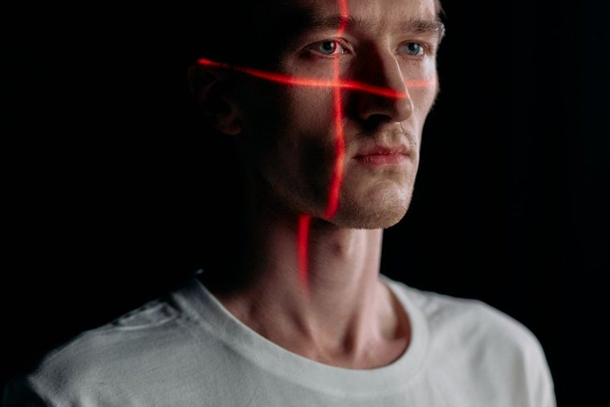
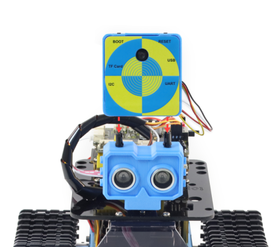
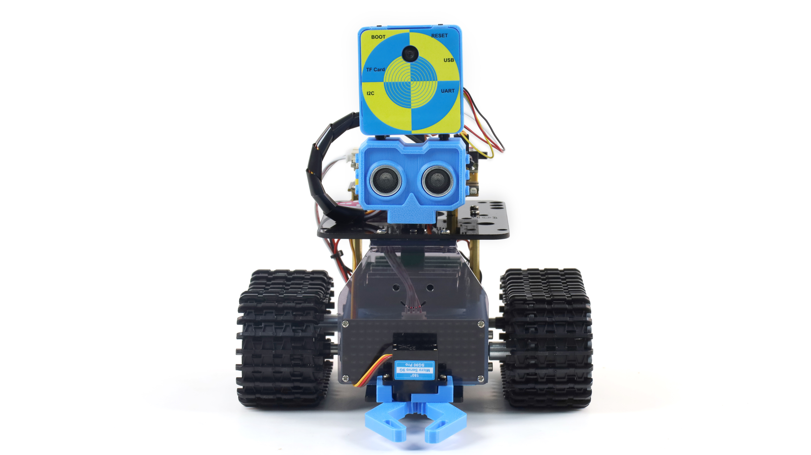
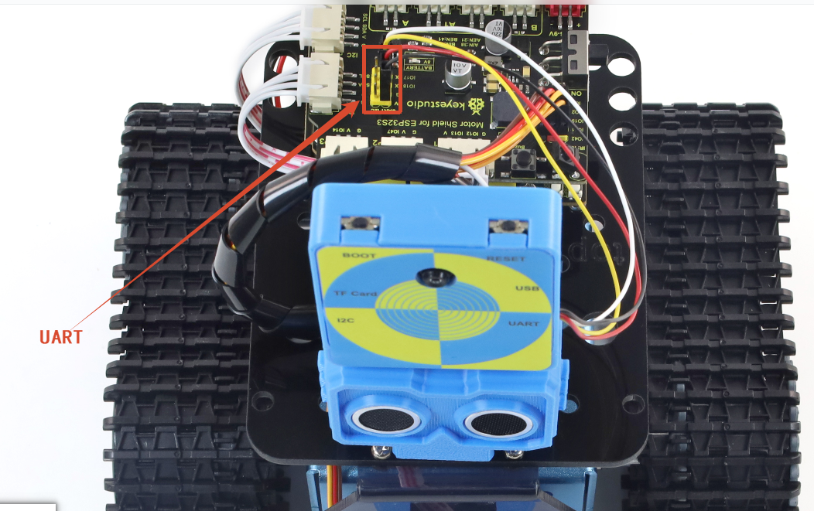
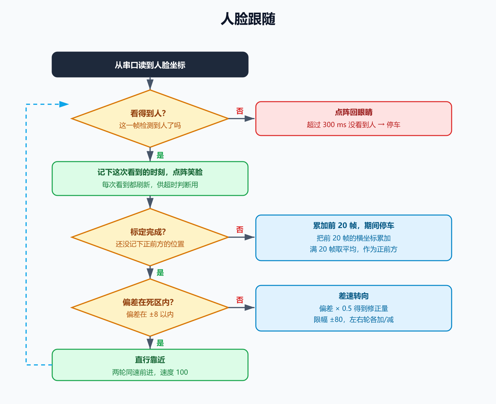

### 项目 19：AI 视觉模块：人脸跟随

#### **1. 简介：**

{width=520px}

站到车前，车会转过来看着你；你往左走，它往左转；你走远了，它跟上来。第 5 课用超声波跟随，只知道前面有没有东西、离多远；换成摄像头以后，能知道人在画面的哪一边。

人脸模式比颜色模式多回一样东西：坐标。模块给出人脸中心在画面里的横坐标，人偏左还是偏右一目了然，左右轮的差速就照这个偏差算。

麻烦在量程。不同固件给出的坐标范围不一样，有的到 100，有的到 320 像素，写死一个中心值，换一只模块就偏。做法是上电后站到镜头正前方一秒，车把前二十帧的横坐标取平均，把这个平均值当作正前方，之后所有偏差都相对它算。

站正前方，车直行靠近；往左移，左轮慢、右轮快，车跟着左转；走出画面，300 毫秒后它停下，点阵从笑脸换回眼睛。

#### **2. 所需清单：**

本课用到的器件：

|     |     |     |
| :---: | :---: | :---: |
| {width=170px}<br><span style="font-size:0.85em">TinyVision AI 视觉摄像头 ×1</span> | {width=170px}<br><span style="font-size:0.85em">9G 舵机（180°） ×1</span> | {width=170px}<br><span style="font-size:0.85em">DRV8835 电机扩展板 ×1</span> |
| {width=170px}<br><span style="font-size:0.85em">履带底盘总成 ×1</span> | {width=170px}<br><span style="font-size:0.85em">8×16 LED 点阵屏 ×1</span> | {width=170px}<br><span style="font-size:0.85em">ESP32-S3 开发板 ×1</span> |
#### **3. 参数：**

| 项目 | 参数 |
| --- | --- |
| 识别模式 | `face` |
| 回传格式 | `FACE:x,y` |
| 跟随速度 | 100 |
| 比例系数 KP | 0.5 |
| 修正上限 | ±80 |
| 对准死区 | ±8 |
| 标定帧数 | 20 |
| 丢失停车延时 | 300 ms |
| 云台角度 | 90°（固定，不参与跟随） |

#### **4. 接线说明：**

本课回到装法 B：模块在云台上，镜头朝正前方，按 2.2.9 与云台支架一起锁死。`setup()` 把云台转到 90° 就停在那里，左右跟随交给两侧轮子的差速——目标偏在画面哪一边，车就往哪一边修正。


| 视觉模块 | 主控 | 说明 |
| --- | :---: | --- |
| TX | IO18 | 回传人脸坐标 |
| RX | IO17 | 下发模式指令 |
| VCC / GND | 5V / GND | 供电与共地 |

| 信号 | 主控 GPIO |
| --- | :---: |
| 云台舵机 | IO42（固定 90°） |
| 左轮 AIN / AEN | IO38 / IO21 |
| 右轮 BIN / BEN | IO40 / IO41 |


**装法B：**









#### **5. 流程图：**

上电先标定 20 帧，标定完才开始跟随：



#### **6. 测试代码：**

> **本课工程有三个文件**：`19_Face_Following.ino`、`AiCam.h`、`AiCam.cpp`。视觉模块的串口收发和字符串解析都在 `AiCam.cpp` 里，三个文件放在同一个文件夹，少一个编译不过。

```cpp
#include <ESP32Servo.h>
#include "AiCam.h"  // 视觉模块驱动

// ===== 电机引脚 =====
#define MOTOR_AIN 38  // A 路方向：左轮
#define MOTOR_AEN 21  // A 路调速：左轮
#define MOTOR_BIN 40  // B 路方向：右轮
#define MOTOR_BEN 41  // B 路调速：右轮

// ===== 云台舵机 =====
#define PAN_SERVO_PIN 42  // 第 8 课

// ===== 视觉模块串口 =====
// 主控 RX←模块 TX，主控 TX→模块 RX，需共地
#define CAM_RX 18  // 主控接收脚
#define CAM_TX 17  // 主控发送脚

// ===== 点阵引脚 =====
#define CLK_Pin 9  // 时钟，接模块 CLK
#define DIN_Pin 8  // 数据，接模块 DIN

// ===== 跟随参数 =====
#define PAN_CENTER     90  // 云台固定朝正前
#define FOLLOW_SPEED  100  // 跟随前进速度
#define KP            0.5  // 比例系数
#define TURN_MAX       80  // 单侧修正上限
#define DEAD_ZONE       8  // 对准死区
#define CALI_FRAMES    20  // 标定帧数
#define LOST_STOP     300  // 丢失超时（ms）

// ===== 调试开关 =====
// 1 打印标定中心值，0 静音
#define DEBUG_OUT 1

// ===== 表情编号 =====
#define FACE_EYES  0  // 没看到人：眼睛
#define FACE_SMILE 1  // 看到人：笑脸

// 16 字节对应 16 列，每字节 8 位对应一列 8 行

// 待机：两只方眼
unsigned char eyes[] = {
  0x00, 0x00, 0x00, 0x00, 0x1C, 0x1C, 0x00, 0x00,
  0x00, 0x00, 0x1C, 0x1C, 0x00, 0x00, 0x00, 0x00
};

// 笑脸：看到人
unsigned char smile[] = {
  0x00, 0x00, 0x1C, 0x02, 0x02, 0x02, 0x5C, 0x40,
  0x40, 0x5C, 0x02, 0x02, 0x02, 0x1C, 0x00, 0x00
};

AiCam aiCam(CAM_RX, CAM_TX);  // 视觉模块实例
Servo panServo;               // 云台舵机

int centerX = -1;             // 标定中心 X，-1 未完成
long sumX = 0;                // 标定累加值
int caliCount = 0;            // 标定帧计数
unsigned long lastSeen = 0;   // 最后检测到人
int curFace = -1;             // 当前表情，-1 未显示

void setup() {
#if DEBUG_OUT
  Serial.begin(115200);
#endif

  // 两线拉高，总线置空闲
  pinMode(CLK_Pin, OUTPUT);
  pinMode(DIN_Pin, OUTPUT);
  digitalWrite(CLK_Pin, HIGH);
  digitalWrite(DIN_Pin, HIGH);
  showFace(FACE_EYES);  // 显示待机表情

  // 云台：50 Hz，脉宽 500~2500 µs
  ESP32PWM::allocateTimer(0);
  panServo.setPeriodHertz(50);
  panServo.attach(PAN_SERVO_PIN, 500, 2500);
  panServo.write(PAN_CENTER);  // 朝正前，本课不再转动
  delay(500);

  // 电机引脚
  pinMode(MOTOR_BIN, OUTPUT);
  pinMode(MOTOR_AIN, OUTPUT);
  ledcAttach(MOTOR_BEN, 1000, 8);  // 1 kHz，8 位
  ledcAttach(MOTOR_AEN, 1000, 8);
  stopCar();

  // 启动视觉模块，人脸检测模式
  aiCam.begin();
  aiCam.setMode("face");

  delay(500);  // 等模式切换完成
}

void loop() {
  aiCam.readSerial();  // 每轮读取串口

  if (!aiCam.isFaceValid()) {
    // 未检测到人：超时停车
    showFace(FACE_EYES);
    if (millis() - lastSeen > LOST_STOP) {
      stopCar();  // 超时停车
    }
    delay(20);
    return;
  }

  // 检测到人
  lastSeen = millis();   // 刷新检测时刻
  showFace(FACE_SMILE);  // 显示笑脸

  int x = aiCam.getFaceX();  // 人脸中心 X

  // 标定正前方
  // 模块 X 量程未知（0~100 或 0~320 像素），
  // 改用前 20 帧取平均，不写死中心值
  if (centerX < 0) {
    sumX += x;
    caliCount++;
    stopCar();  // 标定期间停车

    if (caliCount >= CALI_FRAMES) {
      centerX = (int)(sumX / caliCount);  // 均值为正前方 X
#if DEBUG_OUT
      Serial.print("画面中心已锁定：");
      Serial.println(centerX);
#endif
    }

    delay(20);
    return;
  }

  // 跟随
  int err = x - centerX;  // 偏差：正在右，负在左

  if (abs(err) <= DEAD_ZONE) {
    // 已对准：直行靠近
    goForward(FOLLOW_SPEED);
  } else {
    // 未对准：差速转向
    // err 为正（人在右）时左快右慢
    int correction = constrain((int)(err * KP), -TURN_MAX, TURN_MAX);
    driveMotors(FOLLOW_SPEED + correction, FOLLOW_SPEED - correction);
  }

  delay(20);  // 20 ms 一轮
}

// ===== 点阵显示 =====
// 仅表情变化时写屏
void showFace(int face) {
  if (face == curFace) return;  // 表情未变
  curFace = face;

  if (face == FACE_EYES) {
    matrix_display(eyes);   // 待机
  } else {
    matrix_display(smile);  // 笑脸
  }
}

// 将 16 字节字模写入点阵屏显存
void matrix_display(unsigned char matrix_value[]) {
  // 0x40：写数据模式，地址自增
  IIC_start();
  IIC_send(0x40);
  IIC_end();

  // 0xC0：显存起始地址 0
  IIC_start();
  IIC_send(0xC0);

  // 连写 16 列
  for (int i = 0; i < 16; i++) {
    IIC_send(matrix_value[i]);
  }
  IIC_end();

  // 0x8A：开显示，亮度最大
  IIC_start();
  IIC_send(0x8A);
  IIC_end();
}

// 起始条件：CLK 高电平期间 DIN 下降沿
void IIC_start() {
  digitalWrite(CLK_Pin, HIGH);
  delayMicroseconds(3);
  digitalWrite(DIN_Pin, HIGH);
  delayMicroseconds(3);
  digitalWrite(DIN_Pin, LOW);
  delayMicroseconds(3);
}

// 发送 1 字节，低位在前：CLK 低时置数据，上升沿采样
void IIC_send(unsigned char send_data) {
  for (int i = 0; i < 8; i++) {
    digitalWrite(CLK_Pin, LOW);  // 拉低时钟，准备数据
    delayMicroseconds(3);

    // 从 bit0 起逐位发送
    if (send_data & 0x01) {
      digitalWrite(DIN_Pin, HIGH);
    } else {
      digitalWrite(DIN_Pin, LOW);
    }
    delayMicroseconds(3);

    digitalWrite(CLK_Pin, HIGH); // 拉高时钟，模块采样
    delayMicroseconds(3);

    send_data = send_data >> 1;  // 右移，取出下一位
  }
}

// 停止条件：CLK 高电平期间 DIN 上升沿
void IIC_end() {
  digitalWrite(CLK_Pin, LOW);
  delayMicroseconds(3);
  digitalWrite(DIN_Pin, LOW);
  delayMicroseconds(3);
  digitalWrite(CLK_Pin, HIGH);
  delayMicroseconds(3);
  digitalWrite(DIN_Pin, HIGH);
  delayMicroseconds(3);
}

// ===== 电机驱动 =====
// A 路接左轮、B 路接右轮（与第 7 课一致）
// leftSpeed 走 B 路，rightSpeed 走 A 路
// 先限幅 ±255，再取绝对值给占空比
void driveMotors(int leftSpeed, int rightSpeed) {
  leftSpeed  = constrain(leftSpeed,  -255, 255);  // 右轮限幅
  rightSpeed = constrain(rightSpeed, -255, 255);  // 左轮限幅

  // A 路：左轮
  if (rightSpeed >= 0) {
    digitalWrite(MOTOR_BIN, HIGH);     // 拉高：正转
    ledcWrite(MOTOR_BEN, rightSpeed);  // 占空比 = 速度
  } else {
    digitalWrite(MOTOR_BIN, LOW);      // 拉低：反转
    ledcWrite(MOTOR_BEN, -rightSpeed); // 取绝对值
  }

  // B 路：右轮
  if (leftSpeed >= 0) {
    digitalWrite(MOTOR_AIN, HIGH);    // 拉高：正转
    ledcWrite(MOTOR_AEN, leftSpeed);  // 占空比 = 速度
  } else {
    digitalWrite(MOTOR_AIN, LOW);     // 拉低：反转
    ledcWrite(MOTOR_AEN, -leftSpeed); // 取绝对值
  }
}

// 基本动作
void goForward(int speed)  { driveMotors(speed, speed); }    // 前进：左右同速正转
void goBackward(int speed) { driveMotors(-speed, -speed); }  // 后退：左右同速反转
void spinLeft(int speed)   { driveMotors(-speed, speed); }   // 左转：左后退右前进
void spinRight(int speed)  { driveMotors(speed, -speed); }   // 右转：左前进右后退
void stopCar()             { driveMotors(0, 0); }            // 停止：占空比归零
```

#### **7. 代码解释：**

**(1) 六个参数**

```cpp
#define FOLLOW_SPEED  100  // 跟随前进速度
#define KP            0.5  // 比例系数
#define TURN_MAX       80  // 单侧修正上限
#define DEAD_ZONE       8  // 对准死区
#define CALI_FRAMES    20  // 标定帧数
#define LOST_STOP     300  // 丢失超时（ms）
```

`FOLLOW_SPEED 100` 比前几课的 180 慢，跟人走不需要快。`KP 0.5` 只有一个比例项，没有微分——跟人比巡线简单，偏差本身就是连续的，不需要抑制超调。剩下四个都是保护和标定，后面逐个讲。

**(2) 五个全局状态**

```cpp
int centerX = -1;             // 标定中心 X，-1 未完成
long sumX = 0;                // 标定累加值
int caliCount = 0;            // 标定帧计数
unsigned long lastSeen = 0;   // 最后检测到人
int curFace = -1;             // 当前表情，-1 未显示
```

`centerX` 初值 `-1` 同时是"还没标定"的标记——所以判断用的是 `centerX < 0`，不是某个具体数值。`sumX` 和 `caliCount` 只在标定阶段用，标完就没人看了。`lastSeen` 是丢人宽限的计时起点。

**(3) `loop()` 开头：先处理"没看到人"**

```cpp
  if (!aiCam.isFaceValid()) {
    // 未检测到人：超时停车
    showFace(FACE_EYES);
    if (millis() - lastSeen > LOST_STOP) {
      stopCar();  // 超时停车
    }
    delay(20);
    return;
  }
```

检测不到人脸时**不是立刻停**，而是看距离上次看到人过了多久。`return` 直接结束本轮，后面的标定和跟随逻辑一行都不碰。

`showFace(FACE_EYES)` 放在判断里面、超时判断外面，所以一丢人就换表情，不用等超时。

**(4) 300 ms 宽限：人挥手挡一下脸不该停车**

```cpp
    if (millis() - lastSeen > LOST_STOP) {
      stopCar();  // 超时停车
    }
```

300 ms 内继续按上一轮的速度走（这一轮什么指令都没发，电机保持原状态），超过才停。

这个宽限很有必要：模块偶尔漏检一两帧，人头稍微转一下、光线变一下都会发生。立刻停车的话，车会一顿一顿地往前蹭。300 ms 大约 15 帧，能滤掉绝大多数瞬时漏检。

**(5) 检测到人就刷新时刻**

```cpp
  lastSeen = millis();   // 刷新检测时刻
  showFace(FACE_SMILE);  // 显示笑脸

  int x = aiCam.getFaceX();  // 人脸中心 X
```

`lastSeen` 每看到一次就刷新，所以 300 ms 判的是"距离上一次看到人多久"，不是"距离第一次丢人多久"。这一句放在有效判断之后，只在这一帧真的看到人时才执行。

**(6) 标定：前 20 帧取平均**

```cpp
  if (centerX < 0) {
    sumX += x;
    caliCount++;
    stopCar();  // 标定期间停车

    if (caliCount >= CALI_FRAMES) {
      centerX = (int)(sumX / caliCount);  // 均值为正前方 X
```

模块回传的 `x` 是"人脸中心在画面里的坐标"，但**量程没有统一标准**——有的固件给 0～100，有的给 0～320 像素。代码里写死 `centerX = 160`，换一块模块就全错。

所以改成开机时让操作者站在正前方，取前 20 帧的平均值当中心。20 帧约 0.4 秒，够滤掉单帧抖动；再多就要站着等更久，体验变差。

`stopCar()` 和 `return` 都在标定分支里，标定期间车不动，剩下的跟随逻辑这一轮不执行。

为什么不能省这一步：摄像头装在云台上，云台 90° 不一定是画面正中；再加上镜头畸变，人脸在画面里的"居中"位置往往偏离 160 好几个像素。写死 160 的后果是——人明明站在正前方，车却一直往一边偏。

**(7) 死区：对准了就别再修**

```cpp
  int err = x - centerX;  // 偏差：正在右，负在左

  if (abs(err) <= DEAD_ZONE) {
    // 已对准：直行靠近
    goForward(FOLLOW_SPEED);
  }
```

`DEAD_ZONE = 8`：偏差在 ±8 以内认为已经对准，直接往前走。

没有死区会怎样？人脸坐标每帧都在跳，哪怕人站着不动，`x` 也会在 ±3 上下浮动。车就会不停地左修一点、右修一点，原地左右摇摆，就是不走。死区把这几个像素的噪声吃掉。

**(8) 差速与限幅**

```cpp
  } else {
    // 未对准：差速转向
    // err 为正（人在右）时左快右慢
    int correction = constrain((int)(err * KP), -TURN_MAX, TURN_MAX);
    driveMotors(FOLLOW_SPEED + correction, FOLLOW_SPEED - correction);
  }
```

人在画面右边（`err` 为正）说明车头偏左，要向右转——左轮加速、右轮减速，`+correction` 给左轮正好是这个方向。

`TURN_MAX = 80` 和上一课的 ±90 是一个道理：`FOLLOW_SPEED` 是 100，修正量到 100 就会出现负速度、单侧反转。限在 80 留了 20 的余量，保证两侧始终正转，车是"拐弯"而不是"原地拧"。

**(9) `delay(20)`：50 Hz**

```cpp
  delay(20);  // 20 ms 一轮
}
```

20 ms 一轮等于 50 Hz，和人脸检测的实际帧率接近。再快也是重复读同一帧，白占 CPU；再慢就跟不上人的移动，车会一顿一顿地追。

这课的骨架和第 18 课巡线几乎一样：`readSerial()` → 判断有效 → 算偏差 → 差速 → `delay()`。差别在三处：

| | 第 18 课巡线 | 第 19 课跟随 |
| --- | --- | --- |
| 有效标志 | `valid == 5` | `isFaceValid()` |
| 中心值 | 模块直接给偏移量 | 开机标定 20 帧取平均 |
| 丢目标的处理 | 按记忆方向原地找线，600 ms | 保持直行 300 ms，然后停 |

第 18 课丢线要"找"，因为线不会动；第 19 课丢人要"停"，因为人走了追不上，追上去反而危险。

#### **8. 运行现象：**

打开 `DEBUG_OUT`，串口打印：

```text
视觉模块串口已启动
发送 -> GET:MODE
发送 -> GET:OUTPUT
发送 -> MODE:FACE
画面中心已锁定：78
```

`78` 就是这一台模块在当前位置的**正前方**坐标。

| 你的动作 | 点阵 | 车 |
| --- | --- | --- |
| 正对镜头站 1 s | 笑脸 | 停（标定阶段） |
| 站在正前方 | 笑脸 | 直行靠近 |
| 向左移动 | 笑脸 | 左轮慢、右轮快，向左转 |
| 向右移动 | 笑脸 | 右转 |
| 走出画面 | 眼睛 | 300 ms 后停 |

> 【图片待补】串口打印**画面中心已锁定**的截图。

#### **9. 常见问题解决：**

(1) 车跟得太急、左右摆——把 `KP` 从 0.5 降到 0.3，或者把 `DEAD_ZONE` 从 8 加到 15。

(2) 车反应迟钝、人走了才动——`KP` 加到 0.8，或把 `FOLLOW_SPEED` 从 100 提到 130。

(3) 标定这一步不要省：站在镜头前不动，等它打完**画面中心已锁定**再开始走动。标定期间人在晃，中心值就偏了，后面车会一直斜着看你。
