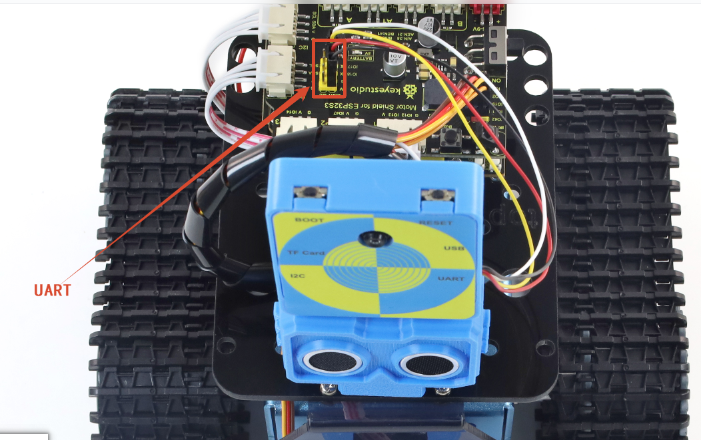
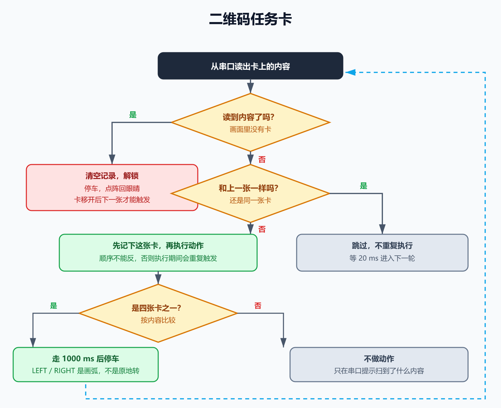

### Project 20: AI Vision Module: QR Code Task Cards

#### **1. Introduction:**


Wave a card printed with a QR code in front of the car and one scan sends it forward for one second; show it another and it curves off to the left. Four cards each hide one instruction — FORWARD, BACKWARD, LEFT, RIGHT — and you cannot tell which from the card's surface; only the car's scan reveals it.

The interesting part is that the car gets into trouble by being too obedient. The camera returns a dozen or so frames per second, so one card held in view is read dozens of times in a row. If it obeyed every one, the car would keep charging forward and never stop. The real job is to make it remember the card it just read and accept the next instruction only after that card is taken away.

The instruction in the QR code is an English word with no spaces and no line breaks — what the module reads back must match, character for character, what was written into it.

On power-on the pan-tilt turns to 90° and the dot matrix shows a pair of eyes. Hold a card 10 to 25 cm in front of the car's nose: the dot matrix becomes a smiley and the car carries out that card's instruction for one second; take the card away and the eyes return, waiting for the next one.

#### **2. Parts List:**
Parts used in this lesson:

|     |     |     |
| :---: | :---: | :---: |
| <br><span style="font-size:0.85em">TinyVision AI vision camera ×1</span> | <br><span style="font-size:0.85em">9G servo (180°) ×1</span> | <br><span style="font-size:0.85em">DRV8835 motor expansion board ×1</span> |
| <br><span style="font-size:0.85em">Mini tracked tank robot bottom assembly ×1</span> | <br><span style="font-size:0.85em">8×16 LED dot matrix display ×1</span> | <br><span style="font-size:0.85em">ESP32-S3 development board ×1</span> |
#### **3. Parameters:**
| Item | Parameter |
| --- | --- |
| Recognition mode | `qr` |
| Report format | `QR:content` |
| Card contents | `FORWARD` / `BACKWARD` / `LEFT` / `RIGHT` |
| Straight speed | 150 |
| Outer wheel on turns | 150 |
| Inner wheel on turns | 50 |
| Action duration per card | 1000 ms |
| Pan-tilt angle | 90° (fixed) |
| De-duplication key | Compare `lastQr` with the current content |

#### **4. Wiring:**

This lesson still uses mounting B: the module sits on the pan-tilt with the lens facing straight ahead; `setup()` turns the pan-tilt to 90° to square up the lens and never moves it again. When scanning, you hold the card in front of the lens — the car does not go looking for it.

| Vision module | Controller | Description |
| --- | :---: | --- |
| TX | IO18 | Reports QR code content |
| RX | IO17 | Sends mode commands |
| VCC / GND | 5V / GND | Power and common ground |

| Signal | Controller GPIO |
| --- | :---: |
| Pan-tilt servo | IO42 |
| Left wheel AIN / AEN | IO38 / IO21 |
| Right wheel BIN / BEN | IO40 / IO41 |
| Dot matrix CLK / DIN | IO9 / IO8 |

**Mounting B:**




> [Image to be added] A photo showing the distance between the handheld card and the camera, indicating how close it must be to scan (roughly 10–25 cm).

#### **5. Flowchart:**

Each round does only three things: read the card, decide whether it is a new one, and execute:



#### **6. Test Code:**
> **This lesson's project has three files**: `20_QR_Code_Tasks.ino`, `AiCam.h`, and `AiCam.cpp`. All serial traffic and string parsing for the vision module live in `AiCam.cpp`; put all three files in the same folder — compilation fails if any is missing.

```cpp
#include <ESP32Servo.h>
#include "AiCam.h"  // Vision module driver

// ===== Motor pins =====
#define MOTOR_AIN 38  // Channel A direction: left wheel
#define MOTOR_AEN 21  // Channel A speed: left wheel
#define MOTOR_BIN 40  // Channel B direction: right wheel
#define MOTOR_BEN 41  // Channel B speed: right wheel

// ===== Pan-tilt servo =====
// Camera and ultrasonic module share a housing on the pan-tilt; this servo changes their direction
#define PAN_SERVO_PIN 42  // Pan-tilt servo, Lessons 8 and 18
#define PAN_CENTER    90  // Straight ahead, camera level

// ===== Vision module serial port =====
// Controller RX <- module TX, controller TX -> module RX, common ground required
#define CAM_RX 18  // Controller RX pin
#define CAM_TX 17  // Controller TX pin

// ===== Dot matrix pins =====
#define CLK_Pin 9  // Clock, connect to module CLK
#define DIN_Pin 8  // Data, connect to module DIN

// ===== Task parameters =====
// Straight 150: below about 70 there is a startup dead zone, 150 gives a reliable start
#define SPEED_MOVE     150  // Forward / backward speed

// Turning uses different speeds on the two sides rather than reversing: reversing only spins in place, while this lesson needs to turn while moving
#define SPEED_TURN_OUT 150  // Outer wheel speed when turning
#define SPEED_TURN_IN   50  // Inner wheel speed when turning

// Action duration per card, determines travel distance
#define ACTION_TIME   1000  // Auto-stop when time is up

// ===== Debug switches =====
// 1 prints scanned content and byte count, 0 turns it off
#define DEBUG_OUT 1

// ===== Expression numbers =====
// Using numbers makes it easy for showFace() to detect expression changes and avoid redundant display writes
#define FACE_EYES  0  // Standby: eyes
#define FACE_SMILE 1  // Card recognized: smiley

// 16 bytes correspond to 16 columns, each byte's 8 bits to 8 rows in a column, bit0 is the top row

// Standby: two square eyes, columns 4/5 and 10/11 lit on rows 2-4
unsigned char eyes[] = {
  0x00, 0x00, 0x00, 0x00, 0x1C, 0x1C, 0x00, 0x00,
  0x00, 0x00, 0x1C, 0x1C, 0x00, 0x00, 0x00, 0x00
};

// Smiley
unsigned char smile[] = {
  0x00, 0x00, 0x1C, 0x02, 0x02, 0x02, 0x5C, 0x40,
  0x40, 0x5C, 0x02, 0x02, 0x02, 0x1C, 0x00, 0x00
};

AiCam aiCam(CAM_RX, CAM_TX);  // Vision module instance
Servo panServo;               // Pan-tilt servo

// Content of the last card executed, to distinguish a held card from a new one
String lastQr = "";

// Current expression, -1 means not shown
int curFace = -1;

void setup() {
#if DEBUG_OUT
  // Debug serial port, not compiled when DEBUG_OUT is 0
  Serial.begin(115200);
#endif

  // Pull both lines HIGH to set the bus idle
  pinMode(CLK_Pin, OUTPUT);
  pinMode(DIN_Pin, OUTPUT);
  digitalWrite(CLK_Pin, HIGH);
  digitalWrite(DIN_Pin, HIGH);
  showFace(FACE_EYES);  // Show standby expression

  // Motor pins
  pinMode(MOTOR_BIN, OUTPUT);      // Right wheel direction
  pinMode(MOTOR_AIN, OUTPUT);      // Left wheel direction
  ledcAttach(MOTOR_BEN, 1000, 8);  // Right wheel PWM: 1 kHz, 8-bit
  ledcAttach(MOTOR_AEN, 1000, 8);  // Left wheel PWM
  stopCar();                       // Stop on power on

  // Pan-tilt: point the camera straight ahead on power on
  ESP32PWM::allocateTimer(0);                 // Allocate an LEDC timer
  panServo.setPeriodHertz(50);                // 50 Hz
  panServo.attach(PAN_SERVO_PIN, 500, 2500);  // IO42, pulse width 500-2500 µs
  panServo.write(PAN_CENTER);                 // Turn to straight ahead
  delay(300);                                 // Wait for the servo to settle

  // Start the vision module in QR code mode
  aiCam.begin();          // Open Serial2 and bind pins
  aiCam.setMode("qr");    // Send MODE:QR

  delay(1000);  // Wait for mode switch to finish, avoid reading stray data during switching
}

// ===== Main loop =====
// Each cycle: read serial -> check for a new card -> execute or stop
void loop() {
  aiCam.readSerial();  // Read the serial port and update the buffer

  String qr = aiCam.getQrCode();  // Current QR code content, empty means no card

#if DEBUG_OUT
  // Print the raw content and byte count when content changes
  // The four cards are 7 / 8 / 4 / 5 bytes respectively
  static String lastPrinted = "";        // static persists across cycles
  if (qr.length() > 0 && qr != lastPrinted) {
    lastPrinted = qr;
    Serial.print("QR code scanned: ");
    Serial.print(qr);
    Serial.print("  Byte count ");
    Serial.println(qr.length());
  }
#endif

  // No card
  // Clear lastQr to release the lock
  if (qr.length() == 0) {
    lastQr = "";          // Allow the next card to trigger
    stopCar();            // Stop the car
    showFace(FACE_EYES);  // Standby expression
    delay(20);
    return;               // End this cycle
  }

  // Same card not removed
  // Skip, do not execute again
  if (qr == lastQr) {
    delay(20);
    return;
  }

  // New card
  // Record before executing to avoid repeated triggering during execution
  lastQr = qr;    // Record this card
  doTask(qr);     // Execute action, blocks internally for 1 s

  delay(20);
}

// ===== Task execution =====
// Each of the four cards runs an action and stops automatically when time is up
//   FORWARD  both wheels forward at the same speed
//   BACKWARD both wheels reverse at the same speed
//   LEFT     left 50 / right 150, arc to the left
//   RIGHT    left 150 / right 50, arc to the right
void doTask(String qr) {
  showFace(FACE_SMILE);  // Show smiley

  // Convert to uppercase before comparing
  String key = qr;
  key.trim();        // Remove leading and trailing whitespace
  key.toUpperCase(); // Convert to uppercase

  bool known = true;  // Whether it is a known card

  if (key == "FORWARD") {
    goForward(SPEED_MOVE);                        // Both wheels forward at the same speed
  } else if (key == "BACKWARD") {
    goBackward(SPEED_MOVE);                       // Both wheels reverse at the same speed
  } else if (key == "LEFT") {
    driveMotors(SPEED_TURN_IN, SPEED_TURN_OUT);   // Left slow, right fast, arc to the left
  } else if (key == "RIGHT") {
    driveMotors(SPEED_TURN_OUT, SPEED_TURN_IN);   // Left fast, right slow, arc to the right
  } else {
    known = false;  // Not one of the four cards, no action
  }

  // Drive motors only for known cards
  if (known) {
    delay(ACTION_TIME);  // Run for the full set duration
    stopCar();           // Stop when time is up
  }
}

// ===== Dot matrix display =====
// Only refresh the display when the expression changes
// Writing the display needs over 20 bytes of software I2C; frequent calls slow the main loop
void showFace(int face) {
  if (face == curFace) return;  // Expression unchanged
  curFace = face;               // Record the current expression

  if (face == FACE_EYES) {
    matrix_display(eyes);   // Standby
  } else {
    matrix_display(smile);  // Smiley
  }
}

// Write the 16-byte font bitmap into the dot matrix display buffer
// Sequence: write data command -> start address -> send 16 bytes -> turn display on
void matrix_display(unsigned char matrix_value[]) {
  // 0x40: write data mode, auto-increment address
  IIC_start();
  IIC_send(0x40);
  IIC_end();

  // 0xC0: start address 0
  IIC_start();
  IIC_send(0xC0);

  // Write 16 columns consecutively
  for (int i = 0; i < 16; i++) {
    IIC_send(matrix_value[i]);
  }
  IIC_end();

  // 0x8A: display on, maximum brightness
  IIC_start();
  IIC_send(0x8A);
  IIC_end();
}

// Start condition: falling edge of DIN while CLK is HIGH
void IIC_start() {
  digitalWrite(CLK_Pin, HIGH);
  delayMicroseconds(3);
  digitalWrite(DIN_Pin, HIGH);
  delayMicroseconds(3);
  digitalWrite(DIN_Pin, LOW);
  delayMicroseconds(3);
}

// Send one byte, LSB first: set data while CLK is LOW, sample on rising edge
void IIC_send(unsigned char send_data) {
  for (int i = 0; i < 8; i++) {
    digitalWrite(CLK_Pin, LOW);  // Pull clock LOW to prepare data
    delayMicroseconds(3);

    // Send bit by bit starting from bit0
    if (send_data & 0x01) {
      digitalWrite(DIN_Pin, HIGH);
    } else {
      digitalWrite(DIN_Pin, LOW);
    }
    delayMicroseconds(3);

    digitalWrite(CLK_Pin, HIGH); // Pull clock HIGH for the module to sample
    delayMicroseconds(3);

    send_data = send_data >> 1;  // Shift right to get the next bit
  }
}

// Stop condition: rising edge of DIN while CLK is HIGH
void IIC_end() {
  digitalWrite(CLK_Pin, LOW);
  delayMicroseconds(3);
  digitalWrite(DIN_Pin, LOW);
  delayMicroseconds(3);
  digitalWrite(CLK_Pin, HIGH);
  delayMicroseconds(3);
  digitalWrite(DIN_Pin, HIGH);
  delayMicroseconds(3);
}

// ===== Motor driver =====
// Channel A drives the left wheel, channel B drives the right wheel (same as Lesson 7)
// leftSpeed goes to channel A, rightSpeed goes to channel B
// First limit to ±255, then take the absolute value for the duty cycle
void driveMotors(int leftSpeed, int rightSpeed) {
  leftSpeed  = constrain(leftSpeed,  -255, 255);  // Left wheel limit
  rightSpeed = constrain(rightSpeed, -255, 255);  // Right wheel limit

  // Channel B: right wheel
  if (rightSpeed >= 0) {
    digitalWrite(MOTOR_BIN, HIGH);     // Pull HIGH: forward rotation
    ledcWrite(MOTOR_BEN, rightSpeed);  // Duty cycle = speed
  } else {
    digitalWrite(MOTOR_BIN, LOW);      // Pull LOW: reverse rotation
    ledcWrite(MOTOR_BEN, -rightSpeed); // Take absolute value, direction set by direction pin
  }

  // Channel A: left wheel
  if (leftSpeed >= 0) {
    digitalWrite(MOTOR_AIN, HIGH);    // Pull HIGH: forward rotation
    ledcWrite(MOTOR_AEN, leftSpeed);  // Duty cycle = speed
  } else {
    digitalWrite(MOTOR_AIN, LOW);     // Pull LOW: reverse rotation
    ledcWrite(MOTOR_AEN, -leftSpeed); // Take absolute value of duty cycle
  }
}

// Basic actions
// Single speed parameter, same value for both wheels
void goForward(int speed)  { driveMotors(speed, speed); }    // Forward: both wheels forward at the same speed
void goBackward(int speed) { driveMotors(-speed, -speed); }  // Backward: both wheels reverse at the same speed
void spinLeft(int speed)   { driveMotors(-speed, speed); }   // Turn left: spin in place
void spinRight(int speed)  { driveMotors(speed, -speed); }   // Turn right: spin in place
void stopCar()             { driveMotors(0, 0); }            // Stop: duty cycle to zero
```

#### **7. Code Explanation:**
**(1) Four parameters**

```cpp
#define SPEED_MOVE     150  // Forward / backward speed

#define SPEED_TURN_OUT 150  // Outer wheel speed when turning
#define SPEED_TURN_IN   50  // Inner wheel speed when turning

#define ACTION_TIME   1000  // Auto-stop when time is up
```

`SPEED_MOVE 150` is a little slower than the 180 of remote control, so you can see which way the car goes after a scan. The 150 / 50 difference between the outer and inner wheels is what produces the "arc". `ACTION_TIME 1000` is the fixed duration of every action, with an automatic stop when time is up so no single instruction can drive the car forever.

**(2) Two global states**

```cpp
String lastQr = "";
```

```cpp
int curFace = -1;
```

`lastQr` remembers "which card was executed last"; an empty initial string means "nothing scanned yet". `curFace` handles expression de-duplication as in earlier lessons, with `-1` meaning nothing has been displayed yet.

**(3) `loop()`: read the serial port, then take the content**

```cpp
  aiCam.readSerial();  // Read the serial port and update the buffer

  String qr = aiCam.getQrCode();  // Current QR code content, empty means no card
```

`getQrCode()` returning an empty string means no card was scanned; a non-empty return is the string decoded from this frame. The empty string is an explicit "no card" signal, so every later check can use `length() == 0`.

**(4) Debug print: raw text and byte count together**

```cpp
#if DEBUG_OUT
  // Print the raw content and byte count when content changes
  // The four cards are 7 / 8 / 4 / 5 bytes respectively
  static String lastPrinted = "";        // static persists across cycles
  if (qr.length() > 0 && qr != lastPrinted) {
    lastPrinted = qr;
    Serial.print("QR code scanned: ");
    Serial.print(qr);
    Serial.print("  Byte count ");
    Serial.println(qr.length());
  }
#endif
```

`#if DEBUG_OUT` is a compile switch: set `DEBUG_OUT` to 0 and this whole block is excluded from compilation and takes no space.

`static String lastPrinted` uses `static` again: it keeps the last printed content across rounds so the same card is not printed over and over.

The byte count distinguishes two cases that "look the same": correct content with an extra newline at the end (one more byte) versus content that is genuinely wrong. Without that number, the raw print alone makes a hidden trailing `\r` very hard to spot.

**(5) No card: unlock**

```cpp
  if (qr.length() == 0) {
    lastQr = "";          // Allow the next card to trigger
    stopCar();            // Stop the car
    showFace(FACE_EYES);  // Standby expression
    delay(20);
    return;               // End this cycle
  }
```

The camera can scan over a dozen times a second, so one card held in view is read repeatedly. `lastQr` remembers "which card was executed last" and skips matching content — so an action runs only once.

**When the card is taken away, `lastQr` must be cleared**, otherwise putting the same card back still yields the same string and never triggers again. That is what `lastQr = ""` does: no card = unlocked.

**(6) Same card: skip**

```cpp
  if (qr == lastQr) {
    delay(20);
    return;
  }
```

The card is still in view and the content has not changed, so skip it. The `delay(20)` cannot be removed — without a delay before `return`, `loop()` spins at tens of kilohertz and eats the whole CPU.

**(7) Record first, then execute**

```cpp
  lastQr = qr;    // Record this card
  doTask(qr);     // Execute action, blocks internally for 1 s
```

What if the order is reversed? Inside `doTask()`, `delay(ACTION_TIME)` stops for a second, and during that second the serial port keeps receiving, filling the buffer with frames of the same card. By the time `doTask` returns and `lastQr` is recorded, several intervening rounds of `loop()` have not reached that line yet, so `qr == lastQr` is false and the action fires again — two or three times in a row.

Record first, then execute: it is like locking the door as you walk in.

**(8) `doTask()`: clean the content before comparing**

```cpp
  String key = qr;
  key.trim();        // Remove leading and trailing whitespace
  key.toUpperCase(); // Convert to uppercase
```

A QR code holds an uppercase English word like `FORWARD`, but generation tools and scanning apps sometimes add a newline or spaces. `trim()` removes whitespace and `toUpperCase()` unifies the case, avoiding "the content is clearly the same but will not match".

Note that the operation is on the copy `key`; `qr` itself is untouched — `lastQr` still stores the original content, so the de-duplication check is unaffected.

The card content must also be English. The vision module outputs ASCII strings; Chinese encoded into multiple bytes over serial is handled unreliably by `trim()` and `toUpperCase()`, and is likely to fail the `==` comparison. Sticking to English is the least troublesome convention in this lesson.

**(9) Four cards, two kinds of turn**

```cpp
  bool known = true;  // Whether it is a known card

  if (key == "FORWARD") {
    goForward(SPEED_MOVE);                        // Both wheels forward at the same speed
  } else if (key == "BACKWARD") {
    goBackward(SPEED_MOVE);                       // Both wheels reverse at the same speed
  } else if (key == "LEFT") {
    driveMotors(SPEED_TURN_IN, SPEED_TURN_OUT);   // Left slow, right fast, arc to the left
  } else if (key == "RIGHT") {
    driveMotors(SPEED_TURN_OUT, SPEED_TURN_IN);   // Left fast, right slow, arc to the right
  } else {
    known = false;  // Not one of the four cards, no action
  }
```

`SPEED_TURN_IN = 50` and `SPEED_TURN_OUT = 150`. **Both wheels turn forward, just at different speeds** — the car traces an arc, not a spin in place.

Spinning in place (one wheel reversing) can easily knock the ball flying on a narrow pitch like the soccer one; an arc is closer to how a person dribbles. If you want a spin in place, just make the `IN` side negative.

**(10) Unknown cards do not drive the motors**

```cpp
  // Drive motors only for known cards
  if (known) {
    delay(ACTION_TIME);  // Run for the full set duration
    stopCar();           // Stop when time is up
  }
```

If you scan a self-printed card whose content is not one of the four, the car only shows a smiley and does not move. The `known` flag also prevents `delay()` and `stopCar()` from running — otherwise you would get the odd behavior of "a useless card scanned, yet the car paused for a moment".

**(11) `delay(20)`: 50 Hz**

```cpp
  delay(20);
}
```

Twenty milliseconds per round is 50 Hz, higher than the vision module's frame rate, so every frame is read and none is missed. This matches the rhythm of Lesson 19.

#### **8. Expected Behavior:**
This lesson needs four task cards: print the four below and cut them out (leave a white margin all round, do not cut into the code), or display them on a phone or computer screen for the car to scan.

> Search for "QR code generator" online and a number of free tools are available. Use whichever you prefer to generate the QR images (keep each code within about 10 characters).

|     |     |
| :---: | :---: |
| <br><span style="font-size:0.85em">FORWARD</span> | <br><span style="font-size:0.85em">BACKWARD</span> |
| <br><span style="font-size:0.85em">LEFT</span> | <br><span style="font-size:0.85em">RIGHT</span> |

At power-on the pan-tilt first turns to 90°, the dot matrix shows eyes, and the Serial Monitor prints `Vision module serial port started`.

With a card held 10–25 cm in front of the car, aimed at its nose, the Serial Monitor prints:

```text
QR code scanned: FORWARD  Byte count 7
(Car moves forward 1 s, dot matrix shows smiley)
(Remove the card, dot matrix returns to eyes)
QR code scanned: LEFT  Byte count 4
(Car arcs to the left for 1 s)
```

| Card | Byte count | Action |
| --- | :---: | --- |
| `FORWARD` | 7 | Both wheels forward at the same speed for 1 s |
| `BACKWARD` | 8 | Both wheels reverse at the same speed for 1 s |
| `LEFT` | 4 | Left slow, right fast, arc left for 1 s |
| `RIGHT` | 5 | Left fast, right slow, arc right for 1 s |

> [Image to be added] A screenshot of the Serial Monitor printing the content and byte count of all four cards in turn.

#### **9. Troubleshooting:**

(1) The car only moves once while you hold the card still — that is normal, the de-duplication is working. To trigger it again, take the card away so the view is empty, then hold it back up.

(2) Distance: too close (under 5 cm) and the camera cannot focus; too far (over 30 cm) and the code is too small. Between 10 and 25 cm is the most reliable range.

(3) Lighting: a QR code is black-and-white contrast, so backlighting or shadows make it unreadable. Let the light source shine from behind you onto the card.

(4) Content: it must be plain English with no spaces. Scan your printed card with a phone to confirm the content really is `FORWARD` — not a trailing space, and not lowercase `forward`. If you actually printed `Forward!`, there is no saving it.
