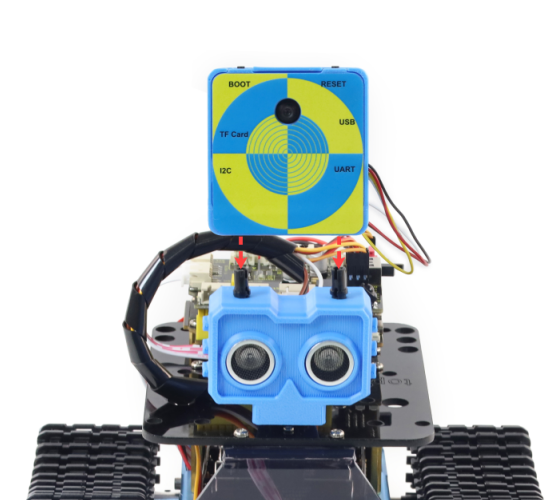
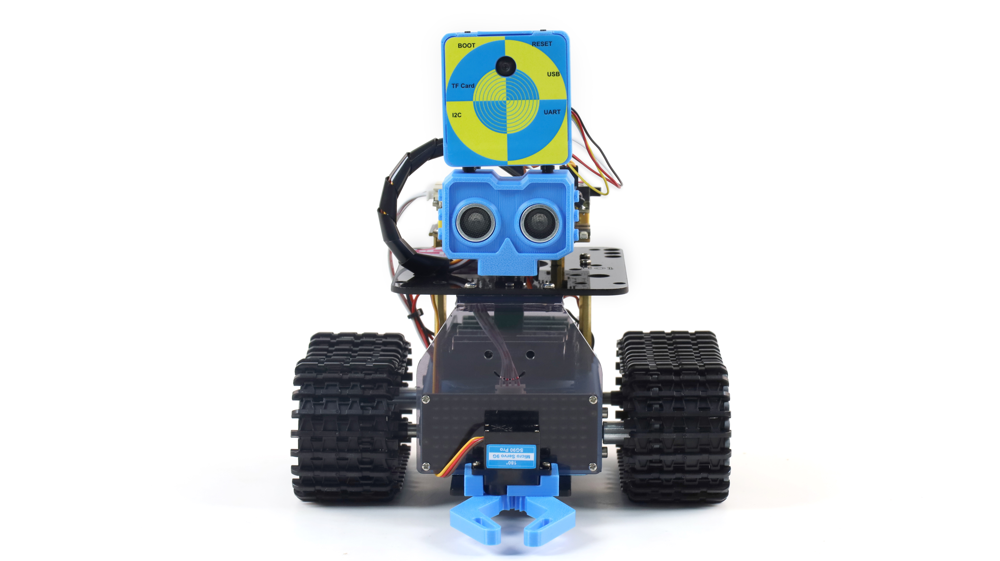
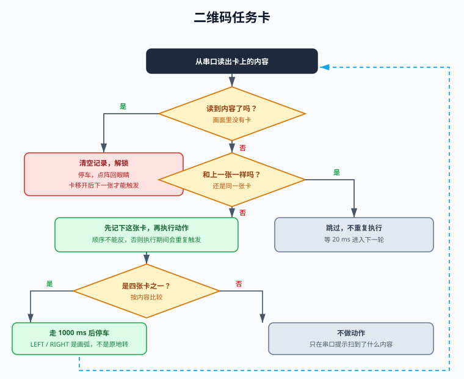

### 项目 20：AI 视觉模块：二维码任务卡

#### **1. 简介：**

{width=520px}

举一张印着二维码的卡片在车前晃一下，车扫一眼就往前走一秒；换一张，它便向左画个弧。四张卡片各藏着一条指令——FORWARD、BACKWARD、LEFT、RIGHT，从卡片表面看不出来，得车扫过才知道。

有意思的是，车会因为太听话而出问题。摄像头每秒回传十几帧，同一张卡在视野里会被连续读到几十次；每次都执行的话，车就一直往前冲，停不下来。真正要解决的，是让它认住刚才那张卡，移开以后才接受下一条。

二维码里的指令用英文单词，不加空格、不换行——模块读回来的内容要和写进去的逐字对上。

上电后云台转到 90°、点阵显示眼睛。举卡对准车头 10 到 25 厘米，点阵变笑脸，车按卡片走一秒；卡移开，点阵回到眼睛，等着下一张。

#### **2. 所需清单：**

本课用到的器件：

|     |     |     |
| :---: | :---: | :---: |
| {width=170px}<br><span style="font-size:0.85em">TinyVision AI 视觉摄像头 ×1</span> | {width=170px}<br><span style="font-size:0.85em">9G 舵机（180°） ×1</span> | {width=170px}<br><span style="font-size:0.85em">DRV8835 电机扩展板 ×1</span> |
| {width=170px}<br><span style="font-size:0.85em">履带底盘总成 ×1</span> | {width=170px}<br><span style="font-size:0.85em">8×16 LED 点阵屏 ×1</span> | {width=170px}<br><span style="font-size:0.85em">ESP32-S3 开发板 ×1</span> |
#### **3. 参数：**

| 项目 | 参数 |
| --- | --- |
| 识别模式 | `qr` |
| 回传格式 | `QR:内容` |
| 卡片内容 | `FORWARD` / `BACKWARD` / `LEFT` / `RIGHT` |
| 直行速度 | 150 |
| 转向外侧轮 | 150 |
| 转向内侧轮 | 50 |
| 单卡动作时长 | 1000 ms |
| 云台角度 | 90°（固定） |
| 去重依据 | `lastQr` 与当前内容比较 |

#### **4. 接线说明：**

本课仍用装法 B：模块在云台上，镜头朝正前方，`setup()` 把云台转到 90° 把镜头摆正，之后不再转。扫卡时由人把卡片举到镜头正前方，车不主动去找卡。

| 视觉模块 | 主控 | 说明 |
| --- | :---: | --- |
| TX | IO18 | 回传二维码内容 |
| RX | IO17 | 下发模式指令 |
| VCC / GND | 5V / GND | 供电与共地 |

| 信号 | 主控 GPIO |
| --- | :---: |
| 云台舵机 | IO42 |
| 左轮 AIN / AEN | IO38 / IO21 |
| 右轮 BIN / BEN | IO40 / IO41 |


**装法B：**







> 【图片待补】手持卡片与摄像头的距离实拍图，说明多远能扫到（约 10～25 cm）。

#### **5. 流程图：**

每轮只做三件事：读卡、判断是不是新卡、执行：



#### **6. 测试代码：**

> **本课工程有三个文件**：`20_QR_Code_Tasks.ino`、`AiCam.h`、`AiCam.cpp`。视觉模块的串口收发和字符串解析都在 `AiCam.cpp` 里，三个文件放在同一个文件夹，少一个编译不过。

```cpp
#include <ESP32Servo.h>
#include "AiCam.h"  // 视觉模块驱动

// ===== 电机引脚 =====
#define MOTOR_AIN 38  // A 路方向：左轮
#define MOTOR_AEN 21  // A 路调速：左轮
#define MOTOR_BIN 40  // B 路方向：右轮
#define MOTOR_BEN 41  // B 路调速：右轮

// ===== 云台舵机 =====
// 摄像头与超声波共壳装在云台上，靠该舵机改变朝向
#define PAN_SERVO_PIN 42  // 云台舵机，第 8、18 课
#define PAN_CENTER    90  // 正前方，镜头水平

// ===== 视觉模块串口 =====
// 主控 RX←模块 TX，主控 TX→模块 RX，需共地
#define CAM_RX 18  // 主控接收脚
#define CAM_TX 17  // 主控发送脚

// ===== 点阵引脚 =====
#define CLK_Pin 9  // 时钟，接模块 CLK
#define DIN_Pin 8  // 数据，接模块 DIN

// ===== 任务参数 =====
// 直行 150：低于约 70 有启动死区，150 可稳定起步
#define SPEED_MOVE     150  // 直行 / 后退速度

// 转向用两侧不同速而非反转：反转只原地打圈，本课需要边走边转
#define SPEED_TURN_OUT 150  // 转向外侧轮速度
#define SPEED_TURN_IN   50  // 转向内侧轮速度

// 单卡动作时长，决定行进距离
#define ACTION_TIME   1000  // 到点自动停

// ===== 调试开关 =====
// 1 打印扫到的内容与字节数，0 关闭
#define DEBUG_OUT 1

// ===== 表情编号 =====
// 用编号便于 showFace() 判断表情是否变化，避免重复写屏
#define FACE_EYES  0  // 待机：眼睛
#define FACE_SMILE 1  // 识别到卡：笑脸

// 16 字节对应 16 列，每字节 8 位对应一列 8 行，bit0 为最上行

// 待机：两只方眼，第 4/5、10/11 列亮第 2~4 行
unsigned char eyes[] = {
  0x00, 0x00, 0x00, 0x00, 0x1C, 0x1C, 0x00, 0x00,
  0x00, 0x00, 0x1C, 0x1C, 0x00, 0x00, 0x00, 0x00
};

// 笑脸
unsigned char smile[] = {
  0x00, 0x00, 0x1C, 0x02, 0x02, 0x02, 0x5C, 0x40,
  0x40, 0x5C, 0x02, 0x02, 0x02, 0x1C, 0x00, 0x00
};

AiCam aiCam(CAM_RX, CAM_TX);  // 视觉模块实例
Servo panServo;               // 云台舵机

// 上次执行的卡片内容，用于区分持续举卡与换新卡
String lastQr = "";

// 当前表情，-1 未显示
int curFace = -1;

void setup() {
#if DEBUG_OUT
  // 调试串口，DEBUG_OUT 为 0 时不编译
  Serial.begin(115200);
#endif

  // 两线拉高，总线置空闲
  pinMode(CLK_Pin, OUTPUT);
  pinMode(DIN_Pin, OUTPUT);
  digitalWrite(CLK_Pin, HIGH);
  digitalWrite(DIN_Pin, HIGH);
  showFace(FACE_EYES);  // 显示待机表情

  // 电机引脚
  pinMode(MOTOR_BIN, OUTPUT);      // 左轮方向
  pinMode(MOTOR_AIN, OUTPUT);      // 右轮方向
  ledcAttach(MOTOR_BEN, 1000, 8);  // 左轮 PWM：1 kHz，8 位
  ledcAttach(MOTOR_AEN, 1000, 8);  // 右轮 PWM
  stopCar();                       // 上电停车

  // 云台：上电先把镜头摆到正前方
  ESP32PWM::allocateTimer(0);                 // 分配 LEDC 定时器
  panServo.setPeriodHertz(50);                // 50 Hz
  panServo.attach(PAN_SERVO_PIN, 500, 2500);  // IO42，脉宽 500~2500 µs
  panServo.write(PAN_CENTER);                 // 转到正前方
  delay(300);                                 // 等舵机到位

  // 启动视觉模块，二维码模式
  aiCam.begin();          // 打开 Serial2 并绑定引脚
  aiCam.setMode("qr");    // 发送 MODE:QR

  delay(1000);  // 等模式切换完成，避免读到切换期杂数据
}

// ===== 主循环 =====
// 每轮：读串口 → 判断新卡 → 执行或停车
void loop() {
  aiCam.readSerial();  // 读完串口并更新缓存

  String qr = aiCam.getQrCode();  // 当前二维码内容，空串表示无卡

#if DEBUG_OUT
  // 内容变化时打印原文与字节数
  // 四张卡分别 7 / 8 / 4 / 5 字节
  static String lastPrinted = "";        // static 跨轮次保持
  if (qr.length() > 0 && qr != lastPrinted) {
    lastPrinted = qr;
    Serial.print("扫到二维码：");
    Serial.print(qr);
    Serial.print("  字节数 ");
    Serial.println(qr.length());
  }
#endif

  // 无卡
  // 清空 lastQr 解除锁定
  if (qr.length() == 0) {
    lastQr = "";          // 允许下一张卡触发
    stopCar();            // 停车
    showFace(FACE_EYES);  // 待机表情
    delay(20);
    return;               // 结束本轮
  }

  // 同一张卡未移开
  // 跳过，不重复执行
  if (qr == lastQr) {
    delay(20);
    return;
  }

  // 新卡
  // 先记录再执行，避免执行期间重复触发
  lastQr = qr;    // 记录本卡
  doTask(qr);     // 执行动作，内部阻塞 1 s

  delay(20);
}

// ===== 任务执行 =====
// 四张卡各执行一段动作，到时间自动停
//   FORWARD  两轮同速正转
//   BACKWARD 两轮同速反转
//   LEFT     左 50 / 右 150，向左画弧
//   RIGHT    左 150 / 右 50，向右画弧
void doTask(String qr) {
  showFace(FACE_SMILE);  // 显示笑脸

  // 统一转大写后比较
  String key = qr;
  key.trim();        // 去首尾空白
  key.toUpperCase(); // 转大写

  bool known = true;  // 是否为已知卡

  if (key == "FORWARD") {
    goForward(SPEED_MOVE);                        // 两轮同速正转
  } else if (key == "BACKWARD") {
    goBackward(SPEED_MOVE);                       // 两轮同速反转
  } else if (key == "LEFT") {
    driveMotors(SPEED_TURN_IN, SPEED_TURN_OUT);   // 左慢右快，向左画弧
  } else if (key == "RIGHT") {
    driveMotors(SPEED_TURN_OUT, SPEED_TURN_IN);   // 左快右慢，向右画弧
  } else {
    known = false;  // 非四张卡，不做动作
  }

  // 仅已知卡驱动电机
  if (known) {
    delay(ACTION_TIME);  // 走满设定时长
    stopCar();           // 到点停车
  }
}

// ===== 点阵显示 =====
// 仅表情变化时写屏
// 写屏要走 20 多字节软件 I2C，频繁调用会拖慢主循环
void showFace(int face) {
  if (face == curFace) return;  // 表情未变
  curFace = face;               // 记录当前表情

  if (face == FACE_EYES) {
    matrix_display(eyes);   // 待机
  } else {
    matrix_display(smile);  // 笑脸
  }
}

// 将 16 字节字模写入点阵屏显存
// 流程：写数据命令 → 起始地址 → 连发 16 字节 → 开显示
void matrix_display(unsigned char matrix_value[]) {
  // 0x40：写数据模式，地址自增
  IIC_start();
  IIC_send(0x40);
  IIC_end();

  // 0xC0：起始地址 0
  IIC_start();
  IIC_send(0xC0);

  // 连写 16 列
  for (int i = 0; i < 16; i++) {
    IIC_send(matrix_value[i]);
  }
  IIC_end();

  // 0x8A：开显示，亮度最大
  IIC_start();
  IIC_send(0x8A);
  IIC_end();
}

// 起始条件：CLK 高电平期间 DIN 下降沿
void IIC_start() {
  digitalWrite(CLK_Pin, HIGH);
  delayMicroseconds(3);
  digitalWrite(DIN_Pin, HIGH);
  delayMicroseconds(3);
  digitalWrite(DIN_Pin, LOW);
  delayMicroseconds(3);
}

// 发送 1 字节，低位在前：CLK 低时置数据，上升沿采样
void IIC_send(unsigned char send_data) {
  for (int i = 0; i < 8; i++) {
    digitalWrite(CLK_Pin, LOW);  // 拉低时钟，准备数据
    delayMicroseconds(3);

    // 从 bit0 起逐位发送
    if (send_data & 0x01) {
      digitalWrite(DIN_Pin, HIGH);
    } else {
      digitalWrite(DIN_Pin, LOW);
    }
    delayMicroseconds(3);

    digitalWrite(CLK_Pin, HIGH); // 拉高时钟，模块采样
    delayMicroseconds(3);

    send_data = send_data >> 1;  // 右移，取出下一位
  }
}

// 停止条件：CLK 高电平期间 DIN 上升沿
void IIC_end() {
  digitalWrite(CLK_Pin, LOW);
  delayMicroseconds(3);
  digitalWrite(DIN_Pin, LOW);
  delayMicroseconds(3);
  digitalWrite(CLK_Pin, HIGH);
  delayMicroseconds(3);
  digitalWrite(DIN_Pin, HIGH);
  delayMicroseconds(3);
}

// ===== 电机驱动 =====
// A 路接左轮、B 路接右轮（与第 7 课一致）
// leftSpeed 走 B 路，rightSpeed 走 A 路
// 先限幅 ±255，再取绝对值给占空比
void driveMotors(int leftSpeed, int rightSpeed) {
  leftSpeed  = constrain(leftSpeed,  -255, 255);  // 右轮限幅
  rightSpeed = constrain(rightSpeed, -255, 255);  // 左轮限幅

  // A 路：左轮
  if (rightSpeed >= 0) {
    digitalWrite(MOTOR_BIN, HIGH);     // 拉高：正转
    ledcWrite(MOTOR_BEN, rightSpeed);  // 占空比 = 速度
  } else {
    digitalWrite(MOTOR_BIN, LOW);      // 拉低：反转
    ledcWrite(MOTOR_BEN, -rightSpeed); // 取绝对值，方向由方向脚决定
  }

  // B 路：右轮
  if (leftSpeed >= 0) {
    digitalWrite(MOTOR_AIN, HIGH);    // 拉高：正转
    ledcWrite(MOTOR_AEN, leftSpeed);  // 占空比 = 速度
  } else {
    digitalWrite(MOTOR_AIN, LOW);     // 拉低：反转
    ledcWrite(MOTOR_AEN, -leftSpeed); // 占空比取绝对值
  }
}

// 基本动作
// 单速度参数，两轮同值
void goForward(int speed)  { driveMotors(speed, speed); }    // 前进：左右同速正转
void goBackward(int speed) { driveMotors(-speed, -speed); }  // 后退：左右同速反转
void spinLeft(int speed)   { driveMotors(-speed, speed); }   // 左转：原地转
void spinRight(int speed)  { driveMotors(speed, -speed); }   // 右转：原地转
void stopCar()             { driveMotors(0, 0); }            // 停止：占空比归零
```

#### **7. 代码解释：**

**(1) 四个参数**

```cpp
#define SPEED_MOVE     150  // 直行 / 后退速度

#define SPEED_TURN_OUT 150  // 转向外侧轮速度
#define SPEED_TURN_IN   50  // 转向内侧轮速度

#define ACTION_TIME   1000  // 到点自动停
```

`SPEED_MOVE 150` 比遥控的 180 慢一点，扫卡之后要看清车往哪走。内外侧 150 / 50 的差速就是"画弧"的来源。`ACTION_TIME 1000` 是每个动作的固定时长，到点自动停，防止某条指令把车一直开下去。

**(2) 两个全局状态**

```cpp
String lastQr = "";
```

```cpp
int curFace = -1;
```

`lastQr` 记"上次执行过的是哪张卡"，初值空串表示"什么都没扫过"。`curFace` 管表情去重，和前面几课一样，`-1` 表示还没显示过。

**(3) `loop()`：读完串口取内容**

```cpp
  aiCam.readSerial();  // 读完串口并更新缓存

  String qr = aiCam.getQrCode();  // 当前二维码内容，空串表示无卡
```

`getQrCode()` 返回空串就是没扫到卡，返回内容就是这一帧解出来的字符串。空串是一个明确的"无卡"信号，所以后面的判断都能用 `length() == 0`。

**(4) 调试打印：原文和字节数一起看**

```cpp
#if DEBUG_OUT
  // 内容变化时打印原文与字节数
  // 四张卡分别 7 / 8 / 4 / 5 字节
  static String lastPrinted = "";        // static 跨轮次保持
  if (qr.length() > 0 && qr != lastPrinted) {
    lastPrinted = qr;
    Serial.print("扫到二维码：");
    Serial.print(qr);
    Serial.print("  字节数 ");
    Serial.println(qr.length());
  }
#endif
```

`#if DEBUG_OUT` 是编译开关，把 `DEBUG_OUT` 改成 0，这段代码整段不参与编译，不占空间。

`static String lastPrinted` 又用到了 `static`：跨轮次保住上次打印的内容，同一张卡不重复刷屏。

打印字节数是为了区分两种"看起来一样"的情况：内容对但末尾多了个换行（字节数多 1），和内容真的不对。没有这个数字，光看打印的原文很难发现末尾藏了个 `\r`。

**(5) 无卡：解锁**

```cpp
  if (qr.length() == 0) {
    lastQr = "";          // 允许下一张卡触发
    stopCar();            // 停车
    showFace(FACE_EYES);  // 待机表情
    delay(20);
    return;               // 结束本轮
  }
```

摄像头一秒能扫十几次，同一张卡在视野里会被反复读到。`lastQr` 记住"上次执行的是哪张"，内容一样就跳过——所以一个动作只执行一次。

**卡拿开之后必须把 `lastQr` 清空**，否则把卡再放回来还是同一个字符串，永远不触发。这就是这一句 `lastQr = ""` 的作用：无卡 = 解锁。

**(6) 同一张卡：跳过**

```cpp
  if (qr == lastQr) {
    delay(20);
    return;
  }
```

卡还在视野里，内容没变，直接跳过。`delay(20)` 不能省——`return` 之前不延时，`loop()` 会以几万赫兹空转，把 CPU 全吃掉。

**(7) 先记录，再执行**

```cpp
  lastQr = qr;    // 记录本卡
  doTask(qr);     // 执行动作，内部阻塞 1 s
```

顺序反了会怎样？`doTask()` 里面 `delay(ACTION_TIME)` 停 1 秒，这 1 秒里串口照收不误，缓存里全是同一张卡的 `qr`。`doTask` 返回后再记 `lastQr`，中间这几轮 `loop()` 还没执行到这一句，`qr == lastQr` 不成立，于是又触发一次——动作会连着放两三次。

先记录、再执行，等于"进门先上锁"。

**(8) `doTask()`：比较前先洗干净**

```cpp
  String key = qr;
  key.trim();        // 去首尾空白
  key.toUpperCase(); // 转大写
```

二维码里存的是 `FORWARD` 这样的大写英文，但生成工具、扫码 App 有时会带上换行或空格。`trim()` 去空白、`toUpperCase()` 统一大小写，避免"内容明明一样却匹配不上"。

注意操作的是 `key` 这个副本，`qr` 本身没动——`lastQr` 存的还是原始内容，去重判断不受影响。

卡片内容还必须是英文。视觉模块输出的是 ASCII 字符串，中文编码后在串口里是多字节，`trim()` 和 `toUpperCase()` 处理起来都不可靠，比较时也容易对不上 `==`。统一用英文，是这一课最省事的约定。

**(9) 四张卡，两种转法**

```cpp
  if (key == "FORWARD") {
    goForward(SPEED_MOVE);                        // 两轮同速正转
  } else if (key == "BACKWARD") {
    goBackward(SPEED_MOVE);                       // 两轮同速反转
  } else if (key == "LEFT") {
    driveMotors(SPEED_TURN_IN, SPEED_TURN_OUT);   // 左慢右快，向左画弧
  } else if (key == "RIGHT") {
    driveMotors(SPEED_TURN_OUT, SPEED_TURN_IN);   // 左快右慢，向右画弧
  }
```

`SPEED_TURN_IN = 50`、`SPEED_TURN_OUT = 150`。**两侧都正转，只是快慢不同**——车走出来的是一段圆弧，不是原地打转。

原地转（一侧反转）在足球场那种窄场地很容易把球挤飞，画弧更接近真人带球的样子。想要原地转，把 `IN` 那边改成负值就行。

**(10) 未知卡不驱动电机**

```cpp
  bool known = true;  // 是否为已知卡
  ...
  } else {
    known = false;  // 非四张卡，不做动作
  }

  // 仅已知卡驱动电机
  if (known) {
    delay(ACTION_TIME);  // 走满设定时长
    stopCar();           // 到点停车
  }
```

扫到一张自己打印的、内容不在四张之列的卡时，车只显示笑脸，不动。`known` 这个标志保证 `delay()` 和 `stopCar()` 也不会执行——不然会出现"扫了张废卡，车却停了一下"的怪现象。

**(11) `delay(20)`：50 Hz**

```cpp
  delay(20);
}
```

20 ms 一轮等于 50 Hz，比视觉模块的帧率高，每一帧都会被读到，不会漏。这个节拍和第 19 课一致。

#### **8. 运行现象：**

上电后云台先转到 90°，点阵显示眼睛，串口打印 `视觉模块串口已启动`。

举卡对准车头 10～25 cm：

```text
扫到二维码：FORWARD  字节数 7
（车前进 1 s，点阵笑脸）
（把卡移开，点阵回眼睛）
扫到二维码：LEFT  字节数 4
（车向左画弧 1 s）
```

| 卡片 | 字节数 | 动作 |
| --- | :---: | --- |
| `FORWARD` | 7 | 两轮同速正转 1 s |
| `BACKWARD` | 8 | 两轮同速反转 1 s |
| `LEFT` | 4 | 左慢右快，向左画弧 1 s |
| `RIGHT` | 5 | 左快右慢，向右画弧 1 s |

> 【图片待补】串口依次打印四张卡内容与字节数的截图。

#### **9. 常见问题解决：**

(1) 卡片举着不动，车只动一次——这是正常的，去重生效。想再触发一次，把卡移开让画面空一下，再举回来。

(2) 距离：太近（小于 5 cm）摄像头对不上焦，太远（大于 30 cm）码太小，10～25 cm 之间最稳。

(3) 光照：二维码是黑白对比，逆光或者阴影会让模块认不出。让光源从你背后照向卡片。

(4) 内容：必须是纯英文、不带空格。用手机扫一下自己打印的卡，确认内容真的是 `FORWARD`，不是尾部多一个空格，也不是小写的 `forward`。真打成 `Forward!` 就救不回来了。
