# 3. 驱动安装

主控板通过板载 CH340 芯片把 USB 转成串口，程序下载和串口打印都走这条路。**装驱动前先用 USB 线把板子接到电脑**，没接板子就装，驱动可能认不到设备。

装没装好，看一个地方就够了：设备管理器（Mac 上是终端）里能不能看到一个 CH340 的串口。第 4 章 Arduino IDE 选端口，选的就是它。

## 3.1 Windows 系统

### 驱动包下载

[下载 Windows CH340 驱动](./Windows.zip)

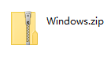

**检查驱动**

1. 用 USB 线接上主控板后，右击桌面上的`此电脑` →「管理 → 设备管理器」。
2. 展开「端口（COM 和 LPT）」，看到 `USB-SERIAL CH340 (COMx)` 就说明驱动已经装好，后面的安装都可以跳过。

   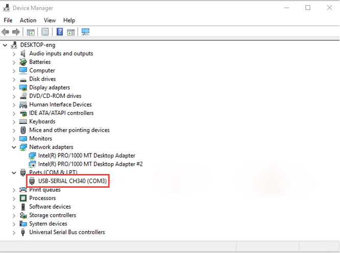

Windows 10 及以上一般会自动装好。没装的时候板子不会出现在「端口」里，而是掉到「其他设备」下面，名字是 `USB2.0-Serial`，前面挂一个黄色感叹号：

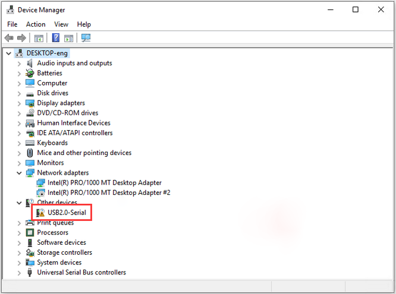

**一键安装（推荐走这条）**

1. 解压后打开 `usb_ch341_3.1.2009.06` 文件夹，双击 `SETUP.EXE`。
2. 点「安装」，等进度条走完，提示「驱动预安装成功」就装好了，点「确定」退出。
3. 拔掉 USB 线再插上，回到设备管理器展开「端口（COM 和 LPT）」，出现 `USB-SERIAL CH340 (COMx)` 就成功了。

**手动指定驱动（一键装不上时用）**

1. 右键「其他设备」下带感叹号的 `USB2.0-Serial`，选「更新驱动程序」。

   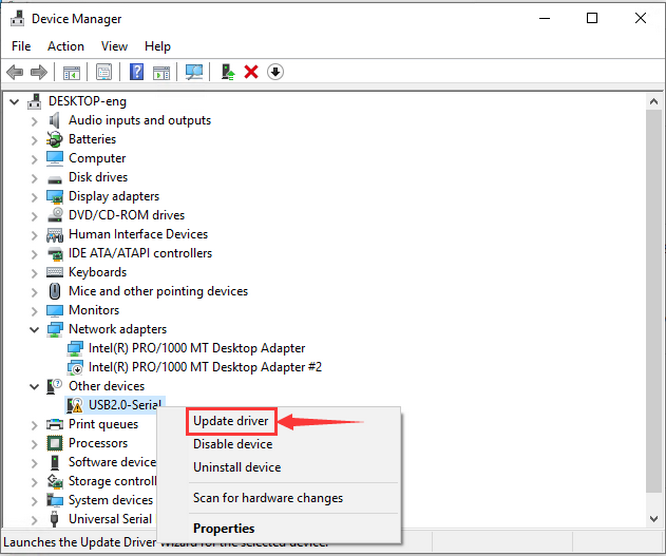

2. 选「浏览我的电脑以查找驱动程序」。

   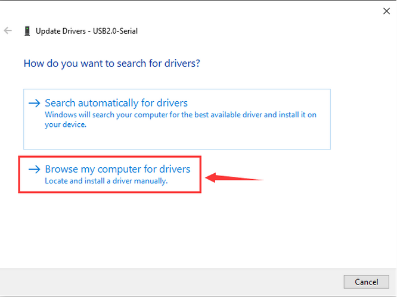

3. 点「浏览」，选中解压出来的 `usb_ch341_3.1.2009.06` 文件夹，再点「下一步」。

   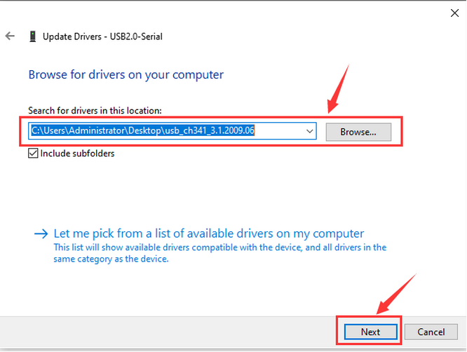

4. 窗口里提示 `The best drivers for your device are already installed`，说明系统已经认到 CH340，点「关闭」。

   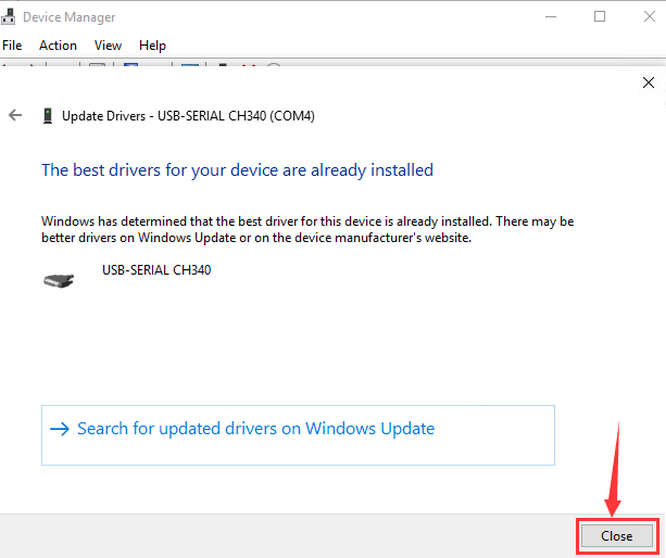

5. 回到设备管理器，设备从「其他设备」挪到「端口（COM 和 LPT）」下面，名字变成 `USB-SERIAL CH340 (COMx)`。记下这个号，第 4 章 Arduino IDE 选端口要用。

> 装完还是没有 COM 口，先换一根 USB 线：很多随手机附带的线只有充电线芯，插上后设备管理器里一点变化都没有。换线不行再换主机后面的 USB 口，前面板供电常常不够。

## 3.2 macOS 系统

### 驱动包下载

[下载 macOS CH340 驱动](./MAC.zip)

先下载对应系统的 CH340 驱动并解压。

> 解压后是 `CH34xVCPDriver.pkg` 和 `CH34xVCPDriver.dmg`，按下面的系统版本选一种装。

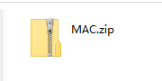

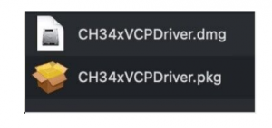

**先放开安装权限**

macOS 对这类底层驱动管得严，装之前要放行一次，装完还要再放行一次。

装之前（macOS 12 及更早）：打开「系统偏好设置 → 安全性与隐私 → 通用」，把「允许从以下位置下载的应用」改成「App Store 和认可的开发者」。

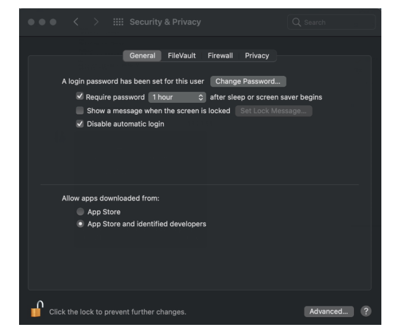

macOS 13 及以后没有这个选项了。双击 pkg 时如果弹出「无法打开，因为 Apple 无法检查其是否包含恶意软件」，去「系统设置 → 隐私与安全性」，页面下方会出现刚才被拦下的提示，点「仍要打开」，再输一次开机密码。

**pkg 格式安装（默认走这条）**

1. 双击 pkg 文件，一路「继续」到「安装」，装完出现成功提示页。

   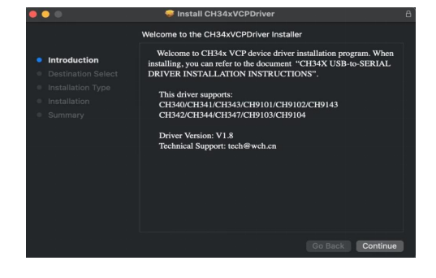

   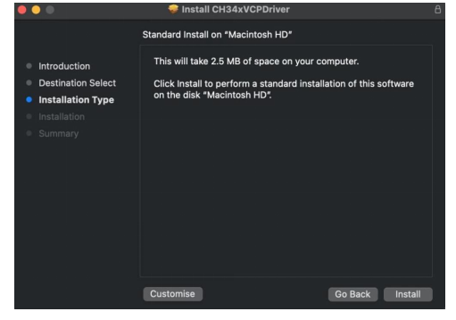

   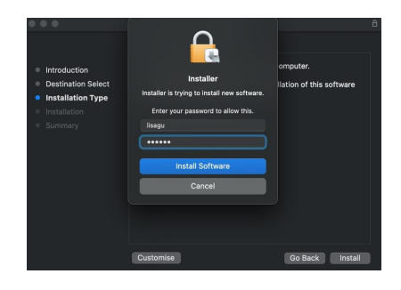

   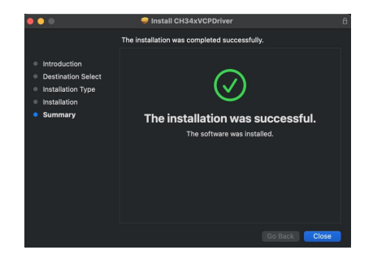

2. OS X 11.0 及以上：打开 LaunchPad → `CH34xVCPDriver` → Install。

   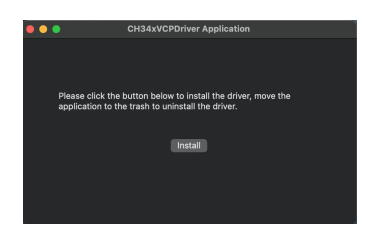

3. 装完系统会提示「系统扩展已被阻止」。打开「系统设置 → 隐私与安全性」（macOS 12 及更早叫「系统偏好设置 → 安全性与隐私」），拉到页面最下面点「允许」，输入开机密码，然后**重启电脑**（下面这张是重启入口）。系统扩展只在开机时加载，不重启等于没装 —— 这一步漏掉，插上板子照样没有端口。

   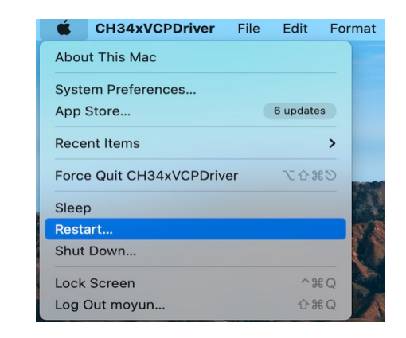

**dmg 格式安装（OS X 11.0 及以上不支持 Rosetta 时用）**

1. 双击 dmg，把 `CH34xVCPDriver` 拖进「应用程序」文件夹。

   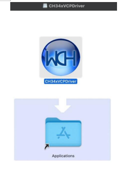

2. 打开 LaunchPad → `CH34xVCPDriver` → Install，装完弹出 success 提示。

   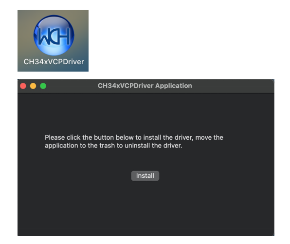

   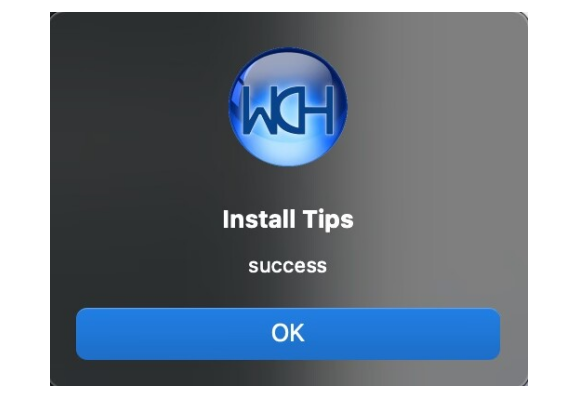

3. 装完同样要去「隐私与安全性」里允许系统扩展，再重启一次。

**确认驱动装上了**

1. 插上主控板，打开「系统报告 → 硬件 → USB」，在右侧 USB 设备树里找 Vendor ID 为 `0x1a86` 的设备 —— 这是 CH340 的厂商标识，有它说明系统已经认到板子。

   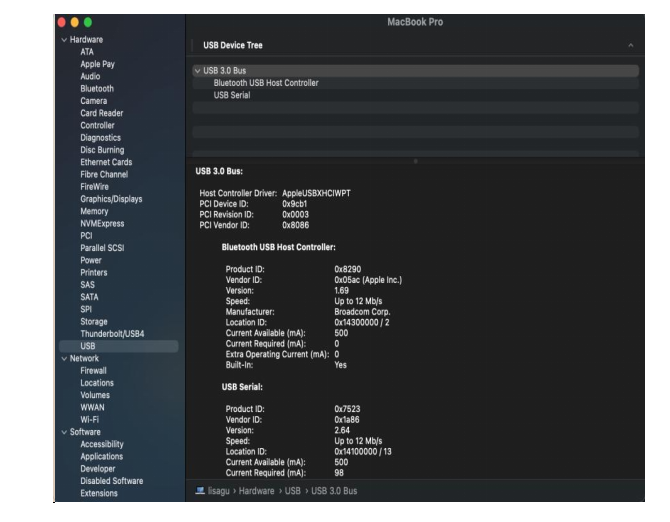

2. 打开「终端」，执行 `cd /dev` 再 `ls tty.wch*`，看到 `tty.wchusbserialx`（x 是分配到的编号）就说明驱动生效了。

   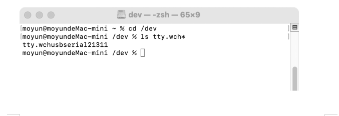

   同一个端口在系统里有两个名字：`tty.wchusbserialx` 和 `cu.wchusbserialx`。Arduino IDE / Thonny 里选 `cu.` 开头的那个 —— `tty` 打开时会等一个载波信号，容易卡住；`cu` 直接就能读写。

> M 系列芯片的 Mac 用资料包里这份驱动就行，它已经支持 Apple Silicon。网上翻到的老版本只支持 Intel，装上也认不到板子。
