# 3. Driver Installation

The main controller board uses its on-board CH340 chip to convert USB to serial; both program uploads and serial print output go through this path. **Connect the board to the computer with a USB cable before installing the driver.** If you install the driver without the board connected, it may not detect the device.

To check whether the installation worked, there is only one thing to look at: whether a CH340 serial port appears in Device Manager (in Terminal on Mac). This is the port you select in the Arduino IDE in Chapter 4.

## 3.1 Windows

### Driver Download

[Download the Windows CH340 driver](./Windows.zip)

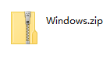

**Check the driver**

1. After connecting the main controller with a USB cable, right-click `This PC` on the desktop and choose "Manage → Device Manager".
2. Expand "Ports (COM & LPT)". If you see `USB-SERIAL CH340 (COMx)`, the driver is already installed and you can skip the rest of the installation.

   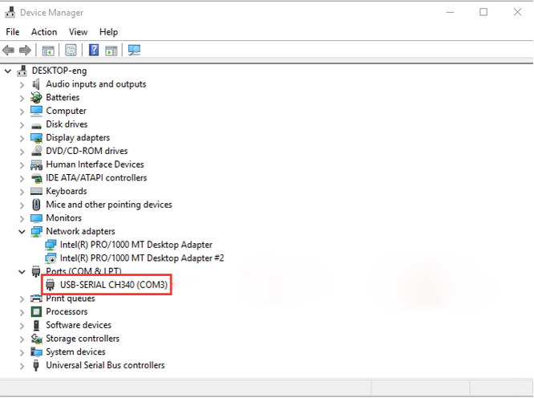

Windows 10 and later usually install it automatically. If the driver is missing, the board will not appear under "Ports" but under "Other devices" instead, named `USB2.0-Serial`, with a yellow exclamation mark in front of it:

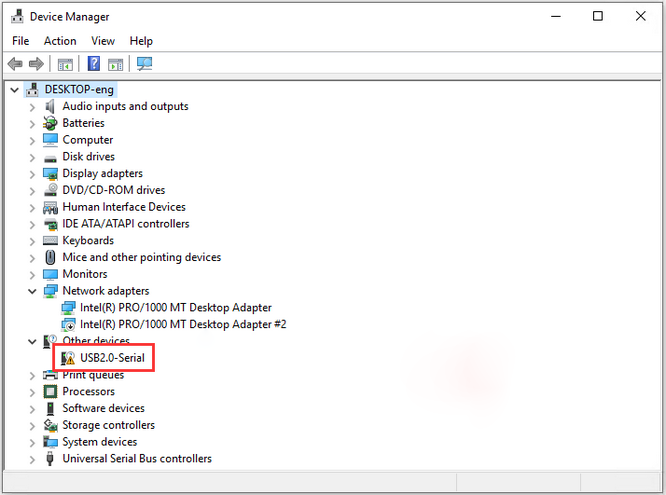

**One-click installation (recommended)**

1. After extracting, open the `usb_ch341_3.1.2009.06` folder and double-click `SETUP.EXE`.
2. Click "Install", wait for the progress bar to finish, and when the message "Driver pre-installation successful" appears, it is done—click "OK" to exit.
3. Unplug the USB cable and plug it back in, then return to Device Manager and expand "Ports (COM & LPT)". If `USB-SERIAL CH340 (COMx)` appears, you have succeeded.

**Specify the driver manually (when one-click installation fails)**

1. Right-click the `USB2.0-Serial` with the exclamation mark under "Other devices" and select "Update driver".

   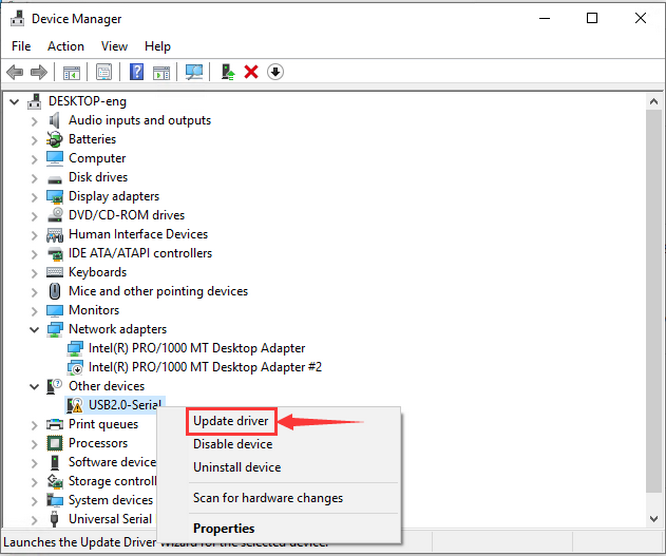

2. Select "Browse my computer for drivers".

   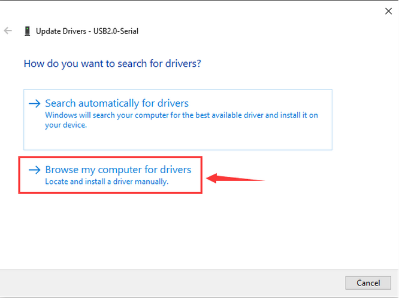

3. Click "Browse", select the extracted `usb_ch341_3.1.2009.06` folder, and then click "Next".

   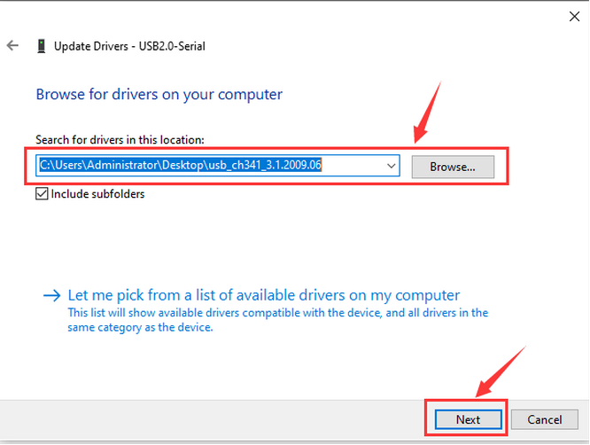

4. If the window says `The best drivers for your device are already installed`, the system already recognizes the CH340—click "Close".

   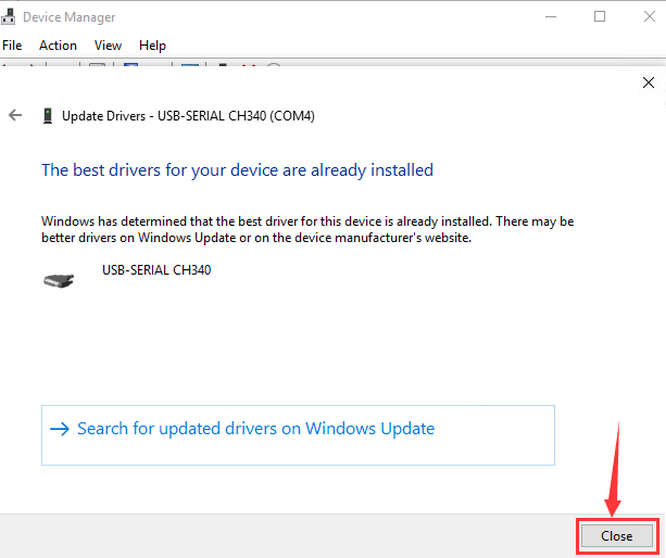

5. Return to Device Manager; the device has moved from "Other devices" to "Ports (COM & LPT)" and is renamed `USB-SERIAL CH340 (COMx)`. Note this number down—you will need it to select the port in the Arduino IDE in Chapter 4.

> If there is still no COM port after installation, first try a different USB cable: many cables that come with phones have only power wires and charging cores, so plugging one in produces no change at all in Device Manager. If a different cable does not help, try a USB port on the back of the computer—the front panel often supplies too little power.

## 3.2 macOS

### Driver Download

[Download the macOS CH340 driver](./MAC.zip)

First download the CH340 driver for your system and extract it.

> After extraction you will find `CH34xVCPDriver.pkg` and `CH34xVCPDriver.dmg`; choose one according to your macOS version and follow the steps below.

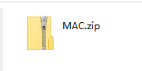

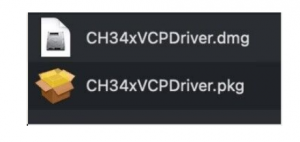

**Allow installation permissions first**

macOS is strict about low-level drivers like this one, so you need to grant permission once before installing, and again after installing.

Before installation (macOS 12 and earlier): open "System Preferences → Security & Privacy → General" and change "Allow apps downloaded from" to "App Store and identified developers".

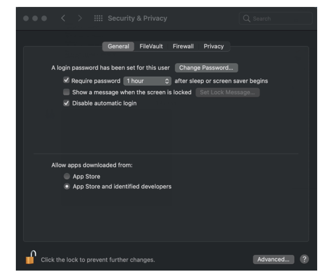

macOS 13 and later do not have this option. If double-clicking the pkg brings up a message that it "cannot be opened because Apple cannot check it for malicious software", go to "System Settings → Privacy & Security"; a notice about the blocked item will appear near the bottom of the page—click "Open Anyway", then enter your login password again.

**Install using the pkg file (default method)**

1. Double-click the pkg file and click "Continue" all the way to "Install"; a success page appears when it finishes.

   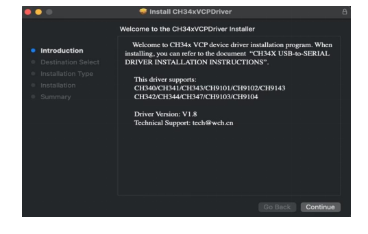

   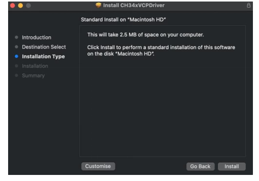

   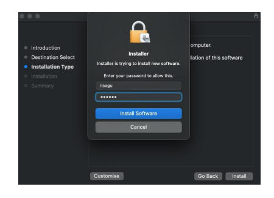

   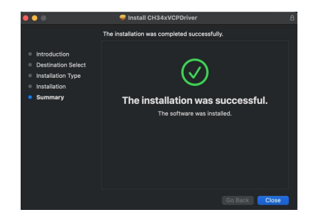

2. OS X 11.0 and later: open LaunchPad → `CH34xVCPDriver` → Install.

   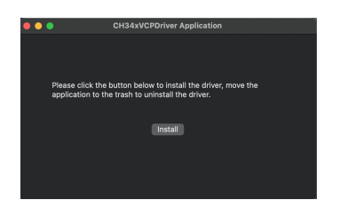

3. After installation, the system reports "System extension blocked". Open "System Settings → Privacy & Security" (on macOS 12 and earlier, "System Preferences → Security & Privacy"), scroll to the bottom of the page, click "Allow", enter your login password, and then **restart the computer** (the screenshot below shows where to restart). System extensions load only at startup, so without a restart it is as if the driver were not installed—skip this step and you will still get no port when you plug in the board.

   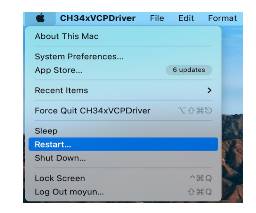

**Install using the dmg file (when OS X 11.0+ does not support Rosetta)**

1. Double-click the dmg and drag `CH34xVCPDriver` into the "Applications" folder.

   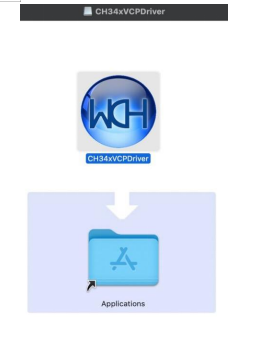

2. Open LaunchPad → `CH34xVCPDriver` → Install; a success message appears when it finishes.

   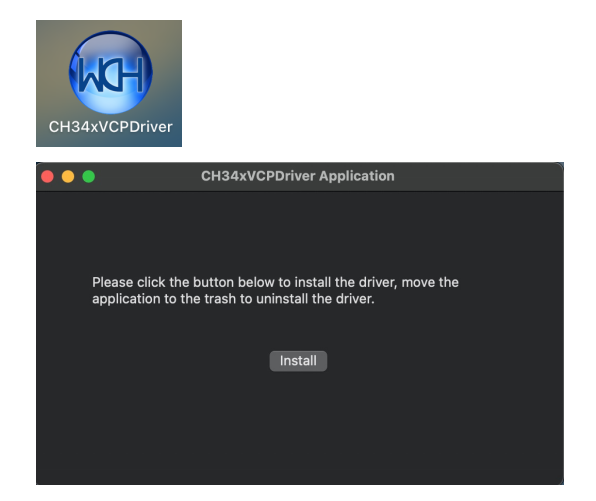

   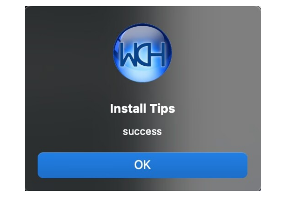

3. As with the pkg method, you must allow the system extension in "Privacy & Security" and then restart once more.

**Confirm the driver is installed**

1. Plug in the main controller, open "System Information → Hardware → USB", and look in the USB device tree on the right for a device whose Vendor ID is `0x1a86`—this is CH340's vendor identifier, and its presence means the system recognizes the board.

   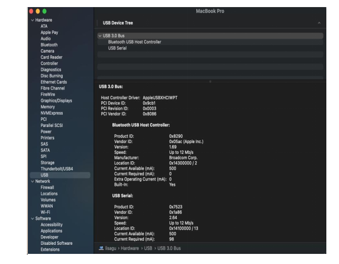

2. Open "Terminal", run `cd /dev` and then `ls tty.wch*`; seeing `tty.wchusbserialx` (where x is the assigned number) means the driver is working.

   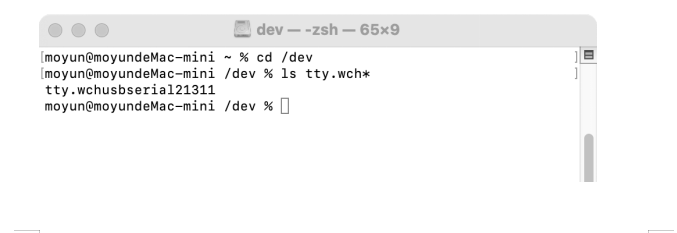

   The same port has two names in the system: `tty.wchusbserialx` and `cu.wchusbserialx`. In the Arduino IDE / Thonny, select the one starting with `cu.`—`tty` waits for a carrier signal when opened and tends to hang, while `cu` allows reading and writing directly.

> For Macs with M-series chips, just use the driver in the resource package; it already supports Apple Silicon. Older versions found online support only Intel, and even after installation they will not recognize the board.
