## 5.1 资料下载

MicroPython 教程资料包含 20 课的示例程序与板级库：

资料包：[MicroPython 资料](./MicroPython_Resource.7z)

解压后有两个文件夹：

- `micropython_code/`：20 课的示例程序，如 `01_LED_Dot_Matrix.py`、`02_Motor_Driving.py`。
- `micropython_libraries/`：板级库，列表与用法见 5.5 节。

## 5.2 安装 Thonny

Thonny 是给初学者做的 Python 编辑器，自带 MicroPython 支持，能直接读写板子里的文件、点一下就运行。

### 5.2.1 下载

官网：<https://thonny.org>，页面上按系统选安装包。

Windows 版的安装包已经把 Python 一起打进去了，不用另装 Python。64 位系统选 `Installer with 64-bit Python 3.10`，老机器选 32 位那个：

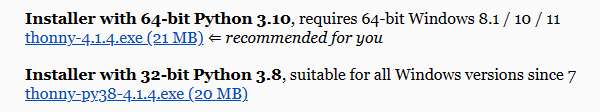

macOS 选对应的 dmg，下载方式和 Windows 一样：

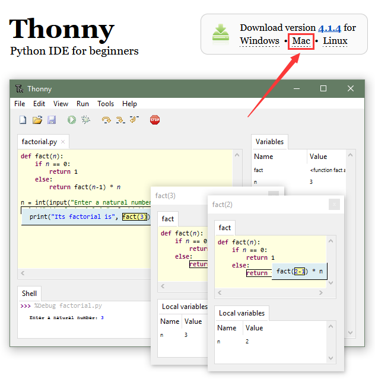

### 5.2.2 安装

1. 双击安装包，选「Install for me only」，点「Next」。

   

2. 勾上「I accept the agreement」，点「Next」。

   

3. 选安装路径。默认在 C 盘，换盘就点「Browse...」，点「Next」。

   

4. 后面几页（开始菜单、桌面图标）保持默认，点「Install」。

   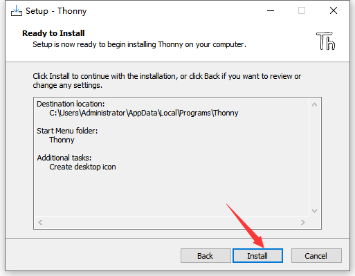

5. 装完点「Finish」，第一次启动会让你选界面语言，选中文或英文都行。

   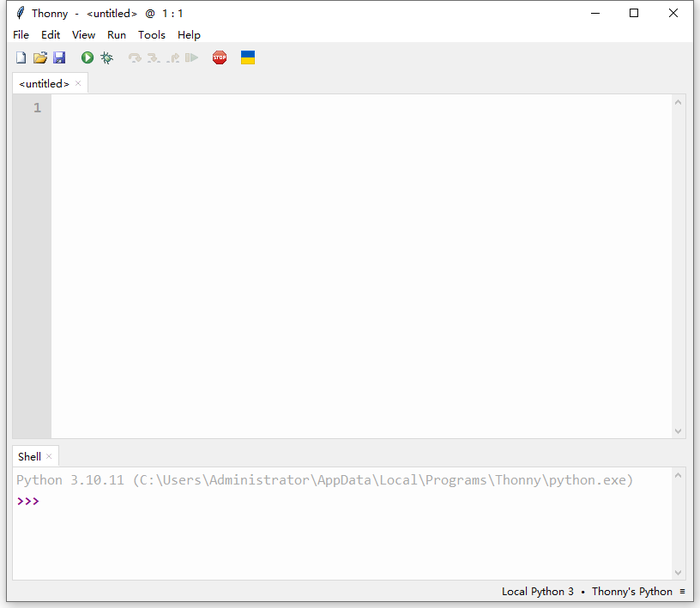

## 5.3 烧录 MicroPython 固件

板子里没有 MicroPython 固件，Thonny 是连不上的，先烧一次固件。

1. 用 USB 线把板子接到电脑。

 

2. 「工具 → 选项」，切到「解释器」页，解释器选 `MicroPython (ESP32)`，端口选板子的 COM 口。

   

   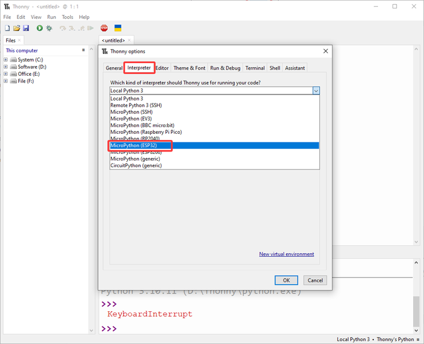

   

3. 点窗口右下角的「Install or update MicroPython (esptool)」。这一步必须先选好串口，否则点不动。

   

4. 在弹出的对话框里按下面选：

   - `Target port`：板子的串口
   - `MicroPython family`：`ESP32-S3`
   - `variant`：`Espressif • ESP32-S3`
   - `version`：`1.28.0`（教程基于这个版本）
   - 勾上「Erase all flash before installing」

   选完点「Install」。

   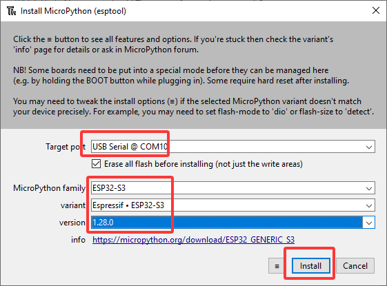

5. 等进度条走完，提示安装成功。

   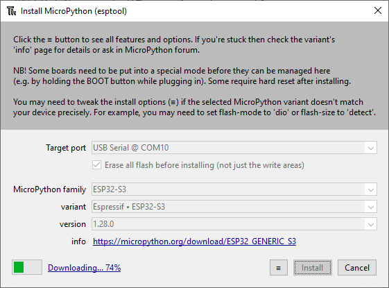

6. 回到主界面，点工具栏的绿色连接按钮。左侧出现 `MicroPython device` 面板、Shell 里打印出 `MicroPython v1.28.0 ... ESP32S3`，就说明固件烧好、板子连上了。

   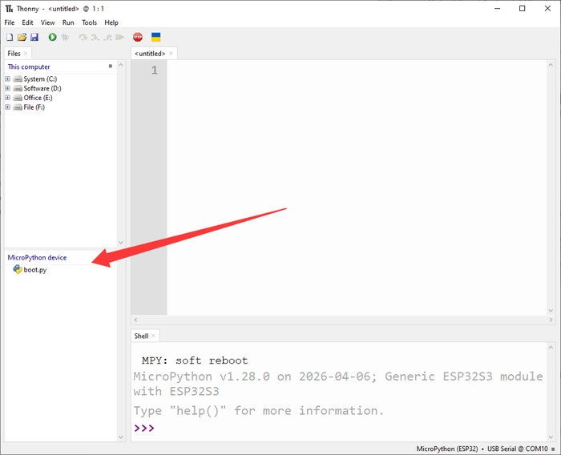

## 5.4 连接开发板与运行代码

固件烧过一次以后，之后每次只要连上板子、选对端口就行。

1. 「工具 → 选项 → 解释器」，解释器选 `MicroPython (ESP32)`，端口选板子的串口，点「OK」。

   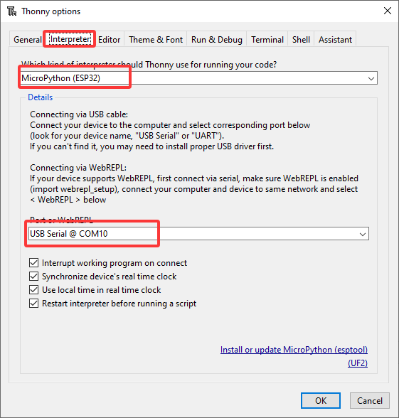

2. 连接成功后，左侧出现 `MicroPython device` 面板，可以看到板子里已有的文件；右下角状态栏会显示 `MicroPython (ESP32) • USB Serial @ COMx`。

   

3. 在左侧「This computer」里打开资料包的示例 `.py`，点工具栏的绿色三角（Run current script，快捷键 F5）就能在线运行，输出和报错都显示在下面的 Shell 里；要停下来点红色方块。

   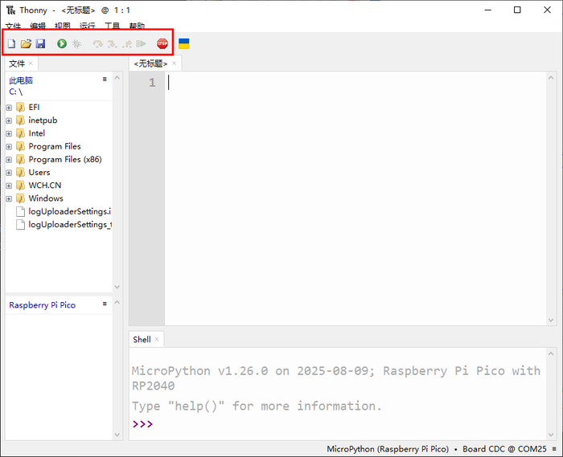

4. 想让板子上电就自动跑，把代码保存成板子根目录的 `main.py`：编辑区按 Ctrl+A 全选、Ctrl+C 复制，再到「MicroPython device」里新建文件、粘贴、保存为 `main.py`。板子重新上电时会自动执行这个文件。

> 在线运行时先点红色方块停下来再保存，运行中写文件会失败。

## 5.5 板级库说明

Mini Tracked Tank Robot（迷你履带坦克机器人）板级库，文件要先拷进板子的 `/lib` 目录，程序才能 `import`：

| 文件 | 作用 | 用到的项目 |
| --- | --- | --- |
| `mini_tracked_tank_robot.py` | 电机、云台/夹爪舵机、点阵、循迹、超声波驱动 | 全部 |
| `mini_tracked_tank_robot_web.py` | 极简 HTTP 服务器（非阻塞，主循环能同时跑车） | 12 ~ 16 |
| `aicam.py` | AI 视觉模块串口驱动 | 17 ~ 20 |
| `ir_rx/` | 红外 NEC 解码（Peter Hinch，MIT 许可） | 10、11 |

拷贝方法：Thonny 左侧「文件」面板进入板子的 `lib` 目录，右键上传上述文件与文件夹即可。

**第一步：**

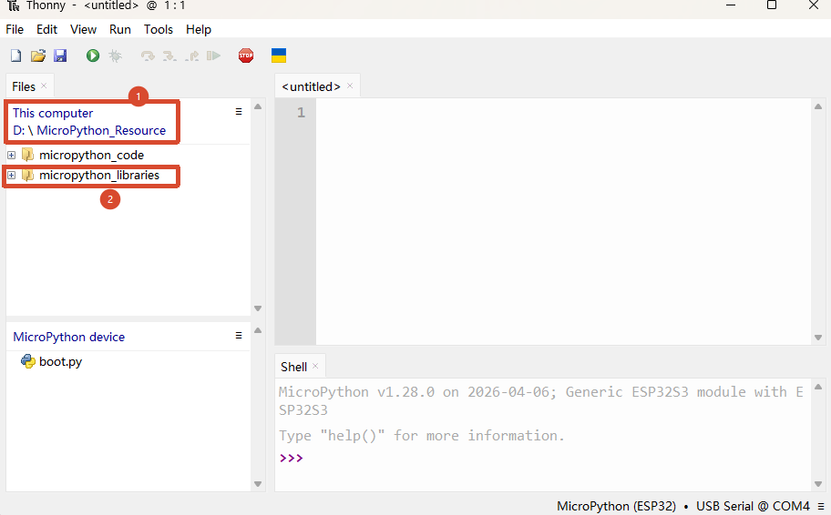

**第二步：**

**上传成功**之后会在`MicroPython device`中看到上传到板子上的库文件
**⚠️注意:** ir_rx文件要按图中步骤直接上传到板子上，不需要展开ir_rx的文件夹单独上传文件夹内的库文件

> 循迹的 PCF8574 走 I2C，和点阵共用 io8/io9。两者不能同时用，库里已经处理好：调用 `Line_init()` 拿走总线，调用 `Matrix_init()` 释放总线。
