## 5.1 Resource Download

The MicroPython tutorial materials contain the sample programs and board-level libraries for the 20 lessons:

Resource package: [MicroPython Resources](./MicroPython_Resource.7z)

After extraction there are two folders:

- `micropython_code/`: the sample programs for the 20 lessons, such as `01_LED_Dot_Matrix.py` and `02_Motor_Driving.py`.
- `micropython_libraries/`: the board-level libraries; see Section 5.5 for the list and usage.

## 5.2 Installing Thonny

Thonny is a Python editor made for beginners. It supports MicroPython out of the box, can read and write files on the board directly, and runs your code with a single click.

### 5.2.1 Download

Official website: <https://thonny.org>. Choose the installer for your operating system on the page.

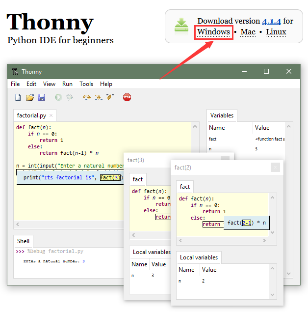

The Windows installer already bundles Python, so you do not need to install Python separately. For a 64-bit system choose `Installer with 64-bit Python 3.10`; for an older machine choose the 32-bit one:

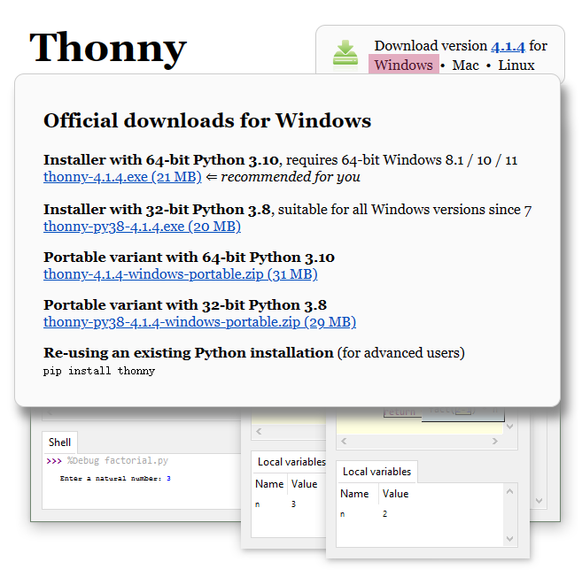

For macOS choose the matching dmg; the download procedure is the same as on Windows:

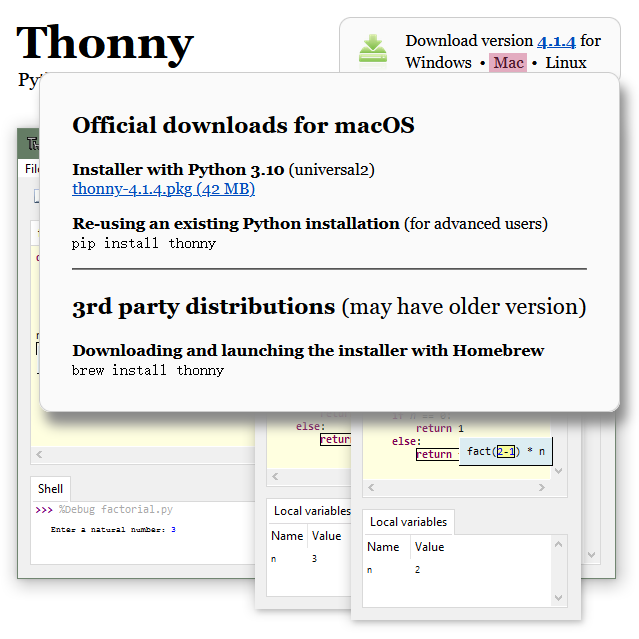

### 5.2.2 Installation

1. Double-click the installer, select **Install for me only**, and click **Next**.

   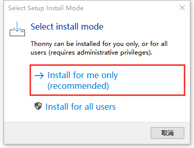

2. Check **I accept the agreement** and click **Next**.

   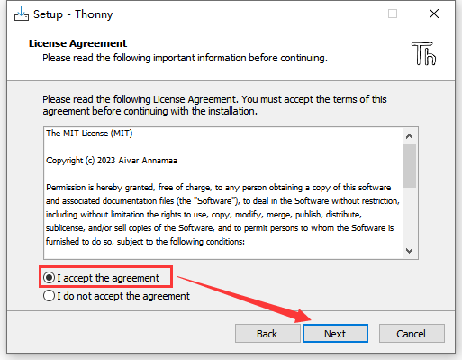

3. Choose the installation path. The default is on the C drive; to use another drive click **Browse...**, then click **Next**.

   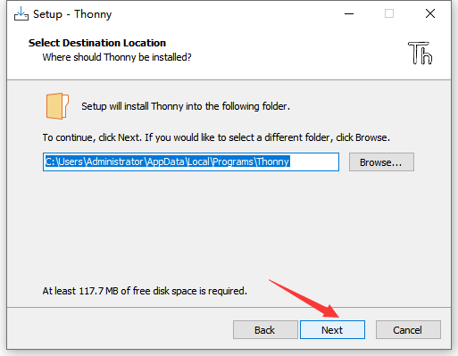

4. Keep the defaults on the remaining pages (Start menu, desktop icon) and click **Install**.

   

5. When installation finishes, click **Finish**. On the first launch you will be asked to choose the interface language; either Chinese or English is fine.

   

## 5.3 Flashing the MicroPython Firmware

> ⚠️ **Before you begin**: The controller board uses an onboard CH340 chip for USB-to-serial communication. Before connecting it to your computer for the first time, install the CH340 driver as described in **Chapter 3: Driver Installation**, otherwise no COM port will appear in the port list below.

The board ships without MicroPython firmware, so Thonny cannot connect to it until the firmware has been flashed once.

1. Connect the board to the computer with a USB cable.

 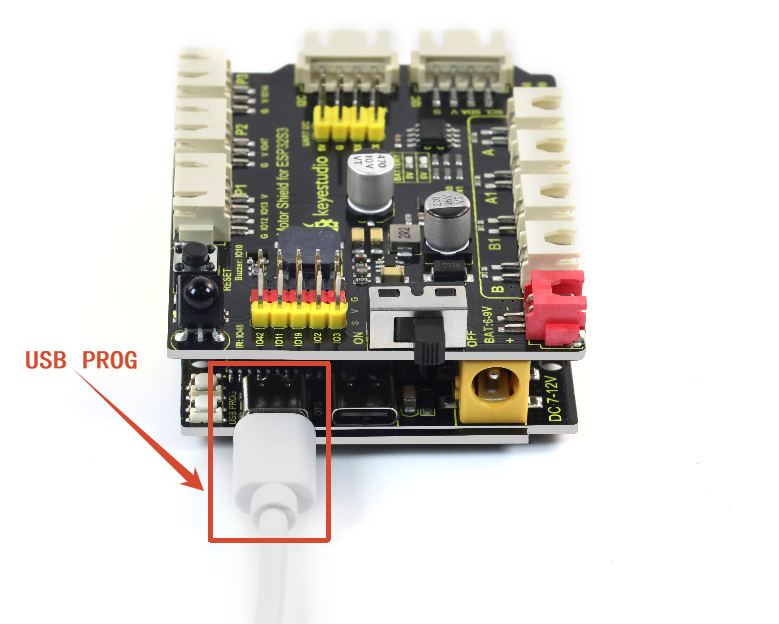

2. Go to **Tools → Options** and switch to the **Interpreter** tab. Select `MicroPython (ESP32)` as the interpreter and the board's COM port as the port.

   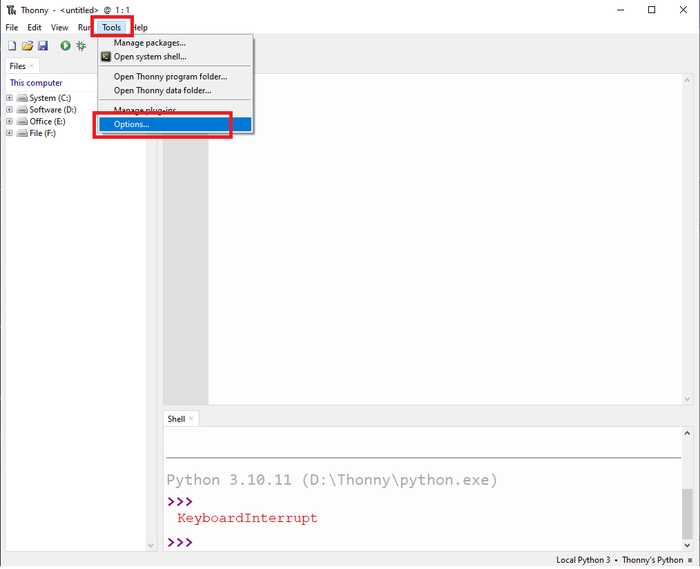

   

   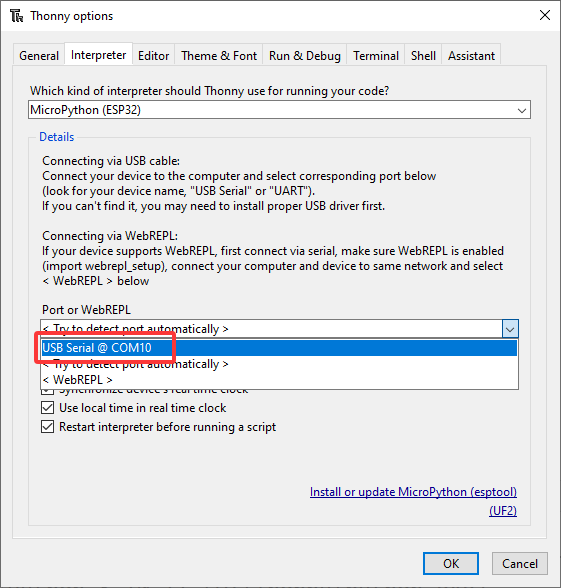

3. Click **Install or update MicroPython (esptool)** in the lower-right corner of the window. You must select the serial port first, otherwise the button is not clickable.

   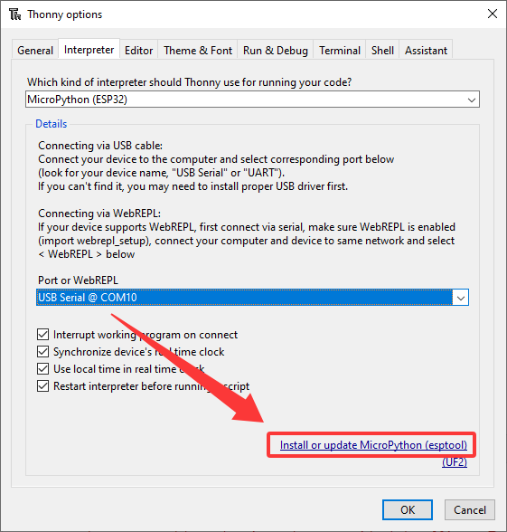

4. In the dialog that appears, make the following selections:

   - `Target port`: the board's serial port
   - `MicroPython family`: `ESP32-S3`
   - `variant`: `Espressif • ESP32-S3`
   - `version`: `1.28.0` (the version this tutorial is based on)
   - Check **Erase all flash before installing**

   When done, click **Install**.

   

5. Wait until the progress bar completes and a success message is shown.

   

6. Return to the main window and click the green connect button in the toolbar. When a `MicroPython device` panel appears on the left and the Shell prints `MicroPython v1.28.0 ... ESP32S3`, the firmware has been flashed and the board is connected.

   

## 5.4 Connecting the Board and Running Code

Once the firmware has been flashed, from then on you only need to connect the board and select the correct port.

1. Go to **Tools → Options → Interpreter**, select `MicroPython (ESP32)` as the interpreter, select the board's serial port as the port, and click **OK**.

   

2. After a successful connection, a `MicroPython device` panel appears on the left showing the files already on the board; the status bar in the lower-right corner shows `MicroPython (ESP32) • USB Serial @ COMx`.

   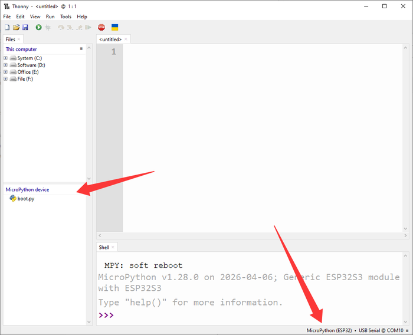

3. Open one of the sample `.py` files from the resource package under **This computer** on the left, then click the green triangle in the toolbar (Run current script, shortcut F5) to run it in place. Output and error messages appear in the Shell below; click the red square to stop.

   

4. To make the board run your code automatically on power-on, save the code as `main.py` in the root directory of the board: press Ctrl+A and then Ctrl+C in the editor to copy everything, then open **MicroPython device**, create a new file, paste, and save it as `main.py`. The board executes this file automatically every time it is powered on.

> Stop the running program with the red square before saving; writing files while the program is running will fail.

## 5.5 Board-Level Libraries

Board-level libraries for the Mini Tracked Tank Robot. The files must first be copied into the `/lib` directory on the board before a program can `import` them:

| File | Purpose | Lessons used |
| --- | --- | --- |
| `mini_tracked_tank_robot.py` | Motor, pan-tilt/gripper servo, dot matrix, line tracking, and ultrasonic drivers | All |
| `mini_tracked_tank_robot_web.py` | Minimal HTTP server (non-blocking, so the main loop can drive the car at the same time) | 12 ~ 16 |
| `aicam.py` | Serial driver for the AI vision module | 17 ~ 20 |
| `ir_rx/` | Infrared NEC decoding (Peter Hinch, MIT license) | 10, 11 |

How to copy: in the **Files** panel on the left of Thonny, enter the `lib` directory on the board, then right-click and upload the files and folders listed above.

**Step 1:**

**Step 2:**

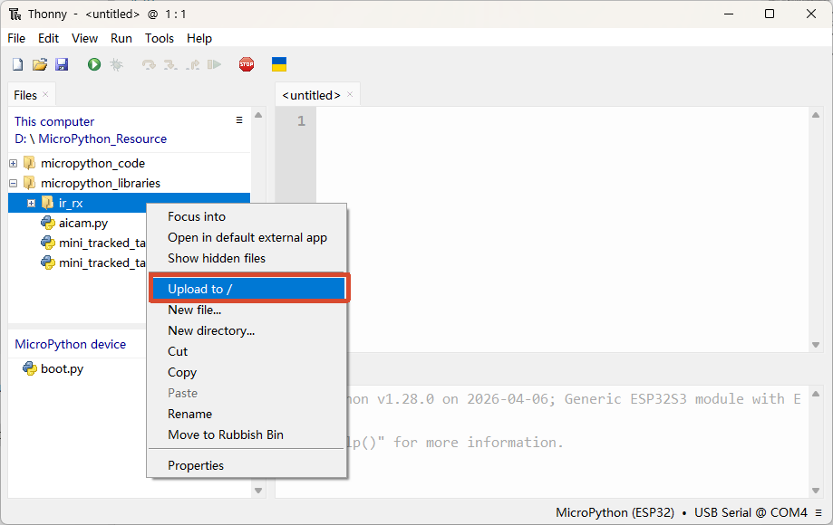

After a **successful upload** you will see the uploaded library files on the board under `MicroPython device`.
**⚠️ Note:** the `ir_rx` file must be uploaded to the board directly by following the steps in the figure. There is no need to expand the `ir_rx` folder and upload the library files inside it individually.

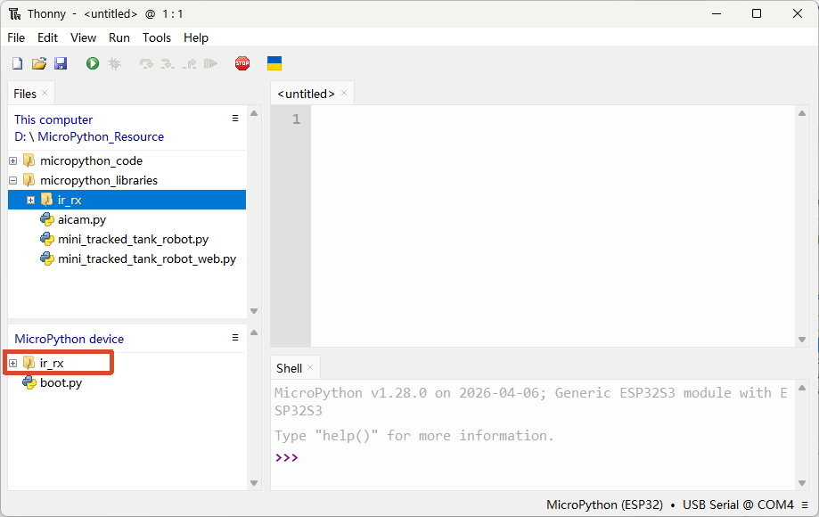

> The PCF8574 used for line tracking runs on I2C and shares io8/io9 with the dot matrix. The two cannot be used at the same time, and the library already handles this: calling `Line_init()` takes over the bus, and calling `Matrix_init()` releases it.
