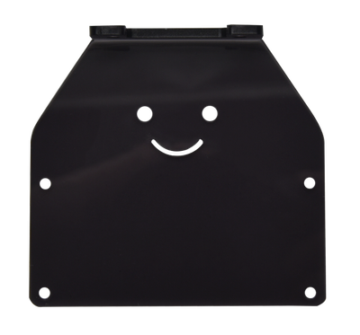
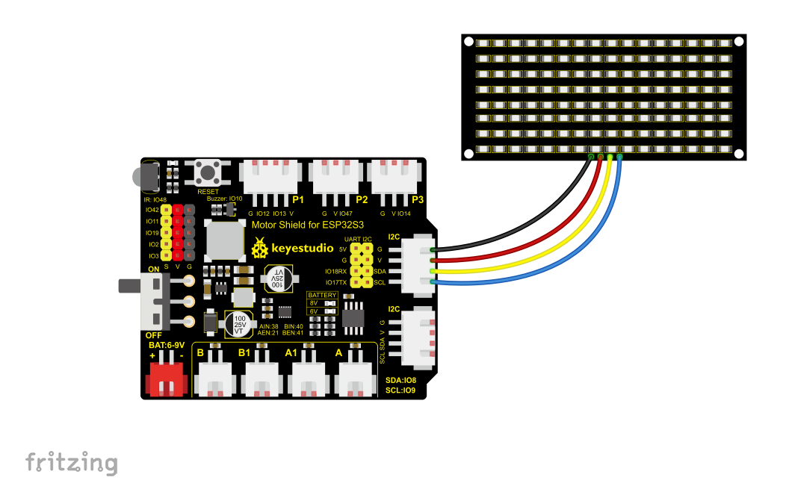
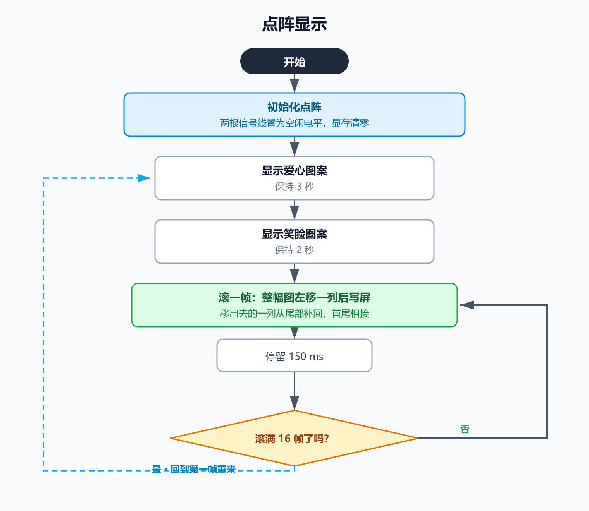
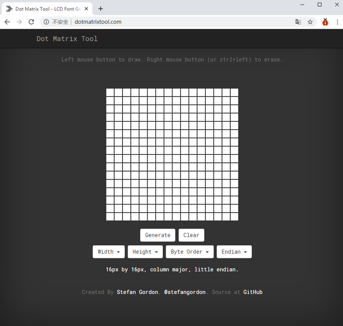
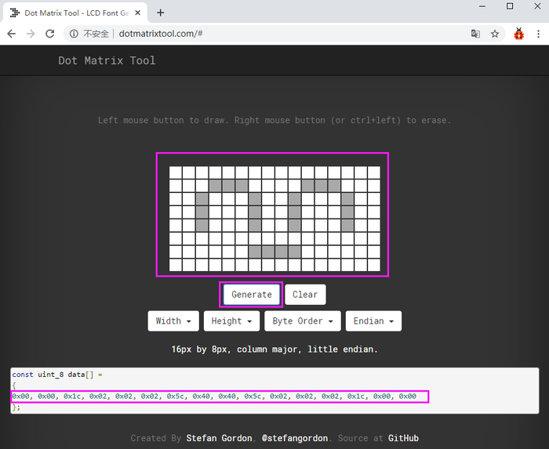

### Project 1: 8×16 Dot Matrix Expression Display

#### **1. Introduction:**

{width=520px}

From a distance it is a picture; up close it is nothing but dots. The 8×16 screen on the front of the car is how the car speaks: a heart while it drives, an exclamation mark when it finds an obstacle, a smiley when it scores a goal. This first lesson does not touch the motors or the sensors — it just lights up that face.

The screen holds 128 LEDs in total. If every LED needed its own pin, the controller would have run out of pins long ago, so a driver chip sits behind the screen and manages the LEDs on the controller's behalf. The controller only provides two lines — one clock and one data — while the screen itself scans column by column at a very high rate, so the human eye sees a stable picture.

In this MicroPython version you do not have to toggle those two lines yourself; the board-level library already wraps the driver, and your program only hands over the content. All you actually need to prepare are 16 bytes, called a **font bitmap**: one byte covers one column, the 8 bits inside a byte cover the 8 rows of that column, and the top row corresponds to the lowest bit. This lesson provides two font bitmaps, a heart and a smiley, and finally makes the smiley scroll horizontally.

#### **2. Parts List:**
Components used in this lesson:

|     |     |
| :---: | :---: |
| {width=200px}<br><span style="font-size:0.85em">8×16 LED dot matrix display ×1</span> | {width=200px}<br><span style="font-size:0.85em">8×16 dot matrix fixing bent acrylic plate ×1</span> |
| {width=200px}<br><span style="font-size:0.85em">ESP32-S3 development board ×1</span> | {width=200px}<br><span style="font-size:0.85em">DRV8835 motor expansion board ×1</span> |
> ⚠️ **The dot matrix was already installed in Chapter 2. This table is for reference only, so there is no need to remove it; the wiring notes below only describe the wiring method for reference and do not require disassembly. See the kit list in 1.4 for the full bill of materials.**

#### **3. Parameters:**
| Item | Parameter |
| --- | --- |
| Display specification | 8×16 LED dot matrix (8 rows × 16 columns) |
| Signal pins | CLK = IO9, DIN = IO8 |
| Font bitmap format | 16 bytes; each byte covers the 8 rows of one column, bit0 at the top row |
| Display content | Heart 3 s → Smiley 2 s → Smiley scrolling (150 ms per frame) |
| Board-level library | `mini_tracked_tank_robot.py` (must be uploaded to `lib/` on the board) |

#### **4. Wiring:**

The dot matrix needs only two signal lines plus power:

| Dot matrix pin | Controller GPIO |
| --- | :---: |
| CLK | IO9 |
| DIN | IO8 |



#### **5. Flowchart:**

Sending one frame takes four steps: initialize the dot matrix, clear the screen, send the font bitmap, and delay. The low-level sequence of "start signal + bit-by-bit transmission" is already wrapped in the library and is not visible in the program:



#### **6. Test Code:**
> ⚠️ **Before uploading the code, upload the board-level library `mini_tracked_tank_robot.py` to the `lib/` directory on the board** (see Section 5.5), otherwise `from mini_tracked_tank_robot import ...` will raise `ImportError`. Every lesson after this one uses it as well.

```python
from mini_tracked_tank_robot import MiniTrackedTankRobot
import time

car = MiniTrackedTankRobot()
car.Matrix_init(9, 8)

# 16 bytes for 16 columns; the 8 bits of each byte are the 8 rows of one column
heart = bytes([
    0x00, 0x00, 0x00, 0x00, 0x08, 0x1C, 0x3E, 0x7C,
    0x7C, 0x3E, 0x1C, 0x08, 0x00, 0x00, 0x00, 0x00
])

smile = bytes([
    0x00, 0x00, 0x1C, 0x02, 0x02, 0x02, 0x5C, 0x40,
    0x40, 0x5C, 0x02, 0x02, 0x02, 0x1C, 0x00, 0x00
])

car.Matrix_clear()          # Clear the display at power-on

while True:
    car.Matrix_display(heart)
    time.sleep(3)           # Heart for 3 seconds

    car.Matrix_display(smile)
    time.sleep(2)           # Smiley for 2 seconds

    # Scroll: shift the whole image left 16 times to return to the original
    for i in range(16):
        car.Matrix_display(smile[i:] + smile[:i])
        time.sleep_ms(150)
```

#### **7. Code Explanation:**
**(1) Importing the board-level library**

```python
from mini_tracked_tank_robot import MiniTrackedTankRobot
import time
```

The first line takes the `MiniTrackedTankRobot` class from the board-level library; the drivers for the dot matrix, motors, servos, line tracking, and ultrasonic sensor are all wrapped in this class. The file must first be uploaded to the `lib/` directory on the board, otherwise the import fails. `time` is a standard library module and handles delays.

**(2) Creating the object and initializing the dot matrix**

```python
car = MiniTrackedTankRobot()
car.Matrix_init(9, 8)
```

First create a `car` object, then call `car.Matrix_init(9, 8)` to tell the library that CLK is connected to IO9 and DIN to IO8. Internally the library configures both lines as outputs and drives them to their idle state. If you change the wiring, change these two numbers; the order is CLK first, DIN second.

**(3) Two font bitmaps, wrapped with `bytes()`**

```python
heart = bytes([
    0x00, 0x00, 0x00, 0x00, 0x08, 0x1C, 0x3E, 0x7C,
    0x7C, 0x3E, 0x1C, 0x08, 0x00, 0x00, 0x00, 0x00
])
```

16 columns × 8 rows = 128 LEDs, so the font bitmap is 16 bytes: one byte covers one column, and the 8 bits inside a byte cover the 8 rows of that column with bit0 at the top. `0x00` means the whole column is off, while `0x1C` is `0001 1100`, lighting rows 3, 4, and 5.

`bytes([...])` is used instead of a plain list because the library's `car.Matrix_display()` expects a byte string; in MicroPython a `bytes` object uses less memory than a `list`.

**(4) Clearing the screen, then looping the display**

```python
car.Matrix_clear()          # Clear the display at power-on

while True:
    car.Matrix_display(heart)
    time.sleep(3)           # Heart for 3 seconds

    car.Matrix_display(smile)
    time.sleep(2)           # Smiley for 2 seconds
```

On power-on the display memory holds random values, so `car.Matrix_clear()` first sends 16 zeros to clear it, which prevents a garbled flash on the first frame. Then `car.Matrix_display()` pushes the whole image in, and `sleep(3)` holds it for 3 seconds — these delays are what actually decide how long the image stays; sending the font bitmap itself takes only about 1 ms.

`while True` is the MicroPython main loop, equivalent to Arduino's `loop()`, except you do not write a separate function: whatever is indented inside it is the loop body.

**(5) Scrolling: slicing and wrapping around**

```python
    for i in range(16):
        car.Matrix_display(smile[i:] + smile[:i])
        time.sleep_ms(150)
```

This is the neatest line in the whole lesson: `smile[i:]` takes bytes i to the end, `smile[:i]` takes the first i bytes, and joining the two shifts the whole image left by i columns. As `i` runs from 0 to 15, shifting by a full 16 columns brings the image back to its original state, with no gap at the seam.

`bytes` supports this kind of slice-and-concatenate operation, and the result is still `bytes`, so it can be fed directly to `car.Matrix_display()`. The delay uses `time.sleep_ms(150)` rather than `sleep(0.15)` — the millisecond version avoids floating point and is lighter in MicroPython. Changing it to 80 makes the scrolling nearly twice as fast while still being readable.

#### 8. Drawing Your Own Pattern: Online Font Bitmap Generator

The 16 bytes in `heart` and `smile` are not calculated by hand; they are clicked out in an online tool. Address: [dotmatrixtool.com](http://dotmatrixtool.com/).

When it opens, there is a 16×16 grid in the middle. Below the grid are the `Generate` and `Clear` buttons, and under those a row of four drop-down boxes: `Width`, `Height`, `Byte Order`, and `Endian`.



**Step 1: change the grid to 8 rows and 16 columns.** Select 16 for `Width` and 8 for `Height`; the grid changes from a square into a long strip, and the status text below becomes `16px by 8px, column major, little endian.`

This default of **column major + little endian** happens to be exactly the format the code needs: the 16 bytes correspond to the 16 columns in order, and bit0 of every byte is the top row. So the `Byte Order` and `Endian` boxes can be left alone.


**Step 2: left-click to light a dot, right-click to erase it.** A left click lights one cell and a wrong click is erased with the right button (or Ctrl + left click). Try clicking the 16 bytes of `smile` from the code to see whether the smiley reappears — after doing this once, you will not have to memorize the format of **one byte per column, bit0 at the top row**.

**Step 3: click Generate to get the data.** Once the drawing is done, click `Generate` and a block of `const uint8_t data[] = {...}` appears at the bottom of the page; the 16 hexadecimal bytes are inside the square brackets.



Copy these 16 bytes into `smile = bytes([...])` in the code and run it again; the dot matrix now displays the picture you drew.

> The tool outputs C-language `const uint8_t data[]` format, which must be rewritten as `bytes([...])` in MicroPython: **copy only the 16 bytes inside the square brackets**, wrap them with `bytes([` and `])`, and keep the comma separators as they are.

#### **9. Expected Behavior:**
After power-on the dot matrix clears first, then cycles through the following rhythm:

1. The heart pattern is displayed for 3 seconds;
2. The smiley pattern is displayed for 2 seconds;
3. The smiley pattern scrolls to the left as a whole, moving one column every 150 ms; after 16 columns it returns to the original image, and then the sequence restarts from step 1.

If the heart and the smiley are clearly lit and the scrolling is continuous without missing columns, the wiring and the font bitmaps are both correct.

> [Image to be added] Photos of the actual running result: one each for the heart, the smiley, and the scrolling, showing the lit dot matrix clearly.

#### **10. Troubleshooting:**

(1) After starting, the Shell below Thonny reports `ImportError: no module named 'mini_tracked_tank_robot'` and the dot matrix stays completely dark. This is most likely because the board-level library was not saved to the board. In Thonny, save `mini_tracked_tank_robot.py` to the `lib/` directory on the board and run the lesson code again.

(2) The Shell shows no error but the screen does not light up at all. First check whether CLK and DIN are swapped. In the code `car.Matrix_init(9, 8)` means CLK first and DIN second, corresponding to CLK on IO9 and DIN on IO8; if the two lines are swapped the screen stays dark, so reinsert them according to the wiring table.

(3) The screen lights up but the pattern is garbled, has missing columns, or is mirrored. The problem is usually in the font bitmap. The 16 bytes correspond to the 16 columns in order and bit0 of each byte is the top row; when using the online tool, select 16 for Width and 8 for Height, keep **column major + little endian**, and copy only the 16 bytes inside the square brackets into `bytes([...])` without changing the order.

(4) The Shell reports `NameError: name 'heart' isn't defined`, which means a font bitmap variable is used before it is defined. Check that the `heart` and `smile` `bytes` objects are defined before the loop, and that their capitalization matches how they are used in `car.Matrix_display()`.
