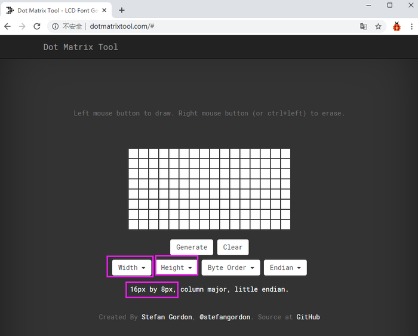

### 项目 1：8×16 点阵表情展示

#### **1. 简介：**

{width=520px}

远看是一幅图，近看全是点。车头这块 8×16 的屏，就是车用来说话的地方：走起来是爱心，发现障碍是感叹号，进球是笑脸。第一课不接电机、不碰传感器，先把这张脸点亮。

屏上一共 128 颗 LED。一颗一根引脚的话，主控早就没脚可用了，所以屏背后藏了一颗驱动芯片替主控管灯。主控只出两根线，一根时钟、一根数据；屏幕自己以很高的频率一列一列扫描，人眼看到的便是一幅稳定的画面。

MicroPython 这一版不用自己去翻转这两根线，板级库已经把驱动封装好了，程序里只管把内容交出去。要准备的其实只有 16 个字节，叫**字模**：一个字节管一列，字节里的 8 位管这一列的 8 行，最上面一行对应最低位。本课给出爱心和笑脸两张字模，最后让笑脸横向滚起来。

#### **2. 所需清单：**

本课用到的器件：

|     |     |
| :---: | :---: |
| {width=200px}<br><span style="font-size:0.85em">8×16 LED 点阵屏 ×1</span> | {width=200px}<br><span style="font-size:0.85em">8×16 点阵固定折弯亚克力板 ×1</span> |
| {width=200px}<br><span style="font-size:0.85em">ESP32-S3 开发板 ×1</span> | {width=200px}<br><span style="font-size:0.85em">DRV8835 电机扩展板 ×1</span> |
> ⚠️ **点阵在第 2 章就装好了，本表只作对照，不用拆下来；下面的接线说明只标清接线方式，供对照，不必拆装。完整物料见 1.4 套件清单。**

#### **3. 参数：**

| 项目 | 参数 |
| --- | --- |
| 显示规格 | 8×16 LED 点阵（8 行 × 16 列） |
| 信号引脚 | CLK = IO9，DIN = IO8 |
| 字模格式 | 16 字节，每字节对应 1 列的 8 行，bit0 在顶行 |
| 显示内容 | 爱心 3 s → 笑脸 2 s → 笑脸滚动（每帧 150 ms） |
| 板级库 | `mini_tracked_tank_robot.py`（需上传到板子 `lib/`） |

#### **4. 接线说明：**

点阵只需两根信号线加电源：

| 点阵引脚 | 主控 GPIO |
| --- | :---: |
| CLK | IO9 |
| DIN | IO8 |


#### **5. 流程图：**

送一帧画面分四步：初始化点阵、清屏、送字模、延时。底层那套"起始信号 + 逐位发送"已经封在库里，程序里看不到：


#### **6. 测试代码：**

> ⚠️ **上传代码前，先把 `mini_tracked_tank_robot.py` 这个板级库上传到板子的 `lib/` 目录**（方法见第 5.5 节），否则 `from mini_tracked_tank_robot import ...` 会报 `ImportError`。本课之后的每一课都要用到它。

```python
from mini_tracked_tank_robot import MiniTrackedTankRobot
import time

car = MiniTrackedTankRobot()
car.Matrix_init(9, 8)

# 16 字节对应 16 列，每字节 8 位对应一列 8 行
heart = bytes([
    0x00, 0x00, 0x00, 0x00, 0x08, 0x1C, 0x3E, 0x7C,
    0x7C, 0x3E, 0x1C, 0x08, 0x00, 0x00, 0x00, 0x00
])

smile = bytes([
    0x00, 0x00, 0x1C, 0x02, 0x02, 0x02, 0x5C, 0x40,
    0x40, 0x5C, 0x02, 0x02, 0x02, 0x1C, 0x00, 0x00
])

car.Matrix_clear()          # 上电清屏

while True:
    car.Matrix_display(heart)
    time.sleep(3)           # 爱心 3 秒

    car.Matrix_display(smile)
    time.sleep(2)           # 笑脸 2 秒

    # 滚动：整幅图循环左移 16 次，正好转回原样
    for i in range(16):
        car.Matrix_display(smile[i:] + smile[:i])
        time.sleep_ms(150)
```

#### **7. 代码解释：**

**(1) 引入板级库**

```python
from mini_tracked_tank_robot import MiniTrackedTankRobot
import time
```

第一行从板级库里取出 `MiniTrackedTankRobot` 类，点阵、电机、舵机、循迹、超声波的驱动都封在这个类里。这个文件要先上传到板子的 `lib/` 目录，否则导入会报错。`time` 是标准库，负责延时。

**(2) 建对象、初始化点阵**

```python
car = MiniTrackedTankRobot()
car.Matrix_init(9, 8)
```

先建一个 `car` 对象，再调 `Matrix_init(9, 8)` 告诉库：CLK 接 IO9、DIN 接 IO8。库内部会把两根线设成输出、拉到空闲状态。换接线就改这两个数字，顺序是 CLK 在前、DIN 在后。

**(3) 两张字模，用 `bytes()` 装**

```python
heart = bytes([
    0x00, 0x00, 0x00, 0x00, 0x08, 0x1C, 0x3E, 0x7C,
    0x7C, 0x3E, 0x1C, 0x08, 0x00, 0x00, 0x00, 0x00
])
```

16 列 × 8 行 = 128 颗灯，所以字模是 16 个字节：一个字节管一列，字节里的 8 位管这一列的 8 行，bit0 在最上面。`0x00` 是这一列全灭，`0x1C` 是 `0001 1100`，点亮第 3、4、5 行。

用 `bytes([...])` 而不是普通列表，是因为库的 `Matrix_display()` 要收字节串；MicroPython 里 `bytes` 比 `list` 省内存。

**(4) 清屏，再循环显示**

```python
car.Matrix_clear()

while True:
    car.Matrix_display(heart)
    time.sleep(3)           # 爱心 3 秒

    car.Matrix_display(smile)
    time.sleep(2)           # 笑脸 2 秒
```

上电时点阵显存里是随机值，先 `Matrix_clear()` 送 16 个 0 清一遍，免得第一帧闪一下花屏。然后 `Matrix_display()` 把整幅图送进去，`sleep(3)` 停 3 秒——真正决定"停多久"的是这两句延时，送字模本身只要 1 ms 左右。

`while True` 是 MicroPython 的主循环，相当于 Arduino 的 `loop()`，但不用单独写函数，缩进在里面就是循环体。

**(5) 滚动：切片回绕**

```python
for i in range(16):
    car.Matrix_display(smile[i:] + smile[:i])
    time.sleep_ms(150)
```

这行是整课最巧的地方：`smile[i:]` 取第 i 个字节到末尾，`smile[:i]` 取开头 i 个字节，两段一拼，就是把整幅图左移了 i 列。`i` 从 0 到 15，移满 16 列正好绕回原图，首尾相接不出黑边。

`bytes` 支持这种切片拼接，拼出来还是 `bytes`，可以直接喂给 `Matrix_display()`。延时用 `time.sleep_ms(150)` 而不是 `sleep(0.15)`——毫秒版本不用浮点数，在 MicroPython 里更省资源。改成 80 滚动快近一倍，仍看得清。

##### 想画自己的图案：在线字模生成工具

代码里 `heart` 和 `smile` 那 16 个字节不是算出来的，是在线工具点出来的。地址：[dotmatrixtool.com](http://dotmatrixtool.com/)。

打开后中间是一块 16×16 的格子。格子下方是 `Generate`、`Clear` 两个按钮，再下面一排四个下拉框：`Width`、`Height`、`Byte Order`、`Endian`。


**一、把格子改成 8 行 16 列。** `Width` 选 16、`Height` 选 8，格子会从方块变成扁长条，下方那行状态文字跟着变成 `16px by 8px, column major, little endian.`。

这个默认的**列优先 + 小端**正好就是代码要的格式：16 个字节依次对应 16 列，每个字节的 bit0 是顶行。所以 `Byte Order` 和 `Endian` 两个框不用动。



**二、左键点亮，右键擦掉。** 左键点一格亮一格，点错了按右键（或 Ctrl + 左键）擦掉。可以先照着代码里 `smile` 的那 16 个字节点一遍，看是不是还原出那个笑脸——这一遍点完，**每字节一列、bit0 在顶行**这个格式就不用背了。

**三、点 Generate 取数据。** 画好之后点 `Generate`，页面底部会冒出一段 `const uint8_t data[] = {...}`，方括号里就是 16 个十六进制字节。


把这 16 个字节抄进代码的 `smile = bytes([...])`，重新运行，点阵显示的就是你画的图。

> 工具给的是 C 语言的 `const uint8_t data[]` 格式，MicroPython 里要改写成 `bytes([...])`：**只把方括号里的 16 个字节抄过来**，外面套上 `bytes([` 和 `])` 就行，逗号分隔照旧。

#### **8. 运行现象：**

上电后点阵先清屏，随后按以下节奏循环：

1. 显示爱心图案 3 秒；
2. 显示笑脸图案 2 秒；
3. 笑脸图案整体向左滚动，每 150 ms 移动一列，移满 16 列回到原图，然后回到第 1 步重新开始。

能看到爱心、笑脸清晰点亮、滚动连续不缺列，就说明接线和字模都对。

> 【图片待补】运行现象实拍：爱心、笑脸、滚动各拍一张，能看清点阵点亮效果。

#### **9. 常见问题解决：**

(1) 运行后 Thonny 下方的 Shell 报 `ImportError: no module named 'mini_tracked_tank_robot'`，点阵全黑，多半是板级库没保存到板子上。在 Thonny 里把 `mini_tracked_tank_robot.py` 保存到板子的 `lib/` 目录，再重新运行本课代码就好。

(2) Shell 没报错、屏却一点不亮，先查 CLK 和 DIN 有没有接反。代码里 `Matrix_init(9, 8)` 是 CLK 在前、DIN 在后，对应 CLK 接 IO9、DIN 接 IO8，两根线对调了屏就不亮，按接线表重插一遍。

(3) 屏亮了但图案错乱、缺列或者左右颠倒，问题一般出在字模上。16 个字节依次对应 16 列、每字节 bit0 是顶行，用在线工具生成时 Width 选 16、Height 选 8，保持**列优先 + 小端**，只把方括号里的 16 个字节抄进 `bytes([...])`，顺序别动。

(4) Shell 报 `NameError: name 'heart' isn't defined`，说明用到了还没定义的字模变量。检查 `heart`、`smile` 这两个 `bytes` 是不是写在循环前头，名字的大小写也要和 `Matrix_display()` 里用的一致。
