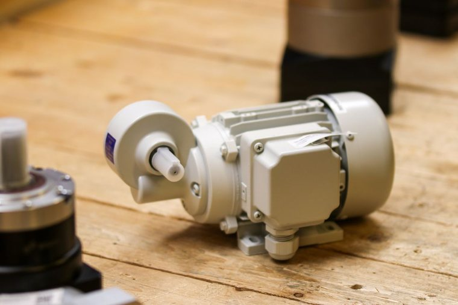
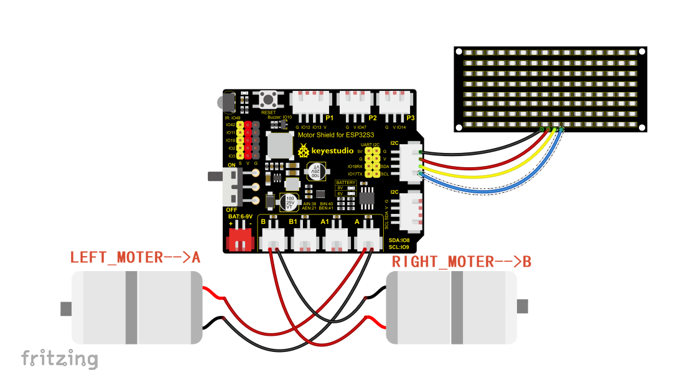
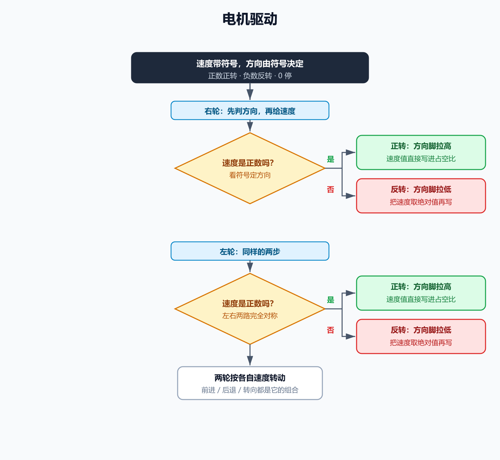

### Project 2: Motor Driving and Speed Control

#### **1. Introduction:**



In the previous lesson the car was only a glowing ornament; in this lesson it moves on its own for the first time.

Start with an unavoidable contradiction: a DC motor has only two wires, so it turns when connected to a battery and reverses when the wires are swapped. But this tutorial does not just need **forward** and **reverse** — it also needs **slower**. A controller pin can only output high or low with nothing in between, so where does that thirty percent of speed come from?

The answer is to change "supply power continuously" into "supply power, pause, and repeat quickly". Inside the DRV8835 on the expansion board there are two sets of **H-bridge** switches that flip the two motor wires between forward, reverse, and disconnected. Speed comes from the proportion of on-time within one period, called the **duty cycle**: at thirty percent, the motor receives thirty percent of the average voltage. With a switching frequency of 20 kHz, above the range of human hearing, the motor cannot follow each pause and instead feels a steady average force.

The board-level library wraps direction and speed control into a few actions: forward, backward, turn left, turn right, stop. You only give an integer speed, and every wheel movement in the later lessons eventually comes down to this set of actions. After power-on the car stops first and the dot matrix shows a smiley, then it drives forward for two seconds and backward for two seconds, followed by a right turn and a left turn in place for one and a half seconds each, with a half-second pause between segments. The last segment ramps the duty cycle from 0 up to 255 and back down to 0, so the car speeds up from slow to fast and then stops from fast; the heart on the dot matrix scrolls in sync.

#### **2. Parts List:**
Components used in this lesson:

|     |     |
| :---: | :---: |
| <br><span style="font-size:0.85em">DRV8835 motor expansion board ×1</span> | <br><span style="font-size:0.85em">Mini Tracked Tank Robot bottom assembly ×1</span> |
| <br><span style="font-size:0.85em">8×16 LED dot matrix display ×1</span> | <br><span style="font-size:0.85em">ESP32-S3 development board ×1</span> |
> ⚠️ **The motors are installed on the chassis at the factory; Chapter 2 only stacks the expansion board onto the controller. This table is for reference only, so there is no need to disassemble anything; the wiring notes below only describe the wiring method for reference and do not require disassembly. See the kit list in 1.4 for the full bill of materials.**

#### **3. Parameters:**
| Item | Parameter |
| --- | --- |
| Channel A (silkscreen AIN/AEN, physical left wheel) | Direction pin IO38, speed pin IO21 |
| Channel B (silkscreen BIN/BEN, physical right wheel) | Direction pin IO40, speed pin IO41 |
| Speed range | −255 to +255 (negative value reverses, 0 stops) |
| Straight-line speed | SPEED_RUN = 150 |
| Turning speed | SPEED_TURN = 150 |
| PWM frequency / resolution | 20 kHz, 16-bit (`duty_u16`, speed 0~255 multiplied by 257) |
| Speed-control demo | Duty cycle 0 → 255 → 0, step 5, 20 ms per step |
| Debug output | Thonny Shell (USB REPL, 115200) |


#### **4. Wiring:**

| Motor | Channel (silkscreen) | Direction pin | Speed pin (PWM) |
| --- | :---: | :---: | :---: |
| Left motor (physical left wheel) | Channel A (AIN/AEN) | IO38 | IO21 |
| Right motor (physical right wheel) | Channel B (BIN/BEN) | IO40 | IO41 |




#### **5. Flowchart:**

The speed is signed; a single branch decides both the direction pin and the duty cycle:



#### **6. Test Code:**
> ⚠️ **Before uploading the code, upload `mini_tracked_tank_robot.py` to the `lib/` directory on the board** (see Section 5.5), otherwise importing the library raises `ImportError`.

```python
from mini_tracked_tank_robot import MiniTrackedTankRobot
import time

car = MiniTrackedTankRobot()
car.Motor_init()
car.Matrix_init(9, 8)

SPEED_RUN = 150
SPEED_TURN = 150

heart = bytes([
    0x00, 0x00, 0x00, 0x00, 0x08, 0x1C, 0x3E, 0x7C,
    0x7C, 0x3E, 0x1C, 0x08, 0x00, 0x00, 0x00, 0x00
])
arrow_down = bytes([
    0x00, 0x00, 0x00, 0x00, 0x10, 0x30, 0x7E, 0xFE,
    0xFE, 0x7E, 0x30, 0x10, 0x00, 0x00, 0x00, 0x00
])
# Arrow glyph shown on the dot matrix when turning left
arrow_left = bytes([
    0x00, 0x00, 0x00, 0x18, 0x18, 0x18, 0x18, 0x18,
    0x18, 0xFF, 0x7E, 0x3C, 0x18, 0x00, 0x00, 0x00
])
arrow_right = bytes([
    0x00, 0x00, 0x00, 0x18, 0x3C, 0x7E, 0xFF, 0x18,
    0x18, 0x18, 0x18, 0x18, 0x18, 0x00, 0x00, 0x00
])
smile = bytes([
    0x00, 0x00, 0x1C, 0x02, 0x02, 0x02, 0x5C, 0x40,
    0x40, 0x5C, 0x02, 0x02, 0x02, 0x1C, 0x00, 0x00
])

car.stop_motor()
car.Matrix_display(smile)
print('Motor driving experiment started')
time.sleep(1)

while True:
    print('Forward (heart icon)')
    car.Matrix_display(heart)
    car.forward(SPEED_RUN, SPEED_RUN)
    time.sleep(2)
    car.stop_motor()
    time.sleep_ms(500)

    print('Backward (down arrow)')
    car.Matrix_display(arrow_down)
    car.back(SPEED_RUN, SPEED_RUN)
    time.sleep(2)
    car.stop_motor()
    time.sleep_ms(500)

    print('Turn right in place')
    car.Matrix_display(arrow_right)
    car.right(SPEED_TURN, SPEED_TURN)
    time.sleep_ms(1500)
    car.stop_motor()
    time.sleep_ms(500)

    print('Turn left in place')
    car.Matrix_display(arrow_left)
    car.left(SPEED_TURN, SPEED_TURN)
    time.sleep_ms(1500)
    car.stop_motor()
    time.sleep_ms(1000)

    # Speed sweep: duty 0 -> 255 -> 0 with the matrix scrolling in sync
    print('Accelerating: 0 -> 255')
    for duty in range(0, 256, 5):
        car.forward(duty, duty)          # Only forward() sets the direction together with the duty
        if duty % 20 == 0:
            step = (duty // 20) % 16
            car.Matrix_display(heart[step:] + heart[:step])
        time.sleep_ms(20)

    print('Decelerating: 255 -> 0')
    for duty in range(255, -1, -5):
        car.forward(duty, duty)
        if duty % 20 == 0:
            step = (duty // 20) % 16
            car.Matrix_display(heart[step:] + heart[:step])
        time.sleep_ms(20)

    car.stop_motor()
    print('Stopped, next round in 2 seconds')
    time.sleep(2)
```

#### **7. Code Explanation:**
**(1) Importing the board-level library and creating the object**

```python
from mini_tracked_tank_robot import MiniTrackedTankRobot
import time

car = MiniTrackedTankRobot()
```

The first line takes the `MiniTrackedTankRobot` class from the board-level library; the drivers for the dot matrix, motors, ultrasonic sensor, servos, and line tracking are all wrapped in this class, and the file must first be uploaded to the `lib/` directory on the board, otherwise the import fails. `time` handles delays. Then create a `car` object; every action afterwards is issued through it.

**(2) Initializing the motors and the dot matrix**

```python
car.Motor_init()
car.Matrix_init(9, 8)
```

`car.Motor_init()` configures the four motor pins (AIN/AEN/BIN/BEN) as outputs and allocates the PWM channels for speed control; without it the motors will not turn. `car.Matrix_init(9, 8)` tells the library that the dot matrix CLK is on IO9 and DIN on IO8, with CLK first and DIN second; if you change the wiring, change these two numbers.

**(3) Promoting the speeds to constants**

```python
SPEED_RUN = 150
SPEED_TURN = 150
```

Promoting the straight-line and turning speeds to constants means changing one place changes the speed of every action. The range is −255 to +255, and 150 is a measured value that overcomes the starting dead zone; set it too low and the wheels buzz without turning. The `bytes` font bitmaps below — heart, the arrows for each direction, and smiley — use the same format as in Lesson 1: 16 bytes for 16 columns, letting the dot matrix show a different icon for each action.

**(4) Driving forward and backward**

```python
while True:
    print('Forward (heart icon)')
    car.Matrix_display(heart)
    car.forward(SPEED_RUN, SPEED_RUN)
    time.sleep(2)
    car.stop_motor()
    time.sleep_ms(500)
```

The two parameters of `car.forward(left wheel, right wheel)` are the duty cycles for the left and right wheels; both positive means forward, and here they are equal so the car drives in a straight line. `time.sleep(2)` keeps it moving for 2 seconds, and `car.stop_motor()` zeroes both duty cycles to stop the car — without it the car keeps rushing forward. `sleep_ms(500)` is the pause between two segments. For backward motion, replace `car.forward` with `car.back(SPEED_RUN, SPEED_RUN)`; the library inverts the direction pins internally and everything else stays the same.

**(5) Turning in place**

```python
    print('Turn right in place')
    car.Matrix_display(arrow_right)
    car.right(SPEED_TURN, SPEED_TURN)
    time.sleep_ms(1500)
    car.stop_motor()
```

`car.right()` / `car.left()` drive the two wheels in opposite directions (turning right means the left wheel goes forward and the right wheel goes backward), so the car spins in place instead of driving a wide arc; the two parameters are still the left and right wheel speeds. After 1.5 seconds of turning you must call `car.stop_motor()`, otherwise it keeps turning. To turn about half a circle more, increase `sleep_ms(1500)`.

**(6) Duty-cycle speed-control demo**

```python
    # Speed sweep: duty 0 -> 255 -> 0 with the matrix scrolling in sync
    print('Accelerating: 0 -> 255')
    for duty in range(0, 256, 5):
        car.forward(duty, duty)          # Only forward() sets the direction together with the duty
        if duty % 20 == 0:
            step = (duty // 20) % 16
            car.Matrix_display(heart[step:] + heart[:step])
        time.sleep_ms(20)
```

`range(0, 256, 5)` raises the duty cycle from 0 to 255 in steps of 5, and `car.forward(duty, duty)` feeds the value straight to both wheels, so the car speeds up smoothly with the duty cycle; `car.forward` is used here because it also sets the direction to forward. The value is updated every 20 ms, and `step` cycles through 0 to 15 with the duty cycle, slicing and wrapping `heart` so the heart scrolls. Deceleration uses `range(255, -1, -5)` in reverse. If the demo feels too slow, reduce `sleep_ms(20)`.

#### **8. Expected Behavior:**
After power-on the smiley is displayed and the car stays stopped; one second later the loop starts and executes in order:

1. Forward for 2 seconds (heart on the dot matrix);
2. Stop for 0.5 seconds (smiley);
3. Backward for 2 seconds (down arrow on the dot matrix);
4. Stop for 0.5 seconds;
5. Turn right in place for 1.5 seconds (left arrow displayed);
6. Stop for 0.5 seconds;
7. Turn left in place for 1.5 seconds (right arrow displayed);
8. Stop for 1 second;
9. Speed control: duty cycle 0→255→0, the car speed changes smoothly with the duty cycle and the heart scrolls in sync;
10. Stop for 2 seconds and return to step 1.

The Shell prints the current action at the same time (115200). If the car runs one round of **forward — backward — right turn — left turn — speed control** and the dot matrix icon follows each action, it is working correctly. If a turn goes the opposite way from what you expect, do not rush to change the program: first check channels A/B and the left/right wheels against the wiring table in 2.3.1.

> [Image to be added] Photos of the four actions: one each for forward, backward, left turn, and right turn, with both the car and the dot matrix icon visible.

#### **9. Troubleshooting:**

(1) The Shell below Thonny reports `ImportError` and neither the dot matrix nor the motors respond. The board-level library was not saved to the `lib/` directory on the board. Save `mini_tracked_tank_robot.py` there and run the code again.

(2) The Shell is clean but the wheels only buzz without turning; in most cases the speed is too low and does not overcome the starting dead zone. `SPEED_RUN = 150` and `SPEED_TURN = 150` in the code are measured values that can actually drive the car; set the speed to that order of magnitude and try again, not something like ten or twenty.

(3) The car moves backward when it should move forward, or turns the wrong way. First check whether the two speed parameters are swapped in the `car.forward()`, `car.back()`, `car.right()`, and `car.left()` calls, then check channels A and B and the left/right wheels against the wiring table. Once you confirm channel A drives the left wheel, the actions become correct.

(4) The Shell reports `NameError: name 'SPEED_RUN' isn't defined`, which usually means the constant was renamed while editing the code but the old name is still used below. Make `SPEED_RUN` and `SPEED_TURN` above the loop and the call sites use the same names.
