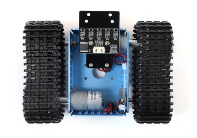

### 项目 2：电机驱动与调速

#### **1. 简介：**

上一课车还只是个会发光的摆件，这一课它第一次自己动。

先想一个问题：一只直流电机只有两根线，接上电池就转，把两根线对调就反转。可我们要的不只是「转」和「反着转」，还要「转慢一点」。主控的引脚只会输出高或低，中间档位没有——那 30% 的速度是怎么来的？

答案在扩展板那颗 DRV8835 里。它内部是两组「H 型」开关，能把电机的两根线在正接、反接、断开之间切换；至于快慢，靠的是 PWM：引脚以 1 kHz 的频率快速开关，一个周期里高电平占的比例就是占空比，占 30% 就等于给了电机三成电压。人耳听不到 1 kHz 的开关声，电机也来不及反应，只感受到平均电压。

这一课用板级库的 `car.forward()`、`car.back()`、`car.left()`、`car.right()` 开车，速度为正就给正转、给 0 就停。后面所有课的车轮动作，最终都落到这些函数上。

{width=520px}

#### **2. 所需清单：**

本课用到的器件：

|     |     |
| :---: | :---: |
| {width=200px}<br><span style="font-size:0.85em">DRV8835 电机扩展板 ×1</span> | {width=200px}<br><span style="font-size:0.85em">履带底盘总成（履带 + 电机 + 轮子） ×1</span> |
| {width=200px}<br><span style="font-size:0.85em">8×16 LED 点阵屏 ×1</span> | {width=200px}<br><span style="font-size:0.85em">ESP32-S3 开发板 ×1</span> |
> ⚠️ **电机出厂就装在底盘上，第 2 章只是把扩展板叠插到主控，本表只作对照，不用拆；下面的接线说明只标清接线方式，供对照，不必拆装。完整物料见 1.4 套件清单。**

#### **3. 参数：**

| 项目 | 参数 |
| --- | --- |
| A 路（丝印 AIN/AEN，物理左轮） | 方向脚 IO38，调速脚 IO21 |
| B 路（丝印 BIN/BEN，物理右轮） | 方向脚 IO40，调速脚 IO41 |
| 速度范围 | −255 ～ +255（负数反转，0 停车） |
| 直行速度 | SPEED_RUN = 150 |
| 转向速度 | SPEED_TURN = 150 |
| PWM 频率 / 位数 | 1 kHz，8 位（ledcAttach） |
| 调速演示 | 占空比 0 → 255 → 0，步进 5，每步 20 ms |
| 调试串口 | 115200 |

> 说明：速度 150 是实测能越过启动死区、两轮阻力较小的值，实际使用时可按地面情况微调。

#### **4. 接线说明：**

| 电机 | 路数（丝印） | 方向脚 | 调速脚（PWM） |
| --- | :---: | :---: | :---: |
| 左电机（物理左轮） | A 路（AIN/AEN） | IO38 | IO21 |
| 右电机（物理右轮） | B 路（BIN/BEN） | IO40 | IO41 |

点阵信号线同第 1 课：CLK = IO9，DIN = IO8。


#### **5. 流程图：**

速度带符号，判一个分支就把方向脚和占空比一起定下来：


#### **6. 测试代码：**

> ⚠️ **上传代码前，先把 `mini_tracked_tank_robot.py` 上传到板子的 `lib/` 目录**（方法见第 5.5 节），否则导入库时会报 `ImportError`。

```python
# 项目 2：电机驱动与调速
# 接线：AIN=IO40、AEN=IO41、BIN=IO38、BEN=IO21；点阵 CLK=IO9、DIN=IO8
# 现象：前进 2 秒 → 后退 2 秒 → 原地右转 1.5 秒 → 原地左转 1.5 秒 → 加减速演示

from mini_tracked_tank_robot import MiniTrackedTankRobot
import time

car = MiniTrackedTankRobot()
car.Motor_init()
car.Matrix_init(9, 8)

SPEED_RUN = 150
SPEED_TURN = 150

heart = bytes([
    0x00, 0x00, 0x00, 0x00, 0x08, 0x1C, 0x3E, 0x7C,
    0x7C, 0x3E, 0x1C, 0x08, 0x00, 0x00, 0x00, 0x00
])
arrow_down = bytes([
    0x00, 0x00, 0x00, 0x00, 0x10, 0x30, 0x7E, 0xFE,
    0xFE, 0x7E, 0x30, 0x10, 0x00, 0x00, 0x00, 0x00
])
# 左转时点阵显示的箭头字模
arrow_left = bytes([
    0x00, 0x00, 0x00, 0x18, 0x18, 0x18, 0x18, 0x18,
    0x18, 0xFF, 0x7E, 0x3C, 0x18, 0x00, 0x00, 0x00
])
arrow_right = bytes([
    0x00, 0x00, 0x00, 0x18, 0x3C, 0x7E, 0xFF, 0x18,
    0x18, 0x18, 0x18, 0x18, 0x18, 0x00, 0x00, 0x00
])
smile = bytes([
    0x00, 0x00, 0x1C, 0x02, 0x02, 0x02, 0x5C, 0x40,
    0x40, 0x5C, 0x02, 0x02, 0x02, 0x1C, 0x00, 0x00
])

car.stop_motor()
car.Matrix_display(smile)
print('电机驱动实验开始')
time.sleep(1)

while True:
    print('前进（显示爱心）')
    car.Matrix_display(heart)
    car.forward(SPEED_RUN, SPEED_RUN)
    time.sleep(2)
    car.stop_motor()
    time.sleep_ms(500)

    print('后退（显示向下箭头）')
    car.Matrix_display(arrow_down)
    car.back(SPEED_RUN, SPEED_RUN)
    time.sleep(2)
    car.stop_motor()
    time.sleep_ms(500)

    print('原地右转')
    car.Matrix_display(arrow_right)
    car.right(SPEED_TURN, SPEED_TURN)
    time.sleep_ms(1500)
    car.stop_motor()
    time.sleep_ms(500)

    print('原地左转')
    car.Matrix_display(arrow_left)
    car.left(SPEED_TURN, SPEED_TURN)
    time.sleep_ms(1500)
    car.stop_motor()
    time.sleep_ms(1000)

    # 调速：占空比 0 → 255 → 0，点阵同步滚动
    print('加速：0 -> 255')
    for duty in range(0, 256, 5):
        car.forward(duty, duty)          # 用 forward 才能同时给定方向
        if duty % 20 == 0:
            step = (duty // 20) % 16
            car.Matrix_display(heart[step:] + heart[:step])
        time.sleep_ms(20)

    print('减速：255 -> 0')
    for duty in range(255, -1, -5):
        car.forward(duty, duty)
        if duty % 20 == 0:
            step = (duty // 20) % 16
            car.Matrix_display(heart[step:] + heart[:step])
        time.sleep_ms(20)

    car.stop_motor()
    print('停止，2 秒后进入下一轮')
    time.sleep(2)
```

#### **7. 代码解释：**

**(1) 引入板级库、建对象**

```python
from mini_tracked_tank_robot import MiniTrackedTankRobot
import time

car = MiniTrackedTankRobot()
```

第一行从板级库取出 `MiniTrackedTankRobot` 类，点阵、电机、超声波、舵机、循迹的驱动都封在这个类里，文件要先上传到板子 `lib/` 目录，否则导入报错。`time` 负责延时。接着建一个 `car` 对象，后面所有动作都由它发出。

**(2) 初始化电机和点阵**

```python
car.Motor_init()
car.Matrix_init(9, 8)
```

`Motor_init()` 把四个电机引脚（AIN/AEN/BIN/BEN）设成输出、给调速分配好通道，不调它电机不会转。`Matrix_init(9, 8)` 告诉库点阵 CLK 接 IO9、DIN 接 IO8，顺序是 CLK 在前、DIN 在后；换接线就改这两个数。

**(3) 速度提成常量**

```python
SPEED_RUN = 150
SPEED_TURN = 150
```

把直行、转向速度提成常量，改一处就能换所有动作的速度。取值范围 −255～+255，150 是实测能越过启动死区的值；调太小轮子嗡嗡响却不转。下面 heart、各方向箭头、smile 这几张 `bytes` 字模和第 1 课格式一样：16 字节对应 16 列，让点阵显示不同动作图标。

**(4) 前进与后退**

```python
while True:
    print('前进（显示爱心）')
    car.Matrix_display(heart)
    car.forward(SPEED_RUN, SPEED_RUN)
    time.sleep(2)
    car.stop_motor()
    time.sleep_ms(500)
```

`forward(左轮, 右轮)` 两个参数分别给左右轮占空比，都是正值就前进；这里两值相等所以走直线。`time.sleep(2)` 决定走 2 秒，`stop_motor()` 把两轮占空比清零停车——不调用它车会一直往前冲，`sleep_ms(500)` 是两段动作间的停顿。后退把 `forward` 换成 `back(SPEED_RUN, SPEED_RUN)`，库内部把方向脚反相，其余一样。

**(5) 原地转向**

```python
    print('原地右转')
    car.Matrix_display(arrow_right)
    car.right(SPEED_TURN, SPEED_TURN)
    time.sleep_ms(1500)
    car.stop_motor()
```

`right()` / `left()` 让两轮反向转（右转就是左轮进、右轮退），车原地打转而不是绕大圈，两个参数仍是左右轮速度。转够 1.5 秒必须 `stop_motor()`，否则会一直转。想多转半圈就调大 `sleep_ms(1500)`。

**(6) 占空比调速演示**

```python
    # 调速：占空比 0 → 255 → 0，点阵同步滚动
    print('加速：0 -> 255')
    for duty in range(0, 256, 5):
        car.forward(duty, duty)          # 用 forward 才能同时给定方向
        if duty % 20 == 0:
            step = (duty // 20) % 16
            car.Matrix_display(heart[step:] + heart[:step])
        time.sleep_ms(20)
```

`range(0, 256, 5)` 让占空比每步加 5 从 0 升到 255，`forward(duty, duty)` 直接把值喂给两轮，车速随占空比平滑上升；这里用 `forward` 是因为它顺带把方向定成正转。每 20 ms 更新一次，`step` 随占空比循环 0～15，把 heart 切片回绕，点阵爱心跟着滚。减速用 `range(255, -1, -5)` 倒着来。嫌演示太慢就调小 `sleep_ms(20)`。

#### **8. 运行现象：**

上电后先显示笑脸并停车，1 秒后进入循环，依次执行：

1. 前进 2 秒（点阵爱心）；
2. 停车 0.5 秒（笑脸）；
3. 后退 2 秒（点阵向下箭头）；
4. 停车 0.5 秒；
5. 原地右转 1.5 秒（点阵显示向左箭头）；
6. 停车 0.5 秒；
7. 原地左转 1.5 秒（点阵显示向右箭头）；
8. 停车 1 秒；
9. 调速：占空比 0→255→0，车速随占空比平滑变化，点阵爱心同步滚动；
10. 停车 2 秒后回到第 1 步。

Shell 同步打印当前动作（115200）。车按「前进—后退—右转—左转—调速」跑一轮，点阵图标跟着动作换就对了。如果转向和预期相反，别急着改程序，先按 2.3.1 的接线表核对 A/B 路和左右轮。

> 【图片待补】四个动作的运行现象图：前进、后退、左转、右转各拍一张，能同时看到车与点阵图标。

#### **9. 常见问题解决：**

(1) Thonny 下方的 Shell 报 `ImportError`，跟着点阵和电机全都不动，是板级库没保存到板子的 `lib/` 目录。把 `mini_tracked_tank_robot.py` 保存进去，再运行代码。

(2) Shell 干干净净，轮子却嗡嗡响就是不转，八成是速度给低了、没越过启动死区。代码里 `SPEED_RUN = 150`、`SPEED_TURN = 150` 是实测能带动车的值，调到这个量级再试，别往十几二十那样给。

(3) 车该前进却后退、左右转反了，先看 `forward()`、`back()`、`right()`、`left()` 调用时两个速度参数写没写反，再按接线表核对 A、B 两路和左右轮。确认 A 路带的是左轮，动作就正常了。

(4) Shell 报 `NameError: name 'SPEED_RUN' isn't defined`，多半是改代码时把常量改了名、下面还在用老名字。把循环前头的 `SPEED_RUN`、`SPEED_TURN` 和调用处统一成同一个名字就行。
