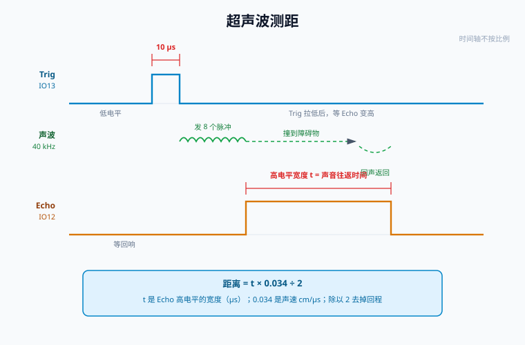

### 项目 3：超声波测距

#### **1. 简介：**

{width=520px}

蝙蝠在漆黑的洞里靠喊一声、听回声，判断前面有没有墙。超声波模块做的是同一件事，只是把声音换成人耳听不见的 40 kHz。

模块前面有两只筒：一只负责喊，一只负责听。主控给出一个 10 微秒的脉冲，喊的那只就发出八个周期的超声波；声波撞到障碍物弹回来，被听的那只收到，它随即把**从喊到听见**这段时间变成一段高电平。这段高电平有多宽，声音就跑了一个来回。

距离因此只有一句算式：`时间 × 声速 ÷ 2`。声速取 0.034 厘米每微秒，除以 2 是因为声音去了一趟还得回来。本课不判断、不避障，只把距离稳稳读出来，每秒往 Shell 打一行：手靠近数值变小、远离变大；正前方什么都没有时，打出来的是 0，表示这一轮没测到距离，并不代表车头贴着墙。

#### **2. 所需清单：**

本课用到的器件：

|     |     |     |
| :---: | :---: | :---: |
| {width=170px}<br><span style="font-size:0.85em">超声波模块（带外壳） ×1</span> | {width=170px}<br><span style="font-size:0.85em">DRV8835 电机扩展板 ×1</span> | {width=170px}<br><span style="font-size:0.85em">ESP32-S3 开发板 ×1</span> |
> ⚠️ **超声波在第 2 章随云台一起装好了，本表只作对照，不用拆；下面的接线说明只标清接线方式，供对照，不必拆装。完整物料见 1.4 套件清单。**

#### **3. 参数：**

| 项目 | 参数 |
| --- | --- |
| 模块 | HC-SR04 超声波测距模块 |
| Trig（触发脚） | IO13 |
| Echo（回响脚） | IO12 |
| 触发脉冲宽度 | 10 µs |
| 声速系数 | 0.034 cm/µs |
| 有效量程 | 2–300 cm（超范围置 0） |
| 测量周期 | 1000 ms |
| 调试串口 | 115200 |

> **接线**：超声波用套件配的 4P 双头线直插扩展板顶部的超声波座（丝印 `G` `IO12` `IO13` `V`），不用一根根接杜邦线，详见 2.3.5 节。

#### **4. 接线说明：**

| 超声波引脚 | 主控 GPIO |
| --- | :---: |
| Trig | IO13 |
| Echo | IO12 |

> **注意**：接线图中的元器件只用于说明接线关系，实际接线时不需要把清单中带外壳的元器件拆开。


#### **5. 流程图：**

一次测距由三段时序拼成，Echo 的宽度就是**声音往返的时间**：



#### **6. 测试代码：**

> ⚠️ **上传代码前，先把 `mini_tracked_tank_robot.py` 上传到板子的 `lib/` 目录**（方法见第 5.5 节），否则导入库时会报 `ImportError`。

```python
from mini_tracked_tank_robot import MiniTrackedTankRobot
import time

car = MiniTrackedTankRobot()
car.Ultrasonic_init(13, 12)

while True:
    distance = car.Ultrasonic_distance()
    print('距离：', distance, 'cm')
    time.sleep(1)           # 1 秒测一次
```

#### **7. 代码解释：**

**(1) 引入板级库、建对象**

```python
from mini_tracked_tank_robot import MiniTrackedTankRobot
import time

car = MiniTrackedTankRobot()
```

从板级库取出 `MiniTrackedTankRobot` 类并建 `car` 对象，超声波、电机等驱动都封在这个类里。库文件要先传到板子 `lib/` 目录，否则导入报错。`time` 负责延时。

**(2) 初始化超声波**

```python
car.Ultrasonic_init(13, 12)
```

`Ultrasonic_init(触发脚, 回响脚)` 告诉库 Trig 接 IO13、Echo 接 IO12，库内部把 Trig 设成输出、Echo 设成输入。换接线就改这两个数，顺序 Trig 在前、Echo 在后。不初始化就读不到回波。

**(3) 读取距离**

```python
distance = car.Ultrasonic_distance()
```

`Ultrasonic_distance()` 发一发超声波、量 Echo 高电平的宽度，按**时间 × 声速 ÷ 2**算出厘米数并返回。返回值存进 `distance` 供后面用；超量程（超过 300 cm）时返回 0。发脉冲、计时、换算这套时序都封在库里，程序里看不到。

**(4) 打印与测量周期**

```python
print('距离：', distance, 'cm')
time.sleep(1)           # 1 秒测一次
```

`print` 把结果打到 Shell（115200），方便对着看读数准不准。`time.sleep(1)` 让每轮停 1 秒，它决定测量周期；改成 `time.sleep_ms(200)` 就是每 200 ms 测一次。别去掉延时，否则循环会不停触发超声波，前后两次回波叠在一起读数就乱了。

#### **8. 运行现象：**

打开Thonny 下方的 Shell（波特率 115200），每秒输出一行距离值，格式为**距离：XX cm**：

- 正前方无障碍或距离超过 300 cm 时，显示**距离：0 cm**；
- 用手或书本在车前移动，数值随距离变化，靠近时变小、远离时变大。

> 【图片待补】Thonny 下方的 Shell输出距离值的截图，展示几行不同距离的数据。

> 【图片待补】用遮挡物在超声波前测距的实物图。

#### **9. 常见问题解决：**

(1) Thonny 下方的 Shell 里读数一直是**距离：0 cm**，手挡上去也不变，先把超声波的 4P 插头拔下来重插一遍，确认插到底、没插反。代码里 `Ultrasonic_init(13, 12)` 是 Trig 接 IO13、Echo 接 IO12，两根线对调后量不到回波，读数就一直停在 0。手靠近变小、远离变大且不怎么跳，才算测距正常。

(2) 数值忽大忽小乱跳，看看测量那会儿有没有东西在探头前晃，周围是不是太吵。另外别把 `time.sleep(1)` 去掉，1 秒的间隔是留给上一次回波收尾的，循环太急两次回波叠在一起也会乱跳。

(3) Shell 报 `ImportError`，一行距离都打不出来，是板级库没保存到板子的 `lib/` 目录。把 `mini_tracked_tank_robot.py` 保存进去再运行。

(4) Shell 报 `NameError: name 'distance' isn't defined`，说明循环里把 `distance = car.Ultrasonic_distance()` 这句漏了，`print` 却还在用它。把读距离那句补回循环，`print('距离：', distance, 'cm')` 才有值可打。
