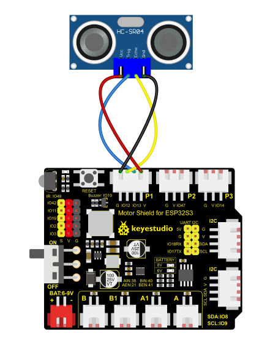
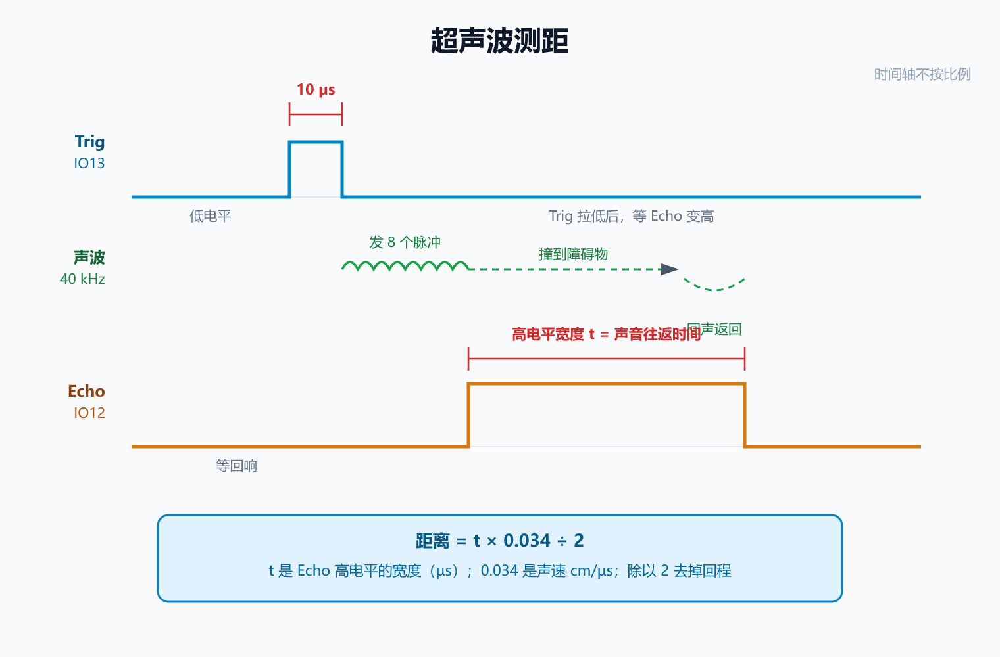

### Project 3: Ultrasonic Ranging

#### **1. Introduction:**


A bat in a pitch-black cave shouts once and listens for the echo to tell whether there is a wall ahead. The ultrasonic module does the same thing, except that the sound is changed to 40 kHz, which human ears cannot hear.

There are two barrels on the front of the module: one does the shouting and one does the listening. The controller sends a 10-microsecond pulse, the shouting barrel emits eight cycles of ultrasonic waves, and when the sound wave hits an obstacle and bounces back, the listening barrel receives it and immediately turns the time **from the shout to the hearing** into a period of high level. How wide that high level is tells you how far the sound travelled on its round trip.

The distance therefore comes down to a single formula: `time × speed of sound ÷ 2`. The speed of sound is taken as 0.034 cm per microsecond, and dividing by 2 is because the sound has to travel there and back. This lesson does not make decisions or avoid obstacles; it only reads the distance steadily and prints one line to the Shell every second: bring your hand closer and the value gets smaller, move it away and it gets larger; when there is nothing directly ahead, the printed value is 0, meaning that no distance was measured in this round — it does not mean the front of the car is against a wall.

#### **2. Parts List:**
Components used in this lesson:

|     |     |     |
| :---: | :---: | :---: |
| <br><span style="font-size:0.85em">Ultrasonic module ×1</span> | <br><span style="font-size:0.85em">DRV8835 motor expansion board ×1</span> | <br><span style="font-size:0.85em">ESP32-S3 development board ×1</span> |
> ⚠️ **The ultrasonic module was already installed together with the pan-tilt in Chapter 2. This table is for reference only, so there is no need to disassemble it; the wiring notes below only describe the wiring method for reference and do not require disassembly. See the kit list in 1.4 for the full bill of materials.**

#### **3. Parameters:**
| Item | Parameter |
| --- | --- |
| Module | HC-SR04 ultrasonic ranging module |
| Trig (trigger pin) | IO13 |
| Echo (echo pin) | IO12 |
| Trigger pulse width | 10 µs |
| Effective range | 2–300 cm (0 is returned when out of range) |
| Measurement period | 1000 ms |
| Debug output | Thonny Shell (USB REPL, 115200) |


#### **4. Wiring:**

| Ultrasonic pin | Controller GPIO |
| --- | :---: |
| Trig | IO13 |
| Echo | IO12 |

> **Note**: the components in the wiring diagram are only there to explain the wiring relationship; when you wire it up, there is no need to take apart a module that has an enclosure.



#### **5. Flowchart:**

A single measurement is assembled from three timing stages, and the width of Echo is exactly the **round-trip time of the sound**:



#### **6. Test Code:**
> ⚠️ **Before uploading the code, upload `mini_tracked_tank_robot.py` to the `lib/` directory on the board** (see Section 5.5), otherwise importing the library raises `ImportError`.

```python
from mini_tracked_tank_robot import MiniTrackedTankRobot
import time

car = MiniTrackedTankRobot()
car.Ultrasonic_init(13, 12)

while True:
    distance = car.Ultrasonic_distance()
    print('Distance: ', distance, 'cm')
    time.sleep(1)           # One measurement per second
```

#### **7. Code Explanation:**
**(1) Importing the board-level library and creating the object**

```python
from mini_tracked_tank_robot import MiniTrackedTankRobot
import time

car = MiniTrackedTankRobot()
```

Take the `MiniTrackedTankRobot` class from the board-level library and create the `car` object; the drivers for the ultrasonic sensor, motors, and so on are all wrapped in this class. The library file must be uploaded to the `lib/` directory on the board first, otherwise the import raises an error. `time` handles delays.

**(2) Initializing the ultrasonic module**

```python
car.Ultrasonic_init(13, 12)
```

`car.Ultrasonic_init(trigger pin, echo pin)` tells the library that Trig is connected to IO13 and Echo to IO12, and internally the library configures Trig as an output and Echo as an input. If you change the wiring, change these two numbers; the order is Trig first and Echo second. Without initialization the echo cannot be read.

**(3) Reading the distance**

```python
    distance = car.Ultrasonic_distance()
```

`car.Ultrasonic_distance()` sends one ultrasonic burst, measures the width of the Echo high level, works out the value in centimetres using **time × speed of sound ÷ 2**, and returns it. The return value is stored in `distance` for later use; when the distance is out of range (beyond 300 cm) it returns 0. The whole sequence of sending the pulse, timing, and converting is wrapped in the library and cannot be seen in the program.

**(4) Printing and the measurement period**

```python
    print('Distance: ', distance, 'cm')
    time.sleep(1)           # One measurement per second
```

`print` sends the result to the Shell, which makes it easy to check whether the reading is accurate. `time.sleep(1)` pauses each round for 1 second, and that is what sets the measurement period; change it to `time.sleep_ms(200)` to measure once every 200 ms. Do not remove the delay, otherwise the loop triggers the ultrasonic module continuously and two consecutive echoes overlap, which makes the readings jump around.

**(5) Why 0.034 and `/ 2` in the formula**

- Speed of sound: 340 m/s = 34000 cm/s = 0.034 cm/µs.
- Internally, `car.Ultrasonic_distance()` measures the HIGH pulse width for the round trip (**emit → hit object → return**). The one-way distance is half of that, so it divides by 2.
- Sample values: a 10 cm target gives a round-trip time of ~588 µs; 1 m gives ~5882 µs; 3 m gives ~17.6 ms.
- 300 cm is the practical upper limit of this module. Beyond that, the echo is too weak and may read as 0 or noise, so the library returns 0 for any result `< 2` or `> 300` — better to report "invalid" than a false number.

**(6) What the three readings mean**

| Reading | Meaning | Cause |
| --- | --- | --- |
| 0 | Invalid | Out of range, no echo, or object too close absorbing the wave |
| 2–300 | Valid | Normal range |
| Jumping up and down | Interference | Tilted target surface, soft clothing absorbing sound, or another ultrasonic sensor pinging nearby |

#### **8. Expected Behavior:**
With the Shell below Thonny open, one distance value is printed every second in the format **Distance: XX cm**:

- When there is no obstacle directly ahead, or the distance is beyond 300 cm, it shows **Distance: 0 cm**;
- When you move your hand or a book in front of the car, the value follows the distance: it gets smaller as the object comes closer and larger as it moves away.

> [Image to be added] A screenshot of distance values printed in the Shell below Thonny, showing several lines of data for different distances.

> [Image to be added] A photo of ranging with an obstacle placed in front of the ultrasonic sensor.

#### **9. Troubleshooting:**

(1) The reading in the Shell below Thonny is always **Distance: 0 cm**, and it does not change even with a hand in front of the sensor. First unplug the 4P connector of the ultrasonic module and plug it in again, making sure it is pushed all the way in and not reversed. In the code `car.Ultrasonic_init(13, 12)` means Trig is on IO13 and Echo on IO12; if the two wires are swapped no echo can be measured and the reading stays at 0. Ranging is only working normally when the value gets smaller as your hand approaches, gets larger as it moves away, and does not jump about much.

(2) If the value jumps wildly up and down, check whether something was moving in front of the sensor head while the measurement was taken and whether the surroundings are very noisy. Also, do not remove `time.sleep(1)`: the 1-second interval is what lets the previous echo finish, and if the loop runs too fast the two echoes overlap and the readings jump as well.

(3) If the Shell reports `ImportError` and not a single distance line is printed, the board-level library was not saved to the `lib/` directory on the board. Save `mini_tracked_tank_robot.py` there and run it again.

(4) If the Shell reports `NameError: name 'distance' isn't defined`, the line `distance = car.Ultrasonic_distance()` was left out of the loop while `print` still uses it. Put the distance-reading line back into the loop so that `print('Distance:', distance, 'cm')` has a value to print.
