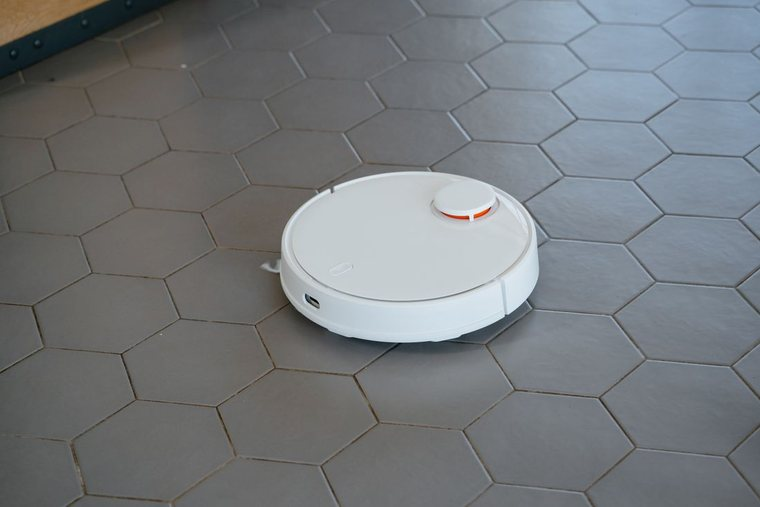
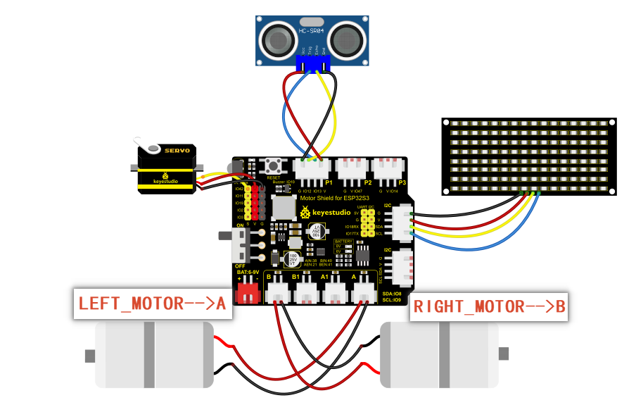
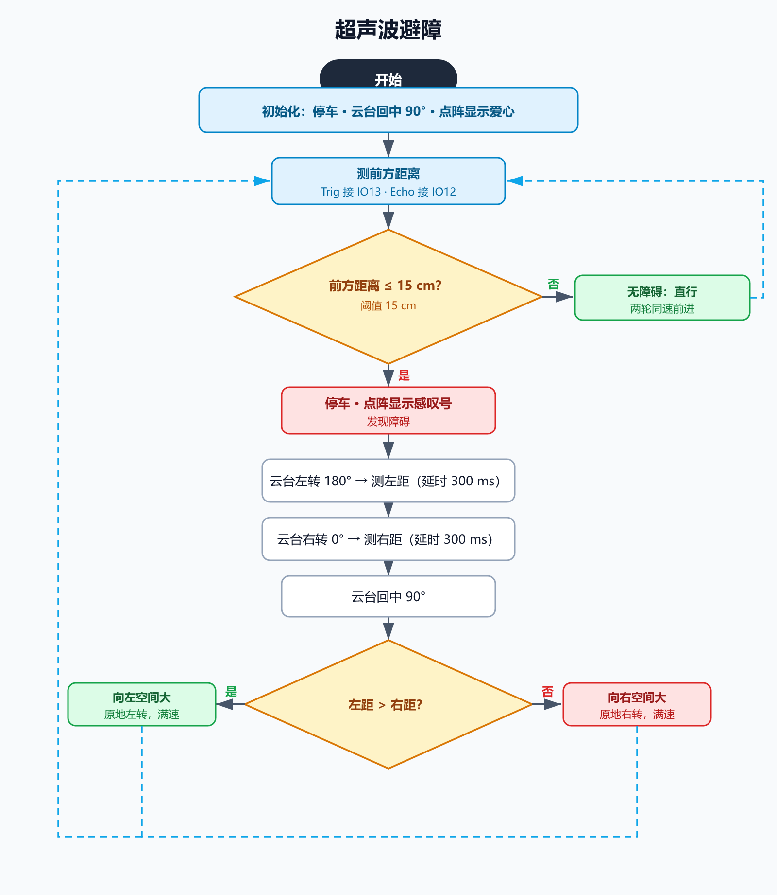

### 项目 4：超声波避障

#### **1. 简介：**

{width=520px}

超声波当眼睛、舵机当脖子、电机当腿、点阵当脸——四个部件第一次一起上场：车自己看路，自己决定往哪边绕。

判断只有一条线：前方 15 厘米以内算障碍。越过这条线，车不会硬顶，而是停下来，把云台转到两侧各量一次，哪边空就往哪边走。两次测量之间留 300 毫秒，让舵机站稳，量出来的数才作数。

八个动作一环扣一环：直行、测距、停车、左看、右看、比较、转向、回中。顺序理清楚，后面写起来就顺。

立在车前的一本书就够试：前方空着时车直行、点阵是爱心；推到离书 15 厘米以内，它停下、感叹号闪一下，云台先转向一侧、点阵换成向左看的图标，量完再转另一侧、换成向右看，两边都比过，朝空间大的那边转半秒，回中，继续往前走。把书挪到车的另一侧，它就会朝反方向绕。

#### **2. 所需清单：**

本课用到的器件：

|     |     |     |
| :---: | :---: | :---: |
| {width=170px}<br><span style="font-size:0.85em">超声波模块（带外壳） ×1</span> | {width=170px}<br><span style="font-size:0.85em">9G 舵机（180°，配十字臂） ×1</span> | {width=170px}<br><span style="font-size:0.85em">DRV8835 电机扩展板 ×1</span> |
| {width=170px}<br><span style="font-size:0.85em">履带底盘总成 ×1</span> | {width=170px}<br><span style="font-size:0.85em">8×16 LED 点阵屏 ×1</span> | {width=170px}<br><span style="font-size:0.85em">ESP32-S3 开发板 ×1</span> |
> ⚠️ **这些器件在第 2 章已经装好在车上，本表只作对照，不用拆下来重装；下面的接线说明只标清接线方式，供对照，不必拆装。完整物料见 1.4 套件清单。**

#### **3. 参数：**

| 项目 | 参数 |
| --- | --- |
| 超声波 | Trig = IO13，Echo = IO12 |
| 云台舵机 | IO42，50 Hz，脉宽 500–2400 µs 对应 0–180° |
| 障碍阈值 | closeDistance = 15 cm（≤ 15 cm 判为有障碍） |
| 左/右测距角度 | 左 180°、右 0°，测完回中 90° |
| 舵机到位延时 | 每次转向后 300 ms |
| 直行速度 | goForward(150) |
| 转向速度 | spinLeft / spinRight(255)，持续 500 ms |
| 点阵引脚 | CLK = IO9，DIN = IO8 |
| 调试串口 | 115200 |

#### **4. 接线说明：**

| 模块 | 引脚 | 主控 GPIO |
| --- | --- | :---: |
| 超声波 | Trig / Echo | IO13 / IO12 |
| 云台舵机 | 信号 | IO42 |
| 左电机（A 路 AIN/AEN） | 方向 / 调速 | IO38 / IO21 |
| 右电机（B 路 BIN/BEN） | 方向 / 调速 | IO40 / IO41 |
| 点阵 | CLK / DIN | IO9 / IO8 |

> **注意**：接线图中的元器件只用于说明接线关系，实际接线时不需要把清单中带外壳的元器件拆开。

> **注意**：ESP32Servo 库用 `ESP32PWM::allocateTimer(0)` 为舵机单独分配定时器，避免与电机 PWM 冲突。



#### **5. 流程图：**

主循环只有一条判断链：先测前方，够远就走；不够远就停车、左右各看一眼，挑宽的那边转过去，再回到测距。



#### **6. 测试代码：**

> ⚠️ **上传代码前，先把 `mini_tracked_tank_robot.py` 上传到板子的 `lib/` 目录**（方法见第 5.5 节），否则导入库时会报 `ImportError`。

```python
from mini_tracked_tank_robot import MiniTrackedTankRobot
import time

car = MiniTrackedTankRobot()
car.Motor_init()
car.Ultrasonic_init(13, 12)
car.Servo_init(42)
car.Matrix_init(9, 8)

CLOSE_DISTANCE = 15        # 小于 15 cm 视为障碍

heart = bytes([
    0x00, 0x00, 0x00, 0x00, 0x08, 0x1C, 0x3E, 0x7C,
    0x7C, 0x3E, 0x1C, 0x08, 0x00, 0x00, 0x00, 0x00
])
alert = bytes([
    0x00, 0x00, 0x00, 0x00, 0x00, 0x00, 0x00, 0x5F,
    0x5F, 0x00, 0x00, 0x00, 0x00, 0x00, 0x00, 0x00
])
look_left = bytes([
    0x00, 0x00, 0x3C, 0x4E, 0x4E, 0x42, 0x3C, 0x00,
    0x00, 0x3C, 0x4E, 0x4E, 0x42, 0x3C, 0x00, 0x00
])
look_right = bytes([
    0x00, 0x00, 0x3C, 0x42, 0x4E, 0x4E, 0x3C, 0x00,
    0x00, 0x3C, 0x42, 0x4E, 0x4E, 0x3C, 0x00, 0x00
])

car.stop_motor()
car.Matrix_display(heart)

while True:
    distance = car.Ultrasonic_distance()
    print('前方距离：', distance, 'cm')

    if distance <= CLOSE_DISTANCE:
        # 有障碍：先停车，亮感叹号
        car.stop_motor()
        car.Matrix_display(alert)
        time.sleep_ms(150)

        # 云台转向一侧，测这一侧距离
        car.Matrix_display(look_left)
        car.Servo_set_angle(180)
        time.sleep_ms(300)
        right_distance = car.Ultrasonic_distance()
        time.sleep_ms(100)

        # 云台转向另一侧，测另一侧距离
        car.Matrix_display(look_right)
        car.Servo_set_angle(0)
        time.sleep_ms(300)
        left_distance = car.Ultrasonic_distance()
        time.sleep_ms(100)

        car.Servo_set_angle(90)

        # 向空间较大的一侧转
        if right_distance > left_distance:
            car.right(255, 255)
        else:
            car.left(255, 255)
        time.sleep_ms(500)
    else:
        # 无障碍，继续直行
        car.Matrix_display(heart)
        car.forward(150, 150)

    time.sleep_ms(100)
```

#### **7. 代码解释：**

**(1) 引入板级库、四路初始化**

```python
from mini_tracked_tank_robot import MiniTrackedTankRobot
import time

car = MiniTrackedTankRobot()
car.Motor_init()
car.Ultrasonic_init(13, 12)
car.Servo_init(42)
car.Matrix_init(9, 8)
```

建 `car` 对象后依次初始化四个部件：`Motor_init()` 管轮子，`Ultrasonic_init(13, 12)` 设 Trig/Echo，`Servo_init(42)` 把云台舵机信号脚设在 IO42，`Matrix_init(9, 8)` 设点阵 CLK/DIN。四个部件这一课第一次一起上场，少初始化哪个哪个就不动。

**(2) 障碍阈值与字模**

```python
CLOSE_DISTANCE = 15        # 小于 15 cm 视为障碍
```

把**多近算障碍**提成常量，改它就改灵敏度：调大车更早躲，调小会贴得更近才反应。下面 heart、alert（感叹号）、look_left、look_right 四张 `bytes` 字模对应直行、遇障、左右张望四种表情，格式同第 1 课。进入循环前的 `car.stop_motor()` 和 `car.Matrix_display(heart)` 让车先停住、亮爱心。

**(3) 测距与分流**

```python
while True:
    distance = car.Ultrasonic_distance()
    print('前方距离：', distance, 'cm')

    if distance <= CLOSE_DISTANCE:
```

每轮先 `Ultrasonic_distance()` 读前方距离，存进 `distance` 并打到 Shell。再用 `if distance <= CLOSE_DISTANCE` 分流：够远走下面的 `else` 直行，够近进这个分支避障。阈值写在常量里，这里只管比较，改灵敏度不用动判断式。

**(4) 停车亮警、云台转向一侧**

```python
        car.stop_motor()
        car.Matrix_display(alert)
        time.sleep_ms(150)

        car.Matrix_display(look_left)
        car.Servo_set_angle(180)
        time.sleep_ms(300)
        right_distance = car.Ultrasonic_distance()
```

判定有障碍后先 `stop_motor()` 停车、`Matrix_display(alert)` 亮感叹号。接着 `Servo_set_angle(180)` 把云台转到一侧，等 `sleep_ms(300)` 让舵机到位再测——不等就转过头，测到的是斜前方。`right_distance` 存这一侧读数；变量名和实际左右对不上没关系，后面只比较大小。

**(5) 测另一侧、云台回中**

```python
        car.Matrix_display(look_right)
        car.Servo_set_angle(0)
        time.sleep_ms(300)
        left_distance = car.Ultrasonic_distance()
        time.sleep_ms(100)

        car.Servo_set_angle(90)
```

`Servo_set_angle(0)` 转到另一侧测 `left_distance`，同样等 300 ms。`time.sleep_ms(100)` 给两次超声波测距之间留间隔。测完 `Servo_set_angle(90)` 让云台回正，免得下一轮直行时超声波歪着看。

**(6) 比较两侧、朝宽处转**

```python
        if right_distance > left_distance:
            car.right(255, 255)
        else:
            car.left(255, 255)
        time.sleep_ms(500)
```

哪边读数大说明哪边空，就往哪边转：`right(255, 255)` / `left(255, 255)` 给满速原地转 500 ms，时间越长转得越多。另一条 `else` 分支是无障碍时的 `car.forward(150, 150)` 直行、点阵保持爱心。循环末尾 `time.sleep_ms(100)` 定下测量节奏。

#### **8. 运行现象：**

上电后云台回中、点阵显示爱心，小车直行，Shell 每轮打印**前方距离：XX cm**：

1. **无障碍**（距离 > 15 cm）：保持直行，点阵爱心。
2. **遇到障碍**（距离 ≤ 15 cm）：停车，点阵感叹号闪一下；云台先转向一侧、点阵显示**向左看**图标并测距，再转向另一侧、显示**向右看**图标并测距；比较两侧距离，朝空间更大的一侧转 500 ms，随后回中继续直行。

小车能绕开前方障碍、不会一直顶着障碍物，点阵状态跟着动作换，就跑对了。

> **已知行为**：`getDistance()` 在超量程时返回 0，而 0 也满足 `≤ 15 cm`，因此超量程会被误判为有障碍并触发避障。实测若出现**空旷处也转向**，可把判断改为 `distance > 0 && distance <= closeDistance`。

> 【图片待补】运行现象实拍：直行、遇障停车、左看测距、右看测距、转向绕行五个状态各拍一张。

> 【图片待补】串口距离输出截图，展示遇障前后的数值变化。

#### **9. 常见问题解决：**

(1) 前方明明空着，车却停车、亮感叹号、左右张望，是因为 `Ultrasonic_distance()` 超量程时返回 0，而 0 也满足 `distance <= CLOSE_DISTANCE`（15 cm），被当成了障碍。把判断改成 `0 < distance <= CLOSE_DISTANCE`，把 0 挡在外面就行。

(2) 云台转过去了，测的却不是正侧方，多半是 `Servo_set_angle(180)` 或 `Servo_set_angle(0)` 之后没等舵机到位就测距。代码里每次转向后的 `time.sleep_ms(300)` 别省，等 300 ms 让云台停稳再读，读数才对得上方向。

(3) 车直行时也歪着头、超声波斜着看，是测完左右两侧后忘了 `Servo_set_angle(90)` 回中。把这句补在比较完两段距离之后，下一轮直行才是正着看。

(4) Shell 报 `ImportError` 说明库没保存到板子的 `lib/` 目录；如果报引脚相关的 `OSError`，就查查 IO13/IO12、IO42、IO9/IO8 这几个初始化脚是不是被重复占用，别让两个部件抢同一根线。
