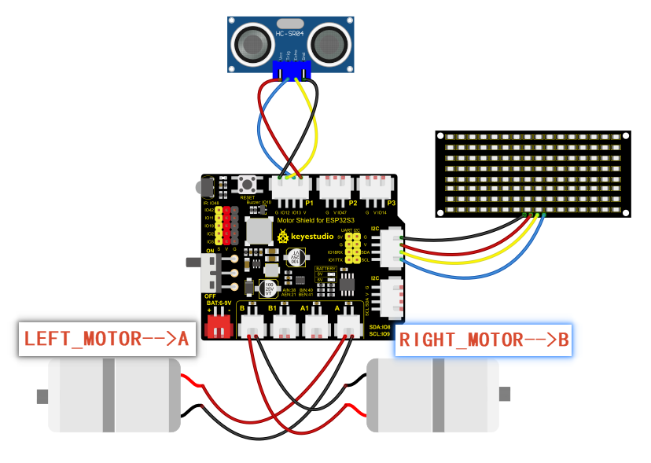
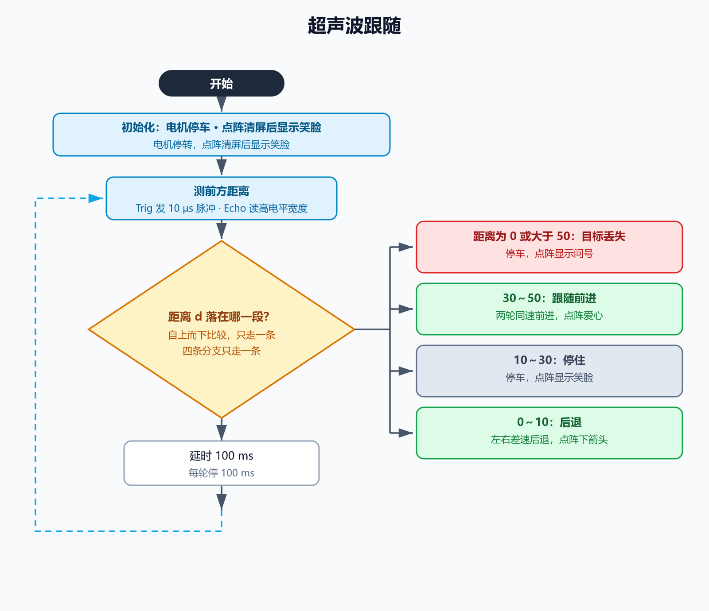

### Project 5: Ultrasonic Following

#### **1. Introduction:**


The car from Lesson 4 goes around obstacles; this lesson does the opposite and makes it actively follow a person: hold your hand 40 cm in front of the car and it follows; move your hand back and it chases forward; bring it within 10 cm and it backs away instead; take your hand away and it stops, with a question mark popping up on the dot matrix.

The eyes are still the ultrasonic module on the pan-tilt, firing one burst forward every 100 milliseconds and working out the distance from the echo, and that single number is then divided into four bands: 30 to 50 cm means follow, 10 to 30 cm means wait, closer than 10 cm means back up, and beyond 50 cm or unreadable means the target is lost.

Each of the four bands corresponds to one action and one expression — heart, smiley, down arrow, question mark. There is no remote control and no line to track; the car decides whether to advance or retreat from this single number alone, and pushing your palm toward it and pulling it back shows the car switching back and forth between the four bands.

#### **2. Parts List:**
Components used in this lesson:

| Ultrasonic module ×1 | 8×16 LED dot matrix display ×1 | DRV8835 motor expansion board ×1 |
| :---: | :---: | :---: |
|  |  |  |
| Mini Tracked Tank Robot bottom assembly ×1 | ESP32-S3 development board ×1 |  |
|  |  |  |
> ⚠️ **These components were already installed on the car in Chapter 2. This table is for reference only, so there is no need to remove and reinstall them; the wiring notes below only describe the wiring method for reference and do not require disassembly. See the kit list in 1.4 for the full bill of materials.**

#### **3. Parameters:**
| Item | Parameter |
| --- | --- |
| Following band | 30–50 cm, move forward |
| Stopping band | 10–30 cm, stop and show the smiley |
| Backing-up band | closer than 10 cm, back up |
| Target lost | farther than 50 cm or invalid reading, stop and show the question mark |
| Ranging period | 100 ms |
| Forward speed | 150 for each wheel |
| Backward speed | left wheel 150, right wheel 105 (the car drifts slightly while backing up) |
| Debug output | Thonny Shell (USB REPL, 115200) |
| Dot matrix icons | heart = following, smiley = stopped, down arrow = backing up, question mark = lost |

#### **4. Wiring:**

| Module | Pin | Controller GPIO |
| --- | --- | :---: |
| Ultrasonic | Trig | IO13 |
| Ultrasonic | Echo | IO12 |
| Dot matrix | CLK | IO9 |
| Dot matrix | DIN | IO8 |
| Left wheel motor | AIN (direction) | IO38 |
| Left wheel motor | AEN (speed) | IO21 |
| Right wheel motor | BIN (direction) | IO40 |
| Right wheel motor | BEN (speed) | IO41 |

> **Note**: the components in the wiring diagram are only there to explain the wiring relationship; when you wire it up, there is no need to take apart a module that has an enclosure.



#### **5. Flowchart:**

The main loop has only one decision chain, and each of the four bands corresponds to a set of actions:



#### **6. Test Code:**
> ⚠️ **Before uploading the code, upload `mini_tracked_tank_robot.py` to the `lib/` directory on the board** (see Section 5.5), otherwise importing the library raises `ImportError`.

```python
from mini_tracked_tank_robot import MiniTrackedTankRobot
import time

car = MiniTrackedTankRobot()
car.Motor_init()
car.Ultrasonic_init(13, 12)
car.Matrix_init(9, 8)

SAFE_DISTANCE = 30         # 30-50 cm: follow
CLOSE_DISTANCE = 10        # Closer than 10 cm: back off
MAX_DISTANCE = 50          # Farther than 50 cm: target lost

heart = bytes([
    0x00, 0x00, 0x00, 0x00, 0x08, 0x1C, 0x3E, 0x7C,
    0x7C, 0x3E, 0x1C, 0x08, 0x00, 0x00, 0x00, 0x00
])
smile = bytes([
    0x00, 0x00, 0x1C, 0x02, 0x02, 0x02, 0x5C, 0x40,
    0x40, 0x5C, 0x02, 0x02, 0x02, 0x1C, 0x00, 0x00
])
arrow_down = bytes([
    0x00, 0x00, 0x00, 0x00, 0x10, 0x30, 0x7E, 0xFE,
    0xFE, 0x7E, 0x30, 0x10, 0x00, 0x00, 0x00, 0x00
])
question = bytes([
    0x00, 0x00, 0x00, 0x00, 0x00, 0x04, 0x02, 0x51,
    0x59, 0x06, 0x00, 0x00, 0x00, 0x00, 0x00, 0x00
])

car.stop_motor()
car.Matrix_display(smile)

while True:
    distance = car.Ultrasonic_distance()
    print('Current distance: ', distance, 'cm')

    if SAFE_DISTANCE < distance <= MAX_DISTANCE:
        # 30-50 cm: follow the target
        car.Matrix_display(heart)
        car.forward(150, 150)

    elif CLOSE_DISTANCE <= distance <= SAFE_DISTANCE:
        # 10-30 cm: good distance, hold still
        car.stop_motor()
        car.Matrix_display(smile)

    elif 0 < distance < CLOSE_DISTANCE:
        # Too close: reverse with differential speed
        car.Matrix_display(arrow_down)
        car.back(150, 105)

    else:
        # Farther than 50 cm or invalid reading: target lost
        car.stop_motor()
        car.Matrix_display(question)

    time.sleep_ms(100)
```

#### **7. Code Explanation:**
**(1) Importing the board-level library and initializing three paths**

```python
from mini_tracked_tank_robot import MiniTrackedTankRobot
import time

car = MiniTrackedTankRobot()
car.Motor_init()
car.Ultrasonic_init(13, 12)
car.Matrix_init(9, 8)
```

Create the `car` object and initialize the motors, the ultrasonic sensor (Trig IO13 / Echo IO12), and the dot matrix (CLK IO9 / DIN IO8) in turn. This lesson does not use the servo, so there is no `car.Servo_init()`. The library file must first be uploaded to the `lib/` directory on the board.

**(2) Three distance thresholds**

```python
SAFE_DISTANCE = 30         # 30-50 cm: follow
CLOSE_DISTANCE = 10        # Closer than 10 cm: back off
MAX_DISTANCE = 50          # Farther than 50 cm: target lost
```

Three lines cut the space ahead into four bands. They are promoted to constants so they are easy to tune: to follow from farther away, just raise `MAX_DISTANCE` to 60, and neither the display nor the actions in the branches need to change.

**(3) Reading the distance and printing to the Shell**

```python
while True:
    distance = car.Ultrasonic_distance()
    print('Current distance: ', distance, 'cm')
```

Each round reads the distance once with `car.Ultrasonic_distance()`, stores it in `distance`, and prints it to the Shell so the reading can be checked directly. The four branches below all rely on this value. The `time.sleep_ms(100)` at the end of the loop sets a 100 ms measurement period.

**(4) Following band: move forward**

```python
    if SAFE_DISTANCE < distance <= MAX_DISTANCE:
        # 30-50 cm: follow the target
        car.Matrix_display(heart)
        car.forward(150, 150)
```

At 30–50 cm, `car.forward(150, 150)` drives both wheels at the same speed so the car follows the target, and the dot matrix shows a heart. The chained comparison `< distance <=` writes the band on one line, which is clearer than splitting it into two conditions.

**(5) Stopping band: stay still**

```python
    elif CLOSE_DISTANCE <= distance <= SAFE_DISTANCE:
        # 10-30 cm: good distance, hold still
        car.stop_motor()
        car.Matrix_display(smile)
```

10–30 cm counts as **just right**, so `car.stop_motor()` stops the car and the smiley is shown. Note that both ends are closed here: the boundary value 30 belongs to this band, which is why the previous branch uses `< SAFE_DISTANCE` to avoid overlap — otherwise 30 cm would satisfy both bands.

**(6) Backing-up band: differential reverse**

```python
    elif 0 < distance < CLOSE_DISTANCE:
        # Too close: reverse with differential speed
        car.Matrix_display(arrow_down)
        car.back(150, 105)
```

Closer than 10 cm is too close, so `car.back(150, 105)` drives the two wheels in reverse with unequal speeds (150 and 105) and the car backs up while drifting slightly instead of reversing in a straight line. The `0 <` in front blocks a reading of 0 (the out-of-range return value), so that **no target** is not mistaken for **too close**.

**(7) Target lost: question mark**

```python
    else:
        # Farther than 50 cm or invalid reading: target lost
        car.stop_motor()
        car.Matrix_display(question)
```

Everything else (farther than 50 cm or an invalid reading) stops the car and shows the question mark. This `else` is the fallback that guarantees every reading has a matching action, so the car never rushes off outside the bands.

#### **8. Expected Behavior:**
After power-on the dot matrix shows a smiley first, and the Shell prints one line every 100 ms:

```text
Current distance: 42 cm
Current distance: 41 cm
Current distance: 18 cm
Current distance: 7 cm
Current distance: 0 cm
```

Four gestures made in front of the car produce four kinds of feedback:

| Hand movement | Distance reading | Car behavior | Dot matrix |
| --- | --- | --- | --- |
| Hold at 30–50 cm | 30–50 | Follow forward | Heart |
| Hold at 10–30 cm | 10–30 | Stop | Smiley |
| Move within 10 cm | Less than 10 | Back up | Down arrow |
| Take your hand away | 0 or more than 50 | Stop | Question mark |

> [Image to be added] A screenshot of the four distance bands in the Shell below Thonny, showing the switching between following, stopping, and backing up.

If the car rushes forward as you get closer, first check whether the two ultrasonic wires are swapped: swapping Trig and Echo keeps the reading at 0.

#### **9. Troubleshooting:**

(1) The closer your hand gets, the more the car rushes forward. First check whether the two ultrasonic wires are swapped: in the code `car.Ultrasonic_init(13, 12)` means Trig is on IO13 and Echo on IO12, and if they are swapped the reading stays at 0 and the actions become chaotic. Swap the two signal wires of the 4P connector back and check whether the **Current distance** in the Shell below Thonny is correct.

(2) When your hand waves slightly near the 30 cm boundary the car keeps twitching between driving forward and stopping, because the thresholds are too close together. Leave some margin between `SAFE_DISTANCE = 30` and `MAX_DISTANCE = 50`; do not put the two lines too close, and with a steadier reading the twitching stops.

(3) The car keeps showing the question mark and does not move. First check whether **Current distance** in the Shell is 0 or larger than `MAX_DISTANCE` (50 cm); both cases fall into the target-lost `else`. Move your hand to somewhere between 10 and 50 cm and try again, or raise `MAX_DISTANCE` to 60 if you want to follow from farther away.

(4) A Shell `ImportError` means the board-level library was not saved to the `lib/` directory on the board; `NameError: name 'SAFE_DISTANCE' isn't defined` means the names of the three threshold constants have diverged. Make `SAFE_DISTANCE = 30`, `CLOSE_DISTANCE = 10`, and `MAX_DISTANCE = 50` before the loop match the names used below.
