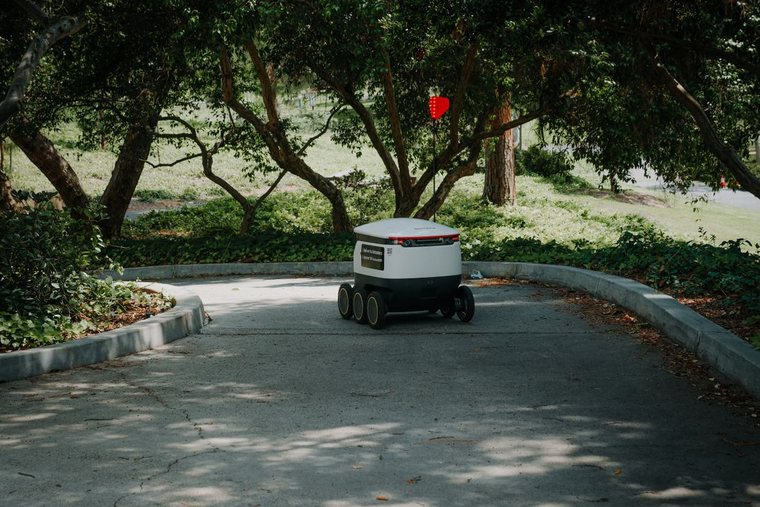

### 项目 5：超声波跟随

#### **1. 简介：**

{width=520px}

第 4 课的车遇到障碍会绕开走，这一课反过来，让它主动跟着人走：手伸到车头前 40 厘米，车跟上来；手往后退，它往前追；贴近到 10 厘米以内，它反而往后缩；手一拿走，它停住，点阵上跳出一个问号。

眼睛还是云台上那只超声波模块，每 100 毫秒往前打一发，用回声算出距离，再把这一个数字分成四段：30 到 50 厘米跟着走，10 到 30 厘米等着，10 厘米以内后退，超过 50 厘米或者读不到就当目标丢了。

四段各对应一个动作和一张表情——爱心、笑脸、下箭头、问号。没有遥控器，也没有循迹线，车只凭这一个数字决定进退；手掌在车前推近再拉远，能看到它在这四段之间来回切。

#### **2. 所需清单：**

本课用到的器件：

|     |     |     |
| :---: | :---: | :---: |
| {width=170px}<br><span style="font-size:0.85em">超声波模块（带外壳） ×1</span> | {width=170px}<br><span style="font-size:0.85em">8×16 LED 点阵屏 ×1</span> | {width=170px}<br><span style="font-size:0.85em">DRV8835 电机扩展板 ×1</span> |
| {width=170px}<br><span style="font-size:0.85em">履带底盘总成（履带 + 电机 + 轮子） ×1</span> | {width=170px}<br><span style="font-size:0.85em">ESP32-S3 开发板 ×1</span> |  |
> ⚠️ **这些器件在第 2 章已经装好在车上，本表只作对照，不用拆下来重装；下面的接线说明只标清接线方式，供对照，不必拆装。完整物料见 1.4 套件清单。**

#### **3. 参数：**

| 项目 | 参数 |
| --- | --- |
| 跟随区间 | 30～50 cm，前进 |
| 停止区间 | 10～30 cm，停车显示笑脸 |
| 后退区间 | 小于 10 cm，后退 |
| 目标丢失 | 大于 50 cm 或读数无效，停车显示问号 |
| 测距周期 | 100 ms |
| 前进速度 | 左右轮各 150 |
| 后退速度 | 左轮 105、右轮 150（后退时车身略偏） |
| 串口波特率 | 115200 |
| 点阵图标 | 爱心=跟随，笑脸=停止，下箭头=后退，问号=丢失 |

#### **4. 接线说明：**

| 模块 | 引脚 | 主控 GPIO |
| --- | --- | :---: |
| 超声波 | Trig | IO13 |
| 超声波 | Echo | IO12 |
| 点阵 | CLK | IO9 |
| 点阵 | DIN | IO8 |
| 左轮电机 | AIN（方向） | IO38 |
| 左轮电机 | AEN（调速） | IO21 |
| 右轮电机 | BIN（方向） | IO40 |
| 右轮电机 | BEN（调速） | IO41 |

> **注意**：接线图中的元器件只用于说明接线关系，实际接线时不需要把清单中带外壳的元器件拆开。


#### **5. 流程图：**

主循环只有一条判断链，四个区间各对应一组动作：


#### **6. 测试代码：**

> ⚠️ **上传代码前，先把 `mini_tracked_tank_robot.py` 上传到板子的 `lib/` 目录**（方法见第 5.5 节），否则导入库时会报 `ImportError`。

```python
from mini_tracked_tank_robot import MiniTrackedTankRobot
import time

car = MiniTrackedTankRobot()
car.Motor_init()
car.Ultrasonic_init(13, 12)
car.Matrix_init(9, 8)

SAFE_DISTANCE = 30         # 30~50 cm：跟随
CLOSE_DISTANCE = 10        # 小于 10 cm：后退
MAX_DISTANCE = 50          # 大于 50 cm：目标丢失

heart = bytes([
    0x00, 0x00, 0x00, 0x00, 0x08, 0x1C, 0x3E, 0x7C,
    0x7C, 0x3E, 0x1C, 0x08, 0x00, 0x00, 0x00, 0x00
])
smile = bytes([
    0x00, 0x00, 0x1C, 0x02, 0x02, 0x02, 0x5C, 0x40,
    0x40, 0x5C, 0x02, 0x02, 0x02, 0x1C, 0x00, 0x00
])
arrow_down = bytes([
    0x00, 0x00, 0x00, 0x00, 0x10, 0x30, 0x7E, 0xFE,
    0xFE, 0x7E, 0x30, 0x10, 0x00, 0x00, 0x00, 0x00
])
question = bytes([
    0x00, 0x00, 0x00, 0x00, 0x00, 0x04, 0x02, 0x51,
    0x59, 0x06, 0x00, 0x00, 0x00, 0x00, 0x00, 0x00
])

car.stop_motor()
car.Matrix_display(smile)

while True:
    distance = car.Ultrasonic_distance()
    print('当前距离：', distance, 'cm')

    if SAFE_DISTANCE < distance <= MAX_DISTANCE:
        # 30~50 cm：跟随前进
        car.Matrix_display(heart)
        car.forward(150, 150)

    elif CLOSE_DISTANCE <= distance <= SAFE_DISTANCE:
        # 10~30 cm：距离合适，停住
        car.stop_motor()
        car.Matrix_display(smile)

    elif 0 < distance < CLOSE_DISTANCE:
        # 太近了，差速后退
        car.Matrix_display(arrow_down)
        car.back(150, 105)

    else:
        # 大于 50 cm 或读数无效：目标丢失
        car.stop_motor()
        car.Matrix_display(question)

    time.sleep_ms(100)
```

#### **7. 代码解释：**

**(1) 引入板级库、三路初始化**

```python
from mini_tracked_tank_robot import MiniTrackedTankRobot
import time

car = MiniTrackedTankRobot()
car.Motor_init()
car.Ultrasonic_init(13, 12)
car.Matrix_init(9, 8)
```

建 `car` 对象，依次初始化电机、超声波（Trig IO13 / Echo IO12）、点阵（CLK IO9 / DIN IO8）。这一课不用舵机，所以没有 `Servo_init()`。库文件要先传到板子 `lib/` 目录。

**(2) 三条距离阈值**

```python
SAFE_DISTANCE = 30         # 30~50 cm：跟随
CLOSE_DISTANCE = 10        # 小于 10 cm：后退
MAX_DISTANCE = 50          # 大于 50 cm：目标丢失
```

三条线把前方切成四段。提成常量是为了好调：想跟得更远，把 `MAX_DISTANCE` 加到 60 就行，各分支的显示和动作都不用改。

**(3) 读距离、打串口**

```python
while True:
    distance = car.Ultrasonic_distance()
    print('当前距离：', distance, 'cm')
```

每轮用 `Ultrasonic_distance()` 读一次距离存进 `distance`，并打到 Shell，方便对着看读数。后面四个分支全靠这个值判断。循环末尾的 `time.sleep_ms(100)` 定下 100 ms 的测量周期。

**(4) 跟随区间：前进**

```python
    if SAFE_DISTANCE < distance <= MAX_DISTANCE:
        car.Matrix_display(heart)
        car.forward(150, 150)
```

30～50 cm 时 `forward(150, 150)` 让两轮同速前进，车跟着目标走，点阵显示爱心。链式比较 `< distance <=` 把区间写在一行，比拆成两个条件清楚。

**(5) 停止区间：停车**

```python
    elif CLOSE_DISTANCE <= distance <= SAFE_DISTANCE:
        car.stop_motor()
        car.Matrix_display(smile)
```

10～30 cm 算**距离正好**，`stop_motor()` 停车、显示笑脸。注意这里两边都闭合：边界值 30 归这一档，所以上一分支用 `< SAFE_DISTANCE` 避开重叠，否则 30 cm 会同时满足两段。

**(6) 后退区间：差速后退**

```python
    elif 0 < distance < CLOSE_DISTANCE:
        car.Matrix_display(arrow_down)
        car.back(150, 105)
```

小于 10 cm 太近了，`back(150, 105)` 让两轮反向、且左右速度不等（150 与 105），车一边退一边略偏，不是笔直倒。前面的 `0 <` 挡住读数 0（超量程返回值），避免把**没目标**误当成**太近**。

**(7) 目标丢失：问号**

```python
    else:
        car.stop_motor()
        car.Matrix_display(question)
```

其余情况（大于 50 cm 或读数无效）停车并显示问号。这个 `else` 兜底保证任何读数都有对应动作，车不会在边界外乱冲。

#### **8. 运行现象：**

上电后点阵先亮笑脸，Shell 每 100 ms 打印一行：

```text
超声波跟随启动
当前距离：42 cm
当前距离：41 cm
当前距离：18 cm
当前距离：7 cm
当前距离：0 cm
```

对着车头做四个动作，能看到四种反馈：

| 手的动作 | 距离读数 | 车的行为 | 点阵 |
| --- | --- | --- | --- |
| 停在 30～50 cm | 30～50 | 向前跟 | 爱心 |
| 停在 10～30 cm | 10～30 | 停住 | 笑脸 |
| 贴到 10 cm 以内 | 小于 10 | 往后退 | 向下箭头 |
| 手掌拿开 | 0 或大于 50 | 停住 | 问号 |

> 【图片待补】Thonny 下方的 Shell里四段距离读数的截图，能看出跟随、停止、后退三种状态切换。

#### **9. 常见问题解决：**

(1) 手越靠近车反而往前冲，先查超声波两根线有没有插反：代码里 `Ultrasonic_init(13, 12)` 是 Trig 接 IO13、Echo 接 IO12，对调后读数会一直是 0，动作就跟着乱了。把 4P 插头的两根信号线换回来，再看 Thonny 下方 Shell 的**当前距离**对不对。

(2) 手在 30 cm 边界附近轻轻一晃，车就在前进和停车之间来回抽，是三档阈值挨得太近了。`SAFE_DISTANCE = 30`、`MAX_DISTANCE = 50` 之间留点余量，别把两条线贴太紧，读数稳一点就不抽了。

(3) 车一直显示问号不动，先看 Shell 里的**当前距离**是不是 0 或大于 `MAX_DISTANCE`（50 cm），这两种情况都落进目标丢失那个 `else`。手拿到 10～50 cm 之间再试，想跟得更远就把 `MAX_DISTANCE` 加到 60。

(4) Shell 报 `ImportError`，是板级库没保存到板子的 `lib/` 目录；报 `NameError: name 'SAFE_DISTANCE' isn't defined`，则是三条阈值常量的名字改岔了，把循环前的 `SAFE_DISTANCE = 30`、`CLOSE_DISTANCE = 10`、`MAX_DISTANCE = 50` 和下面用的名字统一好。
