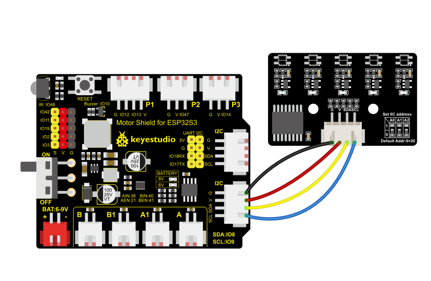
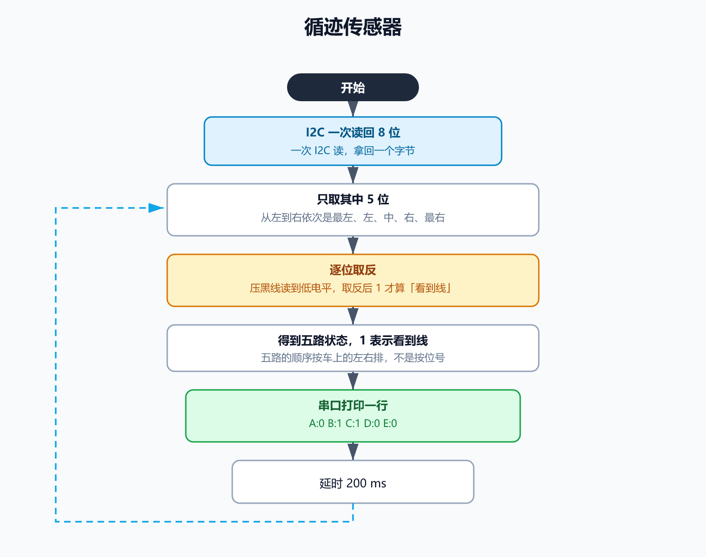

### Project 6: Line-Tracking Sensor

#### **1. Introduction:**

Flip the car over and the side facing the ground carries a row of five small black squares. Each one holds a pair of infrared tubes: one shines down at the floor, the other watches the light that comes back — a white surface reflects it, black absorbs it, and the receiving tube turns that difference into a high or a low level.

If each of the five probes needed a pin of its own, the controller would have to free up more room, so they all hang off a single PCF8574 and report back over just two wires (IO8 and IO9). These five channels are really five bits of one byte, and together they form a number from 0 to 31.

There is no need to make the car drive yet; just print the five channels to the Shell, one line every 200 milliseconds. With the car on white paper all five read 0; put a finger or a strip of black tape under one probe and that bit turns 1; press the whole row onto a black line and all five turn 1.

Five 0s and 1s lined up from left to right are the car's entire knowledge of the ground under its feet — the next lesson drives with exactly that.

#### **2. Parts List:**
Components used in this lesson:

|     |     |
| :---: | :---: |
| <br><span style="font-size:0.85em">Mini Tracked Tank Robot bottom assembly ×1</span> | <br><span style="font-size:0.85em">DRV8835 motor expansion board ×1</span> |
| <br><span style="font-size:0.85em">ESP32-S3 development board ×1</span> | <br><span style="font-size:0.85em">5-channel IIC line-tracking sensor module ×1</span> |

> ⚠️ **This set of sensors was fixed in place and its wiring was run during the Chapter 2 assembly. This table is for reference only, so there is no need to remove anything; the wiring notes below only describe the wiring method for reference and do not require disassembly. See the kit list in 1.4 for the full bill of materials.**

#### **3. Parameters:**
| Item | Parameter |
| --- | --- |
| Expander chip | PCF8574, I2C to 8-bit parallel |
| I2C address | 0x20 (A2 A1 A0 all tied to ground) |
| SDA / SCL | IO8 / IO9 |
| Bus rate | 400 kHz (fast mode) |
| Channels used | 5: P4 P0 P1 P2 P3 (left → right) |
| Level logic | Reads 0 on a black line; the code inverts it to 1 |
| Print period | 200 ms |

#### **4. Wiring:**

| Signal | Controller GPIO | Note |
| --- | :---: | --- |
| SDA | IO8 | Shared with the dot matrix DIN; the dot matrix is not used in this lesson |
| SCL | IO9 | Shared with the dot matrix CLK; the dot matrix is not used in this lesson |
| VCC | 5V | Supplied by the expansion board |
| GND | GND | Common ground |



#### **5. Flowchart:**

The read sequence has only three steps, but the bit order and the inversion are the two places where it is easiest to go wrong:



#### **6. Test Code:**
> ⚠️ **Before uploading the code, upload `mini_tracked_tank_robot.py` to the `lib/` directory on the board** (see Section 5.5), otherwise importing the library raises `ImportError`.

```python
from mini_tracked_tank_robot import MiniTrackedTankRobot
import time

car = MiniTrackedTankRobot()
car.Line_init(9, 8)

time.sleep(1)

while True:
    A, B, C, D, E = car.Line_get()
    print('A:{}  B:{}  C:{}  D:{}  E:{}'.format(A, B, C, D, E))
    time.sleep_ms(200)
```

#### **7. Code Explanation:**
**(1) Importing the board-level library and creating the object**

```python
from mini_tracked_tank_robot import MiniTrackedTankRobot
import time

car = MiniTrackedTankRobot()
```

As in the previous lessons, take the `MiniTrackedTankRobot` class from the board-level library and create the `car` object, which supplies the line-tracking readings. The library file must first be uploaded to the `lib/` directory on the board, otherwise the import fails.

**(2) Initializing line tracking**

```python
car.Line_init(9, 8)

time.sleep(1)
```

`car.Line_init(9, 8)` sets the I2C bus used for line tracking to SCL = IO9 and SDA = IO8 (the PCF8574 address 0x20 is hard-coded in the library), with SCL first and SDA second. The `time.sleep(1)` that follows waits one second so the PCF8574 has settled after power-on before the first read, which avoids garbage in the first few frames.

**(3) Reading the five probes**

```python
    A, B, C, D, E = car.Line_get()
```

`car.Line_get()` returns the levels of all five probes at once, assigned left to right to A through E. The library has already inverted the levels internally, so here 1 means the probe is over a black line and 0 means a white surface — use the values directly, no further inversion is needed.

**(4) Printing and the delay**

```python
    print('A:{}  B:{}  C:{}  D:{}  E:{}'.format(A, B, C, D, E))
    time.sleep_ms(200)
```

`format` fills the five values into the string so the Shell prints one line at a time, which is easy to read side by side. `time.sleep_ms(200)` prints once every 200 ms; make it smaller if you want a finer view. Put a finger under one probe and the matching position jumps from 0 to 1.

#### **8. Expected Behavior:**
After power-on the Shell prints one line every 200 ms, with the five digits matching the five probes from left to right:

```text
A:0  B:0  C:1  D:0  E:0
A:0  B:1  C:1  D:0  E:0
A:0  B:1  C:0  D:1  E:0
A:1  B:1  C:1  D:1  E:1
```

With the car on white paper all five are 0; put a finger or a strip of black tape under one probe and that position turns 1; press the whole row onto a black line and all five turn 1.

> [Image to be added] A photo of the whole car sitting on the black line with all five Shell digits at 1 (including the Shell window).

Two common phenomena:

- All five numbers stay at 0 even when your finger blocks a probe — first check whether the 4P plug is seated all the way, then check whether SDA and SCL are swapped. Swapping I2C wires will not burn anything, but not a single byte will come back.
- Readings jump occasionally — the probes are too high off the ground (5–8 mm is normal) or ambient light is too strong. Line-tracking sensors work by reflected light, and direct midday sun makes them read white constantly.

#### **9. Troubleshooting:**

(1) Clicking Run in Thonny raises `ImportError: no module named 'mini_tracked_tank_robot'`, which means the board-level library was not saved to the board. Use Thonny's **Save to board** to put `mini_tracked_tank_robot.py` into the `lib/` directory and run it again.

(2) The five numbers in the Shell below Thonny stay at 0 even when a finger is placed under a probe. First check whether the 4P plug of the line-tracking board is pushed all the way in, then check whether SDA and SCL are swapped — in the code `car.Line_init(9, 8)` means SCL = IO9 and SDA = IO8, and a reversed I2C connection will not burn the board but will not read back a single byte either.

(3) Readings that jump occasionally are usually caused by the probes sitting too high above the ground or by strong ambient light. Line tracking works on reflected light, so keep the probes 5–8 mm above the floor; direct midday sunlight makes them read white all the time, so move into the shade or shade the sensor and try again.

(4) A Shell `NameError: name 'A' isn't defined` means A is being printed before `A, B, C, D, E = car.Line_get()` has run; put the probe-reading line before the print.
