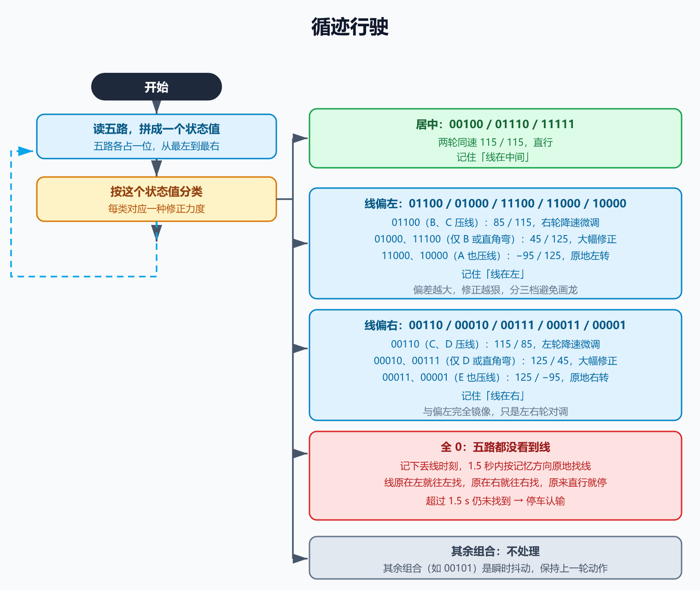

### Project 7: Line Following

#### **1. Introduction:**

Put the car on a black track, press reset, and it completes a lap on its own: fast on the straights, slowing the inner wheel on gentle curves to hug the line again, and reversing the inner wheel on right-angle corners to pivot around. The previous lesson only printed the five readings to the Shell; now those readings actually drive the car.

Which side the line is on is decided entirely by the five probes under the car. Five 0s and 1s make 32 combinations, of which a dozen or so show up in a real run, and each one maps to a pair of wheel speeds: both wheels at the same speed when the line is centered; slow the inner wheel and keep the outer one going when it drifts a little; reverse the inner wheel when it drifts a lot, to twist the body back.

Losing the line has a remedy too. Seams, reflections, and the nose lifting through a corner can all make the five probes read white at the same time; the car remembers whether the line was last on the left or on the right and keeps searching in that direction for 1.5 seconds — if it finds the line it carries on, if not it stops.

With the car running straight along the line, push it to one side and it steers itself back; cut a gap in the line and it charges along its previous heading for 1.5 seconds before stopping and giving up.

#### **2. Parts List:**
Components used in this lesson:

| Mini Tracked Tank Robot bottom assembly ×1 | DRV8835 motor expansion board ×1 | ESP32-S3 development board ×1 |
| :---: | :---: | :---: |
|  |  |  |
| 5-channel IIC line-tracking sensor module ×1 |  |  |
|  |  |  |
> ⚠️ **This lesson adds no new components; everything was already installed in Chapter 2, so nothing needs to be removed. The wiring notes below only describe the wiring method for reference and do not require disassembly. See the kit list in 1.4 for the full bill of materials.**

#### **3. Parameters:**
| Item | Parameter |
| --- | --- |
| Straight-line speed | 115 |
| Fine-correction speed | inner wheel 85, outer wheel 115 |
| Sharp-turn speed | inner wheel 45, outer wheel 125 |
| Pivot speed | inner wheel reverse 95, outer wheel forward 125 |
| Line-lost memory window | 1500 ms |
| Control period | 5 ms |
| Speed range | −255 to +255 (a negative value means reverse) |

#### **4. Wiring:**

| Signal | Controller GPIO |
| --- | :---: |
| SDA (line tracking) | IO8 |
| SCL (line tracking) | IO9 |
| Left wheel AIN / AEN | IO38 / IO21 |
| Right wheel BIN / BEN | IO40 / IO41 |

#### **5. Flowchart:**

The five-bit code `state` is the fork in the whole program; look at this diagram before reading the `if / elif` chain below:



#### **6. Test Code:**
> ⚠️ **Before uploading the code, upload `mini_tracked_tank_robot.py` to the `lib/` directory on the board** (see Section 5.5), otherwise importing the library raises `ImportError`.

```python
from mini_tracked_tank_robot import MiniTrackedTankRobot
import time

car = MiniTrackedTankRobot()
car.Motor_init()
car.Line_init(9, 8)

BASE_SPEED = 115           # Base speed for driving straight
RECOVER_IN = 95            # Inner wheel reverse speed for sharp turns
RECOVER_OUT = 125          # Outer wheel forward speed for sharp turns

last_dir = 0               # 0 = straight, 1 = line on the left, 2 = line on the right
lost_start = 0             # Time the line was first lost, 0 means the line is not lost

car.stop_motor()
print('Line tracking started')
time.sleep(2)              # Same as the Arduino version: start tracking 2 seconds after power-on

while True:
    A, B, C, D, E = car.Line_get()
    state = (A << 4) | (B << 3) | (C << 2) | (D << 1) | E

    if state != 0:
        lost_start = 0     # On the line: clear the lost-line timer

    if state in (0b00100, 0b01110, 0b11111):
        car.drive(BASE_SPEED, BASE_SPEED)          # Centered: drive straight
        last_dir = 0

    elif state == 0b01100:
        car.drive(85, BASE_SPEED)                  # Drifting left: slow the left wheel
        last_dir = 1

    elif state in (0b01000, 0b11100):
        car.drive(45, RECOVER_OUT)                 # Clearly to the left
        last_dir = 1

    elif state in (0b11000, 0b10000):
        car.drive(-RECOVER_IN, RECOVER_OUT)        # Far left: spin left in place
        last_dir = 1

    elif state == 0b00110:
        car.drive(BASE_SPEED, 85)                  # Drifting right: slow the right wheel
        last_dir = 2

    elif state in (0b00010, 0b00111):
        car.drive(RECOVER_OUT, 45)                 # Clearly to the right
        last_dir = 2

    elif state in (0b00011, 0b00001):
        car.drive(RECOVER_OUT, -RECOVER_IN)        # Far right: spin right in place
        last_dir = 2

    elif state == 0b00000:
        # All five sensors off the line: search in the last known direction
        if lost_start == 0:
            lost_start = time.ticks_ms()

        if time.ticks_diff(time.ticks_ms(), lost_start) < 1500:
            if last_dir == 1:
                car.drive(-RECOVER_IN, RECOVER_OUT)    # The line was on the left
            elif last_dir == 2:
                car.drive(RECOVER_OUT, -RECOVER_IN)    # The line was on the right
            else:
                car.stop_motor()                       # Was driving straight: stop
        else:
            car.stop_motor()                           # Timed out without finding the line: stop

    # Other combinations (e.g. 0b01111, 0b11110) are sensor transitions: keep the last motor command

    time.sleep_ms(5)
```

#### **7. Code Explanation:**
**(1) Importing the board-level library, initializing line tracking and motors**

```python
from mini_tracked_tank_robot import MiniTrackedTankRobot
import time

car = MiniTrackedTankRobot()
car.Motor_init()
car.Line_init(9, 8)
```

`MiniTrackedTankRobot` packs the motors, line tracking and servo into one class; `car.Motor_init()` sets up the motor pins first, then `car.Line_init(9, 8)` tells the library that the line-tracking SCL is on IO9 and SDA on IO8 — the order cannot be reversed. If you rewire it, change these two numbers.

**(2) Speed constants, line-lost state and the start-up delay**

```python
BASE_SPEED = 115           # Base speed for driving straight
RECOVER_IN = 95            # Inner wheel reverse speed for sharp turns
RECOVER_OUT = 125          # Outer wheel forward speed for sharp turns

last_dir = 0               # 0 = straight, 1 = line on the left, 2 = line on the right
lost_start = 0             # Time the line was first lost, 0 means the line is not lost

car.stop_motor()
print('Line tracking started')
time.sleep(2)              # Same as the Arduino version: start tracking 2 seconds after power-on
```

The three speed constants are gathered at the top, so tuning how fast the car goes only means changing these lines: `BASE_SPEED` rules the straights, while `RECOVER_IN/OUT` rule the inner-wheel reverse and outer-wheel forward speeds in a sharp turn. `last_dir` remembers which side the line was last on, and `lost_start` records when the line was lost, with 0 meaning it is not lost. Starting with `car.stop_motor()` and then `sleep(2)` gives you two seconds to get your hands clear so the car does not shoot off the moment it powers up.

**(3) Packing the five readings into a five-bit binary number**

```python
    A, B, C, D, E = car.Line_get()
    state = (A << 4) | (B << 3) | (C << 2) | (D << 1) | E

    if state != 0:
        lost_start = 0     # On the line: clear the lost-line timer
```

`car.Line_get()` returns the 0/1 value of all five probes at once, and shifting and OR-ing them together builds a `state` from 0 to 31: A is the most significant bit and E the least significant, so you can see which channels are on the line from where the 1s are. Every decision below looks only at this one number. As long as `state` is not 0 (still on the line), `lost_start` is reset to zero, which cancels the current line-lost timing.

**(4) Driving straight when centered and correcting left in stages**

```python
    if state in (0b00100, 0b01110, 0b11111):
        car.drive(BASE_SPEED, BASE_SPEED)          # Centered: drive straight
        last_dir = 0

    elif state == 0b01100:
        car.drive(85, BASE_SPEED)                  # Drifting left: slow the left wheel
        last_dir = 1

    elif state in (0b01000, 0b11100):
        car.drive(45, RECOVER_OUT)                 # Clearly to the left
        last_dir = 1

    elif state in (0b11000, 0b10000):
        car.drive(-RECOVER_IN, RECOVER_OUT)        # Far left: spin left in place
        last_dir = 1
```

The two arguments of `car.drive(left, right)` are the left and right wheel speeds, and a negative value means reverse. When the middle three channels are on the line (`0b00100` and so on) the car is centered, so both wheels run at the same speed. Drifting left is corrected in three stages by severity: first drop the left wheel to 85 for a gentle correction, then with a bigger offset drop the left wheel to 45 and raise the right to 125, and in the worst case reverse the left wheel at 95 while the right runs forward at 125 to pivot the car left in place. Each stage records `last_dir = 1` so that the line-lost search later knows which way to look. Changing these speeds changes how sharply the car steers.

**(5) Correcting right in stages**

```python
    elif state == 0b00110:
        car.drive(BASE_SPEED, 85)                  # Drifting right: slow the right wheel
        last_dir = 2

    elif state in (0b00010, 0b00111):
        car.drive(RECOVER_OUT, 45)                 # Clearly to the right
        last_dir = 2

    elif state in (0b00011, 0b00001):
        car.drive(RECOVER_OUT, -RECOVER_IN)        # Far right: spin right in place
        last_dir = 2
```

Correcting to the right is exactly symmetrical: the right wheel drops to 85, then to 45, and finally reverses at 95 while the left wheel stays put or rises to 125, with `last_dir` set to 2. Note that the argument order of `car.drive()` is `car.drive(left, right)`; swap them and the car turns the wrong way.

**(6) Searching for the lost line and the control period**

```python
    elif state == 0b00000:
        # All five sensors off the line: search in the last known direction
        if lost_start == 0:
            lost_start = time.ticks_ms()

        if time.ticks_diff(time.ticks_ms(), lost_start) < 1500:
            if last_dir == 1:
                car.drive(-RECOVER_IN, RECOVER_OUT)    # The line was on the left
            elif last_dir == 2:
                car.drive(RECOVER_OUT, -RECOVER_IN)    # The line was on the right
            else:
                car.stop_motor()                       # Was driving straight: stop
        else:
            car.stop_motor()                           # Timed out without finding the line: stop

    # Other combinations (e.g. 0b01111, 0b11110) are sensor transitions: keep the last motor command

    time.sleep_ms(5)
```

All five at 0 means the line is lost, and the first time this branch is entered `time.ticks_ms()` records the moment. `time.ticks_diff()` then measures how long ago that was: under 1500 ms the car keeps turning in the remembered direction to look for the line, and beyond that it calls `car.stop_motor()` and gives up. `ticks_ms/ticks_diff` are the MicroPython standard-library millisecond timers, and they compute the difference correctly even across an overflow. Transition states that are not listed (such as `0b01111`) do nothing at all, keeping the previous motor command so the body does not jitter and stall. Finally `sleep_ms(5)` fixes a 5 ms control period; make it smaller for sharper steering, larger for steadier but slower reactions.

#### **8. Expected Behavior:**
The Shell below Thonny prints **Line following started** once at the beginning and nothing afterwards — the main loop contains no `print()`, and the 5 ms cycle is left to the motors.

| Situation | Behavior |
| --- | --- |
| Car centered on the line | Drives straight at speed 115 |
| Gentle curve | Inner wheel slows down, the body eases back onto the line |
| Right-angle corner | Inner wheel reverses briefly and the car pivots around |
| Running past the end of the line | Pivots to search for the line, continues if found within 1.5 s |
| Completely off the line | Stops after 1.5 s |

> [Image to be added] A photo of the car completing a full lap on the A2 line-following track (one shot on a curve and one on a straight is ideal).

Try tuning the car in this order:

1. Run the car on a straight line first; if it weaves left and right, `BASE_SPEED` is too high or the probes are too far off the ground — drop it to 100 and try again.
2. Next try a gentle curve; if the car cuts the inside and runs off, raise `RECOVER_OUT` from 125 to 135 so the outer wheel spins faster.
3. Finally try a right-angle corner; if the car pivots in place without making it around, raise `RECOVER_IN` from 95 to 110 so the reversing side pulls harder.

If the car turns the opposite way, motor channels A and B are wired backward: swap the two 2P motor plugs, no code change needed.

#### **9. Troubleshooting:**

(1) Running the code raises `ImportError: no module named 'mini_tracked_tank_robot'`, which means the board-level library is not on the board; use Thonny's **Save to board** to put the library file into the `lib/` directory and run it again.

(2) The car weaves left and right on a straight line. First lower `BASE_SPEED` from 115, for example to 100, and try again; at the same time check whether the probes sit too far above the ground — mounted high, the reflection is weak and the heading drifts easily.

(3) The car cuts the inside of a gentle curve and shoots off. Raise `RECOVER_OUT` from 125 to 135 so the outer wheel spins faster and the body can hug the line again.

(4) On a right-angle corner the car pivots but cannot get round. Raise `RECOVER_IN` from 95 to 110 so the reversed side pulls harder.

(5) The car turns the opposite way altogether. First check whether the A and B motor wires are swapped — just swap the 2P plugs of the two motors, no code change needed; if the wiring is fine, check the two arguments of `car.drive()`, which is defined as `car.drive(left, right)`, and written the other way round the car drives backwards.

(6) After leaving a corner the car spins around and cannot find the line: once all five probes read 0 it searches in the direction remembered in `last_dir` for 1.5 seconds, then stops. If it loses the line often on that stretch, increase the search timeout from 1500 to 2000.
