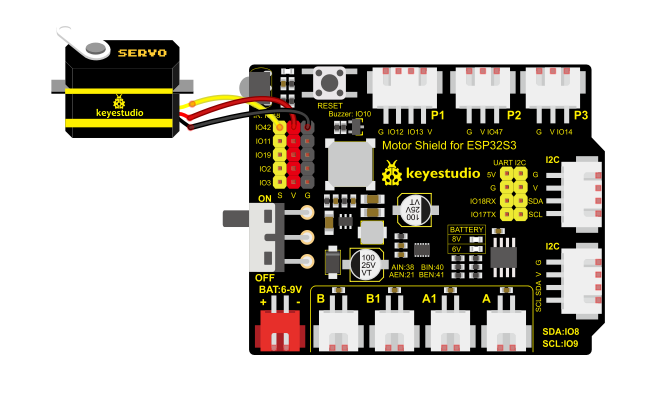

### Project 8: Servo Control

#### **1. Introduction:**


In the obstacle avoidance of Lesson 4 the car turns its head left and right to take a look each way — the part doing the turning is this small servo: the ultrasonic module sits on a pan-tilt bracket mounted on top of it, so when the servo turns, the sensor sweeps with it. The assembly instructions asked you to set it to 90° before fixing it in place, precisely so that the sensor pointing straight ahead matches 90° in the program.

A servo is not the same kind of thing as an ordinary motor. A motor spins as soon as it is powered and stops when the power is cut; a servo has a potentiometer inside to measure the angle and a control board to compare, and what it receives is one pulse every 20 milliseconds, where the width of the pulse says which angle to go to: 0.5 ms for 0°, 1.5 ms for 90°, and 2.5 ms for 180°.

Once it reaches the position it locks there; try to twist it by hand and you feel clear resistance, and it springs back when you let go. This lesson sweeps it from 0° to 180° and back, pausing 15 milliseconds per degree, so a full sweep takes about 2.7 seconds.

At power-on the servo first clicks over to 0° (facing right), then sweeps steadily to the other end, pauses half a second at the limit and sweeps back, going back and forth continuously; the Shell prints one start-up line.

#### **2. Parts List:**
Components used in this lesson:

| 9G servo (180°, with cross arm) ×1 | DRV8835 motor expansion board ×1 | ESP32-S3 development board ×1 |
| :---: | :---: | :---: |
|  |  |  |
> ⚠️ **The servo was centered at 90° and installed in Chapter 2. This table is for reference only, so there is no need to remove anything; the wiring notes below only describe the wiring method for reference and do not require disassembly. See the kit list in 1.4 for the full bill of materials.**

#### **3. Parameters:**
| Item | Parameter |
| --- | --- |
| Model | 9G micro servo, 180° travel |
| Signal pin | IO42 |
| Control frequency | 50 Hz (20 ms period) |
| Pulse width range | 500–2500 µs |
| Angle mapping | 500 µs ≈ 0°, 1500 µs ≈ 90°, 2500 µs ≈ 180° |
| Sweep step | One degree per step, 15 ms between steps |
| Full-sweep time | About 2.7 s (180 degrees × 15 ms) |

#### **4. Wiring:**

| Servo wire | Color (typical) | Connects to |
| --- | --- | --- |
| Signal | Orange / yellow | IO42 |
| Power | Red | 5V |
| Ground | Brown / black | GND |




#### **5. Flowchart:**

The **angle** of a servo is not a number but the width of a high level. One pulse arrives every 20 ms and the high level lasts 0.5–2.5 ms, from which the servo works out the target angle:


#### **6. Test Code:**
> ⚠️ **Before uploading the code, upload `mini_tracked_tank_robot.py` to the `lib/` directory on the board** (see Section 5.5), otherwise importing the library raises `ImportError`.

```python
from mini_tracked_tank_robot import MiniTrackedTankRobot
import time

STEP_MS = 15               # Delay for each degree of rotation, smaller is faster

car = MiniTrackedTankRobot()

# This lesson only moves the pan-tilt servo, but the motors and the claw still need fixed levels:
# With floating driver inputs the B-channel wheels creep, and a floating claw signal picks up interference from the pan-tilt PWM
car.Motor_init()
car.stop_motor()
car.Claw_init(11)
car.Claw_set_angle(90)

car.Servo_init(42)
car.Servo_set_angle(0)
time.sleep(1)

while True:
    for angle in range(0, 181):        # 0 deg -> 180 deg
        car.Servo_set_angle(angle)
        time.sleep_ms(STEP_MS)
    time.sleep_ms(500)

    for angle in range(180, -1, -1):   # 180 deg -> 0 deg
        car.Servo_set_angle(angle)
        time.sleep_ms(STEP_MS)
    time.sleep_ms(500)
```

#### **7. Code Explanation:**
**(1) Importing the library, creating the object, setting the step**

```python
from mini_tracked_tank_robot import MiniTrackedTankRobot
import time

STEP_MS = 15               # Delay for each degree of rotation, smaller is faster

car = MiniTrackedTankRobot()
```

The `MiniTrackedTankRobot` class already wraps the PWM drive for the pan-tilt servo, so you do not have to work out pulse widths yourself. `STEP_MS` is how many milliseconds to pause for every degree of travel, and changing it changes the sweep speed: smaller sweeps faster, larger sweeps slower.

**(2) Giving the other three channels a fixed level**

```python
# This lesson only moves the pan-tilt servo, but the motors and the claw still need fixed levels:
# With floating driver inputs the B-channel wheels creep, and a floating claw signal picks up interference from the pan-tilt PWM
car.Motor_init()
car.stop_motor()
car.Claw_init(11)
car.Claw_set_angle(90)
```

This lesson only turns the pan-tilt, but the motors and gripper cannot be ignored. `car.Motor_init()` followed by `car.stop_motor()` brakes the motors, otherwise the B-channel wheels spin on their own while the driver inputs float. `car.Claw_init(11)` plus `car.Claw_set_angle(90)` holds the gripper signal at 90°, so a floating gripper signal does not get dragged around by the pan-tilt PWM and jitter. This initialization block is not the star of the lesson, but it is the precondition for the car not driving off by itself.

**(3) Initializing the pan-tilt and homing it**

```python
car.Servo_init(42)
car.Servo_set_angle(0)
time.sleep(1)
```

`car.Servo_init(42)` sets the pan-tilt servo signal pin to IO42, `car.Servo_set_angle(0)` turns it to 0° first, and `sleep(1)` holds for one second so the starting point is easy to see. To use a different signal pin, change the 42.

**(4) Sweeping from 0° to 180°**

```python
while True:
    for angle in range(0, 181):        # 0 deg -> 180 deg
        car.Servo_set_angle(angle)
        time.sleep_ms(STEP_MS)
    time.sleep_ms(500)
```

`range(0, 181)` counts from 0 to 180 (181 is not included), calling `car.Servo_set_angle(angle)` once per degree, with `sleep_ms(STEP_MS)` in between to give the servo time to get there and to make the motion visible. At the end of the sweep `sleep_ms(500)` pauses half a second. `while True` is the main loop, and whatever is indented inside it is one complete cycle of motion.

**(5) Sweeping back from 180° to 0°**

```python
    for angle in range(180, -1, -1):   # 180 deg -> 0 deg
        car.Servo_set_angle(angle)
        time.sleep_ms(STEP_MS)
    time.sleep_ms(500)
```

The third argument of `range(180, -1, -1)` is the step, −1, counting down from 180 to 0, which exactly retraces the previous sweep. The two pieces together make the back-and-forth sweep; if you only want half of it, change 181 to 91.

#### **8. Expected Behavior:**
This lesson's code does not print anything to the Shell. At power-on the servo first **clicks** over to 0°, then starts sweeping steadily towards 180°; simply observe the pan-tilt motion:

| Stage | Behavior |
| --- | --- |
| At power-on | Turns to 0° (facing right), stabilizes after a slight jitter |
| 0° → 180° | Swept in about 2.7 s, the ultrasonic sensor scanning from right to left |
| At 180° | Pauses 0.5 s |
| 180° → 0° | Sweeps back in the same 2.7 s |
| Loop | Repeats continuously |

> [Image to be added] One photo each of the servo at the two extreme end positions.

**Caution**: if the servo keeps buzzing at either end, cut the power immediately. The stall current can exceed 700 mA, which will drag down the 5V rail of the whole car and reset the controller along with it. In that case change the 500 and 2000 in `Servo_set_angle()` inside `mini_tracked_tank_robot.py` to 600 and 1800 and try again.

How to center the servo (needed before installation or after replacing a servo) is described in Section 2.1; you can use `Servo_return_to_center_90.ino` or the corresponding `.py` to park it at 90°.

#### **9. Troubleshooting:**

(1) The servo does not move at all at power-on. First check whether the signal wire is on IO42 — `car.Servo_init(42)` only recognizes that pin, so a wrong pin or a missing connection means the servo never receives PWM and will not turn; if the Shell below Thonny also reports `OSError`, IO42 is most likely occupied by another program, so restart the board and try again.

(2) Running the code raises `ImportError: no module named 'mini_tracked_tank_robot'`, which means the board-level library was not saved to the board. Use Thonny's **Save to board** to put the library file into `lib/` and run it again.

(3) A Shell `NameError: name 'STEP_MS' isn't defined` means the line `STEP_MS = 15` was deleted or commented out; put it back and the servo moves again.

(4) The servo moves in jerks, or only sweeps half the range. Check whether `range(0, 181)` has been changed to 91 — that is the half-range version; change it back to 181 for a full 0° to 180°.
