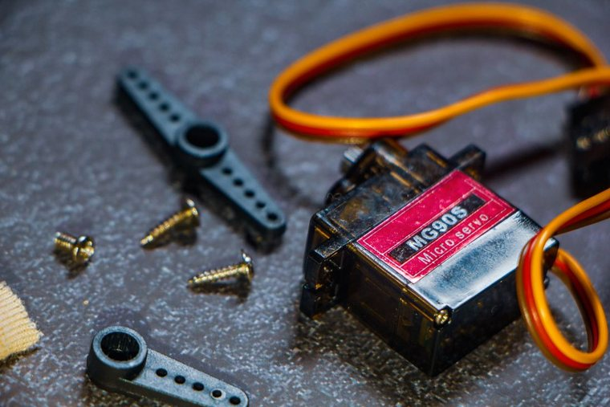
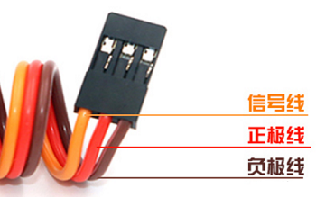
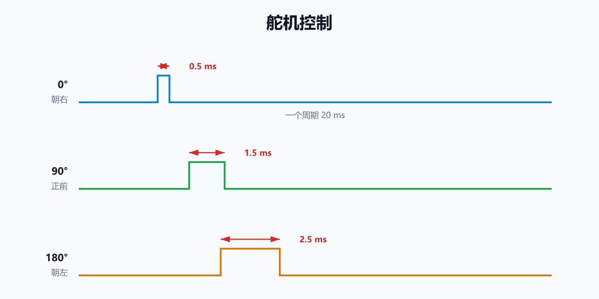

### 项目 8：舵机控制

#### **1. 简介：**

{width=520px}

第 4 课避障时，车会左右转头各看一眼——转的就是这只小舵机：超声波模块靠云台支架架在它上面，舵机一转，探头跟着扫。装车时要求先把它调到 90° 再固定，就是为了让探头正对前方时对应程序里的 90°。

舵机和普通电机不是一类东西。电机给电就转、断电才停；舵机内部有电位器量角度、有控制板做比较，收到的是每 20 毫秒一个脉冲，脉冲有多宽就代表转到哪个角度：0.5 毫秒对 0°，1.5 毫秒对 90°，2.5 毫秒对 180°。

转到位以后它锁在那儿，用手去掰能感到明显的反抗，松手又弹回去。本课让它从 0° 扫到 180° 再扫回来，每转一度停 15 毫秒，走完全程约 2.7 秒。

上电时舵机先“咔”一下转到 0°（朝右），然后匀速扫向另一端，到顶停半秒再扫回来，一直往复；Shell 会打印一行启动信息。

#### **2. 所需清单：**

本课用到的器件：

|     |     |     |
| :---: | :---: | :---: |
| {width=170px}<br><span style="font-size:0.85em">9G 舵机（180°，配十字臂） ×1</span> | {width=170px}<br><span style="font-size:0.85em">DRV8835 电机扩展板 ×1</span> | {width=170px}<br><span style="font-size:0.85em">ESP32-S3 开发板 ×1</span> |
> ⚠️ **舵机在第 2 章已按 90° 调中后装好，本表只作对照，不用拆；下面的接线说明只标清接线方式，供对照，不必拆装。完整物料见 1.4 套件清单。**

#### **3. 参数：**

| 项目 | 参数 |
| --- | --- |
| 型号 | 9G 微型舵机，行程 180° |
| 信号脚 | IO42 |
| 控制频率 | 50 Hz（周期 20 ms） |
| 脉宽范围 | 500～2500 µs |
| 角度对应 | 500 µs ≈ 0°，1500 µs ≈ 90°，2500 µs ≈ 180° |
| 扫描步进 | 每度一次，步间延时 15 ms |
| 全行程耗时 | 约 2.7 s（180 度 × 15 ms） |

#### **4. 接线说明：**

| 舵机线 | 颜色（常见） | 接到 |
| --- | --- | --- |
| 信号 | 橙 / 黄 | IO42 |
| 电源 | 红 | 5V |
| 地 | 棕 / 黑 | GND |




#### **5. 流程图：**

舵机的**角度**不是一个数字，而是一段高电平的宽度。每 20 ms 来一个脉冲，高电平持续 0.5～2.5 ms，舵机内部据此判断目标角度：



#### **6. 测试代码：**

> ⚠️ **上传代码前，先把 `mini_tracked_tank_robot.py` 上传到板子的 `lib/` 目录**（方法见第 5.5 节），否则导入库时会报 `ImportError`。

```python
from mini_tracked_tank_robot import MiniTrackedTankRobot
import time

STEP_MS = 15               # 每转 1 度的延时，越小越快

car = MiniTrackedTankRobot()

# 本课只动云台，但电机和夹爪也要给固定电平：
# 驱动板输入悬空时 B 路轮子会自己转，夹爪信号悬空会被云台的 PWM 干扰
car.Motor_init()
car.stop_motor()
car.Claw_init(11)
car.Claw_set_angle(90)

car.Servo_init(42)
car.Servo_set_angle(0)
time.sleep(1)

while True:
    for angle in range(0, 181):        # 0° → 180°
        car.Servo_set_angle(angle)
        time.sleep_ms(STEP_MS)
    time.sleep_ms(500)

    for angle in range(180, -1, -1):   # 180° → 0°
        car.Servo_set_angle(angle)
        time.sleep_ms(STEP_MS)
    time.sleep_ms(500)
```

#### **7. 代码解释：**

**(1) 引入库、建对象、定步进**

```python
from mini_tracked_tank_robot import MiniTrackedTankRobot
import time

STEP_MS = 15               # 每转 1 度的延时，越小越快

car = MiniTrackedTankRobot()
```

`MiniTrackedTankRobot` 类里封好了云台舵机的 PWM 驱动，不用自己算脉宽。`STEP_MS` 是每走 1 度停的毫秒数，改它就能调整扫描速度：调小扫得快，调大扫得慢。

**(2) 给其余三路固定电平**

```python
# 本课只动云台，但电机和夹爪也要给固定电平：
# 驱动板输入悬空时 B 路轮子会自己转，夹爪信号悬空会被云台的 PWM 干扰
car.Motor_init()
car.stop_motor()
car.Claw_init(11)
car.Claw_set_angle(90)
```

本课只让云台转，但电机和夹爪不能不管。`Motor_init()` 后 `stop_motor()` 把电机刹住，否则驱动板输入悬空时 B 路轮子会自己转。`Claw_init(11)` 加 `Claw_set_angle(90)` 把夹爪信号固定在 90°，免得悬空时被云台的 PWM 带着乱抖。这组初始化不是本课主角，却是车不自己乱跑的前提。

**(3) 初始化云台、归零**

```python
car.Servo_init(42)
car.Servo_set_angle(0)
time.sleep(1)
```

`Servo_init(42)` 把云台舵机的信号脚设成 IO42，`Servo_set_angle(0)` 先转到 0°，`sleep(1)` 停 1 秒看清起点。换信号脚就改 42 这个数字。

**(4) 0° 扫到 180°**

```python
while True:
    for angle in range(0, 181):        # 0° → 180°
        car.Servo_set_angle(angle)
        time.sleep_ms(STEP_MS)
    time.sleep_ms(500)
```

`range(0, 181)` 从 0 数到 180（不含 181），一度一次 `Servo_set_angle(angle)`，中间 `sleep_ms(STEP_MS)` 让舵机有时间转过去、也才看得清过程。扫到头再 `sleep_ms(500)` 停半秒。`while True` 是主循环，缩进在里面的就是一轮完整动作。

**(5) 180° 扫回 0°**

```python
for angle in range(180, -1, -1):   # 180° → 0°
    car.Servo_set_angle(angle)
    time.sleep_ms(STEP_MS)
time.sleep_ms(500)
```

`range(180, -1, -1)` 第三个参数 −1 是步长，从 180 倒数到 0，正好把上一轮走回来。两段拼起来就是往复扫描；想只扫一半，把 181 改成 91 即可。

#### **8. 运行现象：**

上电时舵机会先**咔**一下转到 0°，然后开始匀速扫向 180°，Shell 打印：

```text
云台舵机已启动，开始在 0°~180° 之间来回转动...
```

| 阶段 | 现象 |
| --- | --- |
| 上电瞬间 | 转到 0°（朝右），轻微抖动后稳定 |
| 0° → 180° | 约 2.7 s 扫过，超声波从右扫到左 |
| 到 180° | 停 0.5 s |
| 180° → 0° | 同样 2.7 s 扫回 |
| 循环 | 不断往复 |

> 【图片待补】舵机扫到两端极限位置时的实拍图各一张。

**注意**：舵机转到两端时如果一直响，立刻断电。堵转电流能到 700 mA 以上，会拖垮整车的 5V，主控跟着复位。这时候把 `attach()` 的 500/2500 改成 600/2400 再试。

调中位的做法（装车前或换舵机后要做）见 2.1 节，可以用 `Servo_return_to_center_90.ino` 或对应的 `.py` 让它停在 90°。

#### **9. 常见问题解决：**

(1) 上电舵机一点不动，先查信号线是不是接在 IO42——`Servo_init(42)` 只认这个脚，插错脚或者忘了接，舵机收不到 PWM 自然不转；如果 Thonny 下方的 Shell 还报 `OSError`，多半是 IO42 被别的程序占着，重启板子再试。

(2) 运行报 `ImportError: no module named 'mini_tracked_tank_robot'`，是板级库没保存到板子，用 Thonny 的**保存到板子**把库文件放进 lib/ 再跑。

(3) Shell 报 `NameError: name 'STEP_MS' isn't defined`，是初始化那句 `STEP_MS = 15` 被删掉或注释了，补回来就能动。

(4) 舵机转起来一顿一顿、或者只扫半程，看一眼 `range(0, 181)` 是不是被改成了 91——那是只扫一半的写法，改回 181 才是完整的 0° 到 180°。
