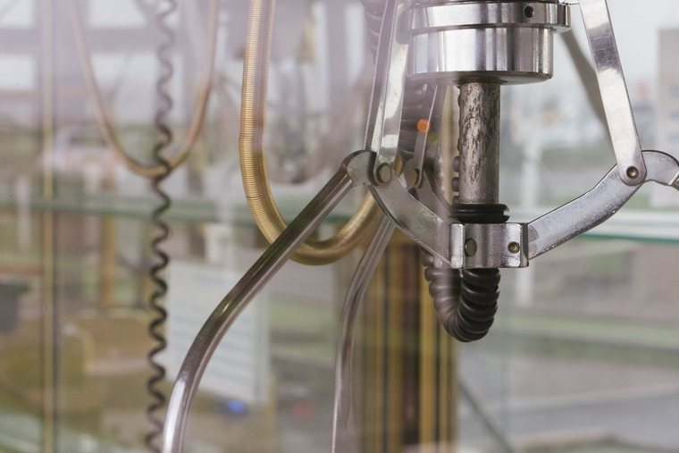
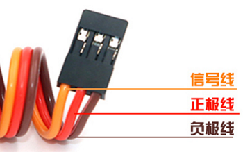
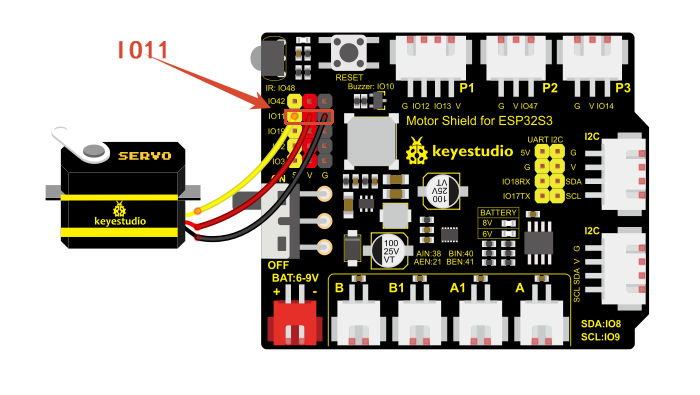
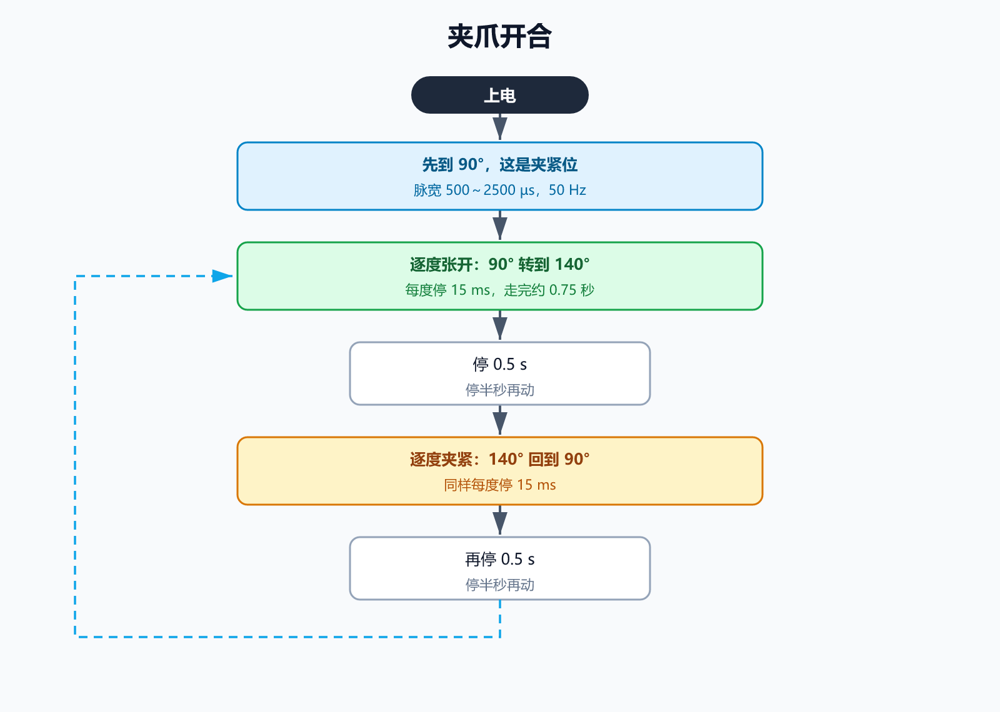

### Project 9: Gripper Control and Grasping

#### **1. Introduction:**

{width=520px}

A gripper is mounted on the front of the car: two 3D-printed jaws driven by a single 9G servo. It has only two postures — closed at 90° and open at 140° — and both the later object-grabbing and ball-kicking tasks rely on these two angles.

It is the same model as the one on the pan-tilt, yet only the 50° between 90° and 140° is used. At 90° the two jaws press together, and at 140° they open more than twenty millimetres, just enough to take an eraser or a crumpled paper ball.

Open and close it a few times while it is still empty to see which opening each angle corresponds to, then put something in and see what it can hold.

At power-on the jaws close to 90° first, then open and close again, taking about 0.75 seconds per direction and pausing half a second at each end; the Shell prints one start-up line.

#### **2. Parts List:**
Components used in this lesson:

|     |     |
| :---: | :---: |
| {width=170px}<br><span style="font-size:0.85em">Large mechanical gripper (semi-finished) ×1</span> | {width=170px}<br><span style="font-size:0.85em">9G servo (180°, with cross arm) ×1</span> |
| {width=170px}<br><span style="font-size:0.85em">DRV8835 motor expansion board ×1</span> | {width=170px}<br><span style="font-size:0.85em">ESP32-S3 development board ×1</span> |
> ⚠️ **The gripper was already fitted in Chapter 2. This table is for reference only, so there is no need to remove anything; the wiring notes below only describe the wiring method for reference and do not require disassembly. See the kit list in 1.4 for the full bill of materials.**

#### **3. Parameters:**
| Item | Parameter |
| --- | --- |
| Signal pin | IO11 |
| Control frequency | 50 Hz |
| Pulse width range | 500–2500 µs |
| Closed angle | 90° |
| Open angle | 140° |
| Open/close step | One degree per step, 15 ms between steps |
| Time per direction | About 0.75 s (50 degrees × 15 ms) |

#### **4. Wiring:**

| Servo wire | Color (typical) | Connects to |
| --- | --- | --- |
| Signal | Orange / yellow | IO11 |
| Power | Red | 5V |
| Ground | Brown / black | GND |





#### **5. Flowchart:**

The gripper has no branches, just a four-beat cycle: open, wait, close, wait. The waiting time decides whether the motion is easy to see.



#### **6. Test Code:**
> ⚠️ **Before uploading the code, upload `mini_tracked_tank_robot.py` to the `lib/` directory on the board** (see Section 5.5), otherwise importing the library raises `ImportError`.

```python
from mini_tracked_tank_robot import MiniTrackedTankRobot
import time

STEP_MS = 15               # Delay for each degree of rotation, smaller is faster
CLAW_OPEN = 140
CLAW_CLOSE = 90

car = MiniTrackedTankRobot()

# This lesson only moves the claw, but the motors and the pan-tilt still need fixed levels:
# With floating driver inputs the B-channel wheels creep, and a floating pan-tilt signal picks up interference from the claw PWM
car.Motor_init()
car.stop_motor()
car.Servo_init(42)
car.Servo_set_angle(90)

car.Claw_init(11)
car.Claw_set_angle(CLAW_CLOSE)
time.sleep(1)

while True:
    for angle in range(CLAW_CLOSE, CLAW_OPEN + 1):     # 90 deg -> 140 deg: open
        car.Claw_set_angle(angle)
        time.sleep_ms(STEP_MS)
    time.sleep_ms(500)

    for angle in range(CLAW_OPEN, CLAW_CLOSE - 1, -1): # 140 deg -> 90 deg: close
        car.Claw_set_angle(angle)
        time.sleep_ms(STEP_MS)
    time.sleep_ms(500)
```

#### **7. Code Explanation:**
**(1) Importing the library, the constants and the step**

```python
from mini_tracked_tank_robot import MiniTrackedTankRobot
import time

STEP_MS = 15               # Delay for each degree of rotation, smaller is faster
CLAW_OPEN = 140
CLAW_CLOSE = 90

car = MiniTrackedTankRobot()
```

`CLAW_OPEN` and `CLAW_CLOSE` promote the open angle of 140° and the closed angle of 90° to constants, so changing the opening means touching only these two lines. `STEP_MS` is again the delay per degree; make it smaller and the jaws move faster. The gripper and the pan-tilt share the same library and the same kind of servo, only the angle range they travel is different.

**(2) Giving the motors and the pan-tilt a fixed level**

```python
# This lesson only moves the claw, but the motors and the pan-tilt still need fixed levels:
# With floating driver inputs the B-channel wheels creep, and a floating pan-tilt signal picks up interference from the claw PWM
car.Motor_init()
car.stop_motor()
car.Servo_init(42)
car.Servo_set_angle(90)
```

This is the mirror image of Lesson 8: here the gripper is the star and the motors and pan-tilt have to be held steady. `car.Motor_init()` together with `car.stop_motor()` stops the B-channel wheels from spinning while floating, and `car.Servo_init(42)` together with `car.Servo_set_angle(90)` pins the pan-tilt at 90° so a floating signal is not disturbed by the gripper PWM.

**(3) Initializing the gripper and closing it to 90° first**

```python
car.Claw_init(11)
car.Claw_set_angle(CLAW_CLOSE)
time.sleep(1)
```

`car.Claw_init(11)` sets the gripper signal pin to IO11, and `car.Claw_set_angle(CLAW_CLOSE)` closes it to 90° at power-on — this is the mechanical clamping position, and it must not be written as 0°, which is the dead point where the gears would fight each other continuously. `sleep(1)` waits one second.

**(4) Opening from 90° to 140°**

```python
while True:
    for angle in range(CLAW_CLOSE, CLAW_OPEN + 1):     # 90 deg -> 140 deg: open
        car.Claw_set_angle(angle)
        time.sleep_ms(STEP_MS)
    time.sleep_ms(500)
```

`range(CLAW_CLOSE, CLAW_OPEN + 1)` counts from 90 to 140 (hence the +1, so that 140 is included), calling `car.Claw_set_angle(angle)` once per degree, with `sleep_ms(STEP_MS)` letting the jaws open smoothly. At the end of the travel it pauses 500 ms.

**(5) Closing from 140° back to 90°**

```python
    for angle in range(CLAW_OPEN, CLAW_CLOSE - 1, -1): # 140 deg -> 90 deg: close
        car.Claw_set_angle(angle)
        time.sleep_ms(STEP_MS)
    time.sleep_ms(500)
```

The step of −1 counts down from 140 to 90 (`CLAW_CLOSE - 1` so that 90 is included). The two loops together make the endless open-and-close cycle. To grip more firmly you can lower `CLAW_CLOSE` to 85, but do not go below the mechanical limit of the servo.

#### **8. Expected Behavior:**
This lesson's code does not print anything to the Shell. At power-on the jaws close to 90° first, then start the open-and-close cycle; simply observe the gripper motion:

| Stage | Behavior |
| --- | --- |
| At power-on | Closes to 90°, the jaws fully shut |
| 90° → 140° | Opens, in about 0.75 s |
| At 140° | Pauses 0.5 s |
| 140° → 90° | Closes, in about 0.75 s |
| Loop | Opens and closes continuously |

> [Image to be added] A photo of an intermediate frame during the open-and-close motion (around 115°).

#### **9. Troubleshooting:**

(1) The Shell reports `NameError: name 'CLAW_OPEN' isn't defined`, which means an angle constant is being used before it is defined at the top; add `CLAW_OPEN = 140` and `CLAW_CLOSE = 90` above the code that uses them.

(2) The jaws do nothing at all at power-on. First check whether the gripper servo signal wire is on IO11 — `car.Claw_init(11)` recognizes only that pin, so a wrong pin or a missing connection means the jaws will not move.

(3) Running the code reports `ImportError: no module named 'mini_tracked_tank_robot'`, which means the board-level library is not on the board; use Thonny's **Save to board** to put the library file into the `lib/` directory and run it again.

(4) The jaws open so wide that nothing is held. Bring `CLAW_OPEN` down from 140 a little, say to 130, so the opening is narrower and the grip steadier; do not take `CLAW_CLOSE` below 85, because at the mechanical limit the servo keeps fighting and heating up.
