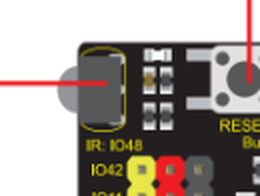
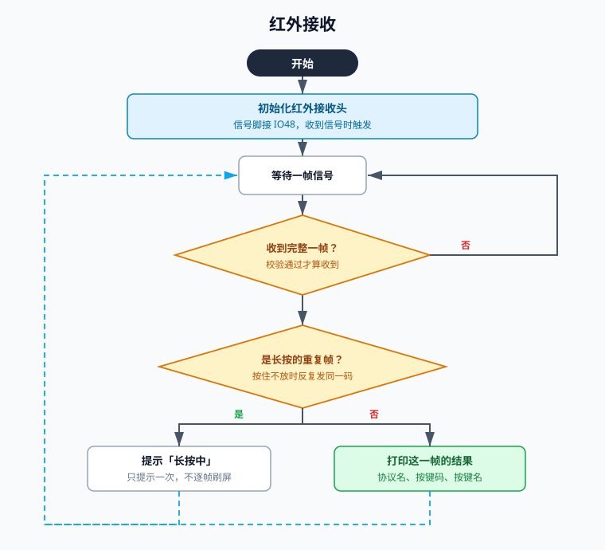

### 项目 10：红外接收

#### **1. 简介：**

{width=520px}

电视、空调、玩具遥控器，用的都是红外。按一下键，它发出的不是一束持续的光，而是一串每秒闪烁三万八千次的不可见光——人眼看不到，接收头却能把这串闪烁解成 0 和 1。

一次按键发一整帧，帧里有地址、有键值、还有校验；按住不放时，遥控器不再重复整帧，只隔一段发一个很短的重复标记，说明还是这个键。所以长按在数据上留下的痕迹和按一下完全不同。

本课先不控制任何东西，只让车听懂遥控器：对准车头按方向键，Shell 打印出协议名和键值，上、下、左、右、OK 分别对应 70、21、68、67、64。

每只遥控器的码值未必一样，资料里这一组只是手上的样本，Shell 打出来的那个数字才是这只遥控器的答案。

#### **2. 所需清单：**

本课用到的器件：

|     |     |     |
| :---: | :---: | :---: |
| {width=170px}<br><span style="font-size:0.85em">17 键红外遥控器（JMFP-4） ×1</span> | {width=170px}<br><span style="font-size:0.85em">红外接收头 ×1</span> | {width=170px}<br><span style="font-size:0.85em">DRV8835 电机扩展板 ×1</span> |
| {width=170px}<br><span style="font-size:0.85em">ESP32-S3 开发板 ×1</span> |  |  |
> ⚠️ **接收头在扩展板上，本表只作对照，不用拆；下面的接线说明只标清接线方式，供对照，不必拆装。完整物料见 1.4 套件清单。**

#### **3. 参数：**

| 项目 | 参数 |
| --- | --- |
| 接收脚 | IO48 |
| 载波频率 | 38 kHz |
| 协议 | NEC |
| 串口波特率 | 115200 |
| 已收录键值 | 上 70、下 21、左 68、右 67、OK 64 |
| 重复帧标志 | `IRDATA_FLAGS_IS_REPEAT` |
| 依赖库 | `IRremote` |

#### **4. 接线说明：**

| 接收头引脚 | 接到 |
| --- | :---: |
| OUT / S | IO48 |
| VCC | 5V |
| GND | GND |

#### **5. 流程图：**

接收和解码是两件事：`IrReceiver.decode()` 负责把光信号还原成一帧数据，`decodedIRData` 里才有协议、码值、是否长按这些字段。



#### **6. 测试代码：**

> ⚠️ **上传代码前，先把 `mini_tracked_tank_robot.py`、`ir_rx/ 文件夹` 上传到板子的 `lib/` 目录**（方法见第 5.5 节），否则导入库时会报 `ImportError`。

```python
from machine import Pin
from ir_rx.nec import NEC_8
import time

IR_RX_PIN = 48

# 遥控器按键码值；批次不同可能不同，以串口打印为准
KEY_NAMES = {
    70: '上',
    21: '下',
    68: '左',
    67: '右',
    64: 'OK / 停止',
}

holding = False


def on_ir(data, addr, ctrl):
    # data 为 -1 表示长按重复码，其余负数表示解码错误
    global holding
    if data == -1:
        if not holding:
            print('（长按中，后面不再逐帧打印）')
            holding = True
        return

    holding = False
    if data < 0:
        return

    name = KEY_NAMES.get(data, '')
    print('按键码：{}（0x{:02X}） {}'.format(data, data, name))


ir = NEC_8(Pin(IR_RX_PIN, Pin.IN), on_ir)
print('红外接收就绪，把遥控器对准车头')

while True:
    time.sleep_ms(100)
```

#### **7. 代码解释：**

**(1) 引入库、接收脚与按键表**

```python
from machine import Pin
from ir_rx.nec import NEC_8
import time

IR_RX_PIN = 48

# 遥控器按键码值；批次不同可能不同，以Shell 打印为准
KEY_NAMES = {
    70: '上',
    21: '下',
    68: '左',
    67: '右',
    64: 'OK / 停止',
}
```

这里没用板级库，而是直接用 MicroPython 的红外库：`from machine import Pin` 拿引脚类，`from ir_rx.nec import NEC_8` 拿 NEC 协议的解码类，两个文件都要上传到 `lib/`。`IR_RX_PIN = 48` 是接收头接的脚。`KEY_NAMES` 只是把常见码值翻成中文名，**每只遥控器码值不同**，按Shell 打印的实际数字改这里的键即可。

**(2) 回调函数与长按标志**

```python
holding = False


def on_ir(data, addr, ctrl):
    # data 为 -1 表示长按重复码，其余负数表示解码错误
    global holding
```

`on_ir(data, addr, ctrl)` 是解码成功时库自动回调的函数：`data` 是按键码，`addr` 是地址码，`ctrl` 是控制位，本课只用 `data`。`holding` 记录是否正处于长按，用 `global` 才能在函数里改它。

**(3) 长按重复码只提示一次**

```python
    if data == -1:
        if not holding:
            print('（长按中，后面不再逐帧打印）')
            holding = True
        return

    holding = False
    if data < 0:
        return
```

NEC 协议按住不放时，库会把重复码报成 `data == -1`；其余负数表示解码出错。收到重复码时，第一次打印一句提示并置 `holding = True`，以后直接 `return`，避免每秒刷屏。收到正常码先把 `holding` 清回 `False`，再滤掉负数错误码。

**(4) 查表翻译并打印码值**

```python
    name = KEY_NAMES.get(data, '')
    print('按键码：{}（0x{:02X}） {}'.format(data, data, name))
```

`KEY_NAMES.get(data, '')` 查不到就返回空串，不会报错。`format` 里 `{}` 打十进制码，`0x{:02X}` 打两位十六进制，`name` 打中文名——这一行打印的数字，就是下一课要填进键值常量的依据。

**(5) 注册接收器、主循环空转**

```python
ir = NEC_8(Pin(IR_RX_PIN, Pin.IN), on_ir)
print('红外接收就绪，把遥控器对准车头')

while True:
    time.sleep_ms(100)
```

`NEC_8(Pin(48, Pin.IN), on_ir)` 建一个接收器：引脚设成输入，解码结果自动送进 `on_ir`。之后按键是中断驱动的，主循环里不用反复读，只要 `sleep_ms(100)` 空转让程序挂着就行。

#### **8. 运行现象：**

上电后Shell 打印：

```text
红外接收实验开始，把遥控器对准车头
等待按键……
```

对准车头按方向键：

```text
协议：NEC   按键码：70（0x46）   上
协议：NEC   按键码：21（0x15）   下
协议：NEC   按键码：68（0x44）   左
协议：NEC   按键码：67（0x43）   右
协议：NEC   按键码：64（0x40）   OK / 停止
```

按住**上**不放：

```text
协议：NEC   按键码：70（0x46）   上
（长按中，后面不再逐帧打印）
```

> 【图片待补】Thonny 下方的 Shell里连续按五个方向键的完整输出截图。

#### **9. 常见问题解决：**

(1) 运行报 `ImportError: no module named 'ir_rx'`，是红外解码库没保存到板子，用 Thonny 的**保存到板子**把 ir_rx 文件夹放进 lib/ 目录。

(2) 按遥控器时 Thonny 下方的 Shell 一点输出都没有，先看遥控器电池装了没、电池仓里的塑料片抽掉没——新遥控器那片塑料不抽掉根本通不了电。

(3) 电池没问题还没反应，查接收头的受光面是不是被车壳挡住了。代码里 `ir = NEC_8(Pin(48, Pin.IN), on_ir)` 用的是 IO48，接收头是侧面受光的，得让它**看见**遥控器，隔一层茶色亚克力没事，隔黑塑料就收不到。

(4) 距离也有关系：室内正对车头按一般 8 m 内有效，但正对阳光或白炽灯时红外会被淹没，先把距离缩到 1 m 以内试试。

(5) Shell 报 `NameError: name 'on_ir' isn't defined`，是回调函数 `on_ir` 还没定义就拿去建接收器了，把函数写到 `ir = NEC_8(...)` 前面；报 `OSError` 则多半是 IO48 被别的程序占着，重启板子或换个空闲脚。
